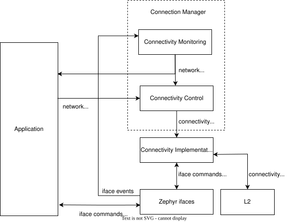

<!-- Copyright 2015-2026 Zephyr Project members and individual contributors. -->
<!-- SPDX-License-Identifier: Apache-2.0 -->
<!-- 中文翻译；编号、导航和明确标注的译注为本地新增。 -->

# 第19章\_连接管理器概览

原文：[官方页面](https://docs.zephyrproject.org/latest/services/connectivity/networking/conn_mgr/main.html)。读取日期：2026-10-14；保存的 latest 页面及 HTML 摘要见[来源记录](../SOURCES.md)。

## 19.1\_作用与结构（Structure）

连接管理器（Connection Manager）是一组可选的 Zephyr 功能，让应用监视和控制连接能力（Connectivity，即接入支持 IP 的网络），尽量不必关心底层网络技术的细节。

应用可以通过统一的抽象 API 控制网络关联（Network Association）并监视网络接入，减少技术专用的重复代码。因此，同一份应用代码有机会支持 Wi-Fi、LTE 等差异很大的连接技术，也可以同时管理和使用多种技术。

连接管理器分为两个子系统：

- [连接状态监视（Connectivity Monitoring）](#conn-mgr-monitoring)：监视全部可用的 [Zephyr 网络接口（Network Interface，iface）](P023_网络接口.md#net-if-interface)，通过[网络管理（Network Management）](P022_网络管理.md#net-mgmt-interface)事件通知 IP 连接建立或丢失。原文标注头文件为 `include/zephyr/net/conn_mgr_monitoring.h`。
- [连接控制（Connectivity Control）](#conn-mgr-control)：提供控制接口网络关联的抽象 API，头文件为 `include/zephyr/net/conn_mgr_connectivity.h`。

下图展示应用、连接管理器与 Zephyr 之间的简化关系。



官方图中的 Application 为应用，Connection Manager 为连接管理器，Connectivity Monitoring 为连接状态监视，Connectivity Control 为连接控制。更详细的关系见[连接实现架构图](P020_连接实现.md#conn-mgr-integration-diagram-detailed)。

> 源码跟踪译注：原文监视头文件名称有误；本轮实际读取的官方文件为 `include/zephyr/net/conn_mgr_monitor.h`，本仓库对应入口为 [`conn_mgr_monitor.h`](../../../include/zephyr/net/conn_mgr_monitor.h)。控制头文件为 [`conn_mgr_connectivity.h`](../../../include/zephyr/net/conn_mgr_connectivity.h)。源码版本和网页 latest 不能自动等同，读取摘要见[来源记录](../SOURCES.md)。

## 19.2\_连接状态监视（Connectivity Monitoring）

监视子系统跟踪所有可用接口的[运行状态（Operational State）](P023_网络接口.md#net-if-interface-state-management)及 IP 地址的获得与丢失，无论接口是否支持连接控制。

只有同时满足以下条件，接口才算就绪（Ready）：

1. **管理状态启用（admin-up）**：接口已收到进入可运行状态的指令，通常通过 [`net_if_up()`](https://docs.zephyrproject.org/latest/doxygen/html/group__net__if.html#ga02644cc623fc7a8878c17d54984e4210) 完成。
2. **运行状态启用（oper-up）**：接口已经在线、完全可用；如果需要网络关联，也已完成关联。详见[网络接口状态管理](P023_网络接口.md#net-if-interface-state-management)。
3. **至少分配了一个 IP 地址**：IPv4 或 IPv6 均可，任意一种或两种已分配即满足此条件。地址分配见[网络接口说明](P023_网络接口.md#net-if-interface)。
4. **未被忽略**：被忽略（Ignored）的接口始终按未就绪处理，见[忽略接口](#conn-mgr-monitoring-ignoring-ifaces)。

**原文注意（Note）**：接口状态和 IP 地址通常由接口的[二层实现（L2 Implementation）](P024_二层管理.md#net-l2-interface)或绑定的[连接实现](P020_连接实现.md#conn-mgr-impl)更新，详见[实现接口状态报告](P020_连接实现.md#conn-mgr-impl-guidelines-iface-state-reporting)。

任一条件不再满足时，接口立即不再就绪。首次至少有一个接口就绪时，触发 [`NET_EVENT_L4_CONNECTED`](https://docs.zephyrproject.org/latest/doxygen/html/group__net__mgmt.html#gacbd2b10cc345359c07de4a62eb172a09)，此时称 IP 连接就绪。只要始终还有至少一个就绪接口，其他接口在就绪与未就绪之间变化不会再次触发这一整体连接事件。

当最后一个就绪接口也不再就绪时，触发 [`NET_EVENT_L4_DISCONNECTED`](https://docs.zephyrproject.org/latest/doxygen/html/group__net__mgmt.html#gacd9e0b5e2f540794b20f11b070ffbd65)，此时 IP 连接未就绪。

**原文注意**：还会触发更具体的 [`NET_EVENT_L4_IPV4_CONNECTED`](https://docs.zephyrproject.org/latest/doxygen/html/group__net__mgmt.html#ga532fdc2f199e047a5d17e325cee12cf1)、[`NET_EVENT_L4_IPV4_DISCONNECTED`](https://docs.zephyrproject.org/latest/doxygen/html/group__net__mgmt.html#gaa92cc806d93446d548a05edb8e0074c2)、[`NET_EVENT_L4_IPV6_CONNECTED`](https://docs.zephyrproject.org/latest/doxygen/html/group__net__mgmt.html#gaf6bb88ed90df5aacb40e42fcc5bfbcf5) 和 [`NET_EVENT_L4_IPV6_DISCONNECTED`](https://docs.zephyrproject.org/latest/doxygen/html/group__net__mgmt.html#gac81abeab44fbf2b6f29d4e11a1e1bd17)。它们分别跟踪具备 IPv4 或 IPv6 能力的接口是否就绪，机制与整体连接／断开事件相似。

> 译注：这里的“就绪”由接口状态和 IP 地址判断，不等于已通过实际访问验证某个互联网服务器可达。

### 19.2.1\_使用方法（Usage）

启用 [`CONFIG_NET_CONNECTION_MANAGER`](https://docs.zephyrproject.org/latest/kconfig.html#CONFIG_NET_CONNECTION_MANAGER) 后，连接状态监视生效。要接收更新，创建并注册监听 [`NET_EVENT_L4_CONNECTED`](https://docs.zephyrproject.org/latest/doxygen/html/group__net__mgmt.html#gacbd2b10cc345359c07de4a62eb172a09)、[`NET_EVENT_L4_DISCONNECTED`](https://docs.zephyrproject.org/latest/doxygen/html/group__net__mgmt.html#gacd9e0b5e2f540794b20f11b070ffbd65) 的回调：

```c
/* Callback struct where the callback will be stored */
struct net_mgmt_event_callback l4_callback;

/* Callback handler */
static void l4_event_handler(struct net_mgmt_event_callback *cb,
                             uint32_t event, struct net_if *iface)
{
        if (event == NET_EVENT_L4_CONNECTED) {
                LOG_INF("Network connectivity gained!");
        } else if (event == NET_EVENT_L4_DISCONNECTED) {
                LOG_INF("Network connectivity lost!");
        }

        /* Otherwise, it's some other event type we didn't register for. */
}

/* Call this before Connection Manager monitoring initializes */
static void my_application_setup(void)
{
        /* Configure the callback struct to respond to (at least) the L4_CONNECTED
         * and L4_DISCONNECTED events.
         *
         *
         * Note that the callback may also be triggered for events other than those specified here!
         * (See the net_mgmt documentation)
         */
        net_mgmt_init_event_callback(
                &l4_callback, l4_event_handler,
                NET_EVENT_L4_CONNECTED | NET_EVENT_L4_DISCONNECTED
        );

        /* Register the callback */
        net_mgmt_add_event_callback(&l4_callback);
}
```

代码注释译文：定义保存回调的结构与处理函数；收到连接／断开事件时记录日志；其他事件可能是筛选误命中，不作处理。在监视子系统初始化前调用应用设置函数，配置至少包含上述两个事件的掩码，再注册回调。指定的事件集合不保证回调只收到这些事件，处理函数仍须检查实际事件编号。

也可以通过 [`NET_MGMT_REGISTER_EVENT_HANDLER`](https://docs.zephyrproject.org/latest/doxygen/html/group__net__mgmt.html#ga3a6ca8a72ab12afd4f9b0461253eaa12) 在编译时注册处理函数，从而确保监视初始化前已经登记：

```c
static void l4_event_handler(uint64_t event, struct net_if *iface, void *info,
                             size_t info_length, void *user_data)
{
        if (event == NET_EVENT_L4_CONNECTED) {
                LOG_INF("Network connectivity gained!");
        } else if (event == NET_EVENT_L4_DISCONNECTED) {
                LOG_INF("Network connectivity lost!");
        }

        /* Otherwise, it's some other event type we didn't register for. */
}

NET_MGMT_REGISTER_EVENT_HANDLER(l4_callback, l4_event_handler,
                                NET_EVENT_L4_CONNECTED | NET_EVENT_L4_DISCONNECTED, NULL);
```

更多说明见[监听网络事件](P022_网络管理.md#net-mgmt-listening)。为了不漏掉初次连接事件，应在监视子系统初始化前注册监听器；策略见下一节。

> 源码跟踪译注：第一段原例使用 `uint32_t event`，但本次官方 [`net_mgmt.h`](../../../include/zephyr/net/net_mgmt.h) 的动态回调参数为 `uint64_t mgmt_event`；移植原例时应匹配实际头文件类型。第二段原例的宏参数也颠倒了处理函数与事件掩码，当前定义顺序为“名称、事件掩码、处理函数、用户数据”。按该头文件应写为 `NET_MGMT_REGISTER_EVENT_HANDLER(l4_callback, NET_EVENT_L4_CONNECTED | NET_EVENT_L4_DISCONNECTED, l4_event_handler, NULL);`。原例保留供对照，未作为已编译通过的程序。

### 19.2.2\_避免漏掉通知（Avoiding Missed Notifications）

监视子系统可能在初始化时立即触发事件。如果应用随后才注册监听器，就可能错过第一批通知，无法得知第一次连接建立。

监视初始化采用 [`SYS_INIT`](../device_reference/P005_系统初始化接口.md#gaf507cc0613add8113c41896bd631254f) 的 `APPLICATION` 级别，优先级由 [`CONFIG_NET_CONNECTION_MANAGER_MONITOR_PRIORITY`](https://docs.zephyrproject.org/latest/kconfig.html#CONFIG_NET_CONNECTION_MANAGER_MONITOR_PRIORITY) 指定。可用更早的优先级注册回调，例如 `0`：

```c
static int my_application_setup(void)
{
        /* Register callbacks here */
        return 0;
}

SYS_INIT(my_application_setup, APPLICATION, 0);
```

注释中的位置用于注册回调。如果不能提前注册，也可以在注册完成后调用 [`conn_mgr_mon_resend_status()`](https://docs.zephyrproject.org/latest/doxygen/html/group__conn__mgr.html#gacdde95f41f32e7a829d8cd3a6d0e2277)，请求重发当前连接状态事件：

```c
static void my_late_application_setup(void)
{
  /* Register callbacks here */

  /* Once done, request that events be re-triggered */
  conn_mgr_mon_resend_status();
}
```

代码注释的顺序是“先注册回调，再请求重新触发事件”。

### 19.2.3\_忽略接口（Ignoring Ifaces）

应用可调用 [`conn_mgr_ignore_iface()`](https://docs.zephyrproject.org/latest/doxygen/html/group__conn__mgr.html#ga7bad393c43a24df7a03176830b05b288) 忽略一个接口，也可调用 [`conn_mgr_ignore_l2()`](https://docs.zephyrproject.org/latest/doxygen/html/group__conn__mgr.html#ga6bd1ee46dc2e3dae554fce49e82c6187) 忽略整个 L2 实现；后者相当于逐一忽略使用该实现的全部接口。

被忽略的接口无论真实状态如何，连接管理器都把它视为不能用于网络通信。例如，某些已配置接口无法或不应访问更大范围的互联网时，可以忽略它们。[批量便利函数](#conn-mgr-control-api-bulk)也可选择跳过被忽略的接口。进一步说明见 [`conn_mgr_ignore_iface()`](https://docs.zephyrproject.org/latest/doxygen/html/group__conn__mgr.html#ga7bad393c43a24df7a03176830b05b288) 与 [`conn_mgr_watch_iface()`](https://docs.zephyrproject.org/latest/doxygen/html/group__conn__mgr.html#gacc8735b835dea9b31531fcca9fe8a979)。

### 19.2.4\_监视 API

原文要求包含 `include/zephyr/net/conn_mgr_monitoring.h`；正确文件名见本章前面的源码译注。接口参考为[连接管理器 API（Connection Manager API）](https://docs.zephyrproject.org/latest/doxygen/html/group__conn__mgr.html)。

## 19.3\_连接控制（Connectivity Control）

许多接口必须完成网络关联后才能使用。连接控制提供通用的 [`conn_mgr_if_connect()`](https://docs.zephyrproject.org/latest/doxygen/html/group__conn__mgr__connectivity.html#ga575d367c95592fd9f4ead694ff94543f) 和 [`conn_mgr_if_disconnect()`](https://docs.zephyrproject.org/latest/doxygen/html/group__conn__mgr__connectivity.html#gada2b5271b3e5dbcab629e1538b3d8eb4)，分别请求关联与解除关联（Disassociation）。接口通过[绑定到连接实现](P020_连接实现.md#conn-mgr-impl-binding)来支持这组 API，应用无需编写大量技术专用代码。

另外还提供关联期间统一的保持连接（Persistence）和超时（Timeout）行为、同时控制全部接口管理状态与关联的批量函数，以及常见操作的可选自动行为。

### 19.3.1\_绑定与基本操作（Binding and Basic Operation）

在使用连接管理器请求关联或解除关联前，接口必须先绑定到连接实现。绑定由接口提供者完成，而不是由应用完成，可以理解为接口声明的扩展；见[将接口绑定到实现](P020_连接实现.md#conn-mgr-impl-binding)。

绑定后，传给接口的所有连接控制命令都被转发到相应实现函数。所有实现必须遵循[实现约定](P020_连接实现.md#conn-mgr-impl-guidelines)，以免行为不一致。

原文描述：绑定接口处于 admin-up 后，调用 [`conn_mgr_if_connect()`](https://docs.zephyrproject.org/latest/doxygen/html/group__conn__mgr__connectivity.html#ga575d367c95592fd9f4ead694ff94543f) 发起关联。关联成功时，实现将接口置为 operational-up；不可恢复的失败触发[致命错误事件](#conn-mgr-control-events-fatal-error)。关联过程可以设置可选的[超时](#conn-mgr-control-timeouts)。

[`conn_mgr_if_connect()`](https://docs.zephyrproject.org/latest/doxygen/html/group__conn__mgr__connectivity.html#ga575d367c95592fd9f4ead694ff94543f) 有意保持简单，不接收连接参数。连接实现应提供预配置或自动配置关联参数、凭据的方法，见[允许预配置连接](P020_连接实现.md#conn-mgr-impl-guidelines-preconfig)。

> 源码跟踪译注：当前官方 [`conn_mgr_connectivity.c`](../../../subsys/net/conn_mgr/conn_mgr_connectivity.c) 会在需要时调用 `net_if_up()`，因此调用者并非必须先手工启用接口。源码还包含“非保持模式且缺少连接配置”的提前返回分支，详见下一章；本段保留原文的操作描述。

### 19.3.2\_连接丢失与主动断开

因外部因素丢失连接时，实现将接口置为 operational-down。是否随后尝试重连，由保持连接设置决定。

应用也可主动调用 [`conn_mgr_if_disconnect()`](https://docs.zephyrproject.org/latest/doxygen/html/group__conn__mgr__connectivity.html#gada2b5271b3e5dbcab629e1538b3d8eb4) 放弃连接。实现解除关联并将接口置为 operational-down；这种主动断开不会触发新的连接尝试，即使启用了保持连接。

## 19.4\_超时与保持连接（Timeouts and Persistence）

连接管理器要求全部连接实现支持连接超时与保持连接，并允许逐接口设置。具体实现必须准确履行这些行为，详见[实现超时与保持连接](P020_连接实现.md#conn-mgr-impl-timeout-persistence)。

连接管理器还实现可选的接口空闲超时（Interface Idle Timeout）。对此，底层实现只需在每次使用接口时调用 [`conn_mgr_if_used()`](https://docs.zephyrproject.org/latest/doxygen/html/group__conn__mgr__connectivity.html#ga4079113088236aede697538d79e5272f)。

### 19.4.1\_连接超时（Connection Timeout）

调用 [`conn_mgr_if_connect()`](https://docs.zephyrproject.org/latest/doxygen/html/group__conn__mgr__connectivity.html#ga575d367c95592fd9f4ead694ff94543f) 开始一次连接尝试。若没有超时设置，该尝试持续到成功；若已通过 [`conn_mgr_if_set_timeout()`](https://docs.zephyrproject.org/latest/doxygen/html/group__conn__mgr__connectivity.html#ga467ecbb330d21b8dfea3e0ce08448400) 设置超时，则在超时到期且仍未成功时放弃本次尝试，并触发[超时事件](#conn-mgr-control-events-timeout)。

### 19.4.2\_接口空闲超时（Interface Idle Timeout）

通过 [`conn_mgr_if_set_idle_timeout()`](https://docs.zephyrproject.org/latest/doxygen/html/group__conn__mgr__connectivity.html#ga93f333199c87b2d7668e94c92efd31ce) 配置不活动超时。连接后，接口连续指定秒数没有活动就会自动断开，并触发[空闲超时事件](#conn-mgr-control-events-idle-timeout)。就保持连接规则而言，空闲超时属于非主动的连接丢失。

### 19.4.3\_保持连接（Connection Persistence）

每个接口都有保持连接设置。原文通过 [`conn_mgr_binding_set_flag()`](https://docs.zephyrproject.org/latest/doxygen/html/group__conn__mgr__connectivity__impl.html#ga4f0f3244f48c5e0204faf8278c2bd94f) 设置 [`CONN_MGR_IF_PERSISTENT`](https://docs.zephyrproject.org/latest/doxygen/html/group__conn__mgr__connectivity.html#ggaf10fb532a3dd07ec8c692a72643d0e3fa0edb461193b3486d06f75fd1da93746f) 标志来启用或禁用它。

开启后，任何非主动的连接丢失都会启动一次新的连接尝试，并重新开始适用的超时计时；关闭后不会自动重连。

**原文注意**：保持连接不影响一次连接尝试内部的行为，影响它的只有超时设置。因此，即使开启保持连接，一次连接尝试超时后也不会因此再尝试；反过来，未设置超时时，即使关闭保持连接，也会一直尝试到成功。实现者视角见[连接尝试期间的保持设置](P020_连接实现.md#conn-mgr-impl-tp-persistence-during-connect)。

> 译注：[`conn_mgr_binding_set_flag()`](https://docs.zephyrproject.org/latest/doxygen/html/group__conn__mgr__connectivity__impl.html#ga4f0f3244f48c5e0204faf8278c2bd94f) 是以绑定结构为参数的实现侧接口。应用通常使用接受 `struct net_if *` 的 [`conn_mgr_if_set_flag()`](https://docs.zephyrproject.org/latest/doxygen/html/group__conn__mgr__connectivity.html#gae86d1c808f31b8ca5e67bacbc844ef47)；两者不能仅凭名称互换。定义见本章所引控制头文件和下一章的实现头文件。

## 19.5\_控制事件（Control Events）

连接控制通过网络管理事件通知重要状态变化，实现侧要求见[触发连接控制事件](P020_连接实现.md#conn-mgr-impl-guidelines-trigger-events)。

| 事件 | 触发条件与数据 |
| --- | --- |
| [`NET_EVENT_CONN_IF_FATAL_ERROR`](https://docs.zephyrproject.org/latest/doxygen/html/group__conn__mgr__connectivity.html#gae8f207559a7123bd2eca5ef08086d377) | 出现不可恢复错误，即后续关联必然失败、应放弃全部尝试。处理函数获得出错接口指针；具体实现还可传入应用专用数据指针。 |
| [`NET_EVENT_CONN_IF_TIMEOUT`](https://docs.zephyrproject.org/latest/doxygen/html/group__conn__mgr__connectivity.html#ga5ea6e37ca9eda2b6fd8b165b8182dd38) | 接口关联尝试超时，处理函数获得该接口指针。 |
| [`NET_EVENT_CONN_IF_IDLE_TIMEOUT`](https://docs.zephyrproject.org/latest/doxygen/html/group__conn__mgr__connectivity.html#gaaab7f33dcc175b4c9117d6c69a0c84c8) | 接口被判为不活动。原文后一句称传入“关联尝试超时的接口”；译注：按本节条件和当前实现，应理解为发生空闲超时的接口。 |

监听控制事件的原例：

```c
/* Declare a net_mgmt callback struct to store the callback */
struct net_mgmt_event_callback my_conn_evt_callback;

/* Declare a handler to receive control events */
static void my_conn_evt_handler(struct net_mgmt_event_callback *cb,
                                uint32_t event, struct net_if *iface)
{
        if (event == NET_EVENT_CONN_IF_TIMEOUT) {
                /* Timeout occurred, handle it */
        } else if (event == NET_EVENT_CONN_IF_FATAL_ERROR) {
                /* Fatal error occurred, handle it */
        }

        /* Otherwise, it's some other event type we didn't register for. */
}

int main()
{
        /* Configure the callback struct to respond to (at least) the CONN_IF_TIMEOUT
         * and CONN_IF_FATAL_ERROR events.
         *
         * Note that the callback may also be triggered for events other than those specified here!
         * (See the net_mgmt documentation)
         */

        net_mgmt_init_event_callback(
                &conn_mgr_conn_callback, conn_mgr_conn_handler,
                    NET_EVENT_CONN_IF_TIMEOUT | NET_EVENT_CONN_IF_FATAL_ERROR
        );

        /* Register the callback */
        net_mgmt_add_event_callback(&conn_mgr_conn_callback);
        return 0;
}
```

代码注释译文：声明保存回调的结构和处理函数；分别处理连接超时与致命错误；忽略筛选误命中的其他事件；在 `main()` 配置至少包含这两个事件的掩码，然后注册回调。监听细节见[网络事件监听](P022_网络管理.md#net-mgmt-listening)。

> 源码跟踪译注：该原例声明的是 `my_conn_evt_callback`、`my_conn_evt_handler`，初始化和注册却使用 `conn_mgr_conn_callback`、`conn_mgr_conn_handler`，名称不一致。实际使用时必须统一，并把动态回调的事件参数与当前 `uint64_t` 定义保持一致。空闲超时事件由当前连接管理器的 idle worker 发出；这些核对不代表本轮已构建或运行示例。

## 19.6\_自动行为（Automated Behaviors）

- **自动 admin-up**：Zephyr 初始化时自动启用接口的管理状态。应用可通过 [`net_if_flag_set()`](https://docs.zephyrproject.org/latest/doxygen/html/group__net__if.html#ga52f9fca13e9f836799e0e40f581744d2) 设置 [`NET_IF_NO_AUTO_START`](https://docs.zephyrproject.org/latest/doxygen/html/group__net__if.html#ggae691e5537917ffce27ad0db82c730371a0babb762301878eaf8ef8a05213ecf05) 关闭它；状态含义见[接口状态管理](P023_网络接口.md#net-if-interface-state-management)。
- **自动连接（Automatic Connect）**：默认对进入 admin-up 的绑定接口自动发起连接。应用可用 [`conn_mgr_if_set_flag()`](https://docs.zephyrproject.org/latest/doxygen/html/group__conn__mgr__connectivity.html#gae86d1c808f31b8ca5e67bacbc844ef47) 设置 [`CONN_MGR_IF_NO_AUTO_CONNECT`](https://docs.zephyrproject.org/latest/doxygen/html/group__conn__mgr__connectivity.html#ggaf10fb532a3dd07ec8c692a72643d0e3fadaf5c01734a04f70f3caf5c841c936dd) 禁用。
- **自动 admin-down**：默认在绑定接口放弃关联后关闭其管理状态。可以关闭 [`CONFIG_NET_CONNECTION_MANAGER_AUTO_IF_DOWN`](https://docs.zephyrproject.org/latest/kconfig.html#CONFIG_NET_CONNECTION_MANAGER_AUTO_IF_DOWN) 来对所有接口禁用，也可以用 [`conn_mgr_if_set_flag()`](https://docs.zephyrproject.org/latest/doxygen/html/group__conn__mgr__connectivity.html#gae86d1c808f31b8ca5e67bacbc844ef47) 设置单个接口的 [`CONN_MGR_IF_NO_AUTO_DOWN`](https://docs.zephyrproject.org/latest/doxygen/html/group__conn__mgr__connectivity.html#ggaf10fb532a3dd07ec8c692a72643d0e3fa2b65e55f411eef6b9805c9977097f86d)。

## 19.7\_控制 API 与批量 API（Bulk API）

包含 `include/zephyr/net/conn_mgr_connectivity.h`，即可使用[连接管理器连接控制 API](https://docs.zephyrproject.org/latest/doxygen/html/group__conn__mgr__connectivity.html)。

控制子系统还提供同时操作全部接口的批量函数，可以按需限定为只操作未被忽略的接口。它们使用同一头文件，见[连接控制批量 API](https://docs.zephyrproject.org/latest/doxygen/html/group__conn__mgr__connectivity__bulk.html)。


<a id="overview"></a>
<a id="conn-mgr-overview"></a>
<a id="structure"></a>
<a id="id1"></a>
<a id="conn-mgr-integration-diagram-simple"></a>
<a id="connectivity-monitoring"></a>
<a id="conn-mgr-monitoring"></a>
<a id="usage"></a>
<a id="conn-mgr-monitoring-usage"></a>
<a id="avoiding-missed-notifications"></a>
<a id="conn-mgr-monitoring-missing-notifications"></a>
<a id="ignoring-ifaces"></a>
<a id="conn-mgr-monitoring-ignoring-ifaces"></a>
<a id="connectivity-monitoring-api"></a>
<a id="conn-mgr-monitoring-api"></a>
<a id="connectivity-control"></a>
<a id="conn-mgr-control"></a>
<a id="basic-operation"></a>
<a id="conn-mgr-control-operation"></a>
<a id="binding"></a>
<a id="conn-mgr-control-operation-binding"></a>
<a id="connecting"></a>
<a id="conn-mgr-control-operation-connecting"></a>
<a id="connection-loss"></a>
<a id="conn-mgr-control-operation-loss"></a>
<a id="manual-disconnection"></a>
<a id="conn-mgr-control-operation-disconnection"></a>
<a id="timeouts-and-persistence"></a>
<a id="conn-mgr-control-persistence-timeouts"></a>
<a id="connection-timeouts"></a>
<a id="conn-mgr-control-timeouts"></a>
<a id="interface-idle-timeout"></a>
<a id="conn-mgr-control-idle-timeout"></a>
<a id="connection-persistence"></a>
<a id="conn-mgr-control-persistence"></a>
<a id="control-events"></a>
<a id="conn-mgr-control-events"></a>
<a id="fatal-error"></a>
<a id="conn-mgr-control-events-fatal-error"></a>
<a id="timeout"></a>
<a id="conn-mgr-control-events-timeout"></a>
<a id="conn-mgr-control-events-idle-timeout"></a>
<a id="idle-timeout"></a>
<a id="listening-for-control-events"></a>
<a id="conn-mgr-control-events-listening"></a>
<a id="automated-behaviors"></a>
<a id="conn-mgr-control-automations"></a>
<a id="conn-mgr-control-automations-auto-up"></a>
<a id="conn-mgr-control-automations-auto-connect"></a>
<a id="conn-mgr-control-automations-auto-down"></a>
<a id="connectivity-control-api"></a>
<a id="conn-mgr-control-api"></a>
<a id="bulk-api"></a>
<a id="conn-mgr-control-api-bulk"></a>

<!-- reading-navigation:start -->

**主线阅读**

[上一篇：连接管理器入口](P018_连接管理器入口.md) · [本模块主线目录](../reading/networking.md) · [全部主线](../reading/README.md) · [下一篇：连接实现](P020_连接实现.md)

<details>
<summary>原册编号导航（含扩展参考）</summary>

[上一章](P018_连接管理器入口.md) · [返回大纲](大纲.md) · [下一章](P020_连接实现.md)

</details>

<!-- reading-navigation:end -->
