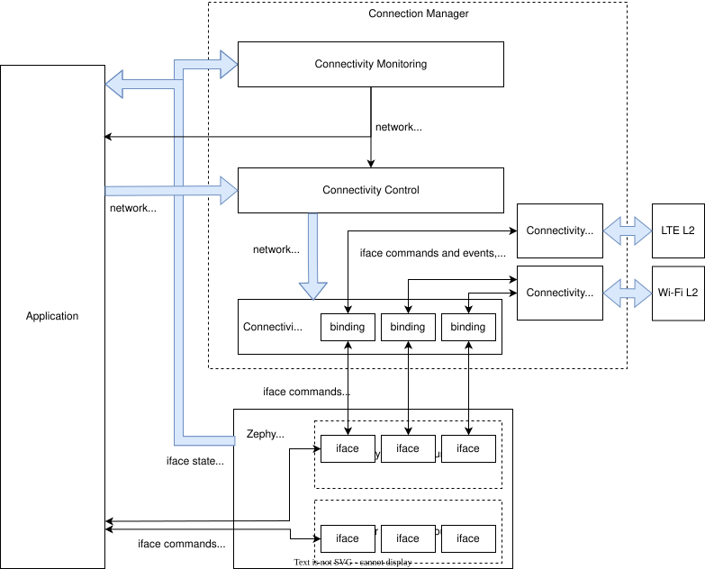

<!-- Copyright 2015-2026 Zephyr Project members and individual contributors. -->
<!-- SPDX-License-Identifier: Apache-2.0 -->
<!-- 中文翻译；编号、导航和明确标注的译注为本地新增。 -->

# 第20章\_连接实现

原文：[官方页面](https://docs.zephyrproject.org/latest/services/connectivity/networking/conn_mgr/implementation.html)。读取日期：2026-10-14；保存的 latest 页面及 HTML 摘要见[来源记录](../SOURCES.md)。

## 20.1\_概览（Overview）

连接实现（Connectivity Implementation）是面向特定网络技术的模块，使 Zephyr 网络接口（iface）能够支持[连接控制（Connectivity Control）](P019_连接管理器概览.md#conn-mgr-control)。它把通用控制 API 调用转换为具体硬件操作，并负责实现标准化的保持连接（Persistence）与超时（Timeout）行为。编写符合约定的实现时，应遵循本章的实现准则。

## 20.2\_架构（Architecture）

实现 API 允许使用 [`CONN_MGR_CONN_DEFINE`](https://docs.zephyrproject.org/latest/doxygen/html/group__conn__mgr__connectivity__impl.html#ga3c2b01efd38ecbb9fbb33ac0fc7c88f3) 在构建时定义连接实现。该宏创建静态的 [`conn_mgr_conn_impl`](https://docs.zephyrproject.org/latest/doxygen/html/structconn__mgr__conn__impl.html) 实例，其中保存对传入的 [`conn_mgr_conn_api`](https://docs.zephyrproject.org/latest/doxygen/html/structconn__mgr__conn__api.html) 结构的引用；后者填写各实现回调（Callback）。

定义后，可按名称引用实现，并用 [`CONN_MGR_BIND_CONN`](https://docs.zephyrproject.org/latest/doxygen/html/group__conn__mgr__connectivity__impl.html#ga16633bf29ebac6850b8c511b33bd189f) 将其绑定到尚未绑定的接口。不要误将两个实现绑定到同一个接口。绑定后，[连接控制 API](P019_连接管理器概览.md#conn-mgr-control-api)会转入 [`conn_mgr_conn_api`](https://docs.zephyrproject.org/latest/doxygen/html/structconn__mgr__conn__api.html) 中对应的函数。

绑定不会直接修改 [接口结构（iface struct）](https://docs.zephyrproject.org/latest/doxygen/html/structnet__if.html)，而是创建 [`conn_mgr_conn_binding`](https://docs.zephyrproject.org/latest/doxygen/html/structconn__mgr__conn__binding.html) 实例并加入内部[可迭代段（Iterable Section）](https://docs.zephyrproject.org/latest/kernel/iterable_sections/index.html#iterable-sections-api)。绑定结构保存接口、所绑定实现的引用，以及指向每接口上下文的指针。

通过遍历该段，可以查找某个接口绑定了哪个实现，或确认没有绑定。大多数连接控制 API 都使用这项查找，因此调用有相对较高的搜索开销，应节制使用。一个连接实现可以绑定多个接口，见后文“不为每个接口实例化实现”。

下图展示连接管理器、Zephyr 与应用之间的详细集成关系：



图中的 bound／unbound 表示已绑定／未绑定接口，binding 是绑定对象，iface state 是接口状态，commands and events 为命令与事件；各技术的实现连接其对应 L2。简化图见[连接管理器概览](P019_连接管理器概览.md#conn-mgr-integration-diagram-simple)。

### 20.2.1\_上下文指针（Context Pointer）

同一个实现可以供多个接口共享，因此每个绑定都实例化一个独有的上下文容器（Context Container），其类型可配置；绑定持有该容器引用，使实现能够访问每接口状态。还应遵循后文的绑定加锁要求与共享实现要求。

## 20.3\_定义并公开连接实现

定义实现的原例：

```c
/* Create the API implementation functions */
int my_connect_impl(struct conn_mgr_conn_binding *const binding) {
        /* Cause your underlying technology to associate */
}
int my_disconnect_impl(struct conn_mgr_conn_binding *const binding) {
        /* Cause your underlying technology to disassociate */
}
void my_init_impl(struct conn_mgr_conn_binding *const binding) {
        /* Perform any required initialization for your underlying technology */
}

/* Declare the API struct */
static struct conn_mgr_conn_api my_impl_api = {
        .connect = my_connect_impl,
        .disconnect = my_disconnect_impl,
        .init = my_init_impl,
        /* ... so on */
};

/* Define the implementation (named MY_CONNECTIVITY_IMPL) */
CONN_MGR_CONN_DEFINE(MY_CONNECTIVITY_IMPL, &my_impl_api);
```

注释译文：先创建连接、断开与初始化函数，分别发起底层关联、解除关联和必要的初始化；再声明填入这些函数的 API 结构；最后定义名为 `MY_CONNECTIVITY_IMPL` 的实现。示例函数体表示待补充的实现，并非完整可运行程序。

**原文注意（Note）**：还必须声明上下文指针类型，否则上述定义不能工作。

### 20.3.1\_公开声明（Declaring an Implementation Publicly）

定义之后，在头文件中声明，可使其他编译单元（Compilation Unit）引用该实现。原例头文件 `my_connectivity_header.h`：

```c
CONN_MGR_CONN_DECLARE_PUBLIC(MY_CONNECTIVITY_IMPL);
```

需要引用此实现的每个编译单元，都必须包含含有该声明的头文件。

### 20.3.2\_声明上下文类型（Declaring a Context Type）

为了使用 [`CONN_MGR_CONN_DEFINE`](https://docs.zephyrproject.org/latest/doxygen/html/group__conn__mgr__connectivity__impl.html#ga3c2b01efd38ecbb9fbb33ac0fc7c88f3)，必须声明相应的上下文指针类型，因为每个连接绑定都包含该类型的上下文。

若使用 [`CONN_MGR_CONN_DECLARE_PUBLIC`](https://docs.zephyrproject.org/latest/doxygen/html/group__conn__mgr__connectivity__impl.html#ga519cfa66e1a1f0b769ce2bf61a61887f)，将类型定义放在公开声明旁边。原例 `my_connectivity_impl.h`：

```c
#define MY_CONNECTIVITY_IMPL_CTX_TYPE struct my_context_type *
CONN_MGR_CONN_DECLARE_PUBLIC(MY_CONNECTIVITY_IMPL);
```

然后在调用 [`CONN_MGR_CONN_DEFINE`](https://docs.zephyrproject.org/latest/doxygen/html/group__conn__mgr__connectivity__impl.html#ga3c2b01efd38ecbb9fbb33ac0fc7c88f3) 前包含该头文件。原例 `my_connectivity_impl.c`：

```c
#include "my_connectivity_impl.h"

CONN_MGR_CONN_DEFINE(MY_CONNECTIVITY_IMPL, &my_impl_api);
```

若不需要公开声明，只在定义前紧邻声明上下文类型即可：

```c
#define MY_CONNECTIVITY_IMPL_CTX_TYPE struct my_context_type *
CONN_MGR_CONN_DEFINE(MY_CONNECTIVITY_IMPL, &my_impl_api);
```

**原文注意**：命名必须匹配。上下文类型宏使用实现名称再追加 `_CTX_TYPE`；因此 `MY_CONNECTIVITY_IMPL` 对应 `MY_CONNECTIVITY_IMPL_CTX_TYPE`。

如果不需要上下文指针，原文称将类型声明为 `void`，其实际代码使用 `void *`：

```c
#define MY_CONNECTIVITY_IMPL_CTX_TYPE void *
```

> 译注：以上头文件与源文件名称是实现者自行创建的示例，不是本仓库已附带的文件；应保留实际代码中的指针类型 `void *`。

### 20.3.3\_将接口绑定到实现（Binding an Iface to an Implementation）

在接口的设备定义之后，可调用 [`CONN_MGR_BIND_CONN`](https://docs.zephyrproject.org/latest/doxygen/html/group__conn__mgr__connectivity__impl.html#ga16633bf29ebac6850b8c511b33bd189f) 进行绑定：

```c
/* Define an iface */
NET_DEVICE_INIT(my_iface,
        /* ... the specifics here don't matter ... */
);

/* Now bind MY_CONNECTIVITY_IMPL to that iface --
 * the name used should match with the above
 */
CONN_MGR_BIND_CONN(my_iface, MY_CONNECTIVITY_IMPL);
```

代码注释译文：先定义接口，细节在本例省略；再把 `MY_CONNECTIVITY_IMPL` 绑定到该接口，绑定中的接口名必须与上面的设备定义一致。

## 20.4\_连接实现准则（Connectivity Implementation Guidelines）

连接管理器把许多行为交给各连接实现完成，使自身保持精简，并允许底层技术选用适合的实现方式。其前提是每个实现都完整遵守公共约定，保持应用所见行为一致。

### 20.4.1\_完整实现超时与保持连接

所有实现都必须完整支持启用或关闭超时、保持连接，而不受底层技术的固有行为限制。对应用呈现的行为必须严格符合[超时与保持连接](P019_连接管理器概览.md#conn-mgr-control-persistence-timeouts)的定义；实现细节见本章最后部分。

### 20.4.2\_符合 API 约定

每个实现 API 函数（implementation API function）应遵循对应控制 API 的描述。例如 [`conn_mgr_conn_api.connect`](https://docs.zephyrproject.org/latest/doxygen/html/structconn__mgr__conn__api.html#a92064a4752f0c9621c5c6a745708a66e) 必须遵循 [`conn_mgr_if_connect()`](https://docs.zephyrproject.org/latest/doxygen/html/group__conn__mgr__connectivity.html#ga575d367c95592fd9f4ead694ff94543f) 的行为规范。

### 20.4.3\_允许预配置连接（Pre-configuration）

实现应允许应用在调用 [`conn_mgr_if_connect()`](https://docs.zephyrproject.org/latest/doxygen/html/group__conn__mgr__connectivity.html#ga575d367c95592fd9f4ead694ff94543f) 前，预先设置全部必要参数，例如网络服务集标识符（Service Set Identifier，SSID）或预共享密钥（Pre-Shared Key，PSK）。不应要求应用在该调用中或之后再提供参数；未提供时，应按下一节等待有效配置。

### 20.4.4\_等待有效配置

如果应用预配置了无效参数，或没有配置参数，导致关联失败，应将其按网络失败处理，而不是立即放弃连接尝试。实现应异步等待有效配置，可以无限等待，也可以等待到配置的连接超时到期。

例外是：接口关闭了保持连接，且实现提供了 [`conn_mgr_conn_api.has_connection_config`](https://docs.zephyrproject.org/latest/doxygen/html/structconn__mgr__conn__api.html#a2490ac680ca52c93ab0c7f48c04f673c)。此时若该回调返回 `false`，[`conn_mgr_if_connect()`](https://docs.zephyrproject.org/latest/doxygen/html/group__conn__mgr__connectivity.html#ga575d367c95592fd9f4ead694ff94543f) 会提前退出，不启用接口，以降低功耗并避免无用的状态转换，同时触发 `NET_EVENT_CONN_IF_NO_CONFIGURATION` 通知订阅者配置缺失。

### 20.4.5\_报告接口状态（Iface State Reporting）

实现必须及时更新绑定接口的状态：

1. 绑定初始化（binding init）时，将接口设置为等待状态（Dormant）、载波关闭（Carrier-down），或同时设置两者。状态含义见[网络接口状态管理](P023_网络接口.md#net-if-interface-state-management)。
2. 当且仅当关联完成、连接就绪时，使接口处于非等待（Non-dormant）且载波开启（Carrier-up）状态。
3. 检测到服务中断时，立即设置 Dormant 或 Carrier-down。对服务经常短暂中断的技术，允许用一个短暂的独立计时来延后判定；它与连接超时不同。
4. 如果该技术还负责 IP 地址分配，必须把获得的地址[分配到接口](P023_网络接口.md#net-if-interface-ip-management)。

**原文注意**：状态更新不一定要由连接实现亲自完成。例如，接口使用 [DHCP](P030_DHCPv4.md#dhcpv4-interface) 时，不必由实现另行分配 IP；底层 [L2 实现](P024_二层管理.md#net-l2-interface)已更新 Dormant 状态时，也无需重复更新。

### 20.4.6\_不要把接口状态当作实现内部状态

其他线程访问 Zephyr 接口时未必遵循绑定互斥锁（Binding Mutex），因此实现回调执行期间，接口状态可能发生不可预期的变化。

应更新接口状态以反映网络可用性，但不能把接口状态作为实现行为的依据，也不要为内部决策读取它。如果要跟踪 Dormant 或 IP 分配状态，在上下文中另存独立状态变量。

### 20.4.7\_不妨碍技术专用 API（Remain Non-interferent）

实现不能阻止应用直接调用所关联技术的专用 API；应用绕过通用控制层使用底层技术，也不应破坏连接实现。确有必要的例外应局限到明确的 API，并记录说明。

**原文注意**：不允许实现被破坏，但应用直接控制关联状态时，出现不符合应用直觉的行为是允许的。例如应用直接命令底层解除关联，实现可以把它当成意外断线而立即重连。

### 20.4.8\_保持非阻塞（Remain Non-blocking）

所有实现回调应非阻塞。例如，[`conn_mgr_conn_api.connect`](https://docs.zephyrproject.org/latest/doxygen/html/structconn__mgr__conn__api.html#a92064a4752f0c9621c5c6a745708a66e) 启动连接过程后立即返回。例外是 [`conn_mgr_conn_api.init`](https://docs.zephyrproject.org/latest/doxygen/html/structconn__mgr__conn__api.html#ad2bb08d518e2f797002ca5257889a59e)，允许阻塞；但这会延迟系统初始化，因此耗时工作仍应考虑放到后台线程。

### 20.4.9\_初始化后立即接受 API 调用

[`conn_mgr_conn_api.init`](https://docs.zephyrproject.org/latest/doxygen/html/structconn__mgr__conn__api.html#ad2bb08d518e2f797002ca5257889a59e) 完成后，实现必须立即能接受 API 调用。即使紧接初始化就调用 [`conn_mgr_conn_api.connect`](https://docs.zephyrproject.org/latest/doxygen/html/structconn__mgr__conn__api.html#a92064a4752f0c9621c5c6a745708a66e)，最终也必须导致关联尝试。

若底层技术尚未准备好，应以非阻塞方式将连接请求排队，待就绪后执行，不能丢弃请求。

### 20.4.10\_状态保存在上下文中

每个绑定都有上下文指针，实现应将全部状态保存在该上下文中。唯一例外是明确只允许绑定单个接口的实现，可使用静态声明的状态。另见“不为每个接口实例化实现”。

### 20.4.11\_只通过绑定结构访问接口

不要使用静态声明的接口，也不要从外部获取接口引用。例如，不能假设绑定接口就是默认接口而调用 [`net_if_get_default()`](https://docs.zephyrproject.org/latest/doxygen/html/group__net__if.html#ga55214771e462cbd4930ffa738813cb87)。

始终使用相关绑定结构（binding struct）提供的接口指针（iface pointer），并遵循绑定加锁规则。

### 20.4.12\_实现必须可在编译时选择

提供 Kconfig 选项启用或关闭连接实现，且关闭后不影响接口本身的可用性。也就是说，构建可以保留连接管理器和原本会绑定的网络接口，同时不包含此连接实现及绑定。

### 20.4.13\_不要为每个接口实例化实现

不要给每个待绑定接口分别声明一份连接实现。应让所有适用接口绑定到同一个全局实现，用各自上下文保存接口专属状态。仍需遵循绑定加锁与只通过绑定访问接口的规则。

### 20.4.14\_访问绑定前必须加锁

绑定可能随时被多个线程读写；不先[加锁（locking it）](https://docs.zephyrproject.org/latest/doxygen/html/group__conn__mgr__connectivity__impl.html#ga27be6dec40356facce7da18a31a2c12a)就读写会导致不可预测的行为。这适用于绑定的全部下属对象，包括上下文容器内容。访问完成后必须[解锁（unlock）](https://docs.zephyrproject.org/latest/doxygen/html/group__conn__mgr__connectivity__impl.html#ga94a4930a6d7c4db4427dfdfad8f3c154)。

**原文注意**：资源本身线程安全时可能构成例外，但应谨慎；同时操作多个线程安全资源仍可能产生竞态条件（Race Condition）。因此建议始终锁定绑定，不依赖这一例外。

### 20.4.15\_不得禁用内置功能

不得阻止[超时与保持连接](P019_连接管理器概览.md#conn-mgr-control-persistence-timeouts)或[自动行为](P019_连接管理器概览.md#conn-mgr-control-automations)等内置功能的使用。所有实现必须完整支持它们，不能强制某功能永远开启或永远关闭。

### 20.4.16\_触发连接控制事件

原文指出，连接控制的网络管理事件并非全部由管理器自动产生，实现必须自行触发相应事件：连接超时时触发原文所写的 `NET_EVENT_CONN_CMD_IF_TIMEOUT`；发生不可恢复的连接错误时触发 [`NET_EVENT_CONN_IF_FATAL_ERROR`](https://docs.zephyrproject.org/latest/doxygen/html/group__conn__mgr__connectivity.html#gae8f207559a7123bd2eca5ef08086d377)。事件意义见概览中的[超时](P019_连接管理器概览.md#conn-mgr-control-events-timeout)与[致命错误](P019_连接管理器概览.md#conn-mgr-control-events-fatal-error)，发事件方法见[网络管理](P022_网络管理.md#net-mgmt-interface)。

> 源码跟踪译注：`NET_EVENT_CONN_CMD_IF_TIMEOUT` 是事件编码中的命令部分，完整通知事件应使用 `NET_EVENT_CONN_IF_TIMEOUT`，其定义组合了管理层事件前缀与命令字段，见 [`conn_mgr_connectivity.h`](../../../include/zephyr/net/conn_mgr_connectivity.h)。另外，当前 [`conn_mgr_connectivity.c`](../../../subsys/net/conn_mgr/conn_mgr_connectivity.c) 会由空闲计时工作项发送 `NET_EVENT_CONN_IF_IDLE_TIMEOUT`；不能将原文“一律不自动触发”的说法套用于后来加入的空闲超时机制。

## 20.5\_实现超时与保持连接（Implementing Timeouts and Persistence）

先阅读概览中的[预期行为](P019_连接管理器概览.md#conn-mgr-control-persistence-timeouts)。无论底层技术如何工作，连接实现都必须遵守这些行为；必要时添加补充逻辑来模拟底层缺少的能力。常见边界如下。

### 20.5.1\_底层技术自带保持连接

若底层在断线或失败后自动重连／重试，而这与接口的超时或保持设置冲突，实现必须主动取消这些尝试。例如：

- 接口关闭保持连接时，底层自动断线重连应立即取消。
- 底层没有超时机制时，配置的连接超时到期后，实现应取消尝试，以实现超时行为。

### 20.5.2\_底层会提前放弃连接

如果底层没有重试机制、会在配置超时到达前放弃，或不会在断线后重连，实现必须主动重新发起连接来补足差异：

- 底层不保持连接，而接口开启保持连接时，主动触发重连。
- 底层不支持超时，而接口启用了超时时，手工取消到期的连接尝试。
- 底层强制的超时时间短于连接管理器设置时，主动启动下一次底层尝试。

### 20.5.3\_底层存在关联重试（Association Retry）

许多技术不会一次关联就成功，而是连续尝试多次，通常间隔很短。连接实现应把这一串连续的关联子尝试视为一次完整的连接尝试。

因此某次子尝试失败后，即使关闭保持连接，也不能据此阻止后续子尝试，因为它们仍属于同一次整体尝试。参见下一节。

每个实现自行决定连续子尝试失败达到何种程度，算作一次整体连接尝试失败。但只要配置超时尚未到达，或者没有超时，子尝试仍应继续。

### 20.5.4\_连接尝试期间的保持设置

保持连接设置不能影响一次连接尝试内部的任何行为；它只决定断线后是否自动启动新的连接尝试。尝试期间是否继续重试，应完全由超时设置决定。

## 20.6\_实现 API（Implementation API）

包含 `include/zephyr/net/conn_mgr_connectivity_impl.h` 使用[连接管理器连接实现 API](https://docs.zephyrproject.org/latest/doxygen/html/group__conn__mgr__connectivity__impl.html)。这些接口仅供连接实现使用。

源码跟踪入口为 [`conn_mgr_connectivity_impl.h`](../../../include/zephyr/net/conn_mgr_connectivity_impl.h)；本轮官方版本依据见[来源记录](../SOURCES.md)。


<a id="connectivity-implementations"></a>
<a id="conn-mgr-impl"></a>
<a id="overview"></a>
<a id="conn-mgr-impl-overview"></a>
<a id="architecture"></a>
<a id="conn-mgr-impl-architecture"></a>
<a id="id1"></a>
<a id="conn-mgr-integration-diagram-detailed"></a>
<a id="context-pointer"></a>
<a id="conn-mgr-impl-ctx"></a>
<a id="defining-an-implementation"></a>
<a id="conn-mgr-impl-defining"></a>
<a id="declaring-an-implementation-publicly"></a>
<a id="conn-mgr-impl-declaring"></a>
<a id="id2"></a>
<a id="declaring-a-context-type"></a>
<a id="conn-mgr-impl-declaring-ctx"></a>
<a id="id3"></a>
<a id="id4"></a>
<a id="binding-an-iface-to-an-implementation"></a>
<a id="conn-mgr-impl-binding"></a>
<a id="connectivity-implementation-guidelines"></a>
<a id="conn-mgr-impl-guidelines"></a>
<a id="completely-implement-timeout-and-persistence"></a>
<a id="conn-mgr-impl-guidelines-timeout-persistence"></a>
<a id="conform-to-api-specifications"></a>
<a id="conn-mgr-impl-guidelines-conformity"></a>
<a id="allow-connectivity-pre-configuration"></a>
<a id="conn-mgr-impl-guidelines-preconfig"></a>
<a id="await-valid-connectivity-configuration"></a>
<a id="conn-mgr-impl-guidelines-await-config"></a>
<a id="implement-iface-state-reporting"></a>
<a id="conn-mgr-impl-guidelines-iface-state-reporting"></a>
<a id="do-not-use-iface-state-as-implementation-state"></a>
<a id="conn-mgr-impl-guidelines-iface-state-writeonly"></a>
<a id="remain-non-interferent"></a>
<a id="conn-mgr-impl-guidelines-non-interference"></a>
<a id="remain-non-blocking"></a>
<a id="conn-mgr-impl-guidelines-non-blocking"></a>
<a id="make-api-immediately-ready"></a>
<a id="conn-mgr-impl-guidelines-immediate-api-readiness"></a>
<a id="do-not-store-state-information-outside-the-context-pointer"></a>
<a id="conn-mgr-impl-guidelines-context-pointer"></a>
<a id="access-ifaces-only-through-binding-structs"></a>
<a id="conn-mgr-impl-guidelines-iface-access"></a>
<a id="make-implementations-optional-at-compile-time"></a>
<a id="conn-mgr-impl-guidelines-bindings-optional"></a>
<a id="do-not-instance-implementations"></a>
<a id="conn-mgr-impl-guidelines-no-instancing"></a>
<a id="do-not-access-bindings-without-locking-them"></a>
<a id="conn-mgr-impl-guidelines-binding-access"></a>
<a id="do-not-disable-built-in-features"></a>
<a id="conn-mgr-impl-guidelines-support-builtins"></a>
<a id="trigger-connectivity-control-events"></a>
<a id="conn-mgr-impl-guidelines-trigger-events"></a>
<a id="implementing-timeouts-and-persistence"></a>
<a id="conn-mgr-impl-timeout-persistence"></a>
<a id="inherently-persistent-technologies"></a>
<a id="conn-mgr-impl-tp-inherent-persistence"></a>
<a id="technologiess-that-give-up-on-connection-attempts"></a>
<a id="conn-mgr-impl-tp-inherent-nonpersistence"></a>
<a id="technologies-with-association-retry"></a>
<a id="conn-mgr-impl-tp-assoc-retry"></a>
<a id="persistence-during-connection-attempts"></a>
<a id="conn-mgr-impl-tp-persistence-during-connect"></a>
<a id="implementation-api"></a>
<a id="conn-mgr-impl-api"></a>

<!-- reading-navigation:start -->

**主线阅读**

[上一篇：连接管理器概览](P019_连接管理器概览.md) · [本模块主线目录](../reading/networking.md) · [全部主线](../reading/README.md) · [下一篇：网络配置库](P021_网络配置库.md)

<details>
<summary>原册编号导航（含扩展参考）</summary>

[上一章](P019_连接管理器概览.md) · [返回大纲](大纲.md) · [下一章](P021_网络配置库.md)

</details>

<!-- reading-navigation:end -->
