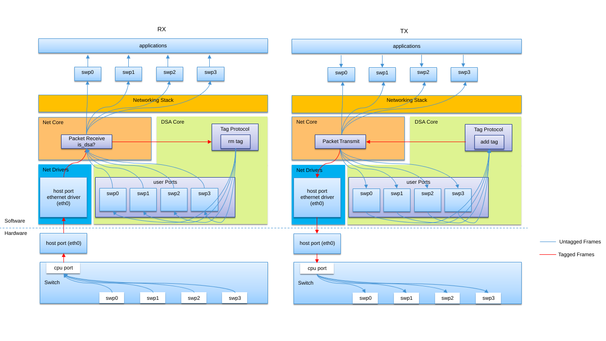

<!-- Copyright 2015-2026 Zephyr Project members and individual contributors. -->
<!-- SPDX-License-Identifier: Apache-2.0 -->
<!-- 中文翻译；编号、导航和明确标注的译注为本地新增。 -->

# 第126章\_DSA分布式交换机架构

原文：[官方页面](https://docs.zephyrproject.org/latest/services/connectivity/networking/dsa.html)。读取日期：2026-10-14；保存的 latest 页面及 HTML 摘要见[来源记录](../SOURCES.md)。

## 1. 概述（Overview）

分布式交换机架构（Distributed Switch Architecture，DSA）并不是新事物，它在 Linux 中已经是成熟多年的子系统。原文不再重复背景、术语和相关知识，这些内容可参阅 [Linux DSA 文档](https://www.kernel.org/doc/html/latest/networking/dsa/dsa.html)。

## 2. DSA 交换机收发流程（DSA Switch TX/RX Process）

DSA 交换机的发送／接收流程如下。



> 图中文字对照：网络驱动（Net Drivers）、DSA 核心（DSA Core）、用户端口（User Ports）、交换机（Switch）、CPU 端口（CPU Port）、主机端口（Host Port）、以太网驱动（Ethernet Driver）、网络核心（Net Core）、标签协议（Tag Protocol）、去除／添加标签（rm tag / add tag）、网络协议栈（Networking Stack）、应用（Applications）、软件／硬件（Software / Hardware）、带标签帧／无标签帧（Tagged / Untagged Frames）、数据包接收／发送（Packet Receive / Transmit）。图中 `swp0` 至 `swp3` 为交换机端口，`eth0` 为主机以太网接口。原图以原始 SVG 格式保存，未改写图形内容。

## 3. 主机接口（Host Interface）

主机接口的网络设备使用普通且未经修改的以太网驱动，作为 DSA 的承载端口（Conduit Port），通过处理器管理交换机。

## 4. 交换机接口（Switch Interface）

交换机接口也作为标准以太网接口暴露给 Zephyr。与承载端口相连的接口充当 CPU 端口，其他供用户使用的接口充当用户端口（User Ports）。

## 5. 交换机标签协议（Switch Tagging Protocols）

交换机标签协议通常由厂商定义，标签一般包含以下信息：

- 标识以太网帧来自哪个端口，或应发送到哪个端口。
- 说明该帧为什么被转发到管理接口。

标签附加在数据包上，构成交换机帧头（Switch Frame Header）。也存在不使用标签的情况，具体取决于厂商。

## 6. 网络协议栈处理（Networking Stack Process）

DSA 子系统需要通过承载端口处理交换机专用的标签协议。

接收路径（RX Path）在 `subsys/net/ip/net_core.c` 的 `net_recv_data()` 前部调用 `dsa_recv()`，先去除标签并重新指定网络接口。

发送路径（TX Path）把交换机接口注册为标准以太网设备，以 `dsa_xmit()` 作为 `ethernet_api->send`。`dsa_xmit()` 处理标签，并把发送工作重定向到承载端口。

> 译注——源码跟踪：当前官方 [`net_core.c`](https://github.com/zephyrproject-rtos/zephyr/blob/main/subsys/net/ip/net_core.c) 检查承载端口后调用 `dsa_recv()`；这是协议栈已有的接收流程，不是要求应用再次插入同样调用。

## 7. DSA 设备驱动支持（DSA Device Driver Support）

DSA 核心驱动会与管理数据输入／输出（Management Data Input/Output，MDIO）、物理层（PHY）及设备树（Devicetree）等子系统和驱动交互，处理通用的 DSA 设置与工作流程，因此具体设备驱动的接入相对简单。

设备树中的交换机描述应遵循 `dts/bindings/dsa/dsa.yaml`。

设备驱动需要准备 [`dsa_api`](https://docs.zephyrproject.org/latest/doxygen/html/structdsa__api.html)、可选的私有数据，以及 [`dsa_port_config`](https://docs.zephyrproject.org/latest/doxygen/html/structdsa__port__config.html)，并可使用以下宏：

- [`DSA_SWITCH_INST_INIT`](https://docs.zephyrproject.org/latest/doxygen/html/group__dsa__core.html#gaa7665e4b96cbc40cbae6de621f773aa4)。
- [`DSA_PORT_INST_INIT`](https://docs.zephyrproject.org/latest/doxygen/html/group__dsa__core.html#ga012eeda4facb67b5c387b74878b53188)。

下面是 i.MX NETC 的例子：

```c
#define DSA_NETC_PORT_INST_INIT(port, n)                                                    \
        COND_CODE_1(DT_NUM_PINCTRL_STATES(port),                                            \
                        (PINCTRL_DT_DEFINE(port);), (EMPTY))                                \
        struct dsa_netc_port_config dsa_netc_##n##_##port##_config = {                      \
                .pincfg = COND_CODE_1(DT_NUM_PINCTRL_STATES(port),                          \
                                (PINCTRL_DT_DEV_CONFIG_GET(port)), NULL),                   \
                .phy_mode = NETC_PHY_MODE(port),                                            \
        };                                                                                  \
        struct dsa_port_config dsa_##n##_##port##_config = {                                \
                .mcfg = NET_ETH_MAC_DT_CONFIG_INIT(port),                                   \
                .port_idx = DT_REG_ADDR(port),                                              \
                .phy_dev = DEVICE_DT_GET_OR_NULL(DT_PHANDLE(port, phy_handle)),             \
                .phy_mode = DT_PROP_OR(port, phy_connection_type, ""),                      \
                .ethernet_connection = DEVICE_DT_GET_OR_NULL(DT_PHANDLE(port, ethernet)),   \
                .prv_config = &dsa_netc_##n##_##port##_config,                              \
        };                                                                                  \
        DSA_PORT_INST_INIT(port, n, &dsa_##n##_##port##_config)

#define DSA_NETC_DEVICE(n)                                                                  \
        AT_NONCACHEABLE_SECTION_ALIGN(static netc_cmd_bd_t dsa_netc_##n##_cmd_bd[8],        \
                                      NETC_BD_ALIGN);                                       \
        static struct dsa_netc_data dsa_netc_data_##n = {                                   \
                .cmd_bd = dsa_netc_##n##_cmd_bd,                                            \
        };                                                                                  \
        DSA_SWITCH_INST_INIT(n, &dsa_netc_api, &dsa_netc_data_##n, DSA_NETC_PORT_INST_INIT);
```

## 8. 常见问题（Common Pitfalls Using DSA Setups）

以下说明摘自 Linux DSA 文档，也适用于 Zephyr：虽然承载端口和 CPU 端口在 Zephyr 中暴露为以太网设备，但不能像普通用户端口那样直接使用。

一旦承载网络设备配置为使用 DSA，即 `dev->dsa_ptr` 不再为空，且其后方交换机要求使用标签协议，该网络接口就只能专用于承载。直接通过它发送数据包，例如用该接口打开套接字，会绕过交换机标签协议的发送函数；另一端交换机期待收到带标签帧，因此通常会丢弃这种帧。

> 译注——平台术语：`dev->dsa_ptr` 是原文从 Linux 文档引用的字段名称，不应据此在 Zephyr 中查找同名设备成员。Zephyr 的 DSA 配置与接口结构见官方 [`dsa_core.h`](https://github.com/zephyrproject-rtos/zephyr/blob/main/include/zephyr/net/dsa_core.h)。这里需要保留的共同约束是承载路径必须经过相应标签处理。

## 9. 待完成工作（TODO Work）

与 Linux 相比，Zephyr 的 DSA 及基于 DSA 的功能还有很多需要支持。原文提出首先支持桥接层，再为用户提供两种交换机端口使用方式：

- 独立模式（Standalone Mode）：全部用户端口作为普通以太网设备工作，不进行交换。
- 网桥模式（Bridge Mode）：将用户端口加入虚拟网桥设备后启用交换模式，可把 IP 地址分配给网桥。

> 译注——官方页面进度差异：本页仍把桥接列为待完成工作，而当前官方 [TSN 交换机示例](P124_TSN交换机示例.md) 已展示把 DSA 用户端口加入以太网桥的流程。应结合目标驱动与该示例核对实际支持范围，不能把本页的 TODO 直接当作所有当前版本都没有桥接能力，也不能据示例推断全部交换机配置功能都已完成。


<a id="distributed-switch-architecture-dsa"></a>
<a id="dsa"></a>
<a id="contents"></a>
<a id="id1"></a>
<a id="id2"></a>
<a id="id3"></a>
<a id="id4"></a>
<a id="id5"></a>
<a id="id6"></a>
<a id="id7"></a>
<a id="id8"></a>
<a id="dsa-switch-tx-rx-process"></a>
<a id="host-interface"></a>
<a id="switch-interface"></a>
<a id="switch-tagging-protocols"></a>
<a id="networking-stack-process"></a>
<a id="dsa-device-driver-support"></a>
<a id="common-pitfalls-using-dsa-setups"></a>
<a id="todo-work"></a>

<!-- reading-navigation:start -->

**主线阅读**

[上一篇：流量分类](P119_流量分类.md) · [本模块主线目录](../reading/networking.md) · [全部主线](../reading/README.md) · [下一篇：时间敏感网络](P127_时间敏感网络.md)

<details>
<summary>原册编号导航（含扩展参考）</summary>

[上一章](P125_10BASE-T1S测试示例.md) · [返回大纲](大纲.md) · [下一章](P127_时间敏感网络.md)

</details>

<!-- reading-navigation:end -->
