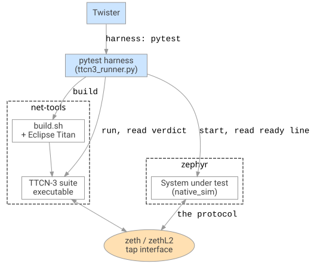
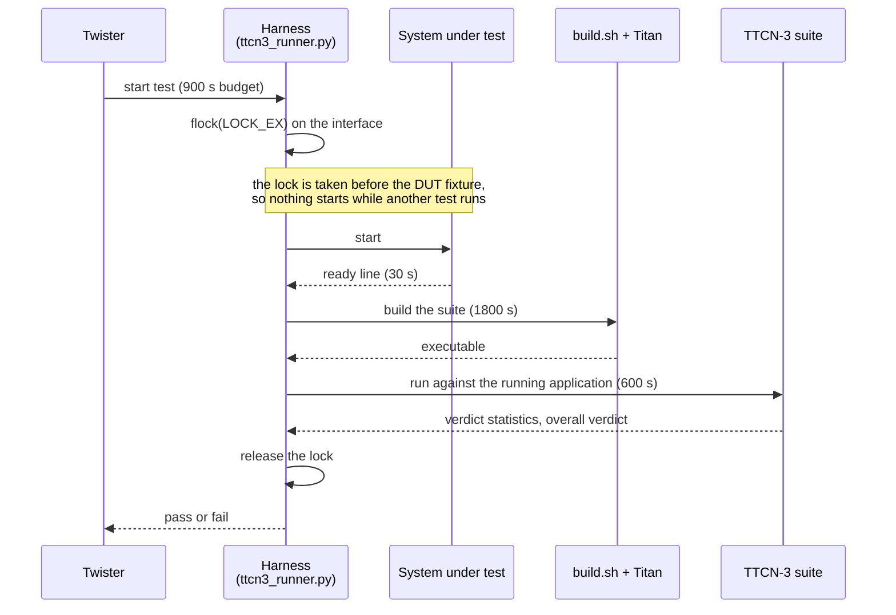

<!-- Copyright 2015-2026 Zephyr Project members and individual contributors. -->
<!-- SPDX-License-Identifier: Apache-2.0 -->
<!-- 中文翻译；编号、导航和明确标注的译注为本地新增。 -->

# 第156章\_一致性测试架构

原文：[官方页面](https://docs.zephyrproject.org/latest/services/connectivity/networking/conformance/architecture.html)。读取日期：2026-10-14；保存的 latest 页面及 HTML 摘要见[来源记录](../SOURCES.md)。

## 1. 一致性测试的组成（How the Conformance Tests Are Put Together）

四个部分分布在两个仓库中：Zephyr 应用、Twister 与 pytest 测试控制层（Test Harness）、封装 Eclipse Titan 的 Shell 脚本，以及 TTCN-3 测试套件（Test Suite）。被测应用与协议套件仅通过线路上的报文交互。

## 2. 各组件（The Pieces）

下图展示 Twister 和 pytest 控制层如何驱动 Zephyr 应用与 Titan 构建的 TTCN-3 套件，两侧通过 TAP 接口相遇。图回答“由谁构建什么，以及两侧在哪里交互”。



| 组件／原图文字 | 作用与中文说明 |
| --- | --- |
| `Twister` | 构建被测系统、启动它，再针对它运行 pytest 控制层。提供测试标识、平台限制和整个测试的 900 秒预算。 |
| `pytest harness (ttcn3_runner.py)` | 所有测试共用 [tests/net/conformance/ttcn3_runner.py](https://github.com/zephyrproject-rtos/zephyr/blob/main/tests/net/conformance/ttcn3_runner.py)。判断套件是否具备运行条件，取得接口锁，构建、运行套件并读取判定。 |
| `System under test (native_sim)` | 被测系统（System Under Test，SUT），即启用了协议的普通 Zephyr 应用，不编入测试逻辑。 |
| `build.sh + Eclipse Titan` | 主机侧构建。Titan 将 TTCN-3 编译成 C++ 并生成 Makefile，`build.sh` 安排输入源码。 |
| `TTCN-3 suite executable` | TTCN-3 套件可执行文件，即从外部驱动协议的测试本身。 |
| `zeth / zethL2 tap interface` | TAP 虚拟网络接口，是应用与套件共享的交互点；没有控制通道、共享内存或 Zephyr 映像内测试钩子。 |

> 图中文字译注：`zephyr` 和 `net-tools` 是两个源码仓库；`harness: pytest` 表示选用 pytest 控制层；`start, read ready line` 是启动并读取就绪行；`build` 是构建；`run, read verdict` 是运行并读取判定；`the protocol` 表示双方交换被测协议报文。原 SVG 保留官方字节内容，没有重绘替换。

## 3. Zephyr 侧（The Zephyr Side）

### 3.1 被测系统（System Under Test）

每个应用都刻意保持普通：启用协议，生成套件需要观察的流量，再打印一行具有辨识度的就绪消息（Ready Line）。该行是应用与控制层之间的唯一约定，用于通知协议栈已经启动，套件可以开始发送。

每个套件目录包括：

```text
tests/net/conformance/<suite>/
    CMakeLists.txt
    prj.conf
    README.rst
    tests.yaml
    src/main.c
    pytest/pytest.ini
    pytest/conftest.py
    pytest/test_<suite>_conformance.py
```

这些文件是新增套件时在 Zephyr 仓库中创建的应用、配置、说明与 pytest 文件；已有套件的目录已经提供它们。

### 3.2 Twister 集成（Twister Integration）

每个 `tests.yaml` 共用以下配置块：

```yaml
common:
  harness: pytest
  slow: true
  timeout: 900
  platform_allow:
    - native_sim
  integration_platforms:
    - native_sim
```

`harness: pytest` 把运行交给 pytest 控制层，而不是从控制台输出读取 ztest 摘要。`slow: true` 让套件不进入普通 Twister 运行，因为完整测试需要数十分钟。900 秒超时必须同时覆盖套件构建与运行。只允许 `native_sim` 平台，因为 TAP 驱动会把被测系统接入真实链路。

测试本身只有三个步骤：请求锁、等待就绪行、运行套件。

```python
def test_mdns_conformance(network_lock, dut, suite_binary):
    dut.readlines_until(regex='mDNS responder ready', timeout=30.0)
    run_suite(suite_binary, SUITE)
```

`network_lock` 参数有意放在最前面，原因见下节。每个测试目录中的 `conftest.py` 相同，只把共用运行器放入 `sys.path` 并重新导出锁夹具（Fixture）。

## 4. 测试控制层（The Harness）

下面是一次一致性测试从取得锁到返回判定的官方 Mermaid 时序图，另存的[原始图源码](images/ttcn3_conformance_sequence.mmd)保留原始内容。



> 时序图译注：Twister 启动测试，总预算 900 秒；Harness 对接口执行 `flock(LOCK_EX)`；必须在 DUT 夹具之前取得锁，另一项测试运行时不能启动新被测应用。随后启动应用，最多等 30 秒就绪行；构建套件的内部预算 1800 秒，得到可执行文件后运行套件，内部预算 600 秒；套件返回判定统计和总体判定，控制层释放锁，再向 Twister 返回通过或失败。这些内部上限仍受外层 900 秒预算约束。

以下逻辑均位于 [tests/net/conformance/ttcn3_runner.py](https://github.com/zephyrproject-rtos/zephyr/blob/main/tests/net/conformance/ttcn3_runner.py)。

### 4.1 占用接口（Holding the Interface）

Twister 在各自独立的 pytest 进程中运行测试，因此互斥（Mutual Exclusion）必须跨进程生效。控制层在会话作用域（Session Scope）夹具中，对锁文件取得独占 `flock`。

顺序与锁本身同样重要。测试先请求锁夹具，再请求 `dut` 夹具，所以另一测试占用接口时，被测系统甚至不会启动；否则两个应用同时响应 `192.0.2.1`，会干扰双方测试。

锁文件名包含有效用户标识（Effective User ID，EUID）。特权套件以 root 运行；在具有相应保护的粘滞位临时目录（Sticky Temporary Directory）中，root 不能打开其他用户遗留的锁文件。整次运行要么全部特权、要么全部非特权，所以按用户划分的锁仍能排除该运行中的所有冲突；这也意味着不能同时启动特权和非特权两批运行。

### 4.2 套件特征（Suite Traits）

控制层从 `suites/<name>/build.conf` 读取三项特征。

- `MODE=parallel`：测试用例创建并行测试组件（Parallel Test Component），必须通过 Titan 主控制器（Main Controller）运行，不能直接作为单个可执行文件运行；还需安装 `expect`。
- `PRIVILEGED=yes`：套件绑定特权端口或打开包套接字，必须以 root 运行。
- `L2=yes`：套件工作在 IP 层以下，需要 `zethL2` 而非 `zeth`。

`build.sh` 会把同一文件作为 Shell 片段加载，因此内容采用 Shell 赋值语法；Python 控制层只匹配其中的子字符串。

### 4.3 构建与运行套件（Building and Running the Suite）

构建调用 `build.sh <suite>`，内部超时预算为 1800 秒，产物为 `suites/<suite>/build/<suite>`。

运行时必须兼容 Titan 的两种安装布局：发行版包把库放在 `TTCN3_DIR/lib/titan`，源码安装则放在 `TTCN3_DIR/lib`。控制层选择实际存在的目录，加到 `LD_LIBRARY_PATH` 最前面，并把 `TTCN3_DIR/bin` 加到 `PATH` 最前面。并行套件通过 `ttcn3_start` 启动，其余直接启动可执行文件。

套件在新会话（Session）中启动，使超时套件及其创建的全部子进程可以一并终止；遗留的主控制器可能继续占用接口，影响下一项测试。

### 4.4 将判定转换成结果（Turning a Verdict into a Result）

两个正则表达式匹配 Titan 运行末尾的输出，并断言：打印了判定、至少运行一个测试用例、总体判定为 `pass`。套件没有输出，或由于过滤而一个用例也未执行，都应失败，不能悄然通过。判定含义见 [读取测试结果](P157_运行协议一致性测试.md#ttcn3-verdicts)。

> 译注——当前实现的精确判断：`run_suite()` 实际提取 `pass`、`inconc`、`fail`、`error` 数量，要求 `passed > 0`，并要求 `Overall verdict` 为 `pass`。因此“至少运行一个”在该实现中具体是至少出现一个通过用例；不是仅检查进程正常退出，也不是只看 Twister 有没有报异常。

## 5. 主机侧（The Host Side）

本节内容都位于 net-tools 仓库的 `ttcn3` 下。

### 5.1 布局（Layout）

```text
ttcn3/
    common/            shared TTCN-3 modules and the ethernet test port
    modules/           third party modules, cloned, not in git
    modules.txt        which modules, at which commit
    fetch-modules.sh   clone or check out the pinned commits
    build.sh           build one suite
    suites/<name>/     the suite, its sources.txt and its .cfg
```

原目录树注释对应为：`common/` 保存共用 TTCN-3 模块和以太网测试端口；`modules/` 保存克隆的第三方模块，不进入 Git；`modules.txt` 记录模块与固定提交；`fetch-modules.sh` 克隆或检出这些提交；`build.sh` 构建一个套件；`suites/<name>/` 保存套件及其 `sources.txt`、`.cfg`。

### 5.2 套件如何构建（How a Suite Is Built）

`build.sh` 清空该套件的构建目录，再重新建立扁平布局，将所需源码通过符号链接（Symbolic Link）并排放在同一目录。

扁平布局是兼容性处理：Titan 生成的 Makefile 使用 `sed` 和目标文件词干（Target Stem）作为模式生成依赖规则；源码名一旦含有带斜杠的路径就会出错。因此必须能够通过不含目录的文件名访问每份源码。

链接顺序为套件自己的源码、`common` 源码、`common/sources.txt` 列出的模块源码，再到套件自己的 `sources.txt`。随后 `ttcn3_makefilegen` 生成 Makefile；单进程模式带 `-s`，并行模式不带；最后由 `make` 构建。

### 5.3 共用 TTCN-3 层（Shared TTCN-3 Layer）

`Zephyr_SUT` 保存各套件共用的模块参数（Module Parameters）。套件不把地址或超时写死在自身源码中，而从这里读取，因此修改一份配置文件就能将测试迁到另一条链路。

| 参数 | 默认值 | 含义 |
| --- | --- | --- |
| `tsp_sut_ipv4` | `192.0.2.1` | Zephyr 应答的 IPv4 地址 |
| `tsp_sut_ipv6` | `2001:db8::1` | Zephyr 应答的 IPv6 地址 |
| `tsp_tester_ipv4` | `192.0.2.2` | 套件应答的 IPv4 地址 |
| `tsp_tester_ipv6` | `2001:db8::2` | 套件应答的 IPv6 地址 |
| `tsp_tester_interface` | `zeth` | 链路本地多播（Link-Local Multicast）所需接口 |
| `tsp_sut_hostname` | `zephyr` | 响应器拥有的主机名 |
| `tsp_response_timeout` | `5.0` | 允许等待应答的时间 |
| `tsp_silence_timeout` | `2.0` | 观察没有报文到达的持续时间 |

`Zephyr_Transport` 提供 `Zephyr_Tester` 组件，它具有 `IPL4asp` 端口和辅助操作：监听、打开、发送、在保护定时器（Guard Timer）限制下接收，以及断言没有任何内容到达。基于套接字的套件扩展此组件，不自行打开套接字。

`ARP_Types` 为手写模块，放在 `common` 而不是 `arp` 套件中，因为在 IP 层以下工作的套件必须自行回答地址解析（Address Resolution），该链路上没有其他响应者。Titan 项目没有发布 ARP 模块。

### 5.4 以太网测试端口（Ethernet Test Port）

Titan 发布了原始链路层测试端口 `LANL2asp`，这里没有使用。它通过 `libpcap` 捕获数据，打开句柄时读超时为 0；原文指出，在 Linux 上这意味着等待捕获块填满。测试链路流量少，帧可能一直无法交给测试，而且没有参数可以改变这一设置。

`common/Ethernet_PT.cc` 改为读取包套接字，每帧到达就立即交付。它接受三个测试端口参数：必填的 `interface`；默认使用接口自身地址的 `source_address`；以及可选的 `ethertype`，设置后只上交指定类型的帧。

### 5.5 第三方模块（Third-Party Modules）

套件基于 Titan 项目发布的协议模块和测试端口构建，不重复定义消息格式。使用的 11 个仓库均在 `modules.txt` 中固定到一个提交，由 `fetch-modules.sh` 按需克隆。源码没有直接纳入本仓库（Vendoring），克隆目录由 Git 忽略。固定提交让今天通过的套件在后续仍可依据相同模块源码构建；调整固定版本只需修改一行并重跑获取流程。

上游模块采用 EPL-2.0，这里自行编写的部分采用 Apache-2.0。两者均经开放源代码促进会（Open Source Initiative，OSI）批准，符合 Zephyr 对不会编入固件映像的工具所提出的许可要求，见 [贡献外部组件](../contributing/P012_外部组件贡献.md#external-contributions)。

> 译注——模块数量的版本差异：上文保留原网页的“11 个仓库”。本次读取的官方 [modules.txt](https://github.com/zephyrproject-rtos/net-tools/blob/master/ttcn3/modules.txt) 实际包含 13 条非注释模块记录，各自固定提交；应按所用版本清单获取，不要把原文数量当作完整性判断条件。

## 6. 测试网络（The Test Network）

`zeth` 是两侧都有地址的普通 TAP 接口，使用它的套件就是链路上的另一个主机。`zethL2` 则完全不配置 IP 地址，并让主机不在其上应答，从而使 Zephyr 成为唯一回答地址解析的协议栈。接口创建方法见 [设置网络接口](P157_运行协议一致性测试.md#ttcn3-interfaces)。

> 原文警告：`zethL2` 名称出现在三处，必须保持一致，但没有机制自动检查：运行器中的 `L2_INTERFACE` 决定测试前要求存在的接口；每个 L2 测试 `boards/native_sim.overlay` 中的 `host-interface` 决定被测系统接入哪里；套件配置中的 `system.pt.interface` 决定套件监听哪里。不一致时表现为收不到帧并超时，而不是立即报告名称不匹配。

## 7. 添加套件（Adding a Suite）

每个套件分别在两个仓库中有一半内容；创建之前先选择测试形态。

### 7.1 选择形态（Choosing the Shape）

**套接字还是原始帧（Sockets or Raw Frames）**：可通过 UDP／TCP 表达测试意图时，扩展 `Zephyr_Tester`，使用 `IPL4asp` 端口，在 `zeth` 上运行，通常不需要特权。必须查看或发出帧本身时，使用 `Ethernet_Port`，在 `zethL2` 上以 root 运行，并自行处理地址解析，因为该链路上没有其他响应者。优先选套接字；原始帧路线多出一个接口和特权操作需求。译注：DHCP 固定使用低端口，仍是套接字路线中需要特权的例外，见套件表。

**单进程还是并行（Single or Parallel）**：除非用例创建并行测试组件，否则采用单进程模式。并行模式需要 Titan 主控制器与 `expect`，也让手动运行更复杂。

### 7.2 主机侧（The Host Side）

创建 `suites/<name>`，包含 TTCN-3 源码、列出所需模块源码的 `sources.txt`，以及带模块参数和待执行用例列表的 `<name>.cfg`。只运行第三方模块用例的套件无需自己的源码，`coap` 就是这样的完整例子。

从 `Zephyr_SUT` 取得地址与超时。新上游模块加入 `modules.txt` 并固定提交。如果套件采用并行模式、需要特权或工作于 IP 层以下，再添加 `build.conf`。

### 7.3 Zephyr 侧（The Zephyr Side）

在 [tests/net/conformance](https://github.com/zephyrproject-rtos/zephyr/blob/main/tests/net/conformance) 下按前面的目录布局创建应用。`src/main.c` 启用协议、生成需要观察的流量并打印唯一的就绪行。`tests.yaml` 复用共用块，测试命名为 `net.conformance.<name>`。

三个 pytest 文件中，`pytest.ini` 与 `conftest.py` 原样复制；`test_<name>_conformance.py` 只改变套件名称和要等待的就绪行。

### 7.4 记录不符合之处（Recording What Does Not Match）

如果断言的行为不符合标准，应在断言所在位置注明，避免把偏差悄然固化。尚无任何套件覆盖的部分写入 [已知覆盖缺口](P155_TTCN3协议一致性测试.md#ttcn3-known-gaps)；添加新套件时也应在 [套件列表](P155_TTCN3协议一致性测试.md#ttcn3-suites)中增加一行。

### 7.5 尝试运行（Trying It Out）

先按 [手动运行套件](P157_运行协议一致性测试.md#ttcn3-running-by-hand) 分别运行两侧，套件通过后再接入 Twister。第一次构建较慢；缺少前提时测试会跳过而不是失败，因此“瞬间通过”的套件很可能根本没有运行。

> 译注：本章描述官方测试架构及扩展步骤，未在本次翻译中创建套件、清理构建目录、运行测试或修改主机网络。


<a id="how-the-conformance-tests-are-put-together"></a>
<a id="ttcn3-architecture"></a>
<a id="contents"></a>
<a id="id5"></a>
<a id="id6"></a>
<a id="id7"></a>
<a id="id8"></a>
<a id="id9"></a>
<a id="id10"></a>
<a id="id11"></a>
<a id="id12"></a>
<a id="id13"></a>
<a id="id14"></a>
<a id="id15"></a>
<a id="id16"></a>
<a id="id17"></a>
<a id="id18"></a>
<a id="id19"></a>
<a id="id20"></a>
<a id="id21"></a>
<a id="id22"></a>
<a id="id23"></a>
<a id="id24"></a>
<a id="id25"></a>
<a id="id26"></a>
<a id="the-pieces"></a>
<a id="id3"></a>
<a id="the-zephyr-side"></a>
<a id="the-system-under-test"></a>
<a id="twister-integration"></a>
<a id="the-harness"></a>
<a id="ttcn3-runner"></a>
<a id="id4"></a>
<a id="holding-the-interface"></a>
<a id="suite-traits"></a>
<a id="building-and-running-the-suite"></a>
<a id="turning-a-verdict-into-a-result"></a>
<a id="the-host-side"></a>
<a id="layout"></a>
<a id="how-a-suite-is-built"></a>
<a id="the-shared-ttcn-3-layer"></a>
<a id="the-ethernet-test-port"></a>
<a id="third-party-modules"></a>
<a id="the-test-network"></a>
<a id="ttcn3-test-network"></a>
<a id="adding-a-suite"></a>
<a id="ttcn3-adding-a-suite"></a>
<a id="choosing-the-shape"></a>
<a id="id1"></a>
<a id="id2"></a>
<a id="recording-what-does-not-match"></a>
<a id="trying-it-out"></a>

<!-- reading-navigation:start -->

**主线阅读**

[上一篇：TTCN3协议一致性测试](P155_TTCN3协议一致性测试.md) · [本模块主线目录](../reading/networking.md) · [全部主线](../reading/README.md) · [下一篇：运行协议一致性测试](P157_运行协议一致性测试.md)

<details>
<summary>原册编号导航（含扩展参考）</summary>

[上一章](P155_TTCN3协议一致性测试.md) · [返回大纲](大纲.md) · [下一章](P157_运行协议一致性测试.md)

</details>

<!-- reading-navigation:end -->
