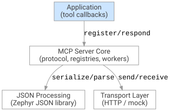

<!-- Copyright 2015-2026 Zephyr Project members and individual contributors. -->
<!-- SPDX-License-Identifier: Apache-2.0 -->
<!-- 中文翻译；编号、导航和明确标注的译注为本地新增。 -->

# 第178章\_MCP服务器

原文：[官方页面](https://docs.zephyrproject.org/latest/services/connectivity/networking/api/mcp.html)。读取日期：2026-10-14；保存的 latest 页面及 HTML 摘要见[来源记录](../SOURCES.md)。

## 1. 概述（Overview）

[模型上下文协议（Model Context Protocol，MCP）](https://modelcontextprotocol.io/specification/2025-11-25)是一项连接 AI 应用与外部数据源、工具的开放标准。它定义基于 JSON-RPC 的通信协议，连接 MCP 客户端（AI 智能体）与 MCP 服务器（能力提供者）。

Zephyr MCP Server 库实现 MCP 规范 `2025-11-25` 版本的服务器角色，使联网的 Zephyr 设备能够公开工具，供 AI 智能体通过 HTTP 发现和调用。该库建立在现有 Zephyr 子系统上：HTTP 服务器库负责传输，JSON 库负责序列化（Serialization）。

> 原文提示：此库标记为[实验性（Experimental）](https://docs.zephyrproject.org/latest/develop/api/api_lifecycle.html#api-lifecycle-experimental)。目前仅实现返回文本的工具服务；更多内容类型、会话管理、SSE 流式传输、授权（Authorization）及其他服务计划在后续版本提供。

## 2. 架构（Architecture）

下面保留官方分层架构 SVG 原图，使用本地相对路径引用；图中文字的中文对应解释紧随其后。



图中各层从应用到传输依次为：

| 原图标签 | 中文及职责 |
| --- | --- |
| Application / (tool callbacks) | 应用层／工具回调：注册工具，实现回调，并通过 [`mcp_server_submit_tool_message()`](P183_MCP完整API参考.md#gacb8dc5cf60b9f4bad1486f89330e62ad) 把工具执行结果提交给核心。 |
| MCP Server Core / (protocol, registries, workers) | MCP 服务器核心／协议、注册表、工作线程：实现 MCP 状态机，管理客户端连接、工具注册表、执行跟踪及可配置的工作线程池。健康监视线程（Health Monitor Thread）检查超时并触发取消。 |
| JSON Processing / (Zephyr JSON library) | JSON 处理／Zephyr JSON 库：序列化传出的响应，反序列化（Deserialization）收到的 JSON-RPC 请求。 |
| Transport Layer / (HTTP / mock) | 传输层／HTTP 或模拟传输：抽象网络协议。内置 HTTP 传输使用 Zephyr HTTP 服务器库；模拟（Mock）传输用于单元测试。 |

原图连接文字 `register/respond` 表示注册／响应，`serialize/parse` 表示序列化／解析，`send/receive` 表示发送／接收。以上中文图解不替换或改写 SVG 原文件。

### 2.1 HTTP 传输与异步响应

原文说明，Zephyr HTTP 服务器在单个线程中运行，跨所有连接一次处理一个请求。资源回调必须返回，服务器才能处理任意客户端的下一个请求。工具执行可能耗时较长，不适合一直阻塞整个服务器，因此 MCP HTTP 传输实现了“先轮询、再回退到 SSE”的流程：

1. 收到 POST 请求后，传输层在内部等待工具结果，最多等待 [`CONFIG_MCP_HTTP_TIMEOUT_MS`](https://docs.zephyrproject.org/latest/kconfig.html#CONFIG_MCP_HTTP_TIMEOUT_MS)，每隔 [`CONFIG_MCP_HTTP_POLL_INTERVAL_MS`](https://docs.zephyrproject.org/latest/kconfig.html#CONFIG_MCP_HTTP_POLL_INTERVAL_MS) 检查一次。
2. 结果在该时间窗口内就绪时，直接以 `application/json` 返回。
3. 如果超时，传输层切换到服务器发送事件（Server-Sent Events，SSE）模式，返回 `text/event-stream` 响应，其中仅包含事件 ID，没有数据。该响应告知客户端结果尚未就绪，应周期性发送 GET 轮询；重试间隔由 [`CONFIG_MCP_HTTP_SSE_RETRY_MS`](https://docs.zephyrproject.org/latest/kconfig.html#CONFIG_MCP_HTTP_SSE_RETRY_MS) 控制。
4. 客户端在后续 GET 中携带 `Last-Event-Id` 请求头。结果就绪时，服务器发送结果并结束该 SSE 流；尚未就绪时，再发送重试响应。

> 原文提示：这不是完整 SSE 流式传输。它只用于交付无法在初始 HTTP 超时窗口内完成的延迟响应；本阶段不支持服务器主动通知和流式工具输出。

## 3. 配置（Configuration）

启用 [`CONFIG_MCP_SERVER`](https://docs.zephyrproject.org/latest/kconfig.html#CONFIG_MCP_SERVER) 使用该库。通过 [`CONFIG_MCP_TRANSPORT_HTTP`](https://docs.zephyrproject.org/latest/kconfig.html#CONFIG_MCP_TRANSPORT_HTTP) 选择默认 HTTP 传输，或通过 [`CONFIG_MCP_TRANSPORT_MOCK`](https://docs.zephyrproject.org/latest/kconfig.html#CONFIG_MCP_TRANSPORT_MOCK) 选择仅用于测试的模拟传输。

最小 `prj.conf`：

```kconfig
CONFIG_NETWORKING=y
CONFIG_NET_TCP=y
CONFIG_HTTP_SERVER=y
CONFIG_MCP_SERVER=y
CONFIG_MCP_TRANSPORT_HTTP=y
```

主要配置分组如下：

| 分组 | 配置与说明 |
| --- | --- |
| 可扩展性（Scalability） | [`CONFIG_MCP_MAX_CLIENTS`](https://docs.zephyrproject.org/latest/kconfig.html#CONFIG_MCP_MAX_CLIENTS)、[`CONFIG_MCP_MAX_CLIENT_REQUESTS`](https://docs.zephyrproject.org/latest/kconfig.html#CONFIG_MCP_MAX_CLIENT_REQUESTS)、[`CONFIG_MCP_MAX_TOOLS`](https://docs.zephyrproject.org/latest/kconfig.html#CONFIG_MCP_MAX_TOOLS)、[`CONFIG_MCP_REQUEST_WORKERS`](https://docs.zephyrproject.org/latest/kconfig.html#CONFIG_MCP_REQUEST_WORKERS)。 |
| 超时（Timeouts） | [`CONFIG_MCP_TOOL_EXEC_TIMEOUT_MS`](https://docs.zephyrproject.org/latest/kconfig.html#CONFIG_MCP_TOOL_EXEC_TIMEOUT_MS)、[`CONFIG_MCP_TOOL_IDLE_TIMEOUT_MS`](https://docs.zephyrproject.org/latest/kconfig.html#CONFIG_MCP_TOOL_IDLE_TIMEOUT_MS)、[`CONFIG_MCP_TOOL_CANCEL_TIMEOUT_MS`](https://docs.zephyrproject.org/latest/kconfig.html#CONFIG_MCP_TOOL_CANCEL_TIMEOUT_MS)、[`CONFIG_MCP_CLIENT_TIMEOUT_MS`](https://docs.zephyrproject.org/latest/kconfig.html#CONFIG_MCP_CLIENT_TIMEOUT_MS)、[`CONFIG_MCP_HTTP_TIMEOUT_MS`](https://docs.zephyrproject.org/latest/kconfig.html#CONFIG_MCP_HTTP_TIMEOUT_MS)。 |
| 内存分配（Memory Allocation） | 默认 [`CONFIG_MCP_ALLOC_SLAB`](https://docs.zephyrproject.org/latest/kconfig.html#CONFIG_MCP_ALLOC_SLAB) 使用预分配内存块（Memory Slabs），提供确定性、无碎片的分配。[`CONFIG_MCP_ALLOC_HEAP`](https://docs.zephyrproject.org/latest/kconfig.html#CONFIG_MCP_ALLOC_HEAP) 使用 `k_malloc`／`k_free` 按需分配，但可能产生内存碎片。 |

## 4. 使用（Usage）

### 4.1 服务器初始化（Server Setup）

官方初始化和启动示例：

```c
#include <zephyr/net/mcp/mcp_server.h>
#include <zephyr/net/mcp/mcp_server_http.h>

static mcp_server_ctx_t server;

int main(void)
{
    server = mcp_server_init();
    mcp_server_http_init(server);

    /* Register tools here */

    mcp_server_start(server);
    mcp_server_http_start(server);
    return 0;
}
```

> 译注：这是接口调用顺序片段。完整应用应检查上下文及各调用结果，例如初始化失败的 `NULL` 和负错误码；不能只看到启动函数被调用就判定网络服务可用。完整示例见[服务器入门示例](P181_MCP服务器入门示例.md)。

### 4.2 注册工具（Tool Registration）

以下保留官方工具回调和定义：

```c
static int my_tool_cb(enum mcp_tool_event_type event,
                      const char *arguments,
                      const char *execution_token)
{
    if (event == MCP_TOOL_CANCEL_REQUEST) {
        struct mcp_tool_message ack = {
            .type = MCP_USR_TOOL_CANCEL_ACK,
        };

        mcp_server_submit_tool_message(server, &ack, execution_token);

        /* Handle cancellation here */
    }

    struct mcp_tool_message resp = {
        .type = MCP_USR_TOOL_RESPONSE,
        .data = "Tool execution result",
        .length = strlen("Tool execution result"),
        .is_error = false,
    };
    return mcp_server_submit_tool_message(server, &resp, execution_token);
}

static const struct mcp_tool_record my_tool = {
    .metadata = {
        .name = "my_tool",
        .input_schema = "{\"type\":\"object\",\"properties\":{}}",
    },
    .callback = my_tool_cb,
};

mcp_server_add_tool(server, &my_tool);
```

`.data` 接受纯文本字符串，服务器会自动封装成符合 MCP 的 `"text"` 内容项。最大长度由 [`CONFIG_MCP_TOOL_RESULT_MAX_LEN`](https://docs.zephyrproject.org/latest/kconfig.html#CONFIG_MCP_TOOL_RESULT_MAX_LEN) 控制。

> 源码译注：原片段在处理 `MCP_TOOL_CANCEL_REQUEST` 后没有直接返回，会继续构造普通响应。当前官方[入门示例](https://github.com/zephyrproject-rtos/zephyr/blob/main/samples/net/mcp/mcp_server_hello_world/src/main.c)在提交取消确认后返回，避免重复提交；当前[核心实现](https://github.com/zephyrproject-rtos/zephyr/blob/main/subsys/net/lib/mcp/mcp_server.c)会清理已取消的执行上下文，并丢弃被取消执行的响应。编写实际工具时，应完成停止工作和取消确认的处理后结束该路径，不把原示意片段当作完整取消模板。

### 4.3 工具回调模式（Tool Callback Patterns）

| 模式 | 行为 |
| --- | --- |
| 阻塞式（Blocking） | 执行时间短的工具直接在工作线程中运行，返回前调用 [`mcp_server_submit_tool_message()`](P183_MCP完整API参考.md#gacb8dc5cf60b9f4bad1486f89330e62ad)。线程栈大小为 [`CONFIG_MCP_REQUEST_WORKER_STACK_SIZE`](https://docs.zephyrproject.org/latest/kconfig.html#CONFIG_MCP_REQUEST_WORKER_STACK_SIZE)。 |
| 异步式（Asynchronous） | 长操作应在专用线程中执行，让回调立即返回，之后凭执行令牌（Execution Token）提交结果。周期性提交 `MCP_USR_TOOL_PING` 可防止健康监视器因执行空闲而取消它。 |
| 取消（Cancellation） | 健康监视器或客户端请求取消时，回调收到 `MCP_TOOL_CANCEL_REQUEST`。工具应停止工作，并提交 `MCP_USR_TOOL_CANCEL_ACK`。 |

> 源码边界：PING 针对空闲检查，不取消总执行时长上限。[核心实现](https://github.com/zephyrproject-rtos/zephyr/blob/main/subsys/net/lib/mcp/mcp_server.c)分别检查开始以来的执行时间和最近消息以来的空闲时间，周期性 PING 不能无限延长 [`CONFIG_MCP_TOOL_EXEC_TIMEOUT_MS`](https://docs.zephyrproject.org/latest/kconfig.html#CONFIG_MCP_TOOL_EXEC_TIMEOUT_MS)。同一工具是否允许并发执行，由应用负责设计，详见官方[回调接口说明](https://github.com/zephyrproject-rtos/zephyr/blob/main/include/zephyr/net/mcp/mcp_server.h)。

### 4.4 移除工具（Tool Removal）

通过 [`mcp_server_remove_tool()`](P183_MCP完整API参考.md#ga1668b35e8e2e32d1e5e4c1d68561c5fe) 在运行时移除工具。如果工具仍在执行，返回 `-EBUSY`，应稍后重试。

## 5. 限制（Limitations）

原文列出尚未实现的 MCP 功能：

- 资源（Resources）、提示模板（Prompts）、采样（Sampling）、根目录声明（Roots）及会话管理（Session Management）。
- 服务器主动通知及流式工具输出。
- 图片和嵌入资源（Embedded Resource）内容类型；目前只支持 `"text"`。
- 完整 SSE 传输；目前只支持延迟响应交付。

## 6. 测试（Testing）

单元测试位于官方[tests/net/lib/mcp/](https://github.com/zephyrproject-rtos/zephyr/blob/main/tests/net/lib/mcp/)。它们使用 [`CONFIG_MCP_TRANSPORT_MOCK`](https://docs.zephyrproject.org/latest/kconfig.html#CONFIG_MCP_TRANSPORT_MOCK)，无需网络栈即可测试协议逻辑。

## 7. 示例与 API 参考

[MCP 服务器入门示例（Hello World）](P181_MCP服务器入门示例.md#mcp-server-hello-world)注册多个工具，包括基于 GPIO 的 LED 控制；它用两个基本工具定义介绍库的用法。

完整接口入口：[MCP 服务器 API](P183_MCP完整API参考.md)。生成 API 参考页单独跟踪，本章不代表它已完成翻译。

> 验证边界：已核对官方页面、原始 SVG、示例及核心源码；没有启动服务器、向模型客户端注册工具、运行工具回调或执行网络测试。页面描述的工具机制是被翻译的产品功能，不是本次翻译过程中执行的操作。


<a id="mcp-server"></a>
<a id="mcp-server-interface"></a>
<a id="contents"></a>
<a id="id2"></a>
<a id="id3"></a>
<a id="id4"></a>
<a id="id5"></a>
<a id="id6"></a>
<a id="id7"></a>
<a id="id8"></a>
<a id="id9"></a>
<a id="id10"></a>
<a id="id11"></a>
<a id="id12"></a>
<a id="id13"></a>
<a id="id14"></a>
<a id="overview"></a>
<a id="architecture"></a>
<a id="id1"></a>
<a id="http-transport-and-asynchronous-responses"></a>
<a id="configuration"></a>
<a id="usage"></a>
<a id="server-setup"></a>
<a id="tool-registration"></a>
<a id="tool-callback-patterns"></a>
<a id="tool-removal"></a>
<a id="limitations"></a>
<a id="testing"></a>
<a id="sample"></a>
<a id="api-reference"></a>

<!-- reading-navigation:start -->

**主线阅读**

[上一篇：Thread协议](P171_Thread协议.md) · [本模块主线目录](../reading/networking.md) · [全部主线](../reading/README.md) · [下一篇：OCPP充电桩协议](P179_OCPP充电桩协议.md)

<details>
<summary>原册编号导航（含扩展参考）</summary>

[上一章](P177_IEEE802154串口无线电.md) · [返回大纲](大纲.md) · [下一章](P179_OCPP充电桩协议.md)

</details>

<!-- reading-navigation:end -->
