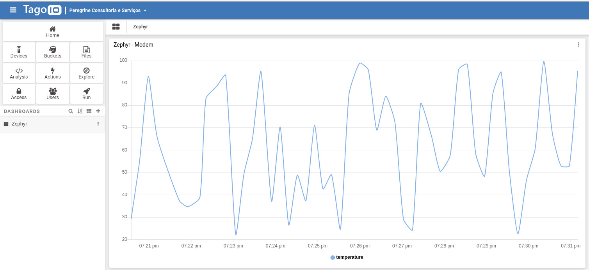
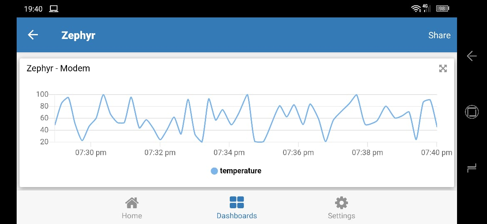

<!-- Copyright 2015-2026 Zephyr Project members and individual contributors. -->
<!-- SPDX-License-Identifier: Apache-2.0 -->
<!-- 中文翻译；编号、导航和明确标注的译注为本地新增。 -->

<a id="tagoio-http-post"></a>

# 第218章\_TagoIO的HTTP上报示例

原文：[官方页面](https://docs.zephyrproject.org/latest/samples/net/cloud/tagoio_http_post/README.html)。读取日期：2026-10-14；保存的latest页面及HTML摘要见[来源记录](../SOURCES.md)。

<a id="overview"></a>

## 218.1 概述（Overview）

<a id="id2"></a>
本示例实现一个HTTP客户端，向[TagoIO](https://tago.io/)[1](#id1)物联网服务平台发送HTTP POST请求。示例发送随机温度值，模拟真实设备，用于加快开发并展示如何发送简单JSON数据。

<a id="id3"></a>
数据发送目标为[TagoIO](https://tago.io/)[1](#id1)服务器，源码位于[samples/net/cloud/tagoio_http_post](https://github.com/zephyrproject-rtos/zephyr/blob/main/samples/net/cloud/tagoio_http_post)。

<a id="requirements"></a>

## 218.2 要求（Requirements）

<a id="id4"></a>
- 一个免费的[TagoIO](https://tago.io/)[1](#id1)账户。
- 能够连接互联网的开发板，参阅[网络功能（Networking）](P001_网络文档入口.md#networking)。
- 原文称提供三种联网方式，但实际列出的项目如下：以太网（Ethernet）使用默认配置；Wi-Fi使用默认配置加Wi-Fi覆盖文件。

<a id="tagoio-device-configuration"></a>

## 218.3 TagoIO设备配置（TagoIO Device Configuration）

<a id="id5"></a>
如果还没有[TagoIO](https://tago.io/)[1](#id1)账户，先创建免费账户。

<a id="id6"></a>
在[TagoIO](https://tago.io/)[1](#id1)添加设备，协议选择自定义HTTP(S)（Custom HTTP(S)），然后显示设备令牌（Device token）。发送数据时，令牌用于识别设备。将令牌填写到[samples/net/cloud/tagoio_http_post/prj.conf](https://github.com/zephyrproject-rtos/zephyr/blob/main/samples/net/cloud/tagoio_http_post/prj.conf)中的`CONFIG_TAGOIO_DEVICE_TOKEN`。

> 译注——通信方式：当前源码的`HTTP_PORT`为80，使用普通TCP套接字，并发送`_ssl: false`请求头，因此这里实际演示的是HTTP；控制台中的“HTTP(S)”协议名称不表示设备已经启用TLS。配置令牌后也应检查实际响应，而不能仅凭连接建立就认为数据已被平台接收。

<a id="building-and-running"></a>

## 218.4 构建与运行（Building and Running）

<a id="ethernet"></a>

### 218.4.1 以太网（Ethernet）

可以在支持以太网的开发板上使用此应用，例如[SAM4E Xplained Pro](https://docs.zephyrproject.org/latest/boards/atmel/sam/sam4e_xpro/doc/index.html#sam4e_xpro)、[SAM V71(B) Xplained Ultra](https://docs.zephyrproject.org/latest/boards/atmel/sam/sam_v71_xult/doc/index.html#sam_v71_xult)、[FRDM-K64F](https://docs.zephyrproject.org/latest/boards/nxp/frdm_k64f/doc/index.html#frdm_k64f)、[Nucleo F767ZI](https://docs.zephyrproject.org/latest/boards/st/nucleo_f767zi/doc/index.html#nucleo_f767zi)等。选择一块板，用最小配置构建`tagoio-http-client`示例：

```sh
west build -b [sam4e_xpro | sam_v71_xult/samv71q21 | frdm_k64f | nucleo_f767zi] samples/net/cloud/tagoio_http_post
west flash
```

<a id="wifi"></a>

### 218.4.2 Wi-Fi（WIFI）

启用Wi-Fi需要内置Wi-Fi的开发板，例如[Disco L475 IOT01 (B-L475E-IOT01A)](https://docs.zephyrproject.org/latest/boards/st/disco_l475_iot1/doc/index.html#disco_l475_iot1)，或添加[ESP-8266模块](https://docs.zephyrproject.org/latest/boards/shields/esp_8266/doc/index.html#module-esp-8266)、[Inventek es-WIFI扩展板](https://docs.zephyrproject.org/latest/boards/shields/inventek_eswifi/doc/index.html#inventek-eswifi-shield)。还须在[samples/net/cloud/tagoio_http_post/overlay-wifi.conf](https://github.com/zephyrproject-rtos/zephyr/blob/main/samples/net/cloud/tagoio_http_post/overlay-wifi.conf)中，将`CONFIG_TAGOIO_HTTP_WIFI_SSID`设置为网络名称（SSID），将`CONFIG_TAGOIO_HTTP_WIFI_PSK`设置为对应密码。

```sh
west build -b disco_l475_iot1 samples/net/cloud/tagoio_http_post -- -DEXTRA_CONF_FILE=overlay-wifi.conf
west flash
```

使用扩展板（Shield）时：

```sh
west build -b [sam_v71_xult/samv71q21 | frdm_k64f | nucleo_f767zi] --shield [esp_8266_arduino | inventek_eswifi_arduino_uart] samples/net/cloud/tagoio_http_post -- -DEXTRA_CONF_FILE=overlay-wifi.conf
west flash
```

> 译注——候选写法：原命令中的`[选项1 | 选项2]`表示择一选择，不是可以直接输入的Shell语法；应去掉方括号、竖线及未选项。例如，选择Nucleo F767ZI的以太网方案时，构建部分写为`west build -b nucleo_f767zi samples/net/cloud/tagoio_http_post`。选择Wi-Fi扩展板时，开发板与Shield也分别只填一个匹配实际硬件的名称。本文保留原命令，但未执行构建或烧录。

<a id="visualizing-tagoio-dashboard"></a>

## 218.5 查看TagoIO仪表盘（Visualizing TagoIO dashboard）

控制台出现日志后，可以在TagoIO创建仪表盘（Dashboard）来显示数据：

1. 进入TagoIO网页控制台。
2. 创建普通类型（Normal）的仪表盘，为它命名并继续。
3. 添加折线图（Line plot graph）。界面会显示你的设备，并自动选择`temperature`温度变量。
4. 保存，即可查看结果。



还可以在手机或平板上体验TagoIO移动应用：在应用商店搜索TagoIO，安装并登录。



<a id="id7"></a>
更多信息见[TagoIO](https://tago.io/)[1](#id1)和<a id="id9"></a>[TagoIO文档](https://docs.tago.io)[2](#id8)。

> 译注——原图与数据：以上两张JPEG均直接下载自本页官方资源，未重绘、裁剪或修改。截图展示的是上游当时的桌面和移动界面，温度值来自示例生成的随机数据，不表示真实传感器测量结果。

<a id="references"></a>

## 218.6 参考资料（References）

<a id="id1"></a>
[1] [TagoIO](https://tago.io/)。返回引用：[1](#id2)、[2](#id3)、[3](#id4)、[4](#id5)、[5](#id6)、[6](#id7)。

<a id="id8"></a>
[2] [TagoIO文档（TagoIO Documentation）](https://docs.tago.io)。[返回引用](#id9)。

<a id="see-also"></a>

## 218.7 另请参阅（See also）

[BSD套接字兼容API（BSD Sockets compatible API）](https://docs.zephyrproject.org/latest/doxygen/html/group__bsd__sockets.html)、[HTTP客户端API（HTTP client API）](https://docs.zephyrproject.org/latest/doxygen/html/group__http__client.html)、[DNS解析库（DNS Resolve Library）](https://docs.zephyrproject.org/latest/doxygen/html/group__dns__resolve.html)、[TLS凭据管理（TLS credentials management）](https://docs.zephyrproject.org/latest/doxygen/html/group__tls__credentials.html)。


> 译注——实现依据：[samples/net/cloud/tagoio_http_post/Kconfig](https://raw.githubusercontent.com/zephyrproject-rtos/zephyr/main/samples/net/cloud/tagoio_http_post/Kconfig)、[samples/net/cloud/tagoio_http_post/src/sockets.c](https://raw.githubusercontent.com/zephyrproject-rtos/zephyr/main/samples/net/cloud/tagoio_http_post/src/sockets.c)、[samples/net/cloud/tagoio_http_post/src/main.c](https://raw.githubusercontent.com/zephyrproject-rtos/zephyr/main/samples/net/cloud/tagoio_http_post/src/main.c)。以上为本次核对的官方来源；分支内容可能继续变化，保存快照的摘要见[来源记录](../SOURCES.md)。下方本仓库相对链接用于版本对照。

对应官方文档源码：[samples/net/cloud/tagoio_http_post/README.rst](https://raw.githubusercontent.com/zephyrproject-rtos/zephyr/main/samples/net/cloud/tagoio_http_post/README.rst)。

> 译注——源码跟踪：本仓库的[对应源码](../../../samples/net/cloud/tagoio_http_post/README.rst)可用于对照，版本可能与网页不同。源码跟踪和实现依据不绑定作者机器目录；项目环境与实验路线另见[项目实验补充](../../zephyr_project_notes/README.md)。

> 译注——示例实现：仓库内的[main.c](../../../samples/net/cloud/tagoio_http_post/src/main.c)用于实现跟踪；它可能与上方网页及main分支版本不同。本文没有执行固件构建、烧录或接线实验。


[上一章](P217_Azure物联网MQTT示例.md) · [返回大纲](大纲.md) · [下一章](P219_MIDI2网络传输示例.md)
