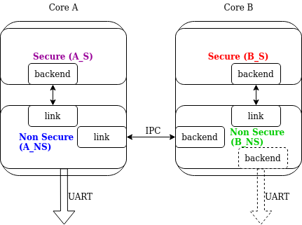
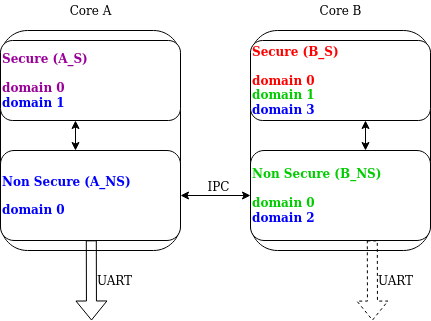

<!-- Copyright 2015-2026 Zephyr Project members and individual contributors. -->
<!-- SPDX-License-Identifier: Apache-2.0 -->
<!-- 中文翻译；阅读编号、导航和译注为本地新增。 -->

<a id="logging-api"></a>

# 第1章\_日志

原文：[Logging](https://docs.zephyrproject.org/latest/services/logging/index.html)。读取日期：2026-10-12，`latest`。

**日志（Logging）**的**应用程序编程接口（Application Programming Interface，API）**为开发者输出的消息提供统一接口。消息先经过前端，再由活动后端处理。前端负责即时过滤与排队，必须尽量快；后端可以稍后运行，花更多时间格式化并发送到**通用异步收发器（Universal Asynchronous Receiver-Transmitter，UART）**、**SEGGER实时传输（Real Time Transfer，RTT）**、**低功耗蓝牙（Bluetooth Low Energy，BLE）**等目的地。需要时可以使用自定义前端和后端。

## 1.1\_能力、级别与消息来源

日志系统提供以下能力：

- 延迟处理，把耗时操作移到已知上下文，缩短调用处记录消息的时间。
- 最多九个后端，以及可与标准后端共存的自定义前端。
- 模块级编译期过滤、各后端独立的运行时过滤，以及模块实例级过滤。
- 使用用户提供函数生成三十二位或六十四位时间戳。
- 专门的数据转储、临时字符串处理接口，以及参数中临时字符串的内置复制。
- panic 模式下阻塞、同步处理。
- 将 `printk()` 重定向到日志系统。
- 多域、多处理器系统支持。
- 浮点数和 `long long` 输出。
- 限速日志宏，避免高频消息淹没日志。

编译期可按模块和严重性移除日志，减少镜像体积与执行时间。也可把日志编译进镜像，再用运行时 API 过滤；每个后端、每个来源独立设置。来源可以是模块，也可以是模块的某个实例。

严重性分为错误、警告、信息、调试四级，对应 `ERR`、`WRN`、`INF`、`DBG`。接口定义在 [include/zephyr/logging/log.h](https://github.com/zephyrproject-rtos/zephyr/blob/main/include/zephyr/logging/log.h)：

| 宏类别 | 用途与例子 |
| --- | --- |
| `LOG_X` | 类似 printf 的普通消息，如 `LOG_ERR` |
| `LOG_HEXDUMP_X` | 转储数据，如 `LOG_HEXDUMP_WRN` |
| `LOG_INST_X` | 某实例的普通消息，如 `LOG_INST_INF` |
| `LOG_INST_HEXDUMP_X` | 某实例的数据转储，如 `LOG_INST_HEXDUMP_DBG` |
| `LOG_WRN_ONCE` | 只关心第一次发生时的警告 |
| `LOG_X_RATELIMIT`、`LOG_HEXDUMP_X_RATELIMIT` | 使用默认间隔的限速普通消息、数据转储 |
| `LOG_X_RATELIMIT_RATE`、`LOG_HEXDUMP_X_RATELIMIT_RATE` | 显式指定毫秒间隔的限速消息 |

配置分为模块配置与全局配置。全局启用时，模块默认都启用，但可局部禁用，并可设置自己的 `LOG_LEVEL`。没有全局覆盖时遵循模块级别；全局覆盖只能增加详细程度，不能降低已设置的更高详细级别。也可规定全局最多编译到哪一级：例如最大级别为 info，则保留错误、警告、信息，排除调试。

每个模块必须有唯一名称并注册；多文件模块只在一个文件注册，其他文件也需声明模块名称。默认前端线程安全，尽量缩短调用时间：通常只创建消息并排队，不立即格式化或访问输出通道。标准消息保存格式信息和参数，hexdump 消息保存复制的数据及字符串；两者都有来源、域、时间戳和级别。

## 1.2\_全局Kconfig选项

配置见 [subsys/logging/Kconfig](https://github.com/zephyrproject-rtos/zephyr/blob/main/subsys/logging/Kconfig)。`CONFIG_LOG` 为总开关。

### 1.2.1\_运行模式与过滤

| 选项 | 作用 |
| --- | --- |
| `CONFIG_LOG_MODE_DEFERRED` | 延迟模式 |
| `CONFIG_LOG_MODE_IMMEDIATE` | 立即、同步模式 |
| `CONFIG_LOG_MODE_MINIMAL` | 最小占用模式 |
| `CONFIG_LOG_RUNTIME_FILTERING` | 允许运行时重新配置过滤 |
| `CONFIG_LOG_DEFAULT_LEVEL` | 模块没有自定级别时的默认值 |
| `CONFIG_LOG_OVERRIDE_LEVEL` | 模块未设级别或低于此值时，覆盖其级别 |
| `CONFIG_LOG_MAX_LEVEL` | 编译保留的最大级别，即最低严重性的详细程度上限 |

### 1.2.2\_处理行为

| 选项 | 作用 |
| --- | --- |
| `CONFIG_LOG_MODE_OVERFLOW` | 无法分配新消息时丢弃最老消息 |
| `CONFIG_LOG_BLOCK_IN_THREAD` | 线程上下文分配不到消息时可阻塞，直到成功或达到 `CONFIG_LOG_BLOCK_IN_THREAD_TIMEOUT_MS` |
| `CONFIG_LOG_PRINTK` | 把 `printk()` 重定向到日志 |
| `CONFIG_LOG_PROCESS_TRIGGER_THRESHOLD` | 缓冲消息数达到阈值时唤醒指定处理线程；线程由 `log_thread_set()` 指定，启用内部处理线程时则作用于内部线程 |
| `CONFIG_LOG_PROCESS_THREAD` | 创建内部日志处理线程 |
| `CONFIG_LOG_PROCESS_THREAD_STARTUP_DELAY_MS` | 日志线程启动延迟，毫秒 |
| `CONFIG_LOG_BUFFER_SIZE` | 循环包缓冲区的字节数 |
| `CONFIG_LOG_FRONTEND` | 将日志传给自定义前端 |
| `CONFIG_LOG_FRONTEND_ONLY` | 只使用自定义前端，不使用后端 |
| `CONFIG_LOG_FRONTEND_OPT_API` | 为常见简单消息启用优化的可选 API |
| `CONFIG_LOG_CUSTOM_HEADER` | 向 `log.h` 注入应用提供的头文件 |
| `CONFIG_LOG_TIMESTAMP_64BIT` | 使用六十四位时间戳 |
| `CONFIG_LOG_SIMPLE_MSG_OPTIMIZE` | 优化简单消息体积和性能，仅三十二位架构可用 |

### 1.2.3\_格式与后端

`CONFIG_LOG_FUNC_NAME_PREFIX_ERR`、`CONFIG_LOG_FUNC_NAME_PREFIX_WRN`、`CONFIG_LOG_FUNC_NAME_PREFIX_INF`、`CONFIG_LOG_FUNC_NAME_PREFIX_DBG` 分别给对应级别的普通日志加函数名前缀，不作用于 hexdump。

| 选项 | 作用 |
| --- | --- |
| `CONFIG_LOG_BACKEND_SHOW_TIMESTAMP` | 输出时间戳 |
| `CONFIG_LOG_BACKEND_SHOW_LEVEL` | 输出级别 |
| `CONFIG_LOG_BACKEND_SHOW_COLOR` | 错误用红色、警告用黄色 |
| `CONFIG_LOG_BACKEND_FORMAT_TIMESTAMP` | 按原文所列 `hh:mm:ss:mmm,uuu` 格式显示时间，否则显示原始值 |
| `CONFIG_LOG_BACKEND_UART` | 启用内置 UART 后端 |
| `CONFIG_LOG_BACKEND_NET` | 启用内置网络后端，向服务器发送 syslog |

> 译注：原文格式说明中的秒与毫秒分隔符写作冒号，后面的实际输出示例使用句点 `hh:mm:ss.mmm,uuu`；两处原样保留，不应据前者硬编码日志解析器。

## 1.3\_模块和实例中的日志

> 译注：模块注册建立消息来源，实例注册进一步区分同一模块的多个对象；最后一节说明如何自行驱动延迟处理。

### 1.3.1\_模块注册

用 `LOG_MODULE_REGISTER` 指定唯一模块名。第二个参数可选，表示编译期日志级别；省略则使用 `CONFIG_LOG_DEFAULT_LEVEL`：

```c
#include <zephyr/logging/log.h>
LOG_MODULE_REGISTER(foo, CONFIG_FOO_LOG_LEVEL);
```

多文件模块中恰好一个文件调用注册宏，其余文件用 `LOG_MODULE_DECLARE` 声明所属模块，同样可以指定级别：

```c
#include <zephyr/logging/log.h>
/* In all files comprising the module but one */
LOG_MODULE_DECLARE(foo, CONFIG_FOO_LOG_LEVEL);
```

头文件实现的函数需要在函数体中、日志调用之前使用声明宏：

```c
#include <zephyr/logging/log.h>

static inline void foo(void)
{
     LOG_MODULE_DECLARE(foo, CONFIG_FOO_LOG_LEVEL);

     LOG_INF("foo");
}
```

可以使用 [Kconfig.template.log_config](https://github.com/zephyrproject-rtos/zephyr/blob/main/subsys/logging/Kconfig.template.log_config) 生成模块级别配置，下面会生成 `CONFIG_FOO_LOG_LEVEL`：

```kconfig
module = FOO
module-str = foo
source "subsys/logging/Kconfig.template.log_config"
```

### 1.3.2\_实例级过滤

多实例模块广泛使用时，整个模块开启日志可能产生过多输出。实例级过滤允许只启用特定实例。先用 `LOG_INSTANCE_PTR_DECLARE` 在实例结构中声明日志结构指针：

```c
#include <zephyr/logging/log_instance.h>

struct foo_object {
     LOG_INSTANCE_PTR_DECLARE(log);
     uint32_t id;
}
```

模块还应提供实例化宏，在其中注册日志实例，并初始化对象内的指针：

```c
#define FOO_OBJECT_DEFINE(_name)                             \
     LOG_INSTANCE_REGISTER(foo, _name, CONFIG_FOO_LOG_LEVEL) \
     struct foo_object _name = {                             \
             LOG_INSTANCE_PTR_INIT(log, foo, _name)          \
     }
```

禁用日志时，不创建日志实例或其指针。源文件中使用实例日志 API 前，通过 `LOG_LEVEL_SET` 设置编译期级别：

```c
LOG_LEVEL_SET(CONFIG_FOO_LOG_LEVEL);

void foo_init(foo_object *f)
{
     LOG_INST_INF(f->log, "Initialized.");
}
```

头文件中同样设置：

```c
static inline void foo_init(foo_object *f)
{
     LOG_LEVEL_SET(CONFIG_FOO_LOG_LEVEL);

     LOG_INST_INF(f->log, "Initialized.");
}
```

> 译注：原例的 `struct foo_object` 声明末尾缺少分号；后两个函数把 `foo_object` 当成类型名，但前文未提供 typedef。实际使用需补齐分号，并使用 `struct foo_object *` 或提供相应 typedef。这里只保留原文片段，不把它们当作独立可编译文件。

### 1.3.3\_控制日志处理

延迟模式默认由自动启动的内部任务处理日志；关闭多线程时可能没有该任务。原文还称可通过关闭 `CONFIG_LOG_PROCESS_TRIGGER_THRESHOLD` 禁用它，再使用 [log_ctrl.h](https://github.com/zephyrproject-rtos/zephyr/blob/main/include/zephyr/logging/log_ctrl.h) 控制。使用前必须初始化，也可以提供返回时间戳的函数；未提供时使用 `k_cycle_get` 或 `k_cycle_get_32`。

`log_process()` 处理一条待处理消息，若仍有消息则返回 true。推荐使用 `LOG_INIT`、`LOG_PROCESS` 包装宏，以兼容全局禁用日志的情况。简单无限循环示例：

```c
#include <zephyr/logging/log_ctrl.h>

int main(void)
{
     LOG_INIT();
     /* If multithreading is enabled provide thread id to the logging. */
     log_thread_set(k_current_get());

     while (1) {
             if (LOG_PROCESS() == false) {
                     /* sleep */
             }
     }
}
```

内部或应用线程处理日志时，都可配置达到一定消息数后唤醒线程，见 `CONFIG_LOG_PROCESS_TRIGGER_THRESHOLD`。

> 译注：关闭内部日志线程的配置是 `CONFIG_LOG_PROCESS_THREAD`。本地 Kconfig 说明阈值设为 0 仅关闭“达到消息数阈值就唤醒”的功能，不会自行删除内部线程。原例 `log_thread_set()` 也不适用于内部线程已启用的情况；自行处理日志时应核对所用配置。

## 1.4\_限速日志

限速宏使相同调用点的日志不会比指定间隔更频繁输出，类似 Linux 的 `printk_ratelimited`。默认间隔来自 `CONFIG_LOG_RATELIMIT_INTERVAL_MS`，原文默认值为 5000 毫秒。显式间隔宏以毫秒参数指定最小间隔。每个宏调用位置都有独立状态。

| 级别 | 默认间隔普通消息 | 显式间隔普通消息 | 默认间隔数据转储 | 显式间隔数据转储 |
| --- | --- | --- | --- | --- |
| 错误 | `LOG_ERR_RATELIMIT` | `LOG_ERR_RATELIMIT_RATE` | `LOG_HEXDUMP_ERR_RATELIMIT` | `LOG_HEXDUMP_ERR_RATELIMIT_RATE` |
| 警告 | `LOG_WRN_RATELIMIT` | `LOG_WRN_RATELIMIT_RATE` | `LOG_HEXDUMP_WRN_RATELIMIT` | `LOG_HEXDUMP_WRN_RATELIMIT_RATE` |
| 信息 | `LOG_INF_RATELIMIT` | `LOG_INF_RATELIMIT_RATE` | `LOG_HEXDUMP_INF_RATELIMIT` | `LOG_HEXDUMP_INF_RATELIMIT_RATE` |
| 调试 | `LOG_DBG_RATELIMIT` | `LOG_DBG_RATELIMIT_RATE` | `LOG_HEXDUMP_DBG_RATELIMIT` | `LOG_HEXDUMP_DBG_RATELIMIT_RATE` |

使用示例：

```c
#include <zephyr/logging/log.h>
#include <zephyr/kernel.h>

LOG_MODULE_REGISTER(my_module, CONFIG_LOG_DEFAULT_LEVEL);

void process_data(void)
{
    /* Convenience macros using default rate (CONFIG_LOG_RATELIMIT_INTERVAL_MS) */
    LOG_WRN_RATELIMIT("Data processing warning: %d", error_code);
    LOG_ERR_RATELIMIT("Critical error occurred: %s", error_msg);
    LOG_INF_RATELIMIT("Processing status: %d items", item_count);
    LOG_HEXDUMP_WRN_RATELIMIT(data_buffer, data_len, "Data buffer:");

    /* Explicit rate macros with custom intervals */
    LOG_WRN_RATELIMIT_RATE(1000, "Fast rate warning: %d", error_code);
    LOG_ERR_RATELIMIT_RATE(30000, "Slow rate error: %s", error_msg);
    LOG_INF_RATELIMIT_RATE(2000, "Custom rate status: %d items", item_count);
    LOG_HEXDUMP_ERR_RATELIMIT_RATE(5000, data_buffer, data_len, "Error data:");
}
```

适用情况包括反复发生但不需要持续刷屏的错误、紧密循环或高频回调中的状态更新、可能淹没系统的调试信息，以及反复失败的网络或 I/O 操作。

`CONFIG_LOG_RATELIMIT` 是总开关。关闭时由 `CONFIG_LOG_RATELIMIT_FALLBACK` 选择回退：`CONFIG_LOG_RATELIMIT_FALLBACK_LOG` 使这些宏按普通日志执行；默认的 `CONFIG_LOG_RATELIMIT_FALLBACK_DROP` 则使其成为空操作。这决定限速不可用时总是输出还是完全不输出。

限速通过静态变量与 `k_uptime_get_32()` 跟踪各调用点上一次记录时间。

> 译注：上例中的 `error_code`、`error_msg`、`item_count`、`data_buffer`、`data_len` 是应用应提供的变量，不是宏自动生成的数据。

## 1.5\_Panic与printk重定向

发生错误后，系统可能无法再依赖调度器或中断，此时不能继续依赖延迟处理，应调用 `log_panic()`。它先通知所有活动后端进入 panic，随后输出完所有缓冲消息；之后的日志都以阻塞方式处理。

日志和 `printk()` 通常争用同一输出。如果输出不支持抢占，或者两类字符交错，可能破坏结果。启用默认开启的 `CONFIG_LOG_PRINTK` 后，`printk()` 被视为级别 0 的日志，不受普通级别过滤关闭；输出由日志统一管理，避免交错。但在延迟模式下，`printk()` 也要等日志线程处理，行为会由立即输出变为延迟输出。

## 1.6\_内部结构与前端

日志由前端、核心和后端组成，来源是模块或模块实例。默认前端在 `LOG_INF` 等 API 调用时执行编译期与运行时过滤、分配缓冲、构造并提交消息。API 可在中断中调用，因此前端尽量优化记录速度。

### 1.6.1\_消息布局

日志消息包含来源、域、级别描述、时间戳、[Cbprintf 打包](P008_格式化输出.md)信息及可选数据。消息是连续内存块，由[多生产者单消费者包缓冲区](../kernel/P060_多生产者单消费者包缓冲区.md)分配，便于整体复制以供离线处理。释放必须顺序进行；后端同步处理，若要延迟处理必须自行复制。

| 区域 | 内容 |
| --- | --- |
| 消息头前四字节 | 两位 MPSC 包缓冲区头；一位追踪/日志标志；三位域 ID；三位级别；十一位 Cbprintf 包长度；十二位数据长度 |
| 消息头后续 | 来源描述符指针；三十二或六十四位时间戳；可选线程 ID 指针；可选八位核心 ID；可选填充 |
| Cbprintf 包，可选 | 头部、参数、附加字符串 |
| Hexdump 数据，可选 | 待转储的字节 |
| 对齐填充，可选 | 满足布局对齐 |

原文四条布局注释：来源描述符与时间戳可能按大小交换顺序以减少填充；线程 ID 仅在 `CONFIG_LOG_THREAD_ID_PREFIX` 启用时出现；核心 ID 仅在 `CONFIG_LOG_CORE_ID_PREFIX` 启用时出现；填充可能用于 Cbprintf 包对齐。

### 1.6.2\_分配失败与运行时过滤

产生消息速度超过处理能力时可能分配失败。不允许覆盖时丢弃新日志；启用 `CONFIG_LOG_MODE_OVERFLOW` 时释放最老待处理消息，直到可分配新消息。覆盖会降低性能，建议调整缓冲大小和启用日志量，减少丢弃。

启用运行时过滤后，每个来源在 **随机存取存储器（Random Access Memory，RAM）** 中有一个三十二位过滤结构，划分为十个三位槽。槽 1–9 分别保存后端级别，槽 0（位 0–2）是各后端最大值的汇总，决定是否值得创建消息；核心处理时再检查各后端槽。运行时过滤掉的日志仍已编译进镜像，因此比编译期过滤占用更多空间。

原例中后端1只收错误、后端2收到 info，其余不用，则汇总为 info：

| 槽0：汇总 | 槽1 | 槽2 | 槽3 | … | 槽9 |
| --- | --- | --- | --- | --- | --- |
| INF | ERR | INF | OFF | … | OFF |

### 1.6.3\_自定义前端与字符串

`CONFIG_LOG_FRONTEND` 将消息传给 [log_frontend.h](https://github.com/zephyrproject-rtos/zephyr/blob/main/include/zephyr/logging/log_frontend.h) 声明的函数。启用 `CONFIG_LOG_FRONTEND_ONLY` 时不创建普通日志消息，也不调用后端；否则自定义前端可与后端共存。

需要在宏层面重定向时，可用 `CONFIG_LOG_CUSTOM_HEADER`，把应用提供的 `zephyr_custom_log.h` 注入到 `log.h` 末尾。Arm Coresight STM 前端见[多域 STM 日志](P012_CoreSight系统跟踪日志.md)。字符串参数由 Cbprintf 打包机制处理，限制和建议见[格式化输出](P008_格式化输出.md)。

## 1.7\_多域日志

复杂系统可能由多个独立二进制域组成，例如多核 **片上系统（System on Chip，SoC）** 的各核心，或 Arm TrustZone 核心的安全/非安全镜像。可让各域独立输出，但每个域都需要 UART 等后端，独立输出也不便使用和扩展；另一种方案是把所有消息汇集到根域，像单域一样处理。

跨域连接一端是后端，另一端是日志链路（Log link）。链路接收另一域的消息、创建包括远端数据在内的本地副本并排队；链路与配套后端共同支持消息传递、过滤配置、来源名称查询等控制。

### 1.7.1\_三种域

终端域具有日志核心和跨域后端，也可并行使用其他后端。中继域连接一个或多个下游域，没有面向用户的输出后端，而通过跨域后端连接另一个中继或根域。根域具有一个或多个链路，并有面向用户的输出后端。



例如 A、B 两个带 TrustZone 的 Cortex-M33 核心，共有 A_S、A_NS、B_S、B_NS 四个域。以 A_NS 为根域，它连接 A_S 和 B_NS；B_NS 再连接 B_S，并通过后端向 A_NS 发送。一个链路因此可以承载多个域。各处仍使用标准日志子系统，所以也可以同时保留其他后端，图中 B_NS 的虚线 UART 就是示例。

### 1.7.2\_域ID

消息通过头部的 `source_id` 与 `domain_id` 标识来源。域 ID 是相对的：各域创建消息时设为 0，跨越链路时加上链路偏移。初始化遍历已注册链路，第一条偏移为 1，之后每条偏移等于前一条偏移加前一链路承载的域数量。



例如 B_S 创建消息时 ID 为 0，经 B_NS—B_S 链路加 1 后为 1，传给 A_NS 后再经 A_NS—B_NS 链路加 2，最终为 3，唯一标识原始来源。

### 1.7.3\_跨域内容与过滤

各域通常不能直接访问彼此地址空间，因此后端可能在跨域发送前进行部分处理，例如复制只读字符串，把字符串包转为完全自包含形式。不同域的时间戳频率和偏移也可能不同；日志系统不会自行转换。

单域中每个来源有各后端的过滤变量；多域中消息源不知道根域有多少后端，因此到根域沿途的每个域都需要该来源的过滤状态。远端来源数量在编译期未知，需动态分配，每个来源一个字。根域后端修改远端模块级别时，先更新本地过滤，再检查本地各后端汇总最大值；若汇总变化，通知远端域。这样保持与单域相同的过滤效果。

### 1.7.4\_消息顺序

日志系统不负责跨域时间戳同步。不同时间源时，按进入根域缓冲区的顺序处理。

若各域共用时间源，或有带外机制重算时间戳，有两个选择：仍按到达顺序处理，主机随后按产生时间排序；或者给各链路独立缓冲，处理时比较每个队首，优先处理最老消息。后者可维持时间顺序，但独立缓冲使内存利用不如共享缓冲，并增加处理延迟，见 `CONFIG_LOG_PROCESSING_LATENCY_US`。

## 1.8\_日志后端

用 `LOG_BACKEND_DEFINE` 在专用段创建后端实例，可以通过 `log_backend_enable()` 动态启用，也可动态禁用。运行时过滤开启时，用 `log_filter_set()` 改变某后端对某模块的过滤；模块由来源 ID 与域 ID 标识。已知名称时，可以遍历注册来源取得 ID。

系统最多支持九个并行后端，处理阶段将消息交给各后端。进入 panic 时，通过 `log_backend_panic()` 通知后端；后端应转为同步、无中断依赖的模式，不支持时应停止自身。有时还通过 `log_backend_dropped()` 通知丢弃数量。消息处理接口与版本有关。

`log_backend_msg_process()` 统一处理普通和 hexdump 消息，也统一用于延迟及立即模式。普通消息的格式参数与 hexdump 数据占据相应消息数据位置。

格式化辅助函数见 [log_output.h](https://github.com/zephyrproject-rtos/zephyr/blob/main/include/zephyr/logging/log_output.h)。使用 `log_output_msg_process()` 的输出示例：

```text
[00:00:00.000,274] <info> sample_instance.inst1: logging message
```

## 1.9\_字典日志

字典日志输出二进制数据，而不是直接可读文本。格式参数按本机存储形式编码；静态字符串，包括格式串与字符串参数，用 **可执行与可链接格式（Executable and Linkable Format，ELF）** 中的引用代替内容。构建时生成的字典把引用映射回字符串，离线解析器据此还原。在某些场景下更紧凑，但使用不如文本直观，需要解析器。

Python 的 `struct` 模块不支持 `long double`，因此这类日志不会显示正确值。

### 1.9.1\_配置

| 配置 | 作用 |
| --- | --- |
| `CONFIG_LOG_DICTIONARY_SUPPORT` | 启用字典支持，应由需要它的后端选中 |
| `CONFIG_LOG_BACKEND_UART_OUTPUT_DICTIONARY_HEX` | UART 输出十六进制字符，便于终端手动收集 |
| `CONFIG_LOG_BACKEND_UART_OUTPUT_DICTIONARY_BIN` | UART 输出原始二进制 |
| `CONFIG_LOG_BACKEND_RTT` | 启用 RTT 后端 |
| `CONFIG_LOG_BACKEND_RTT_OUTPUT_DICTIONARY` | RTT 字典输出，与 `CONFIG_USE_SEGGER_RTT` 一起使用 |
| `CONFIG_LOG_BACKEND_RTT_OUTPUT_DICTIONARY_HEX` | RTT 字典数据使用十六进制字符输出 |

相关后端启用后，构建目录生成 `log_dictionary.json`。它只适用于同一次构建，不能拿来解析其他构建的日志。

### 1.9.2\_离线解析

解析已收集的日志：

```shell
./scripts/logging/dictionary/log_parser.py <build dir>/log_dictionary.json <log data file>
```

第一个参数为 JSON 数据库完整路径，第二个为日志文件。若日志是十六进制字符，例如启用了 UART 的 HEX 输出，在末尾增加 `--hex`，先转换为二进制再解析。

### 1.9.3\_实时解析

实时解析器持续接收运行中设备的数据并解码，仅支持原始二进制字典输出，不支持十六进制字符编码。共有三种输入方式。

串口 UART：

```shell
./scripts/logging/dictionary/live_log_parser.py <build dir>/log_dictionary.json serial <port> <baudrate>
```

例如 `/dev/ttyACM0`，115200 波特率：

```shell
./scripts/logging/dictionary/live_log_parser.py build/zephyr/log_dictionary.json serial /dev/ttyACM0 115200
```

J-Link RTT：

```shell
./scripts/logging/dictionary/live_log_parser.py <build dir>/log_dictionary.json jlink-rtt <device_name>
```

例如 nRF5340：

```shell
./scripts/logging/dictionary/live_log_parser.py build/zephyr/log_dictionary.json jlink-rtt nrf5340_xxaa_app
```

J-Link RTT 模式需要 Python 包 `pylink-square`，原文安装命令为 `pip install pylink-square`。可用 `--channel` 选择 RTT 通道，默认 0；`--speed` 设置连接速度；`--block-address` 指定十六进制 RTT 控制块地址。

文件或标准输入：

```shell
./scripts/logging/dictionary/live_log_parser.py <build dir>/log_dictionary.json file <filepath>
```

省略 `<filepath>` 时从 stdin 读取，可将二进制数据通过管道传入。更多用法见[字典日志示例](P069_字典日志示例.md#logging-dictionary)。

## 1.10\_建议与限制

`CONFIG_LOG_SPEED` 可稍微加快延迟日志，以少量额外内存为代价。`%s` 指向常量字符串时建议转为 `const char *`，指向临时字符串时建议转为 `char *`。字符指针用于 `%p` 时必须转为非字符指针，例如 `void *`：

```c
LOG_WRN("%s", str);
LOG_WRN("%p", (void *)str);
```

原文列出的限制是：日志不支持带宽度的字符串格式，例如 `%.*s`、`%8s`，因为构造消息时只根据参数类型，不扫描格式串。

延迟模式下，如果启用 `CONFIG_LOG_THREAD_ID_PREFIX=y` 与 `CONFIG_THREAD_NAME=y` 在消息前加线程名，格式化时相应 `k_thread` 必须仍然有效。若线程结构通过 `k_malloc()` 或 `malloc()` 动态分配，线程记录消息后退出并释放结构，延迟处理会访问已释放对象。解决方法之一是在释放前调用 `log_flush()`：

```c
struct k_thread *thread = k_malloc(sizeof(*thread)); /* struct allocated dynamically */
k_thread_create(thread, ...);
k_thread_name_set(thread, "foobar");

/* Thread calls LOG_*(...) */

k_thread_join(thread, K_FOREVER);
log_flush();  /* flush log buffer before freeing the struct k_thread */
k_free(thread); /* avoid a potential use-after-free scenario if deferred logging is used */
```

> 译注：上例省略了线程创建参数；`log_flush()` 应在确认相关线程已经停止、不会再产生引用该对象的新消息后使用。不能把“已经调用一次 flush”当成任何并发释放场景都安全。

## 1.11\_基准与栈开销

> 译注：以下数字用于保留原文的模式对比，不能替代目标平台上的性能与栈测量。

### 1.11.1\_原文基准

以下是 [tests/subsys/logging/log_benchmark](https://github.com/zephyrproject-rtos/zephyr/blob/main/tests/subsys/logging/log_benchmark) 在 `qemu_x86` 上的粗略对比，原文用于提供概览：

| 项目 | 原文结果 |
| --- | --- |
| 内核日志 | 7 µs（启用 `CONFIG_LOG_SPEED`）/ 11 µs |
| 用户模式日志 | 13 µs |
| 允许覆盖的内核日志 | 10 µs（启用 `CONFIG_LOG_SPEED`）/ 15 µs |
| 临时字符串日志 | 42 µs |
| 用户模式临时字符串日志 | 50 µs |
| 内存利用率 | 518 |
| 测试中的占用 | 2k |
| 应用中的占用 | 3.5k |
| 单消息占用 | 47（启用 `CONFIG_LOG_SPEED`）/ 32 字节 |

原文脚注说明：内存利用率表示 2048 字节日志区可容纳的、带不同参数数量的消息数；测试占用来自未用过滤和格式化功能的 `log_benchmark`；应用占用来自 [samples/subsys/logging/logger](https://github.com/zephyrproject-rtos/zephyr/blob/main/samples/subsys/logging/logger)；单消息占用是 Cortex-M3 上带两个参数、不含字符串的平均大小。

> 译注：原网页“518”确实如此显示，与 2048 字节及单条消息所需头部相比存在疑点；这里保留来源值，不将其作为可靠容量依据。上述数字均为原文历史基准，不是本次或 HC32 实测，`2k`、`3.5k` 也沿用原文单位写法。

### 1.11.2\_栈使用量

启用日志会增加调用上下文的栈使用，原本已压缩到很小的栈可能溢出。开销随模式、优化、平台变化。延迟模式通常较小，因为调用处只创建并存储消息；立即模式在调用上下文直接执行后端和字符串格式化，因此还取决于后端。

原文给出的两个整数参数消息的栈占用对比如下：

| 平台 | 延迟 | 延迟，无优化 | 立即 | 立即，无优化 |
| --- | ---: | ---: | ---: | ---: |
| Arm Cortex-M3 | 40 | 152 | 412 | 783 |
| x86 | 12 | 224 | 388 | 796 |
| riscv32 | 24 | 208 | 456 | 844 |
| xtensa | 72 | 336 | 504 | 944 |
| x86_64 | 32 | 528 | 1088 | 1440 |

## 1.12\_Coresight、API与示例

NRF54H20 上使用 Arm Coresight STM 的日志方案，见[多域 STM 日志](P012_CoreSight系统跟踪日志.md)。

接口分为[日志 API](../log_core_reference/P002_日志公共接口.md)、[日志控制](../log_core_reference/P005_日志控制接口.md)、[日志消息](../log_message_reference/P001_日志消息接口.md)、[日志后端](../log_backend_reference/P001_日志后端接口.md)与[日志输出](../log_output_reference/P001_日志输出接口.md)。原文相关示例去重列于下表；同一示例在多个 API 分类下出现时保留其用途关系：

| 示例 | 用途与原页分类 |
| --- | --- |
| [蓝牙日志后端](P071_蓝牙日志后端示例.md#logging-ble-backend) | 通过蓝牙发送；日志 API、后端 |
| [Coresight STM 基准](https://docs.zephyrproject.org/latest/samples/boards/nordic/coresight_stm/README.html#coresight_stm_sample) | STM 基准；日志 API |
| [带远程shell的Coresight STM](https://docs.zephyrproject.org/latest/samples/boards/nordic/coresight_stm_shell/README.html#coresight_stm_shell) | STM 与远程 shell；日志 API |
| [字典日志](P069_字典日志示例.md#logging-dictionary) | 二进制日志输出；日志 API |
| [日志](P068_基础日志示例.md#logging) | 向控制台输出；日志 API、控制 API |
| [多域日志](P070_多域日志示例.md#logging_multidomain) | 经 IPC 汇集多个核心日志到同一控制台；控制 API |
| [远程syslog](../networking/P208_远程系统日志示例.md#syslog-net) | 向远端服务器发送 syslog；控制 API、后端 |

<!-- reading-navigation:start -->

**主线阅读**

[本模块主线目录](../reading/observability.md) · [全部主线](../reading/README.md) · [下一篇：核心转储](P002_核心转储.md)

<details>
<summary>原册编号导航（含扩展参考）</summary>

[前置阅读：线程与调度](../kernel/大纲.md) · [下一章：核心转储](P002_核心转储.md) · [返回大纲](大纲.md)

</details>

<!-- reading-navigation:end -->
