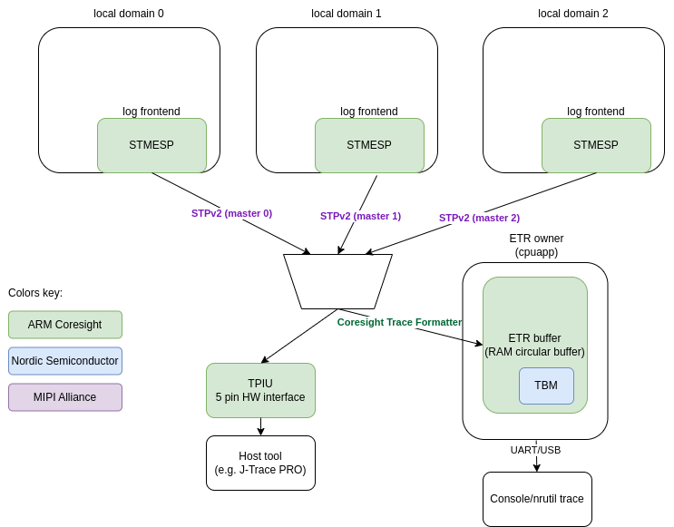

<!-- Copyright 2015-2026 Zephyr Project members and individual contributors. -->
<!-- SPDX-License-Identifier: Apache-2.0 -->
<!-- 中文翻译；阅读编号、导航和译注为本地新增。 -->

<a id="logging-cs-stm"></a>

# 第12章\_CoreSight系统跟踪日志

原文：[Multi-domain logging using ARM Coresight STM](https://docs.zephyrproject.org/latest/services/logging/cs_stm.html)。读取日期：2026-10-13，`latest`。

## 12.1\_多域日志与STM

Arm CoreSight SoC-400 是一套完整的组件库，用于在系统内构建调试和跟踪功能。集成于 CoreSight 系统的**系统跟踪宏单元（System Trace Macrocell，STM）**是一种跟踪源，主要面向软件插桩（Instrumentation）的高带宽跟踪。这里的插桩是对 **STM扩展激励端口（STM Extended Stimulus Port，STMESP）**外设寄存器进行内存映射写入。

多个核心可以共享并直接访问 STM，无须知道彼此的存在。每个核心有 65536 个激励端口，即相同结构的寄存器组，各端口可独立访问。因此，不同执行上下文记录数据时不需要加锁。

## 12.2\_STM扩展激励端口

每个本地域（Local Domain，即各核心）可以访问自己的一组 STMESP 外设。每组包含用于写入数据的寄存器，支持带或不带时间戳（Timestamp）、带或不带标记（Marking），以及用于写入标志（Flag）的寄存器。

每次写入 STMESP 寄存器，用户数据都会编码为 **MIPI系统跟踪协议第2版（MIPI System Trace Protocol v2，STPv2）**。硬件通过在必要时插入 `Major` 和 `Channel` 操作码（Opcode），复用来自不同寄存器组和不同核心的数据。STM 自主加入时间戳和同步操作码；所有核心的时间戳来自同一来源。

STM 生成的数据流可以到达不同的接收端（Sink）。例如，它可以直接发往**跟踪端口接口单元（Trace Port Interface Unit，TPIU）**，或保存在称作**嵌入式跟踪路由器（Embedded Trace Router，ETR）**的随机存取存储器（Random Access Memory，RAM）环形缓冲区中。TPIU 是包含 4 条数据线和 1 条时钟线的五引脚接口，采集数据需要外部工具，例如 J-Trace PRO。

使用 ETR 时，系统中的一个核心负责处理数据，例如通过**通用异步收发器（Universal Asynchronous Receiver/Transmitter，UART）**将数据转发到主机。

## 12.3\_嵌入式跟踪路由器

ETR 是保存跟踪数据的 RAM 环形缓冲区。它可能包含多个来源的数据，因此使用额外的封装协议进行复用，即 **CoreSight跟踪格式器（CoreSight Trace Formatter）**。数据编码为 16 字节帧，每帧最多包含 15 字节数据。

原文描述的环形缓冲区大小限制为 `4k`，因而存在溢出风险。溢出会丢失数据，但 STPv2 数据流包含同步操作码，可以恢复同步。

设备负责处理 ETR 数据。既可以把数据原样转发到主机，例如通过 UART，再由主机工具解码；也可以在芯片上解码，输出人可读的内容。

Nordic Semiconductor 的 NRF54H20 实现通过其自有的**跟踪缓冲区监视器（Trace Buffer Monitor，TBM）**封装获取缓冲区占用程度，而不是直接通过 ETR 外设获取。

## 12.4\_STMESP日志前端

该实现使用[自定义日志前端应用程序编程接口（Application Programming Interface，API）](https://docs.zephyrproject.org/latest/services/logging/index.html#log-frontend)。它假定全部必要操作都在日志宏调用的上下文内执行，并由前端提供时间戳。

前端利用多个 STMESP 寄存器组避免上下文间加锁。通道计数器通过原子递增选择独立的 STMESP 寄存器组，整条消息写入同一组。前端只使用有限的寄存器组池，把大多数通道留给其他用途。

### 早期日志（Early Logging）

STM 或 ETR/TPIU 完成设置前不能使用 STMESP。为支持基础设施就绪之前的日志，数据先写入专用 RAM 缓冲区。调用 [`log_frontend_stmesp_etr_ready()`](P030_STMESP日志前端接口.md) 通知 STM 基础设施就绪后，缓冲区内容被写入 STMESP。

早期日志只适用于拥有并配置 CoreSight 基础设施的核心。例如，NRF54H20 上对应的是安全核心（Secure Core）。

### 跟踪点（Trace Point）

即使日志已经很快，有些情况仍要求更低开销。专门的跟踪点 API 只向一个 STMESP 寄存器写入一次，因此速度很快：

| 函数 | 参数 |
| --- | --- |
| [`log_frontend_stmesp_tp()`](P030_STMESP日志前端接口.md) | 一个索引参数 `index`，范围 0～65280 |
| [`log_frontend_stmesp_tp_d32()`](P030_STMESP日志前端接口.md) | 索引 `index` 范围 0～65280，另带一个 32 位用户数据字 |

> 译注：[STMESP日志前端API](P030_STMESP日志前端接口.md)规定每核不同跟踪点的数量上限为 `32768 - CONFIG_LOG_FRONTEND_STMESP_TP_CHAN_BASE`，与本指南给出的索引范围不同。两处原值均保留，实际使用需核对所用版本接口与配置。

官方给出的 NRF54H20 数据是：记录单个跟踪点耗时低于 100 ns，约为最快日志消息记录速度的 7 倍。

## 12.5\_STM日志的两种模式

- **基于字典的日志（Dictionary-based Logging）**：由主机工具辅助解码。格式字符串只在解码时需要，因此可以从二进制文件中移除。该模式占用内存更少，速度快 2～3 倍；写入数据量更少，ETR 缓冲区发生溢出的机会也更小。
- **独立日志（Standalone Logging）**：在芯片上解码并打印人可读字符串，需要更多设备资源和处理能力。

下图为官方原始的 CoreSight STM 多域日志架构图。



各核心通过日志前端（Log Frontend）向 STMESP 写入数据，STM 汇集各域的 STPv2 数据流。图中展示了 TPIU 外部采集路径，以及 ETR 环形缓冲区和 TBM 的处理路径；原图保留英文标注。

如果输出使用 TPIU，无须再添加软件组件：STM 组成 STPv2 数据流并通过 TPIU 发出。如果使用 ETR RAM 缓冲区，则由拥有该缓冲区的**代理核心（Proxy Core）**负责处理。

字典模式下，代理核心仅通过 UART 原样转发数据。独立模式下，它使用 [CoreSight跟踪解格式器](P011_CoreSight跟踪解复用器.md)和 [MIPI STP解码器](P010_MIPI跟踪协议解码器.md)解码并解复用（Demultiplex）消息，再通过日志[消息格式化（Message Formatting）](https://docs.zephyrproject.org/latest/services/logging/index.html#log-output)转换成人可读字符串。

## 12.6\_基于字典的日志

辅助式多核日志基于 Zephyr 日志 API 的[字典日志功能](https://docs.zephyrproject.org/latest/services/logging/index.html#logging-guide-dictionary)，向 STM 发送不含冗余字符串的消息。日志中记录字符串所在地址，即消息标识符（Identifier，ID），而不直接包含格式字符串，以减小日志子系统。

数据进入 ETR 缓冲区时，代理核心负责导出。主机解码工具利用构建过程中生成的 **JavaScript对象表示法（JavaScript Object Notation，JSON）**数据库，将地址还原成人可读文本。

该方式有以下优势：

- 格式字符串不存放在二进制文件中，二进制体积更小。各本地域只需要前端，日志基础设施也很少，甚至不需要字符串格式化函数。
- 字符串格式化交给主机处理，发送到应用核心以及由其处理的数据更少。
- 日志记录速度快。官方给出的 NRF54H20 数据是：包含至多两个参数的简单消息记录耗时低于 1 μs。

代理核心通过 Nordic 的 TBM 外设取得 ETR 缓冲区占用程度，并通过 UART 发送数据。相应驱动位于 `drivers/debug/debug_nrf_etr.c`。

### 配置

Nordic **片上系统（System on Chip，SoC）**应使用专门的[字典日志配置片段（Snippet）`nordic-log-stm-dict`](../snippets/P048_Nordic字典STM日志配置片段.md)。每个核心均应使用该片段构建。只要有一个核心使用该功能，作为代理、处理 ETR 缓冲区的应用核心也必须启用。所有核心必须采用相同的日志配置。

### 读取日志

1. 设置日志采集。用 Nordic 命令行工具 `nrfutil` 的 `trace stm` 子命令启动采集，指定各域 ID 对应的字典数据库、串口、波特率和输出文件名：

```shell
nrfutil trace stm --database-config 34:build/zephyr/log_dictionary.json,35:build_rad/zephyr/log_dictionary.json --input-serialport /dev/ttyACM1 --baudrate 115200 --output-ascii out.txt
```

2. 采集和解码。`nrfutil` 从指定 UART 端口采集数据，使用提供的字典解码成人可读内容，并保存到指定输出文件；本例为 `out.txt`。
3. 打开输出文件，查看时间戳和日志消息。
4. 如果采集未找到同步信息，重新运行采集流程。

> 注意：重新运行时可能出现解码异常内容或不正确的时间戳。

每行日志在日志级别和模块名之间包含域或核心前缀，用于标识产生该消息的核心。nRF54H20 的前缀如下：

| 核心或域 | 前缀 | ID |
| --- | --- | --- |
| 安全域（Secure Domain） | `sec` | `0x21` |
| 应用核心（Application Core） | `app` | `0x22` |
| 无线核心（Radio Core） | `rad` | `0x23` |
| 系统控制器（System Controller，SysCtrl） | `sys` | `0x2c` |
| 快速轻量处理器（Fast Lightweight Processor，FLPR） | `flpr` | `0x2d` |
| 外围处理器（Peripheral Processor，PPR） | `ppr` | `0x2e` |
| 原文未注明核心名称 | `mod` | `0x24` |

## 12.7\_独立日志

前端向 STMESP 寄存器写入数据。消息格式与 `subsys/logging/frontends/log_frontend_stmesp_demux.c` 中的片上解码器一致。

代理核心通过 Nordic TBM 外设查询 ETR 缓冲区占用程度，读取并解码数据，再通过 UART 发送人可读内容。对应驱动位于 `drivers/debug/debug_nrf_etr.c`。解码过程使用 CoreSight 跟踪解格式器、MIPI STP 解码器以及上述解复用器。

日志消息包含日志宏使用的只读格式字符串，因而这些字符串不能从二进制文件中移除。此模式占用更多只读内存；消息更长，处理也更耗时，因此吞吐率较低。原文给出的比较是：比字典模式慢 2～3 倍。

### 配置

Nordic SoC 应使用专门的[独立日志配置片段 `nordic-log-stm`](../snippets/P047_Nordic独立STM日志配置片段.md)。每个核心都应使用该片段构建。任何核心使用该功能时，应用核心也必须启用，因为应用核心充当处理 ETR 缓冲区的代理。所有核心必须采用相同日志配置。

### 读取日志

日志通过控制台（Console）UART 打印。

> 注意：应用使用 UART 时，必须在设备树（Devicetree）中描述对应 UART 节点，参见[设备树介绍](https://docs.zephyrproject.org/latest/build/dts/intro.html)。

以下为官方日志示例。`app`、`rad` 分别是应用核心和无线核心的前缀，`spsc_pbuf`、`icmsg`、`host` 是输出中的模块名；`wr_idx` 和 `rd_idx` 分别表示写、读位置索引。

```console
[00:00:00.154,790] <inf> app/spsc_pbuf: alloc in 0x2f0df800
[00:00:00.163,319] <inf> app/spsc_pbuf: alloc 0x2f0df800 wr_idx:20
[00:00:00.181,112] <inf> app/spsc_pbuf: commit in 0x2f0df800
[00:00:00.189,090] <inf> app/spsc_pbuf: commit 0x2f0df800, len:20 wr_idx: 44
[00:00:00.202,577] <inf> rad/icmsg: mbox_callback
[00:00:00.214,750] <inf> rad/spsc_pbuf: claim 0x2f0df800 rd_idx:20
[00:00:00.235,823] <inf> rad/spsc_pbuf: free 0x2f0df800 len:20 rd_idx: 44
[00:00:00.244,507] <inf> rad/spsc_pbuf: read done 0x2f0df800 len:20
[00:00:00.272,444] <inf> rad/host: ep recv 0x330021f0, len:20
[00:00:00.283,939] <inf> rad/host: rx:00 exp:00
[00:00:00.292,200] <inf> rad/icmsg: read 0
[00:00:05.077,026] <inf> rad/spsc_pbuf: alloc in 0x2f0df000
[00:00:05.077,068] <inf> rad/spsc_pbuf: alloc 0x2f0df000 wr_idx:44
[00:00:05.077,098] <inf> rad/spsc_pbuf: commit in 0x2f0df000
[00:00:05.077,134] <inf> rad/spsc_pbuf: commit 0x2f0df000, len:20 wr_idx
```

独立模式同样在日志级别与模块名之间加入核心前缀：安全域为 `sec`，应用核心为 `app`，无线核心为 `rad`，系统控制器为 `sys`，快速轻量处理器为 `flpr`，外围处理器为 `ppr`。其对应关系与上一节表格的前六行一致。

## 12.8\_其他考虑

- 使用经过优化的日志宏，即至多包含两个机器字大小的数值参数，例如 `LOG_INF("%d %c", (int)x, (char)y)`，以改善体积和速度。
- 对于内存受限的应用，例如运行在 PPR 核心上的应用，在项目配置中同时设置 `CONFIG_PRINTK=n` 和 `CONFIG_BOOT_BANNER=n`，禁用 `printk()`。
- 多域场景下，例如同时使用无线核心和应用核心时，确保每个数据库前面都带正确的域 ID。
- 保存 STM 日志的 RAM 缓冲区容量有限，可能丢弃部分日志消息。

---

<!-- reading-navigation:start -->

**主线阅读**

[上一篇：CoreSight跟踪解复用器](P011_CoreSight跟踪解复用器.md) · [本模块主线目录](../reading/observability.md) · [全部主线](../reading/README.md) · [下一篇：周期延迟测量工具](P013_周期延迟测量工具.md)

<details>
<summary>原册编号导航（含扩展参考）</summary>

[上一章：CoreSight跟踪解复用器](P011_CoreSight跟踪解复用器.md) · [下一章：周期延迟测量工具](P013_周期延迟测量工具.md) · [返回大纲](大纲.md)

</details>

<!-- reading-navigation:end -->
