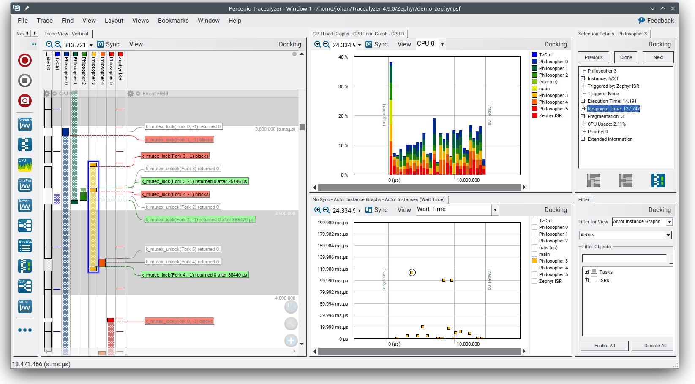
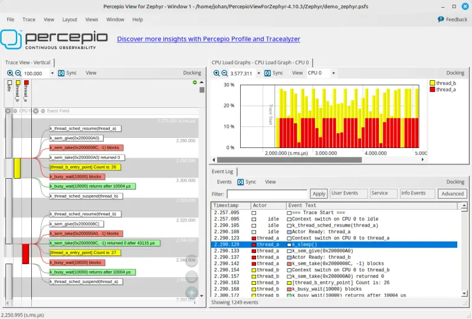
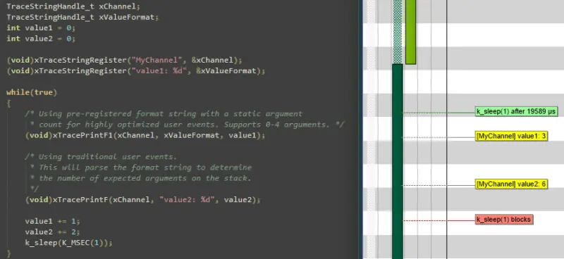
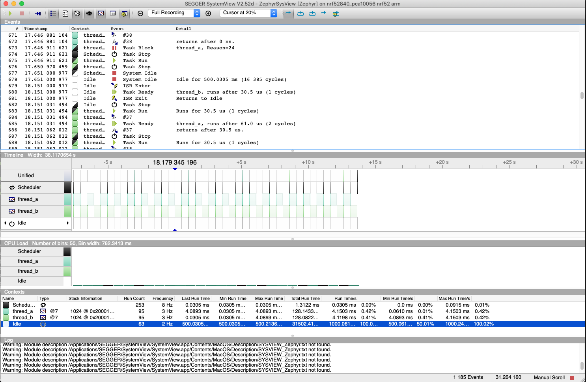

<!-- Copyright 2015-2026 Zephyr Project members and individual contributors. -->
<!-- SPDX-License-Identifier: Apache-2.0 -->
<!-- 中文翻译；阅读编号、导航和译注为本地新增。 -->

# 第15章\_跟踪子系统

原文：[Tracing](https://docs.zephyrproject.org/latest/services/tracing/index.html)。读取日期：2026-10-13，`latest`。

## 15.1\_概述与命名事件

**跟踪（Tracing）**功能提供钩子（Hook），用于从应用收集数据，让主机上的跟踪工具可视化内核及各子系统的内部运行过程。

每个系统都有面向特定应用的事件需要跟踪。以往通常需要自行确定应用载荷（Payload）、选择序列化格式（Serialization Format）、编写目标端序列化代码、决定并实现输入输出（Input/Output，I/O）传输机制，再编写主机端反序列化器或解析器，以及专门的筛选和展示工具。

应用可以使用既有格式，也可覆盖 `include/zephyr/tracing/tracing.h` 中声明的宏来定义自有格式。Zephyr 支持多种格式、传输方式和主机工具。各系统的 I/O 差异很大，因此需要区分 I/O 类型，保证载荷与格式所在的上层（Top Layer）和传输机制所在的底层（Bottom Layer）之间的接口足够通用、高效；详见本章 I/O 分类。

虽然用户可以扩展任何受支持的序列化格式，或提供自己的后端，Zephyr 仍提供一个通用的**命名跟踪事件（Named Trace Event）**函数，便于使用，也展示跟踪框架的扩展方式。

调用 [`sys_trace_named_event()`](../network_thread_trace_reference/P004_命名事件跟踪接口.md#ga205bc648bdf0152f8652f04f15cf48af) 可生成自定义事件。它接受一个事件名称和两个任意的 4 字节参数。如果名称超过序列化格式允许的长度，后端可能截断名称。

## 15.2\_通用跟踪格式

**通用跟踪格式（Common Trace Format，CTF）**是一种描述跟踪格式的开放格式和语言，支持复用工具。已有逐行文本工具 `babeltrace` 和图形工具 TraceCompass。CTF 对 C 程序员来说应当很熟悉，但提供更强的类型约束，参见 [CTF：灵活、高性能的二进制跟踪格式](https://diamon.org/ctf/)。

CTF 能正式描述应用载荷和序列化格式，从而让主机工具、解析器以及筛选和展示工具共用基础设施。

### 通用接口与上层示例

CTF 将事件序列化为包含一个或多个字段的数据包。底层可以在事务开始时执行操作，例如锁定互斥锁（Mutex）；对各字段进行处理，例如同步推送、拼接或加入线程绑定的先进先出队列（First In, First Out，FIFO）；在事务结束时释放互斥锁或发出拼接缓冲区。

宏 `CTF_EVENT` 将每个参数序列化为一个字段；示例中的 `CTF_LITERAL` 宏用于指定带类型的字面量：

```c
/* Example for illustration */
static inline void ctf_top_foo(uint32_t thread_id, ctf_bounded_string_t name)
{
  CTF_EVENT(
    CTF_LITERAL(uint8_t, 42),
    thread_id,
    name,
    "hello, I was emitted from function: ",
    __func__  /* __func__ is standard since C99 */
  );
}
```

底层可以在编译期内部静态完成字段序列化、输出和对齐处理。配置 [`CONFIG_TRACING_CTF`](https://docs.zephyrproject.org/latest/kconfig.html#CONFIG_TRACING_CTF) 启用 CTF 上层，可配合不同传输后端，以同步或异步模式使用。

## 15.3\_Percepio Tracealyzer与流端口

Zephyr 支持几种常见跟踪工具，原文按字母顺序介绍。首先是 [Percepio Tracealyzer](https://percepio.com/tracealyzer)：它提供跟踪可视化、报告生成等分析功能，支持通过不同接口进行流式跟踪（Streaming Tracing），也支持把事件保存在随机存取存储器（Random Access Memory，RAM）缓冲区中的快照跟踪（Snapshot Tracing）。



启用 Tracealyzer 跟踪后，Zephyr 内核事件会自动捕获。应用还可主动调用跟踪库记录应用日志，将内核事件和应用事件一起展示，例如把记录的变量绘为数据曲线或状态图。更多说明见应用自带的 Tracealyzer 用户手册。

Tracealyzer 的跟踪库 **TraceRecorder** 已包含在 Zephyr 清单中，同样采用 Apache 2.0 许可证。向 `prj.conf` 添加：

```ini
CONFIG_TRACING=y
CONFIG_PERCEPIO_TRACERECORDER=y
```

也可在 `menuconfig` 中启用 `Subsystems and OS Services → Tracing Support`（子系统和操作系统服务 → 跟踪支持），并在其 `Tracing Format`（跟踪格式）下选择 `Percepio Tracealyzer`。

还需要配置 TraceRecorder，其中最重要的是选择**流端口（Stream Port）**，即跟踪数据的输出方式。原文列出的截至 2024 年 7 月可用端口如下：

| 端口 | 输出方式 |
| --- | --- |
| Ring Buffer，环形缓冲区 | 数据保存在 RAM 环形缓冲区 |
| RTT，实时传输（Real Time Transfer） | 通过 J-Link 调试探针上的 SEGGER RTT 流式传输 |
| ITM，插桩跟踪宏单元（Instrumentation Trace Macrocell） | 使用 Arm Cortex-M 的 ITM 功能流式传输 |
| Semihost，半主机 | 在 QEMU 模拟器中将跟踪数据流输出到主机文件 |

在 `Modules → percepio → TraceRecorder → Stream Port`（模块 → percepio → TraceRecorder → 流端口）选择端口，或在 `prj.conf` 中添加下列选项之一：

```ini
CONFIG_PERCEPIO_TRC_CFG_STREAM_PORT_RINGBUFFER=y
CONFIG_PERCEPIO_TRC_CFG_STREAM_PORT_RTT=y
CONFIG_PERCEPIO_TRC_CFG_STREAM_PORT_ITM=y
CONFIG_PERCEPIO_TRC_CFG_STREAM_PORT_ZEPHYR_SEMIHOST=y
```

**上述四个选项只能启用一个。**各端口的专用配置位于 `Modules → percepio → TraceRecorder → (Stream Port) Config`，即相应流端口的配置菜单。下面介绍各端口的重要选项。

## 15.4\_Tracealyzer快照跟踪

Ring Buffer 端口把数据保存在设备 RAM 中，默认采用环形缓冲区，因此始终保留最近的数据。可以通过调试器等方式导出跟踪快照。除非有数兆字节空闲 RAM，否则通常只能记录很短的过程，不适合性能分析；但它与断点结合时非常适合调试。例如，在错误处理函数中设置断点，快照便可展示错误发生之前的事件序列。快照不依赖特定调试探针或其他开发工具，也容易上手。

在项目配置文件中设置：

```ini
CONFIG_TRACING=y
CONFIG_PERCEPIO_TRACERECORDER=y
CONFIG_PERCEPIO_TRC_START_MODE_START=y
CONFIG_PERCEPIO_TRC_CFG_STREAM_PORT_RINGBUFFER=y
CONFIG_PERCEPIO_TRC_CFG_STREAM_PORT_RINGBUFFER_SIZE=<size in bytes>
```

> 译注：原文此处及部分后续段落将配置文件写为 `prj.cnf`；按该页前文及 Zephyr 常规命名，应为 `prj.conf`。示例中的 `<size in bytes>` 是以字节计的大小占位符。

对应的 `menuconfig` 操作如下：

1. 启用 `Subsystems and OS Services → Tracing Support`。
2. 在其 `Tracing Format` 下选择 `Percepio Tracealyzer`。
3. 在 `Modules → percepio → TraceRecorder → Recorder Start Mode`（记录器启动模式）选择 `Start`（启动）。
4. 在同级 `Stream Port` 下选择 `Ring Buffer`。
5. 在同级 `Ring Buffer Config → Buffer Size`（环形缓冲区配置 → 缓冲区大小）设置字节数。

RAM 紧张时可缩小默认缓冲区；空闲 RAM 充足且希望记录更久时可增大。还可在 `Subsystems and OS Services → Tracing Support → Tracing Configuration`（跟踪配置）中过滤较不重要的事件，延长可记录时间。

查看数据的简便方式是运行 `west debug` 启动调试器，再执行以下 **GNU调试器（GNU Debugger，GDB）**命令：

```gdb
dump binary value trace.bin *RecorderDataPtr
```

未另行指定路径时，输出文件通常位于构建目录根部。通过 Tracealyzer 的 `File → Open → Open File`（文件 → 打开 → 打开文件）打开它。

## 15.5\_通过SEGGER RTT流式传输

Tracealyzer 内置 SEGGER RTT 支持，可通过 J-Link 探针接收数据，记录很长的跟踪过程。在项目配置中添加：

```ini
CONFIG_TRACING=y
CONFIG_PERCEPIO_TRACERECORDER=y
CONFIG_PERCEPIO_TRC_START_MODE_START_FROM_HOST=y
CONFIG_PERCEPIO_TRC_CFG_STREAM_PORT_RTT=y
CONFIG_PERCEPIO_TRC_CFG_STREAM_PORT_RTT_UP_BUFFER_SIZE=<size in bytes>
```

也可在 `menuconfig` 中依次操作：

1. 启用 `Subsystems and OS Services → Tracing Support`。
2. 在其 `Tracing Format` 下选择 `Percepio Tracealyzer`。
3. 在 `Modules → percepio → TraceRecorder → Recorder Start Mode` 下选择 `Start From Host`（由主机启动）。
4. 在同级 `Stream Port` 下选择 `RTT`。
5. 在同级 `RTT Config`（RTT配置）下设置上行缓冲区的字节数。

`RTT buffer size up` 控制 RTT 发送缓冲区大小，对吞吐量很重要。默认值为 5000 字节，使速度较慢的板载 J-Link 调试器也能取得较好性能。RAM 紧张时可缩小；使用独立 J-Link 探针时，更小的缓冲区通常就够了，例如 1 KB 或更少。

更多说明见 Tracealyzer 用户手册 `Creating and Loading Traces → Percepio TraceRecorder → Using TraceRecorder v4.6 or later → Stream ports`（创建和加载跟踪 → Percepio TraceRecorder → 使用4.6或更新版本 → 流端口），也可搜索 RTT。

## 15.6\_通过Arm ITM流式传输

该端口适用于带 ITM 单元的 Arm Cortex-M 设备。建议使用支持至少 10 MHz **串行线输出（Serial Wire Output，SWO）**的高速调试探针。配置如下：

```ini
CONFIG_TRACING=y
CONFIG_PERCEPIO_TRACERECORDER=y
CONFIG_PERCEPIO_TRC_START_MODE_START=y
CONFIG_PERCEPIO_TRC_CFG_STREAM_PORT_ITM=y
CONFIG_PERCEPIO_TRC_CFG_STREAM_PORT_ITM_PORT=1
```

也可在 `menuconfig` 中启用 `Subsystems and OS Services → Tracing Support`，将其 `Tracing Format` 设为 `Percepio Tracealyzer`，再在 `Modules → percepio → TraceRecorder` 下完成三项设置：`Recorder Start Mode` 选 `Start`，`Stream Port` 选 `ITM`，`ITM Config` 中的 ITM 端口设为 `1`。

主要设置是 ITM 端口号，范围 0～31。Tracealyzer 需要专用通道；端口 0 通常留给 `printf` 日志，因此默认使用通道 1。

`Use internal buffer`（使用内部缓冲区）一般应保持禁用。该选项先在 RAM 中缓冲数据，再推迟到周期运行的 `TzCtrl` 线程中发送。主机端设置取决于所用探针，参见前述用户手册的 `Stream ports` 章节，或搜索 ITM。

## 15.7\_QEMU半主机流式传输

Semihost 端口面向 QEMU 中的 Zephyr 跟踪，无须高速探针即可尝试流式跟踪。数据通过**半主机机制（Semihosting）**写入主机文件。配置如下：

```ini
CONFIG_SEMIHOST=y
CONFIG_TRACING=y
CONFIG_PERCEPIO_TRACERECORDER=y
CONFIG_PERCEPIO_TRC_START_MODE_START=y
CONFIG_PERCEPIO_TRC_CFG_STREAM_PORT_ZEPHYR_SEMIHOST=y
```

使用 `menuconfig` 时：

1. 启用 `General Architecture Options → Semihosting support for Arm and RISC-V targets`（通用架构选项 → Arm和RISC-V目标的半主机支持）。
2. 启用 `Subsystems and OS Services → Tracing Support`。
3. 在其 `Tracing Format` 下选择 `Percepio Tracealyzer`。
4. 在 `Modules → percepio → TraceRecorder → Recorder Start Mode` 下选择 `Start`。
5. 在同级 `Stream Port` 下选择 `Semihost`。

未指定其他路径时，输出是构建目录根部的 `./trace.psf`。通过 Tracealyzer 的 `File → Open → Open File` 打开它。

## 15.8\_记录器启动模式与自定义端口

上述 `Recorder Start Mode` 决定何时开始跟踪。`Start` 会在启动期间 TraceRecorder 库初始化完成后立即开始，推荐用于 Ring Buffer 和 Semihost。

RTT 或 ITM 也可使用 `Start From Host` 或 `Start Await Host`（等待主机启动）。两者均监听 Tracealyzer 发出的开始命令；后者会阻塞 TraceRecorder 初始化，直到收到开始命令。

流端口是 TraceRecorder 内的小型模块，定义输出跟踪数据所调用的函数，并可选地定义读取 Tracealyzer 开始/停止命令的方式。自行实现数据传输端口相对容易。Tracealyzer 可以从文件、套接字（Socket）、COM 串口、命名管道（Named Pipe）等接口接收跟踪流。TraceRecorder 仓库中还提供额外端口，例如轻量级网络协议栈 lwIP 对应的端口，但适配 Zephyr 时可能需要修改。

更多入门说明见 [Tracealyzer入门指南](https://percepio.com/tracealyzer/gettingstarted/)。

## 15.9\_面向Zephyr的Percepio View

**Percepio View** 是基于 Tracealyzer 的免费跟踪工具，用于 Zephyr 应用调试和验证。



它可与传统调试器并用，通过可视化线程、**中断服务例程（Interrupt Service Routine，ISR）**、系统调用（System Call）和应用自定义的用户事件（User Event）的实时执行过程来补充调试器能力。



入门和升级说明见 [Percepio产品页](https://traceviewer.io/get-view/?target=zephyr)。View 提供快照跟踪：数据保存在目标 RAM 环形缓冲区中，经常规调试连接保存到主机。需要流式跟踪时，Percepio 提供付费升级至 Percepio Profile 或 Tracealyzer 的选项。无须修改 Zephyr 源码，只需通过 Kconfig 启用 TraceRecorder 库。View 支持 Windows 和 Linux 主机。

## 15.10\_SEGGER SystemView

Zephyr 内置 [SEGGER SystemView](https://www.segger.com/products/development-tools/systemview/) 支持，可用于具备所需硬件条件的平台上的任何应用。其载荷与格式由应用决定，以 RTT 作为传输。较新的 SystemView 也支持通用异步收发器（Universal Asynchronous Receiver/Transmitter，UART）和快照等方式，但本页所述 Zephyr 集成尚不支持后两者。

向构建命令加入 [SystemView RTT跟踪配置片段 `rtt-tracing`](../snippets/P014_SystemView_RTT跟踪配置片段.md#snippet-rtt-tracing)：

```shell
west build -b <board> -S rtt-tracing samples/synchronization
```

还可以通过 [`CONFIG_SEGGER_SYSVIEW_POST_MORTEM_MODE`](https://docs.zephyrproject.org/latest/kconfig.html#CONFIG_SEGGER_SYSVIEW_POST_MORTEM_MODE) 启用**故障后跟踪（Post-mortem Tracing）**。系统崩溃后，用 `west attach` 连接调试器，再把内部 RAM 缓冲区的最新数据加载到 SystemView。



SystemView 附带的 Zephyr **应用程序编程接口（Application Programming Interface，API）**转换表可能不完整，无法匹配 Zephyr 当前支持的范围。要使用最新描述表，将源码树中的文件复制到本地配置目录，覆盖内置表：

```shell
# On Linux and MacOS
cp $ZEPHYR_BASE/subsys/tracing/sysview/SYSVIEW_Zephyr.txt ~/.config/SEGGER/
```

## 15.11\_TraceCompass与Perfetto

TraceCompass 是可视化 CTF 事件的开源工具，能展示线程调度、中断等，帮助发现复杂系统中未预期的交互和资源冲突。另见 Ericsson 演示文稿[实时系统的高级故障排查](https://wiki.eclipse.org/images/0/0e/TechTalkOnlineDemoFeb2017_v1.pdf)。

[Perfetto](https://perfetto.dev/) 是面向 [Chrome跟踪事件格式（Chrome Trace Event Format）](https://docs.google.com/document/d/1CvAClvFfyA5R-PhYUmn5OOQtYMH4h6I0nSsKchNAySU)的网页查看器，无须安装工具，即可查看与 TraceCompass 相同的调度和中断活动。脚本 `scripts/tracing/ctf2perfetto.py` 仅依赖 Python 3，可将 CTF 转换为该格式：

```shell
$ZEPHYR_BASE/scripts/tracing/ctf2perfetto.py <trace file> -o trace.json
```

在 [Perfetto查看器](https://ui.perfetto.dev)加载 `trace.json` 后，时间线中每个线程有一条泳道，还包含 ISR 以及信号量（Semaphore）、互斥锁、定时器（Timer）等内核对象的泳道。[函数插桩子系统](P016_函数插桩.md)也能把函数调用跟踪输出为相同格式，因而同一构建可以在同一查看器中采用两种视角分析。

默认与 `babeltrace2` 一样，从跟踪文件旁读取**跟踪流描述语言（Trace Stream Description Language，TSDL）**元数据，除非通过 `--metadata` 指向其他位置。必须使用生成该跟踪数据的构建所对应的元数据。CTF 记录不携带长度，遇到元数据未描述的记录时无法跳过；转换器会停止并指出事件标识符（Identifier，ID），而不是输出不完整的跟踪结果。

## 15.12\_用户定义的跟踪

这种格式允许应用定义普通 C 函数，在各钩子触发时运行，无须自行编写或派生跟踪头文件。每个 `sys_port_trace_*` 钩子转发到名为 `sys_trace_<event>_user()` 的 `__weak` 弱符号回调。应用只需覆盖关注的回调，未定义的回调不做任何事。

例如，可以简单翻转**通用输入输出（General-Purpose Input/Output，GPIO）**引脚供外部示波器观察，尽量降低额外的**中央处理器（Central Processing Unit，CPU）**负载；也可生成其他跟踪系统不支持的非标准或专有格式。

回调覆盖线程/调度器、ISR、空闲、系统初始化、睡眠事件、GPIO、定时器、**实时输入输出（Real-Time I/O，RTIO）**和内核对象，包括信号量、互斥锁、条件变量（Condition Variable）、消息队列（Message Queue）、邮箱（Mailbox）、事件、轮询（Polling）、内存块池（Memory Slab）和工作队列（Work Queue）。完整且具有准确签名的权威列表位于 `subsys/tracing/user/tracing_user.h` 的 `sys_trace_*_user` 声明中。部分示例：

```c
void sys_trace_thread_create_user(struct k_thread *thread);
void sys_trace_thread_switched_in_user(void);
void sys_trace_thread_switched_out_user(void);
void sys_trace_isr_enter_user(void);
void sys_trace_isr_exit_user(void);
void sys_trace_idle_user(void);
void sys_trace_k_sem_give_enter_user(struct k_sem *sem);
void sys_trace_k_mutex_lock_enter_user(struct k_mutex *mutex, k_timeout_t timeout);
```

用 [`CONFIG_TRACING_USER`](https://docs.zephyrproject.org/latest/kconfig.html#CONFIG_TRACING_USER) 启用该格式。`tests/subsys/tracing/tracing_user_callbacks` 展示应用覆盖对象回调的方式。

## 15.13\_源码树外的跟踪格式

下游模块可提供自有格式，无须修改 Zephyr 源码树。将 [`CONFIG_TRACING_FORMAT_HEADER`](https://docs.zephyrproject.org/latest/kconfig.html#CONFIG_TRACING_FORMAT_HEADER) 设置为包含路径中的头文件名。它是无提示的 Kconfig 字符串选项，通过模块 Kconfig 中的 `default` 赋值。在未选择源码树内格式时，`include/zephyr/tracing/tracing.h` 用计算得到的 `#include` 引入此头文件。

格式头文件定义需要记录的 `sys_port_trace_*` 钩子，并以下列内容结尾：

```c
/* default no-ops for the scheduler/idle/init/named function layer */
#include <zephyr/tracing/tracing_default_hooks.h>
/* no-op for every sys_port_trace_* hook this header does not define */
#include <zephyr/tracing/tracing_hooks.h>
```

这样，格式只需实现关注的钩子。传输可独立通过 `TRACING_BACKEND_DEFINE()` 添加，参见 `subsys/tracing/include/tracing_backend.h`。因此，自定义格式和自定义后端都不需要修改核心源码树。`tests/subsys/tracing/tracing_format_module` 提供完整示例。

## 15.14\_传输后端与基本使用

当前支持 UART、**通用串行总线（Universal Serial Bus，USB）**、文件、RTT 和 RAM 后端。其中，文件后端用于基于**可移植操作系统接口（Portable Operating System Interface，POSIX）**架构目标的原生端口；RTT 可配合 SystemView；RAM 缓冲区由调试器取回。

`samples/subsys/tracing` 展示不同格式和后端的用法。入门的简便方式是在 [`native_sim`](../native_reference/P004_Native_Simulator本机模拟器.md#native_sim) 主机原生模拟目标上使用 CTF。使用 west 构建：

```shell
# From the root of the zephyr repository
west build -b native_sim samples/subsys/tracing -- -DCONF_FILE=prj_native_ctf.conf
```

或使用 CMake 和 Ninja：

```shell
# From the root of the zephyr repository
# Use cmake to configure a Ninja-based buildsystem:
cmake -Bbuild -GNinja -DBOARD=native_sim -DCONF_FILE=prj_native_ctf.conf samples/subsys/tracing

# Now run the build tool on the generated build system:
ninja -Cbuild
```

运行生成的程序，并用 `-trace-file` 指定数据文件：

```shell
mkdir data
cp $ZEPHYR_BASE/subsys/tracing/ctf/tsdl/metadata data/
./build/zephyr/zephyr.exe -trace-file=data/channel0_0
```

让 `babeltrace` 或 TraceCompass 指向包含元数据和跟踪文件的 `data` 目录，即可查看生成的 CTF 输出。

### RAM后端

对于没有可用 USB/UART 等跟踪 I/O、但有足够 RAM 的设备，可启用 [`CONFIG_TRACING_BACKEND_RAM`](https://docs.zephyrproject.org/latest/kconfig.html#CONFIG_TRACING_BACKEND_RAM)，并调整 [`CONFIG_RAM_TRACING_BUFFER_SIZE`](https://docs.zephyrproject.org/latest/kconfig.html#CONFIG_RAM_TRACING_BUFFER_SIZE)，使缓冲区能记录所需数据。使用 GDB 等运行时调试器把目标缓冲区取回主机：

```gdb
(gdb) dump binary memory data/channel0_0 <ram_tracing_start> <ram_tracing_end>
```

与其他后端一样，生成的 `channel0_0` 文件必须和 `metadata` 文件放在同一目录中。

## 15.15\_借鉴LTTng的后续方向

原文指出，该处提供的上层仍较简单、基础，并不必要地复制了 Zephyr 的 SEGGER SystemView 调试模块。对于 Zephyr 这样的操作系统（Operating System，OS），可以借鉴 Linux 的 **LTTng跟踪工具（Linux Trace Toolkit Next Generation）**，让上层序列化为相同格式，从而直接复用 TraceCompass 现成的 Linux 分析功能。另一种方式是将 TraceCompass 的 LTTng 分析适配到 Zephyr。以目标无关、开源方式让 TraceCompass 观察 Zephyr 的工作仍在推进。

## 15.16\_输入输出分类

下面分别讨论输出和输入的同步性、缓冲方式，以及原子性和通道数量对加锁的影响。

### 原子推送、生产、写入或入队（Atomic Push/Produce/Write/Enqueue）

**同步（Synchronous）**表示调用返回时数据发送已完成；**异步（Asynchronous）**表示返回时发送仍待执行或正在进行，通常用中断、回调、信号或轮询判断完成。**缓冲（Buffered）**表示先复制并合并数据，组成更大的传输，通常用于摊薄开销的突发出队，或缓解抖动的平稳出队。

| 组合 | 示例及影响 |
| --- | --- |
| 同步、无缓冲 | 经 GPIO 执行程序控制I/O（Programmed I/O，PIO），数据流平稳，无须额外 FIFO 内存。抖动小，但无法摊薄写入开销，效率可能较低 |
| 同步、有缓冲 | 文件写入函数 `fwrite()` 或入 FIFO；水位超过阈值时阻塞地突发发送。突发造成的抖动可能导致错过截止时间 |
| 异步、无缓冲 | 直接内存访问（Direct Memory Access，DMA），或共享内存中的零拷贝（Zero-copy）。注意数据冒险和竞态条件 |
| 异步、有缓冲 | 例如入 FIFO |

### 原子拉取、消费、读取或出队（Atomic Pull/Consume/Read/Dequeue）

同步表示调用返回时接收已完成；异步表示返回时接收仍待执行或正在进行，同样通常通过中断、回调、信号或轮询判断完成。有缓冲表示按大于请求大小的块复制数据，通常用于摊薄等待时间。

| 组合 | 示例及影响 |
| --- | --- |
| 同步、无缓冲 | 阻塞读取调用、`fread()`、串行外设接口（Serial Peripheral Interface，SPI）读取，或共享内存中的零拷贝 |
| 同步、有缓冲 | 带缓存的阻塞读取。读取模式具有空间局部性时有意义 |
| 异步、无缓冲 | 例如共享内存中的零拷贝；注意数据冒险和竞态条件 |
| 异步、有缓冲 | 例如 `aio_read()` 或 DMA |

### 原子性、通道与锁

I/O 不一定具有原子性，因此可能需要加锁。如果有多个独立通道，可能无需加锁。原文用以下伪代码区分四类情形：

| 条件 | 示例与锁要求 | 原文伪代码 |
| --- | --- | --- |
| 非原子写、单一共享通道 | 例如 UART，需要锁 | `lock(); emit(a); emit(b); emit(c); release();` |
| 非原子写、多个通道 | 例如多 UART。若底层为每个 Zephyr 线程和 ISR 映射专用通道，则可无锁；每个线程对自身顺序一致，因而缓解竞态 | `emit(a,thread_id); emit(b,thread_id); emit(c,thread_id);` |
| 原子写、单一共享通道 | 例如 `native_sim` 或有 DMA 的板，可能需要锁，也可能不需要。可先拼接到缓冲区，或以锁包围各次输出而不另用内存 | `emit(a ## b ## c); /* Concat to buffer */` 或 `lock(); emit(a); emit(b); emit(c); release(); /* No extra mem */` |
| 原子写、多个通道 | 例如 `native_sim` 或有多通道 DMA 的板，可无锁 | `emit(a ## b ## c, thread_id);` |

## 15.17\_对象跟踪

内核也能跟踪系统中的内核对象。启用 [`CONFIG_TRACING_OBJECT_TRACKING`](https://docs.zephyrproject.org/latest/kconfig.html#CONFIG_TRACING_OBJECT_TRACKING) 会启用[对象核心框架（Object Core Framework）](https://docs.zephyrproject.org/latest/kernel/object_cores/index.html#object-cores-api)，枚举各类内核对象。例如，遍历每个互斥锁。示例中的 `CONTAINER_OF` 宏由成员地址取得所属结构地址，`K_OBJ_TYPE_MUTEX_ID` 是互斥锁对象类型标识符：

```c
static int visit_mutex(struct k_obj_core *obj_core, void *data)
{
    struct k_mutex *mutex = CONTAINER_OF(obj_core, struct k_mutex, obj_core);

    /* Do something */

    return 0;
}

k_obj_type_walk_locked(k_obj_type_find(K_OBJ_TYPE_MUTEX_ID), visit_mutex, NULL);
```

可通过各自的 `CONFIG_OBJ_CORE_*` 选项排除某类对象。[对象核心示例](../basic_samples/P027_对象核心示例.md#object_cores)可以在启用对象跟踪的情况下构建。

## 15.18\_接口参考

以下各组保留官方 API 入口。

| 接口组 | 官方参考 |
| --- | --- |
| 通用跟踪钩子（Tracing Hooks） | [API](../tracing_core_reference/P002_跟踪API总览.md) |
| 线程（Thread） | [API](../network_thread_trace_reference/P001_线程跟踪接口.md) |
| 工作项（Work Item） | [API](../driver_trace_reference/P005_工作项跟踪接口.md) |
| 轮询（Polling） | [API](../sync_trace_reference/P006_轮询跟踪接口.md) |
| 信号量（Semaphore） | [API](../sync_trace_reference/P001_信号量跟踪接口.md) |
| 互斥锁（Mutex） | [API](../sync_trace_reference/P002_互斥锁跟踪接口.md) |
| 条件变量（Condition Variable） | [API](../sync_trace_reference/P003_条件变量跟踪接口.md) |
| 队列（Queue） | [API](../object_trace_reference/P003_队列跟踪接口.md) |
| 先进先出（First In, First Out，FIFO） | [API](../object_trace_reference/P001_FIFO跟踪接口.md) |
| 后进先出（Last In, First Out，LIFO） | [API](../object_trace_reference/P002_LIFO跟踪接口.md) |
| 栈（Stack） | [API](../object_trace_reference/P007_栈跟踪接口.md) |
| 消息队列（Message Queue） | [API](../object_trace_reference/P004_消息队列跟踪接口.md) |
| 邮箱（Mailbox） | [API](../object_trace_reference/P005_邮箱跟踪接口.md) |
| 管道（Pipe） | [API](../object_trace_reference/P006_管道跟踪接口.md) |
| 堆（Heap） | [API](../object_trace_reference/P008_堆跟踪接口.md) |
| 内存块池（Memory Slab） | [API](../object_trace_reference/P009_内存块池跟踪接口.md) |
| 定时器（Timer） | [API](../sync_trace_reference/P005_定时器跟踪接口.md) |
| 系统调用跟踪（Syscall Tracing） | [API](../sync_trace_reference/P007_系统调用跟踪接口.md) |
| 网络（Network） | [API](../network_thread_trace_reference/P002_网络跟踪接口.md) |
| 网络套接字（Network Socket） | [API](../network_thread_trace_reference/P003_套接字跟踪接口.md) |

---

<!-- reading-navigation:start -->

**主线阅读**

[上一篇：可观测性服务目录](P014_可观测性服务目录.md) · [本模块主线目录](../reading/observability.md) · [全部主线](../reading/README.md) · [下一篇：函数插桩](P016_函数插桩.md)

<details>
<summary>原册编号导航（含扩展参考）</summary>

[上一章：可观测性服务目录](P014_可观测性服务目录.md) · [下一章：函数插桩](P016_函数插桩.md) · [返回大纲](大纲.md)

</details>

<!-- reading-navigation:end -->
