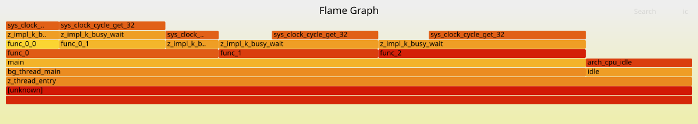

<!-- Copyright 2015-2026 Zephyr Project members and individual contributors. -->
<!-- SPDX-License-Identifier: Apache-2.0 -->
<!-- 中文翻译；阅读编号、导航和译注为本地新增。 -->

<a id="profiling-perf"></a>

# 第21章\_Perf性能采样示例

原文：[Perf tool](https://docs.zephyrproject.org/latest/samples/subsys/profiling/perf/README.html)。读取日期：2026-10-13，`latest`。

## 21.1\_用途与要求

本应用帮助理解 [Perf性能采样工具](P018_性能采样工具.md)的用法。当前实现支持 RISC-V、x86、x86_64 和 Cortex-M 架构。

Cortex-M 支持要求 SysTick 系统定时器、线程栈信息、额外异常信息、Arm 栈遍历（Stack Walking）支持，以及单处理器（Uniprocessor）配置。该后端不适用于可信执行（Trusted Execution）的非安全（Non-secure）映像。

## 21.2\_采样与导出

构建并运行示例：

```shell
west build -b qemu_riscv64 samples/subsys/profiling/perf
west build -t run
```

启动后，在命令行界面（Shell）输入：

```console
uart:~$ perf record <duration> <frequency>
```

该命令按 `<frequency>` 赫兹启动定时采样，持续 `<duration>` 毫秒。等待完成消息 `perf done!`；如果 Perf 缓冲区小于所需容量，则会出现 `perf buf override!`。

用以下命令在终端打印已捕获的采样：

```console
uart:~$ perf printbuf
```

输出类似下文，其中 `Perf buf length` 表示缓冲区长度：

```console
Perf buf length 2046
0000000000000004
00000000001056b2
0000000000108192
000000000010052f
0000000000000000
  ....
000000000010052f
0000000000000000
```

将输出复制到文件，例如 `perf_buf`。

## 21.3\_生成火焰图

使用 `scripts/profiling/stackcollapse.py` 和[火焰图工具 FlameGraph](https://github.com/brendangregg/FlameGraph)生成 `graph.svg`：

```shell
python scripts/profiling/stackcollapse.py perf_buf build/zephyr/zephyr.elf | <flamegraph_dir_path>/flamegraph.pl > graph.svg
```

下图为官方图表示例的原始可缩放矢量图形（Scalable Vector Graphics，SVG）文件，文件及其内嵌交互脚本完整保留。



[打开同一SVG原文件](images/graph_example.svg)。

---

[上一章：性能分析示例目录](P020_性能分析示例目录.md) · [下一章：跟踪示例目录](P022_跟踪示例目录.md) · [返回大纲](大纲.md)
