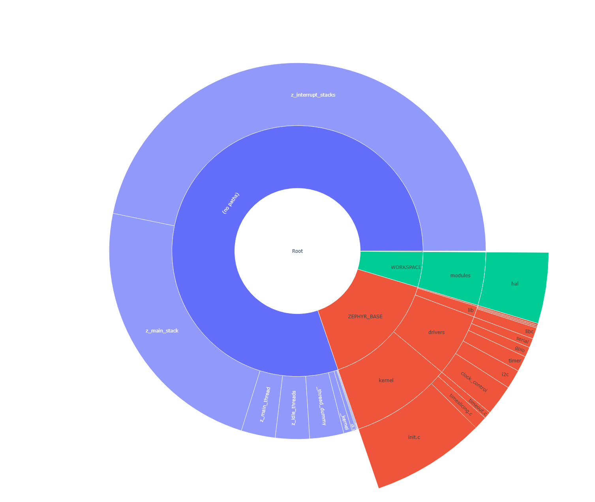
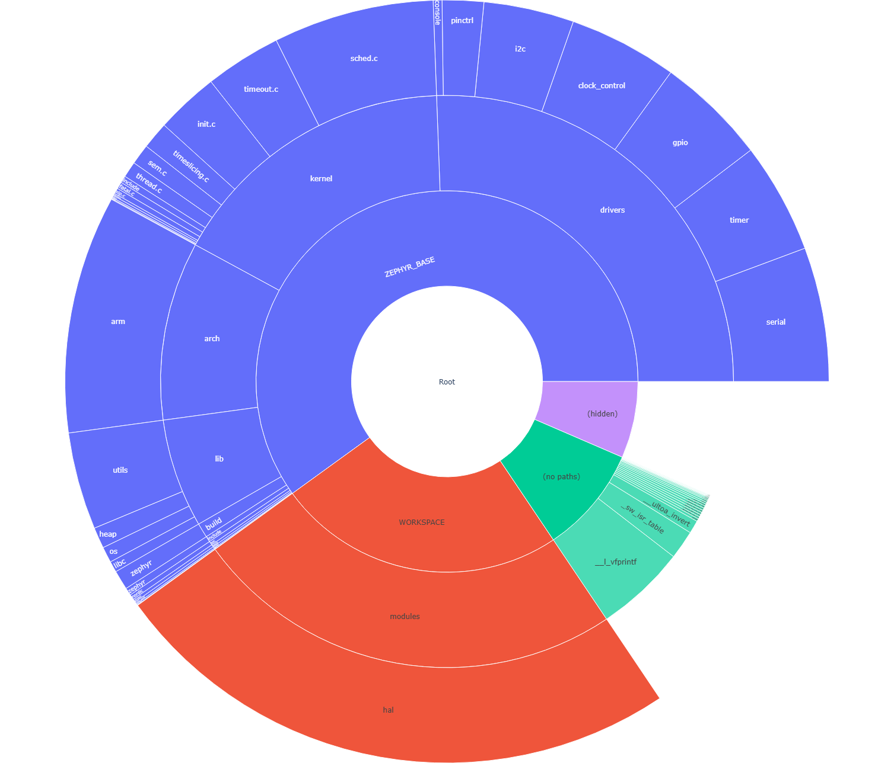
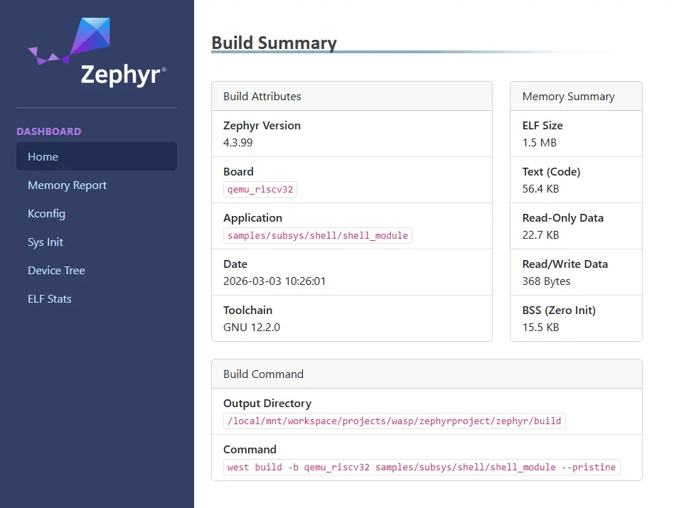

<!-- Copyright 2015-2026 Zephyr Project members and individual contributors. -->
<!-- SPDX-License-Identifier: Apache-2.0 -->
<!-- 中文翻译；阅读编号、导航和译注为本地新增。 -->

# 第3章\_优化分析工具

原文：[Optimization Tools](https://docs.zephyrproject.org/latest/develop/optimizations/tools.html)。读取日期：2026-10-12，`latest`。

Zephyr 提供若干**构建目标（Build Target）**，用于分析固件的存储占用、内存使用及数据结构。还可以生成 HTML **仪表板（Dashboard）**，在一个页面动态浏览构建产物与指标。

> 译注：本章保留官方 `reel_board` 与 `samples/hello_world` 示例，表示在 Zephyr 源码根进行的示范构建，不代表 HC32 实板测量。使用已有应用时选择它实际的板目标和构建目录，不必为阅读本章重新初始化工作区。以下普通构建命令按 Bash 解释；Ubuntu/Fedora 软件安装命令只适用于各自系统。先具备对应工具链与应用依赖，配置或构建报错时先修复该阶段，不能把报告目标当作绕过构建错误的方法。

<a id="footprint-tools"></a>

## 3.1\_从最终镜像分析存储占用

构建系统可以查看生成镜像的 **随机存取存储器（Random-Access Memory，RAM）**、**只读存储器（Read-Only Memory，ROM）**和栈占用。工具分析最终镜像，报告代码与**符号（Symbol）**的大小；符号是链接产物中可识别的函数或数据对象。结合编译器提供的信息，还可以分析最坏情况下的栈使用。

部分工具根据符号对应文件的目录结构组织报告。对于位于项目树外、或者缺少定位元数据的符号，使用以下顶层分类：

| 分类 | 原文解释 |
| --- | --- |
| **隐藏项（Hidden）** | RAM 和 ROM 报告中没有匹配映射文件的符号。其文件未加入元数据、内容为空或未定义；工具无法取得相应函数名或确定其来源。 |
| **无路径项（No paths）** | 带相对路径、无法在报告树中按某个文件的完整位置放置的符号。工具能得到函数名，但不能确定来源。 |

同一函数可能有多个实例，No paths 会在一个条目中列出它们的大小之和。

> 译注：报告中的 ROM 是镜像存储占用分类，在微控制器上常对应 Flash；它不是要求芯片必须使用掩膜 ROM。符号静态占用与运行时最高内存需求也不同，例如动态分配和实际最深栈使用仍有各自的分析边界。

## 3.2\_ram_report：查看RAM占用

`ram_report` 按表格列出编译对象的 RAM 占用，包含每个符号的字节大小与百分比；数据按对象位置及包含符号的文件分组。

从 Zephyr 源码根使用 west：

```sh
# From the root of the zephyr repository
west build -b reel_board samples/hello_world
west build -t ram_report
```

或者使用 CMake 配置 Ninja 构建系统，再执行相应目标：

```sh
# From the root of the zephyr repository
# Use cmake to configure a Ninja-based buildsystem:
cmake -Bbuild -GNinja -DBOARD=reel_board samples/hello_world

# Now run the build tool on the generated build system:
ninja -Cbuild ram_report
```

如果使用**系统构建（System Build，sysbuild）**，应按[专用镜像目标](https://docs.zephyrproject.org/latest/build/sysbuild/index.html#sysbuild-dedicated-image-build-targets)选择对应镜像的报告目标，不直接假定顶层目标名相同。

输出类似如下。`Path` 表示文件或符号路径，`Size` 是字节数，`%` 是占比，`Address` 是符号地址；`WORKSPACE` 与 `ZEPHYR_BASE` 是报告对工作区根及源码根使用的标签：

```text
Path                                                           Size    %      Address
========================================================================================
Root                                                           4637 100.00%  -
├── (hidden)                                                      4   0.09%  -
├── (no paths)                                                 2748  59.26%  -
│   ├── _cpus_active                                              4   0.09%  0x20000314
│   ├── _kernel                                                  32   0.69%  0x20000318
│   ├── _sw_isr_table                                           384   8.28%  0x00006474
│   ├── cli.1                                                    16   0.35%  0x20000254
│   ├── on.2                                                      4   0.09%  0x20000264
│   ├── poll_out_lock.0                                           4   0.09%  0x200002d4
│   ├── z_idle_threads                                          128   2.76%  0x20000120
│   ├── z_interrupt_stacks                                     2048  44.17%  0x20000360
│   └── z_main_thread                                           128   2.76%  0x200001a0
├── WORKSPACE                                                   184   3.97%  -
│   └── modules                                                 184   3.97%  -
│       └── hal                                                 184   3.97%  -
│           └── nordic                                          184   3.97%  -
│               └── nrfx                                        184   3.97%  -
│                   └── drivers                                 184   3.97%  -
│                       └── src                                 184   3.97%  -
│                           ├── nrfx_clock.c                      8   0.17%  -
│                           │   └── m_clock_cb                    8   0.17%  0x200002e4
│                           ├── nrfx_gpiote.c                   132   2.85%  -
│                           │   └── m_cb                        132   2.85%  0x20000060
│                           ├── nrfx_ppi.c                        4   0.09%  -
│                           │   └── m_channels_allocated          4   0.09%  0x200000e4
│                           └── nrfx_twim.c                      40   0.86%  -
│                               └── m_cb                         40   0.86%  0x200002ec
└── ZEPHYR_BASE                                                1701  36.68%  -
    ├── arch                                                      5   0.11%  -
    │   └── arm                                                   5   0.11%  -
    │       └── core                                              5   0.11%  -
    │           ├── mpu                                           1   0.02%  -
    │           │   └── arm_mpu.c                                 1   0.02%  -
    │           │       └── static_regions_num                    1   0.02%  0x20000348
    │           └── tls.c                                         4   0.09%  -
    │               └── z_arm_tls_ptr                             4   0.09%  0x20000240
    ├── drivers                                                 258   5.56%  -
    │   ├── ...                                                 ...    ...%
========================================================================================
                                                               4637
```

## 3.3\_rom_report：查看ROM占用

`rom_report` 用相同形式报告 ROM 占用，按文件位置组织符号、字节大小和百分比。

使用 west：

```sh
# From the root of the zephyr repository
west build -b reel_board samples/hello_world
west build -t rom_report
```

或者使用 CMake 与 Ninja：

```sh
# From the root of the zephyr repository
# Use cmake to configure a Ninja-based buildsystem:
cmake -Bbuild -GNinja -DBOARD=reel_board samples/hello_world

# Now run the build tool on the generated build system:
ninja -Cbuild rom_report
```

输出示例：

```text
Path                                                           Size    %      Address
========================================================================================
Root                                                          27828 100.00%  -
├── ...                                                         ...    ...%
└── ZEPHYR_BASE                                               13558  48.72%  -
    ├── arch                                                   1766   6.35%  -
    │   └── arm                                                1766   6.35%  -
    │       └── core                                           1766   6.35%  -
    │           ├── cortex_m                                   1020   3.67%  -
    │           │   ├── fault.c                                 620   2.23%  -
    │           │   │   ├── bus_fault.constprop.0               108   0.39%  0x00000749
    │           │   │   ├── mem_manage_fault.constprop.0        120   0.43%  0x000007b5
    │           │   │   ├── usage_fault.constprop.0              84   0.30%  0x000006f5
    │           │   │   ├── z_arm_fault                         292   1.05%  0x0000082d
    │           │   │   └── z_arm_fault_init                     16   0.06%  0x00000951
    │           │   ├── ...                                     ...    ...%
    ├── boards                                                   32   0.11%  -
    │   └── arm                                                  32   0.11%  -
    │       └── reel_board                                       32   0.11%  -
    │           └── board.c                                      32   0.11%  -
    │               ├── __init_board_reel_board_init              8   0.03%  0x000063e4
    │               └── board_reel_board_init                    24   0.09%  0x00000ed5
    ├── build                                                   194   0.70%  -
    │   └── zephyr                                              194   0.70%  -
    │       ├── isr_tables.c                                    192   0.69%  -
    │       │   └── _irq_vector_table                           192   0.69%  0x00000040
    │       └── misc                                              2   0.01%  -
    │           └── generated                                     2   0.01%  -
    │               └── configs.c                                 2   0.01%  -
    │                   └── _ConfigAbsSyms                        2   0.01%  0x00005945
    ├── drivers                                                6282  22.57%  -
    │   ├── ...                                                 ...    ...%
========================================================================================
                                                              21652
```

> 译注：原文这份节选中顶层 `Root` 的 27828 与底部的 21652 不一致，且内部多处使用省略号。本译文保留示例原值，不将其作为可相加验证的数据集；实际报告应以同一次构建的完整输出为准。sysbuild 同样使用对应镜像的专用目标。

## 3.4\_ram_plot与rom_plot：交互式占用图

`ram_plot` 和 `rom_plot` 将相同类型的报告绘制为**旭日图（Sunburst Chart）**。单击扇区可深入目录层次，悬停可查看详情。执行目标时先生成**命令行界面（Command-Line Interface，CLI）**报告，再打开浏览器。

RAM 图使用 west：

```sh
# From the root of the zephyr repository
west build -b reel_board samples/hello_world
west build -t ram_plot
```

或者使用 CMake 与 Ninja：

```sh
# From the root of the zephyr repository
# Use cmake to configure a Ninja-based buildsystem:
cmake -Bbuild -GNinja -DBOARD=reel_board samples/hello_world

# Now run the build tool on the generated build system:
ninja -Cbuild ram_plot
```

官方 RAM 图示：



ROM 图对应使用：

```sh
# From the root of the zephyr repository
west build -b reel_board samples/hello_world
west build -t rom_plot
```

或者：

```sh
# From the root of the zephyr repository
# Use cmake to configure a Ninja-based buildsystem:
cmake -Bbuild -GNinja -DBOARD=reel_board samples/hello_world

# Now run the build tool on the generated build system:
ninja -Cbuild rom_plot
```

官方 ROM 图示：



## 3.5\_puncover：浏览文件与栈占用

`puncover` 目标调用第三方 [puncover 工具](https://github.com/HBehrens/puncover)，启动本地 Web 服务，让浏览器查看文件的 ROM、RAM 与栈占用。

原文要求先安装其 Python 包：

```sh
pip3 install --user puncover
```

> 译注：此处保留官方 `--user` 安装形式。若正在使用隔离的 Python 虚拟环境，应在该环境中用 `python -m pip install puncover`，不要机械沿用 `--user`。安装包后还要让本次构建配置找到对应命令；本次翻译没有实际安装或启动它。

**原文警告：**这是第三方工具，其可用性可能随版本变化。遇到问题应查看工具仓库的问题列表，并向其维护者报告。

安装后，从源码根使用 west：

```sh
# From the root of the zephyr repository
west build -b reel_board samples/hello_world
west build -t puncover
```

或者 CMake 与 Ninja：

```sh
# From the root of the zephyr repository
# Use cmake to configure a Ninja-based buildsystem:
cmake -Bbuild -GNinja -DBOARD=reel_board samples/hello_world

# Now run the build tool on the generated build system:
ninja -Cbuild puncover
```

默认服务地址为 `localhost:5000`。通过 `PUNCOVER_HOST`、`PUNCOVER_PORT` 环境变量可分别指定主机地址和端口；额外参数由 `EXTRA_PUNCOVER_ARGS` 提供。sysbuild 应选择相应镜像目标。

## 3.6\_最坏栈使用与非交互报告

要在 puncover 交互页面查看**最坏情况栈使用（Worst-Case Stack Usage）**，原文要求启用 Kconfig 配置项 [`CONFIG_STACK_USAGE`](https://docs.zephyrproject.org/latest/kconfig.html#CONFIG_STACK_USAGE)。下面完整示例同时启用 Kconfig 配置项 `CONFIG_CALLGRAPH_INFO`，用于生成**调用图（Call Graph）**信息，描述函数间调用关系：

```sh
# From the root of the zephyr repository
west build -b reel_board samples/hello_world -- -DCONFIG_STACK_USAGE=y -DCONFIG_CALLGRAPH_INFO=y
west build -t puncover
```

CMake 与 Ninja 形式：

```sh
# From the root of the zephyr repository
# Use cmake to configure a Ninja-based buildsystem:
cmake -Bbuild -GNinja -DBOARD=reel_board -DCONFIG_STACK_USAGE=y -DCONFIG_CALLGRAPH_INFO=y samples/hello_world

# Now run the build tool on the generated build system:
ninja -Cbuild puncover
```

若要生成 **JSON（JavaScript Object Notation，数据交换格式）**报告并且不启动 Web 应用，可以传入 `--generate-report --non-interactive --report-type json`。每个关注函数使用 `--report-max-static-stack-usage FUNCTION_NAME:::MAXIMAL_STACK_SIZE`，其中前者是函数名，后者是最大栈大小参数。

以下原例关注 `log_process_thread_func`、`shell_thread`、`bg_thread_main`、`work_queue_main` 四个函数，分别给出 832、4160、2112、1088：

```sh
# From the root of the zephyr repository
west build -b reel_board samples/hello_world -- -DCONFIG_STACK_USAGE=y -DCONFIG_CALLGRAPH_INFO=y -DEXTRA_PUNCOVER_ARGS="--generate-report;--non-interactive;--report-type;json;--report-max-static-stack-usage;log_process_thread_func:::832;--report-max-static-stack-usage;shell_thread:::4160;--report-max-static-stack-usage;bg_thread_main:::2112;--report-max-static-stack-usage;work_queue_main:::1088;--report-filename;$PWD/report"
west build -t puncover
```

CMake 与 Ninja 形式：

```sh
# From the root of the zephyr repository
# Use cmake to configure a Ninja-based buildsystem:
cmake -Bbuild -GNinja -DBOARD=reel_board -DCONFIG_STACK_USAGE=y -DCONFIG_CALLGRAPH_INFO=y -DEXTRA_PUNCOVER_ARGS="--generate-report;--non-interactive;--report-type;json;--report-max-static-stack-usage;log_process_thread_func:::832;--report-max-static-stack-usage;shell_thread:::4160;--report-max-static-stack-usage;bg_thread_main:::2112;--report-max-static-stack-usage;work_queue_main:::1088;--report-filename;$PWD/report" samples/hello_world

# Now run the build tool on the generated build system:
ninja -Cbuild puncover
```

> 译注：`EXTRA_PUNCOVER_ARGS` 在这里是由分号分隔的 CMake 参数列表，外层双引号保护这些分号；`$PWD/report` 根据当前 Bash 工作目录生成报告文件前缀，不绑定作者机器位置。上述阈值是官方示例输入，不是本项目测量值。编译器信息支持的静态分析也不能直接替代运行路径和间接调用等边界的验证。

## 3.7\_用配置文件管理puncover参数

参数较多时可放入 **YAML（YAML Ain't Markup Language，配置数据格式）**文件，便于维护：

```yaml
elf_file: zephyrproject/zephyr/samples/net/mqtt_publisher/build/zephyr/zephyr.elf
gcc-tools-base: zephyr-sdk-1.0.1/gnu/arm-zephyr-eabi/bin/arm-zephyr-eabi-
src_root: zephyrproject/zephyr
build_dir: zephyrproject/zephyr/samples/net/mqtt_publisher/build
generate-report: true
non-interactive: true
report-type: json
report-max-static-stack-usage:
   - log_process_thread_func:::832
   - shell_thread:::4160
   - bg_thread_main:::2112
   - work_queue_main:::1088
   - mgmt_event_work_handler:::896
```

> 译注：为避免绑定主机目录，本块将原文以 `~/` 开始的四个路径改成相对路径示意，其他参数保留。`elf_file` 指已经构建的 ELF 镜像，`gcc-tools-base` 是编译工具命令前缀，`src_root` 是源码根，`build_dir` 是对应构建目录；其中 **ELF（Executable and Linkable Format，可执行与可链接格式）**保存可分析的符号等信息。这里保留的是原文 MQTT 示例的路径结构，不是上一节 `hello_world` 的同一次构建。实际使用前需统一为同一构建，并按所用 puncover 版本的路径解析位置调整，不能原样混用。

原文通过 `-c puncover_config.yaml` 指定自行创建的配置文件：

```sh
# From the root of the zephyr repository
west build -b reel_board samples/hello_world -- -DCONFIG_STACK_USAGE=y -DCONFIG_CALLGRAPH_INFO=y -DEXTRA_PUNCOVER_ARGS="-c puncover_config.yaml"
west build -t puncover
```

CMake 与 Ninja 形式：

```sh
# From the root of the zephyr repository
# Use cmake to configure a Ninja-based buildsystem:
cmake -Bbuild -GNinja -DBOARD=reel_board -DCONFIG_STACK_USAGE=y -DCONFIG_CALLGRAPH_INFO=y -DEXTRA_PUNCOVER_ARGS="-c puncover_config.yaml" samples/hello_world

# Now run the build tool on the generated build system:
ninja -Cbuild puncover
```

> 译注：配置文件不是 Zephyr 自动生成的文件。上述相对文件名必须能从工具实际运行目录找到；仓库中的 `cmake/reports/CMakeLists.txt` 使用其当前构建子目录作为工作目录，不能只因从源码根运行 west 就假定工具也在源码根找文件。可以在 Bash 源码根用 `-DEXTRA_PUNCOVER_ARGS="-c;$PWD/puncover_config.yaml"` 明确传入本地文件位置；若位置含空格，还需按工具实际参数传递规则保护。配置内相对路径的起点也应核对所用版本，而不是根据 Markdown 所在目录猜测。

## 3.8\_pahole：检查结构体布局

**Poke-a-hole（pahole）**是目标文件分析工具，可查数据结构大小，以及编译器为了按处理器字长对齐成员而留下的**填充空隙（Padding Hole）**。

使用该目标前要先安装工具。源码位于 [pahole官方仓库](https://git.kernel.org/pub/scm/devel/pahole/pahole.git)，Fedora 与 Ubuntu 的软件包名为 `dwarves`。

Ubuntu 的 Bash 终端，当前目录不限：

```sh
sudo apt-get install dwarves
```

Fedora 的 Bash 终端，当前目录不限：

```sh
sudo dnf install dwarves
```

安装后回到 Zephyr 源码根，用 west 构建并分析：

```sh
# From the root of the zephyr repository
west build -b reel_board samples/hello_world
west build -t pahole
```

或者 CMake 与 Ninja：

```sh
# From the root of the zephyr repository
# Use cmake to configure a Ninja-based buildsystem:
cmake -Bbuild -GNinja -DBOARD=reel_board samples/hello_world

# Now run the build tool on the generated build system:
ninja -Cbuild pahole
```

sysbuild 使用专用镜像目标。控制台输出类似如下，其中注释列出成员偏移、大小、结构总大小等信息：

```c
/* Used at: [...]/build/zephyr/kobject_hash.c */
/* <375> [...]/zephyr/include/zephyr/sys/dlist.h:37 */
union {
        struct _dnode *            head;               /*     0     4 */
        struct _dnode *            next;               /*     0     4 */
};
/* Used at: [...]/build/zephyr/kobject_hash.c */
/* <397> [...]/zephyr/include/zephyr/sys/dlist.h:36 */
struct _dnode {
        union {
                struct _dnode *    head;                 /*     0     4 */
                struct _dnode *    next;                 /*     0     4 */
        };                                               /*     0     4 */
        union {
                struct _dnode *    tail;                 /*     4     4 */
                struct _dnode *    prev;                 /*     4     4 */
        };                                               /*     4     4 */

        /* size: 8, cachelines: 1, members: 2 */
        /* last cacheline: 8 bytes */
};
/* Used at: [...]/build/zephyr/kobject_hash.c */
/* <3b7> [...]/zephyr/include/zephyr/sys/dlist.h:41 */
union {
        struct _dnode *            tail;               /*     0     4 */
        struct _dnode *            prev;               /*     0     4 */
};
...
...
```

> 译注：`[...]/` 是原文省略前缀的显示方式。示例里的 `struct _dnode` 为双向链表节点结构，两个联合体各占四字节，总大小八字节；这是该构建的布局，不能把指针大小推广到所有架构。

## 3.9\_dashboard：集中浏览构建结果

HTML 仪表板将工具输出与构建产物汇总到一个页面，除基本构建摘要外，还包括：

- 完整 RAM、ROM 占用，可逐层展开的表格及图表，对应 `footprint`、`ram_plot`、`rom_plot` 等目标。
- Kconfig 配置符号的值及来源，对应 `traceconfig` 目标。
- 初始化级别与函数名，以及系统初始化优先级相对设备树关系的检查结果，对应 `initlevels` 目标。
- 可导航的**设备树（Devicetree）**视图，显示属性值及**绑定（Binding）**描述的详情。

用 west 生成：

```sh
# From the root of the zephyr repository
west build -b reel_board samples/hello_world
west build -t dashboard
```

或者 CMake 与 Ninja：

```sh
# From the root of the zephyr repository
# Use cmake to configure a Ninja-based buildsystem:
cmake -Bbuild -GNinja -DBOARD=reel_board samples/hello_world

# Now run the build tool on the generated build system:
ninja -Cbuild dashboard
```

sysbuild 仍选对应镜像目标。上述命令生成以下文件，并在默认浏览器打开：

```text
build/dashboard/index.html
```

官方仪表板图示按原始格式保留：



<!-- reading-navigation:start -->

**主线阅读**

[上一篇：优化存储占用](P002_优化存储占用.md) · [本模块主线目录](../reading/optimizations.md) · [全部主线](../reading/README.md)

<details>
<summary>原册编号导航（含扩展参考）</summary>

[上一章：优化存储占用](P002_优化存储占用.md) · [返回大纲](大纲.md)

</details>

<!-- reading-navigation:end -->
