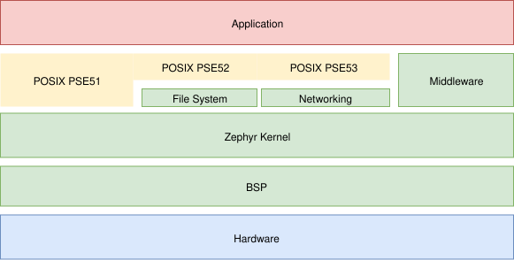
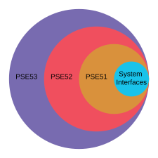

<!-- Copyright 2015-2026 Zephyr Project members and individual contributors. -->
<!-- SPDX-License-Identifier: Apache-2.0 -->
<!-- 中文翻译；编号、导航和明确标注的译注为本地新增。 -->

# 第11章\_POSIX概述与配置

原文：[官方页面](https://docs.zephyrproject.org/latest/services/portability/posix/overview/index.html)。读取日期：2026-10-14；保存的 latest 页面及 HTML 摘要见[来源记录](../SOURCES.md)。

## 11.1\_概述（Overview）

可移植操作系统接口（Portable Operating System Interface，POSIX）是 [IEEE 计算机学会（IEEE Computer Society）](https://www.computer.org/)为保持操作系统之间的兼容性制定的一组标准。Zephyr 实现 [IEEE 1003.1-2017](https://standards.ieee.org/ieee/1003.1/7101/)（也称 POSIX-1.2017）所定义标准 POSIX API 的一个子集。



图中文字：Hardware 为硬件，BSP 为板级支持包（Board Support Package），Zephyr Kernel 为 Zephyr 内核，File System 为文件系统，Networking 为网络，Middleware 为中间件，Application 为应用；POSIX PSE51／PSE52／PSE53 表示后文介绍的各级应用环境规范。

> 原文注意：本页不介绍 Zephyr 的 [POSIX 体系结构（POSIX Architecture）](../native_reference/P002_POSIX架构.md#posix-arch)。后者用于把 Zephyr 作为宿主操作系统上的原生应用运行，以便开展原型开发、测试和诊断。

借助 Zephyr 提供的 POSIX 支持，可以把符合 POSIX 的既有应用移植到 Zephyr 内核运行，从而使用 Zephyr 的功能。为遵循 POSIX 而设计的库，也可以不加修改地移植到基于 Zephyr 内核的应用中。

POSIX API 越来越多地被用作物联网和嵌入式应用的操作系统抽象层（Operating System Abstraction Layer，OSAL），例如 Zephyr、AWS:FreeRTOS、TI-RTOS 和 NuttX。

Zephyr 支持 POSIX 的益处包括：

- 为非嵌入式开发者，尤其是来自 Linux 环境的开发者，提供熟悉的 API。
- 复用基于 POSIX API 的既有库，提高可移植性。
- 为小型微控制器（Microcontroller，MCU）系统提供高效且适合其需求的 API 子集。

译注：原文所说的免修改移植，前提是库所依赖的接口、行为和配置均在实现支持范围内。应结合本册的符合性表及选项限制核对，不能据此推断任意 Linux 程序都能直接运行。

译注——来源访问：原页引用的两份 IEEE 标准介绍页在本次自动核验中返回 HTTP 403，原链接保留。本译文依据 Zephyr 页面及已保存源码，不声称已经取得或翻译独立标准全文。

## 11.2\_POSIX 子规范（POSIX Subprofiles）

Zephyr 支持多个[线程（Threads）](../kernel/P002_线程.md#threads-v2)，也可能采用[对称多处理（Symmetric Multiprocessing，SMP）](../kernel/P045_对称多处理.md#smp-arch)配置，并支持[虚拟内存与内存管理单元（Memory Management Unit，MMU）](../kernel/P021_内存管理入口.md#memory-management-api)。不过，Zephyr 的代码与数据通常共享同一个地址空间，再划分成不同的[内存域（Memory Domains）](../kernel/P041_内存保护与内存域.md#memory-domain)。内核与应用可执行代码通常编译到同一二进制产物中，因此可将 Zephyr 应用看作运行于单个进程上下文。

通用操作系统提供完整 POSIX 符合性，而 Zephyr 等实时操作系统（Real-Time Operating System，RTOS）通常面向固定用途，硬件资源和用户交互有限。在这样的系统中，实现完整 POSIX 可能既不实际，也无必要。

为此，[IEEE 1003.13-2003](https://standards.ieee.org/ieee/1003.13/3322/)（POSIX.13-2003）定义了以下[应用环境规范（Application Environment Profiles，AEP）](P013_POSIX应用环境规范.md#posix-aep)。每个 AEP 在必需的 [POSIX 系统接口](P012_POSIX符合性.md#posix-system-interfaces)基础上逐步增加功能。



- 最小实时系统规范（Minimal Realtime System Profile，[PSE51](P013_POSIX应用环境规范.md#posix-aep-pse51)）。
- 实时控制器系统规范（Realtime Controller System Profile，[PSE52](P013_POSIX应用环境规范.md#posix-aep-pse52)）。
- 专用实时系统规范（Dedicated Realtime System Profile，[PSE53](P013_POSIX应用环境规范.md#posix-aep-pse53)）。
- 多用途实时系统（Multi-Purpose Realtime System，PSE54）。

POSIX.13-2003 的 AEP 于 2003 年通过“功能单元”（Units of Functionality）正式定义；该规范目前已停用，仅供参考。不过，其设计意图仍由 POSIX-1.2017 的[选项（Options）](P015_POSIX选项与选项组.md#posix-options)和[选项组（Option Groups）](P015_POSIX选项与选项组.md#posix-option-groups)表达。

更多信息见 [IEEE 1003.1-2017 第 E 节：子规范划分注意事项（Subprofiling Considerations）](https://pubs.opengroup.org/onlinepubs/9699919799/xrat/V4_subprofiles.html)。

## 11.3\_Zephyr 中的 POSIX 应用

POSIX 应用[采用与其他 Zephyr 应用相同的构建方式](../application/P001_应用开发.md#application)，需要通常的 `prj.conf`、`CMakeLists.txt` 和源码。例如，下面的应用使用 POSIX 函数 `nanosleep()` 与 `perror()`。

简单 POSIX 应用的 `prj.conf`：

```ini
 CONFIG_POSIX_API=y
```

使用 Zephyr POSIX API 的简单应用：

```c
 #include <stddef.h>
 #include <stdio.h>
 #include <time.h>

 void megasleep(size_t megaseconds)
 {
     struct timespec ts = {
         .tv_sec = megaseconds * 1000000,
         .tv_nsec = 0,
     };

     printf("See you in a while!\n");
     if (nanosleep(&ts, NULL) == -1) {
         perror("nanosleep");
     }
 }

 int main()
 {
     megasleep(42);
     return 0;
 }
```

更多例子见 [POSIX 示例应用](P017_POSIX示例目录.md)。

译注：上面完整保留官方示例，包括历史配置 [`CONFIG_POSIX_API`](https://docs.zephyrproject.org/latest/kconfig.html#CONFIG_POSIX_API)；新应用的配置建议见下一节。`megasleep(42)` 中每单位为一百万秒，示例不是等待 42 秒；这里没有执行该程序。配置和源码应放入读者自行创建的应用，而不是替换现有工程文件。

## 11.4\_配置（Configuration）

与 Zephyr 大多数功能一样，POSIX 功能[可高度配置](../getting_started/P001_Zephyr介绍.md#zephyr-intro-configurability)，但原文说明默认关闭。用户必须通过 [Kconfig](../kconfig/P001_配置系统概述.md#kconfig) 显式选择启用 POSIX 选项。

### 11.4.1\_子规范（Subprofiles）

启用下列某个 Kconfig 选项，即可快速配置预定义的 [POSIX 子规范](#posix-subprofiles)：

- [`CONFIG_POSIX_AEP_CHOICE_BASE`](https://docs.zephyrproject.org/latest/kconfig.html#CONFIG_POSIX_AEP_CHOICE_BASE)：[基础（Base）](P012_POSIX符合性.md#posix-system-interfaces-required)。
- [`CONFIG_POSIX_AEP_CHOICE_PSE51`](https://docs.zephyrproject.org/latest/kconfig.html#CONFIG_POSIX_AEP_CHOICE_PSE51)：[PSE51](P013_POSIX应用环境规范.md#posix-aep-pse51)。
- [`CONFIG_POSIX_AEP_CHOICE_PSE52`](https://docs.zephyrproject.org/latest/kconfig.html#CONFIG_POSIX_AEP_CHOICE_PSE52)：[PSE52](P013_POSIX应用环境规范.md#posix-aep-pse52)。
- [`CONFIG_POSIX_AEP_CHOICE_PSE53`](https://docs.zephyrproject.org/latest/kconfig.html#CONFIG_POSIX_AEP_CHOICE_PSE53)：[PSE53](P013_POSIX应用环境规范.md#posix-aep-pse53)。

还可按需通过 Kconfig 启用额外的 [POSIX 选项与选项组](P015_POSIX选项与选项组.md#posix-option-groups)，例如 `CONFIG_POSIX_C_LIB_EXT=y`；再通过[其他 POSIX 相关 Kconfig 选项](P016_POSIX附加配置选项.md#posix-kconfig-options)细调。

原文推荐今后优先通过子规范、选项和选项组配置 Zephyr POSIX。

### 11.4.2\_历史配置（Legacy）

历史上，Zephyr 使用 [`CONFIG_POSIX_API`](https://docs.zephyrproject.org/latest/kconfig.html#CONFIG_POSIX_API) 配置一组职责过多、规模不断增长的 POSIX 功能。原文说明该选项现在已经冻结，可视为等价于以下组合：

- [`CONFIG_POSIX_AEP_CHOICE_PSE51`](https://docs.zephyrproject.org/latest/kconfig.html#CONFIG_POSIX_AEP_CHOICE_PSE51)。
- [`CONFIG_POSIX_FD_MGMT`](https://docs.zephyrproject.org/latest/kconfig.html#CONFIG_POSIX_FD_MGMT)。
- [`CONFIG_POSIX_MESSAGE_PASSING`](https://docs.zephyrproject.org/latest/kconfig.html#CONFIG_POSIX_MESSAGE_PASSING)。
- [`CONFIG_POSIX_NETWORKING`](https://docs.zephyrproject.org/latest/kconfig.html#CONFIG_POSIX_NETWORKING)。

不过，应将 [`CONFIG_POSIX_API`](https://docs.zephyrproject.org/latest/kconfig.html#CONFIG_POSIX_API) 视为历史选项，新 Zephyr 应用不应继续使用它。

译注——配置版本差异：本次核对的官方 `Kconfig.profile` 还定义了默认的 `POSIX_AEP_CHOICE_ZEPHYR`，选择内核可能需要的少量 C 库扩展，并明确它本身不符合完整 POSIX 实现规范。因此“默认关闭”不能理解为默认构建完全没有任何 POSIX 来源函数。当前 `POSIX_API` 的 `select`／`imply` 依赖也比原页四项列表更具体，网络选择受 `NETWORKING` 条件影响；实际最终配置以该版本 Kconfig 和生成的 `.config` 为准，不把原页组合视为逐项不变的构建保证。


译注核对来源：[subsys/portability/posix/Kconfig.profile](https://github.com/zephyrproject-rtos/zephyr/blob/main/subsys/portability/posix/Kconfig.profile)。

本仓库的[对应源码](../../../subsys/portability/posix/Kconfig.profile)可用于跟踪，版本可能与网页不同；本批仅翻译和核对文档，没有执行固件构建、模拟运行或烧录。

<a id="overview"></a>
<a id="posix-overview"></a>
<a id="id2"></a>
<a id="posix-subprofiles"></a>
<a id="id1"></a>
<a id="id3"></a>
<a id="posix-applications-in-zephyr"></a>
<a id="posix-apps"></a>
<a id="id4"></a>
<a id="id5"></a>
<a id="configuration"></a>
<a id="posix-config"></a>
<a id="subprofiles"></a>
<a id="legacy"></a>

<!-- reading-navigation:start -->

**主线阅读**

[上一篇：POSIX文档入口](P010_POSIX文档入口.md) · [本模块主线目录](../reading/portability.md) · [全部主线](../reading/README.md) · [下一篇：POSIX符合性](P012_POSIX符合性.md)

<details>
<summary>原册编号导航（含扩展参考）</summary>

[上一章](P010_POSIX文档入口.md) · [返回大纲](大纲.md) · [下一章](P012_POSIX符合性.md)

</details>

<!-- reading-navigation:end -->
