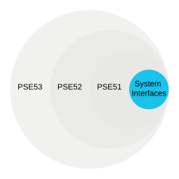
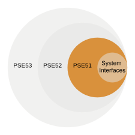
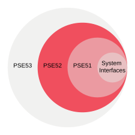
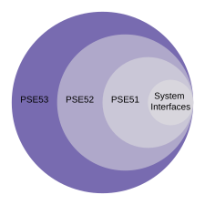

<!-- Copyright 2015-2026 Zephyr Project members and individual contributors. -->
<!-- SPDX-License-Identifier: Apache-2.0 -->
<!-- 中文翻译；编号、导航和明确标注的译注为本地新增。 -->

# 第13章\_POSIX应用环境规范

原文：[官方页面](https://docs.zephyrproject.org/latest/services/portability/posix/aep/index.html)。读取日期：2026-10-14；保存的 latest 页面及 HTML 摘要见[来源记录](../SOURCES.md)。

## 13.1\_应用环境规范（Application Environment Profiles，AEP）

虽然 [IEEE 1003.13-2003](https://standards.ieee.org/ieee/1003.13/3322/) 已停用，它定义的一系列 AEP 仍启发了 [IEEE 1003.1-2017](https://standards.ieee.org/ieee/1003.1/7101/) 中现代子规范选项的设计。下面使用与当前 POSIX-1 一致的术语列出单用途实时系统规范，供参考；本页暂不考虑 PSE54。

## 13.2\_系统接口（System Interfaces）

每个应用环境规范都支持必需的 POSIX [系统接口](P012_POSIX符合性.md#posix-system-interfaces-required)。

## 13.3\_最小实时系统规范（Minimal Realtime System Profile，PSE51）

PSE51 包含全部[系统接口](P012_POSIX符合性.md#posix-system-interfaces-required)以及若干附加功能。

### 13.3.1\_PSE51 系统接口

| 符号（Symbol） | 支持值（Support） | 备注（Remarks） |
| --- | --- | --- |
| _POSIX_AEP_REALTIME_MINIMAL | -1 | [`CONFIG_POSIX_AEP_REALTIME_MINIMAL`](https://docs.zephyrproject.org/latest/kconfig.html#CONFIG_POSIX_AEP_REALTIME_MINIMAL) |

### 13.3.2\_PSE51 选项组（Option Groups）

| 符号（Symbol） | 支持值（Support） | 备注（Remarks） |
| --- | --- | --- |
| [POSIX_C_LANG_JUMP](P015_POSIX选项与选项组.md#posix-option-group-c-lang-jump) | 支持（yes） |  |
| [POSIX_C_LANG_SUPPORT](P015_POSIX选项与选项组.md#posix-option-group-c-lang-support) | 支持（yes） |  |
| [POSIX_DEVICE_IO](P015_POSIX选项与选项组.md#posix-option-group-device-io) | 支持（yes） | [`CONFIG_POSIX_DEVICE_IO`](https://docs.zephyrproject.org/latest/kconfig.html#CONFIG_POSIX_DEVICE_IO) |
| [POSIX_SIGNALS](P015_POSIX选项与选项组.md#posix-option-group-signals) | 支持（yes） | [`CONFIG_POSIX_SIGNALS`](https://docs.zephyrproject.org/latest/kconfig.html#CONFIG_POSIX_SIGNALS) [†](P012_POSIX符合性.md#posix-undefined-behaviour) |
| [POSIX_SINGLE_PROCESS](P015_POSIX选项与选项组.md#posix-option-group-single-process) | 支持（yes） | [`CONFIG_POSIX_SINGLE_PROCESS`](https://docs.zephyrproject.org/latest/kconfig.html#CONFIG_POSIX_SINGLE_PROCESS) |
| [XSI_THREADS_EXT](P015_POSIX选项与选项组.md#posix-option-group-xsi-threads-ext) | 支持（yes） | [`CONFIG_XSI_THREADS_EXT`](https://docs.zephyrproject.org/latest/kconfig.html#CONFIG_XSI_THREADS_EXT) |

### 13.3.3\_PSE51 选项要求（Option Requirements）

| 符号（Symbol） | 支持值（Support） | 备注（Remarks） |
| --- | --- | --- |
| [_POSIX_FSYNC](P015_POSIX选项与选项组.md#posix-option-fsync) | 200809L | [`CONFIG_POSIX_FSYNC`](https://docs.zephyrproject.org/latest/kconfig.html#CONFIG_POSIX_FSYNC) |
| [_POSIX_MEMLOCK](P015_POSIX选项与选项组.md#posix-option-memlock) | 200809L | [`CONFIG_POSIX_MEMLOCK`](https://docs.zephyrproject.org/latest/kconfig.html#CONFIG_POSIX_MEMLOCK) [†](P012_POSIX符合性.md#posix-undefined-behaviour) |
| [_POSIX_MEMLOCK_RANGE](P015_POSIX选项与选项组.md#posix-option-memlock-range) | 200809L | [`CONFIG_POSIX_MEMLOCK_RANGE`](https://docs.zephyrproject.org/latest/kconfig.html#CONFIG_POSIX_MEMLOCK_RANGE) |
| [_POSIX_MONOTONIC_CLOCK](P015_POSIX选项与选项组.md#posix-option-monotonic-clock) | 200809L | [`CONFIG_POSIX_MONOTONIC_CLOCK`](https://docs.zephyrproject.org/latest/kconfig.html#CONFIG_POSIX_MONOTONIC_CLOCK) |
| [_POSIX_SHARED_MEMORY_OBJECTS](P015_POSIX选项与选项组.md#posix-option-shared-memory-objects) | 200809L | [`CONFIG_POSIX_SHARED_MEMORY_OBJECTS`](https://docs.zephyrproject.org/latest/kconfig.html#CONFIG_POSIX_SHARED_MEMORY_OBJECTS) |
| [_POSIX_SYNCHRONIZED_IO](P015_POSIX选项与选项组.md#posix-option-synchronized-io) | 200809L | [`CONFIG_POSIX_SYNCHRONIZED_IO`](https://docs.zephyrproject.org/latest/kconfig.html#CONFIG_POSIX_SYNCHRONIZED_IO) |
| [_POSIX_THREAD_ATTR_STACKADDR](P015_POSIX选项与选项组.md#posix-option-thread-attr-stackaddr) | 200809L | [`CONFIG_POSIX_THREAD_ATTR_STACKADDR`](https://docs.zephyrproject.org/latest/kconfig.html#CONFIG_POSIX_THREAD_ATTR_STACKADDR) |
| [_POSIX_THREAD_ATTR_STACKSIZE](P015_POSIX选项与选项组.md#posix-option-thread-attr-stacksize) | 200809L | [`CONFIG_POSIX_THREAD_ATTR_STACKSIZE`](https://docs.zephyrproject.org/latest/kconfig.html#CONFIG_POSIX_THREAD_ATTR_STACKSIZE) |
| [_POSIX_THREAD_CPUTIME](P015_POSIX选项与选项组.md#posix-option-thread-cputime) | 200809L | [`CONFIG_POSIX_CPUTIME`](https://docs.zephyrproject.org/latest/kconfig.html#CONFIG_POSIX_CPUTIME) |
| [_POSIX_THREAD_PRIO_INHERIT](P015_POSIX选项与选项组.md#posix-option-thread-prio-inherit) | 200809L | [`CONFIG_POSIX_THREAD_PRIO_INHERIT`](https://docs.zephyrproject.org/latest/kconfig.html#CONFIG_POSIX_THREAD_PRIO_INHERIT) |
| [_POSIX_THREAD_PRIO_PROTECT](P015_POSIX选项与选项组.md#posix-option-thread-prio-protect) | 200809L | [`CONFIG_POSIX_THREAD_PRIO_PROTECT`](https://docs.zephyrproject.org/latest/kconfig.html#CONFIG_POSIX_THREAD_PRIO_PROTECT) |
| [_POSIX_THREAD_PRIORITY_SCHEDULING](P015_POSIX选项与选项组.md#posix-option-thread-priority-scheduling) | 200809L | [`CONFIG_POSIX_THREAD_PRIORITY_SCHEDULING`](https://docs.zephyrproject.org/latest/kconfig.html#CONFIG_POSIX_THREAD_PRIORITY_SCHEDULING) |
| _POSIX_THREAD_SPORADIC_SERVER | -1 |  |

## 13.4\_实时控制器系统规范（Realtime Controller System Profile，PSE52）

PSE52 包含 PSE51 的全部功能以及[系统接口](P012_POSIX符合性.md#posix-system-interfaces-required)。

### 13.4.1\_PSE52 系统接口

| 符号（Symbol） | 支持值（Support） | 备注（Remarks） |
| --- | --- | --- |
| _POSIX_AEP_REALTIME_CONTROLLER | -1 | [`CONFIG_POSIX_AEP_REALTIME_CONTROLLER`](https://docs.zephyrproject.org/latest/kconfig.html#CONFIG_POSIX_AEP_REALTIME_CONTROLLER) |

### 13.4.2\_PSE52 选项组

| 符号（Symbol） | 支持值（Support） | 备注（Remarks） |
| --- | --- | --- |
| [POSIX_C_LANG_MATH](P015_POSIX选项与选项组.md#posix-option-group-c-lang-math) | 支持（yes） |  |
| [POSIX_FD_MGMT](P015_POSIX选项与选项组.md#posix-option-group-fd-mgmt) |  | [`CONFIG_POSIX_FD_MGMT`](https://docs.zephyrproject.org/latest/kconfig.html#CONFIG_POSIX_FD_MGMT) |
| [POSIX_FILE_SYSTEM](P015_POSIX选项与选项组.md#posix-option-group-file-system) |  | [`CONFIG_POSIX_FILE_SYSTEM`](https://docs.zephyrproject.org/latest/kconfig.html#CONFIG_POSIX_FILE_SYSTEM) |

### 13.4.3\_PSE52 选项要求

| 符号（Symbol） | 支持值（Support） | 备注（Remarks） |
| --- | --- | --- |
| [_POSIX_MESSAGE_PASSING](P015_POSIX选项与选项组.md#posix-option-message-passing) | 200809L | [`CONFIG_POSIX_MESSAGE_PASSING`](https://docs.zephyrproject.org/latest/kconfig.html#CONFIG_POSIX_MESSAGE_PASSING) |
| _POSIX_TRACE | -1 |  |
| _POSIX_TRACE_EVENT_FILTER | -1 |  |
| _POSIX_TRACE_LOG | -1 |  |

## 13.5\_专用实时系统规范（Dedicated Realtime System Profile，PSE53）

PSE53 包含 PSE52、PSE51 和[系统接口](P012_POSIX符合性.md#posix-system-interfaces-required)的全部功能。

### 13.5.1\_PSE53 系统接口

| 符号（Symbol） | 支持值（Support） | 备注（Remarks） |
| --- | --- | --- |
| _POSIX_AEP_REALTIME_DEDICATED | -1 | [`CONFIG_POSIX_AEP_REALTIME_DEDICATED`](https://docs.zephyrproject.org/latest/kconfig.html#CONFIG_POSIX_AEP_REALTIME_DEDICATED) |

### 13.5.2\_PSE53 选项组

| 符号（Symbol） | 支持值（Support） | 备注（Remarks） |
| --- | --- | --- |
| [POSIX_MULTI_PROCESS](P015_POSIX选项与选项组.md#posix-option-group-multi-process) |  | [`CONFIG_POSIX_MULTI_PROCESS`](https://docs.zephyrproject.org/latest/kconfig.html#CONFIG_POSIX_MULTI_PROCESS)[†](P012_POSIX符合性.md#posix-undefined-behaviour) |
| [POSIX_NETWORKING](P015_POSIX选项与选项组.md#posix-option-group-networking) | 支持（yes） | [`CONFIG_POSIX_NETWORKING`](https://docs.zephyrproject.org/latest/kconfig.html#CONFIG_POSIX_NETWORKING) |
| [POSIX_PIPE](P015_POSIX选项与选项组.md#posix-option-group-pipe) |  |  |
| [POSIX_SIGNAL_JUMP](P015_POSIX选项与选项组.md#posix-option-group-signal-jump) |  |  |

### 13.5.3\_PSE53 选项要求

| 符号（Symbol） | 支持值（Support） | 备注（Remarks） |
| --- | --- | --- |
| [_POSIX_CPUTIME](P015_POSIX选项与选项组.md#posix-option-cputime) | 200809L | [`CONFIG_POSIX_CPUTIME`](https://docs.zephyrproject.org/latest/kconfig.html#CONFIG_POSIX_CPUTIME) |
| _POSIX_PRIORITIZED_IO | -1 |  |
| [_POSIX_PRIORITY_SCHEDULING](P015_POSIX选项与选项组.md#posix-option-priority-scheduling) | -1 |  |
| [_POSIX_RAW_SOCKETS](P015_POSIX选项与选项组.md#posix-option-raw-sockets) | 200809L | [`CONFIG_POSIX_RAW_SOCKETS`](https://docs.zephyrproject.org/latest/kconfig.html#CONFIG_POSIX_RAW_SOCKETS) |
| _POSIX_SPAWN | -1 | [†](P012_POSIX符合性.md#posix-undefined-behaviour) |
| _POSIX_SPORADIC_SERVER | -1 | [†](P012_POSIX符合性.md#posix-undefined-behaviour) |

译注：图和表描述规范的功能组成，不是当前固件全部功能可用的证明。原表中的 `-1`、`200809L`、空白及 † 均原样保留；† 涉及未定义行为，参阅[符合性说明](P012_POSIX符合性.md#posix-undefined-behaviour)。例如原表 [`_POSIX_THREAD_CPUTIME`](P015_POSIX选项与选项组.md#posix-option-thread-cputime) 旁列出 [`CONFIG_POSIX_CPUTIME`](https://docs.zephyrproject.org/latest/kconfig.html#CONFIG_POSIX_CPUTIME)，此处不静默替换其名称；实际配置应同时检查所用版本的 Kconfig 和特性宏。

译注核对来源：[subsys/portability/posix/Kconfig.profile](https://github.com/zephyrproject-rtos/zephyr/blob/main/subsys/portability/posix/Kconfig.profile)。

本仓库的[对应源码](../../../subsys/portability/posix/Kconfig.profile)可用于跟踪，版本可能与网页不同；本批仅翻译和核对文档，没有执行固件构建、模拟运行或烧录。

<!-- reading-navigation:start -->

**主线阅读**

[上一篇：POSIX符合性](P012_POSIX符合性.md) · [本模块主线目录](../reading/portability.md) · [全部主线](../reading/README.md) · [下一篇：POSIX实现设计](P014_POSIX实现设计.md)

原册编号导航（含扩展参考）

[上一章](P012_POSIX符合性.md) · [返回大纲](大纲.md) · [下一章](P014_POSIX实现设计.md)

<!-- reading-navigation:end -->
