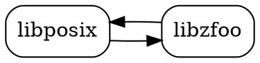
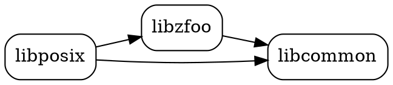

<!-- Copyright 2015-2026 Zephyr Project members and individual contributors. -->
<!-- SPDX-License-Identifier: Apache-2.0 -->
<!-- 中文翻译；编号、导航和明确标注的译注为本地新增。 -->

# 第14章\_POSIX实现设计

原文：[官方页面](https://docs.zephyrproject.org/latest/services/portability/posix/implementation/index.html)。读取日期：2026-10-14；保存的 latest 页面及 HTML 摘要见[来源记录](../SOURCES.md)。

## 14.1\_实现细节（Implementation Details）

在许多方面，Zephyr 以类似 POSIX 操作系统的方式提供支持：API 绑定使用 C 语言，配置完成后可从标准包含路径取得 POSIX 头文件。

与其他通用 POSIX 操作系统相比，Zephyr 有以下特点：

- Zephyr 不是“一个 POSIX 操作系统”。内核并非围绕 POSIX 标准设计，POSIX 支持是按需启用的功能。
- Zephyr 应用不会单独链接，也不会作为子进程运行。
- Zephyr、库和应用代码一起编译、链接，在同一个地址空间中运行，该地址空间也可能是虚拟地址空间；整体类似单进程应用。
- Zephyr 不提供 POSIX Shell、编译器和实用工具，也不是自托管系统（Self-Hosting System）。

> 原文注意：与 Linux 内核或 FreeBSD 不同，Zephyr 不为各受支持体系结构维护固定的系统调用编号表，而是在构建时动态生成系统调用。更多信息见[系统调用（System Calls）](../kernel/P044_系统调用.md#syscalls)。

## 14.2\_设计（Design）

作为一个库，Zephyr 的 POSIX API 实现力求成为应用、中间件与 Zephyr 内核之间的薄抽象层（Thin Abstraction Layer）。一般设计原则如下。

### 14.2.1\_接口与实现的归属

POSIX 接口和实现应放在 Zephyr 的 POSIX 库中，除非某功能同时被 POSIX API 实现和其他功能需要。例如，`getopt()` 的实现应保留在 POSIX 实现中；多线程和网络则应由独立库实现。

### 14.2.2\_避免循环依赖（Dependency Cycles）

POSIX API 与其他 Zephyr 子系统共同依赖某项功能时，应把它实现为独立的 Zephyr 库，供两者复用，以减少代码依赖环。实际可行时，宏也应遵循此规则。

例如，`libposix` 依赖 `libzfoo` 实现 Zephyr 中某个功能 `foo`；若 `libzfoo` 又依赖 `libposix`，就形成循环依赖。可提取共同依赖 `libcommon` 消除这个环。

原图中两个箭头分别为 `libposix → libzfoo` 与 `libzfoo → libposix`。官方图形所附 Graphviz 源码如下，完整保留：

第二幅图仍保留 `libposix → libzfoo`，并让两者共同依赖 `libcommon`，从而去掉反向依赖。

### 14.2.3\_系统调用封装

POSIX API 应以普通可调用 C 函数提供。如果实现内部需要 Zephyr [系统调用（System Call）](../kernel/P044_系统调用.md#syscalls)，应把该系统调用的声明与实现隐藏在 POSIX API 后面。

译注核对来源：[subsys/portability/posix/Kconfig](https://github.com/zephyrproject-rtos/zephyr/blob/main/subsys/portability/posix/Kconfig)、[subsys/portability/posix/options/Kconfig](https://github.com/zephyrproject-rtos/zephyr/blob/main/subsys/portability/posix/options/Kconfig)。

本仓库的[对应源码](../../../subsys/portability/posix/Kconfig)可用于跟踪，版本可能与网页不同；本批仅翻译和核对文档，没有执行固件构建、模拟运行或烧录。

<!-- reading-navigation:start -->

**主线阅读**

[上一篇：POSIX应用环境规范](P013_POSIX应用环境规范.md) · [本模块主线目录](../reading/portability.md) · [全部主线](../reading/README.md) · [下一篇：POSIX选项与选项组](P015_POSIX选项与选项组.md)

原册编号导航（含扩展参考）

[上一章](P013_POSIX应用环境规范.md) · [返回大纲](大纲.md) · [下一章](P015_POSIX选项与选项组.md)

<!-- reading-navigation:end -->
