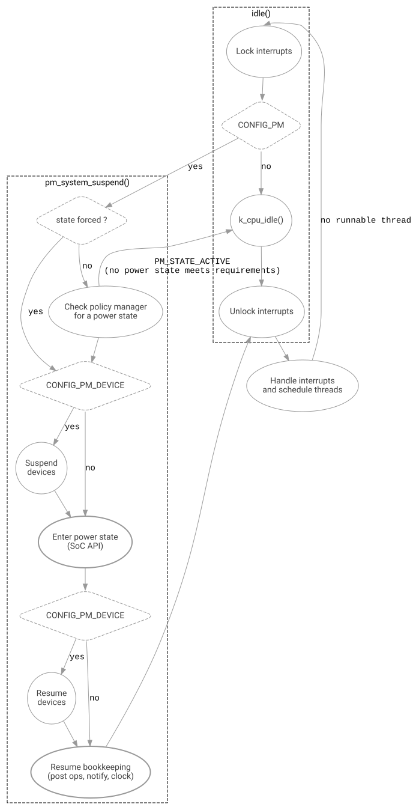
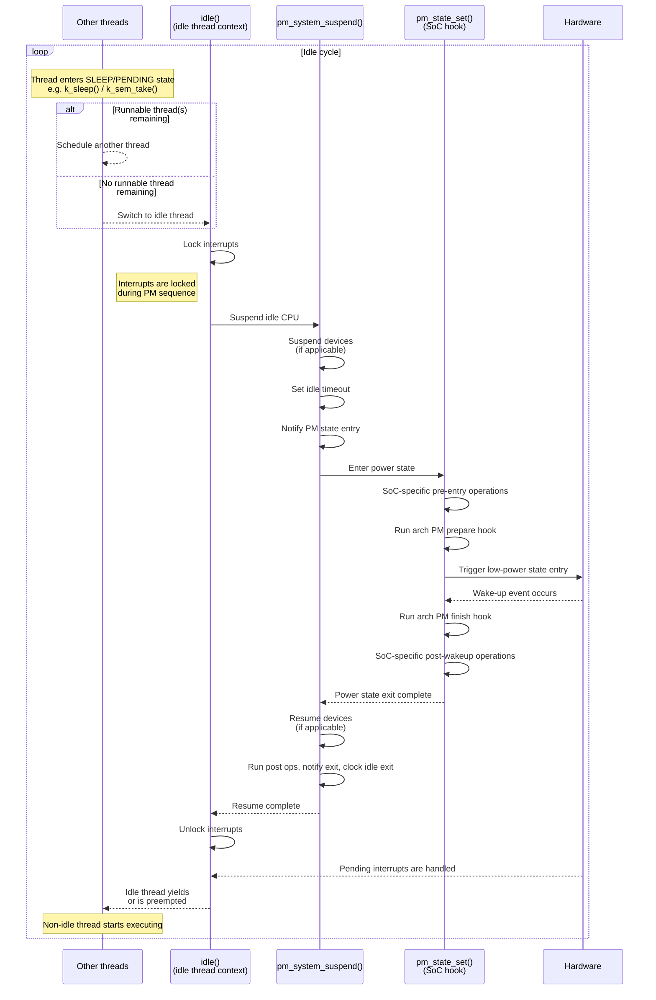

<!-- Copyright 2015-2026 Zephyr Project members and individual contributors. -->
<!-- SPDX-License-Identifier: Apache-2.0 -->
<!-- 中文翻译；阅读编号、导航和译注为本地新增。 -->

# 第2章\_系统电源管理

原文：[System Power Management](https://docs.zephyrproject.org/latest/services/pm/system.html)。读取日期：2026-10-12，`latest`。

内核没有可调度工作时进入**空闲状态（Idle State）**。启用 `CONFIG_PM` 后，内核可调用电源管理子系统，将空闲系统放入平台支持的电源状态。内核提供希望挂起的时长，**电源管理（Power Management，PM）** 根据配置的策略选择适当状态。

唤醒事件由应用负责配置，通常是 **片上系统（System on Chip，SoC）** 外设产生的中断，例如 SysTick、**实时时钟（Real-Time Clock，RTC）**、计数器或 **通用输入输出（General-Purpose Input/Output，GPIO）**。不同 SoC、不同电源模式下，仍在工作的外设不同，因此并非所有唤醒源在所有模式都可用。

## 2.1\_休眠、唤醒与中断恢复次序

原文系统流程图如下：



空闲路径先锁中断。未启用 PM 时调用 `k_cpu_idle()`，随后解锁并处理中断、调度线程。启用 PM 时，若已强制指定状态就采用该状态，否则查询策略管理器；没有符合要求的状态、策略返回 `PM_STATE_ACTIVE` 时，退回普通 **中央处理器（Central Processing Unit，CPU）** 空闲。

选择低功耗状态后，按设备 PM 配置挂起设备，再经 SoC 接口进入电源状态。唤醒后按配置恢复设备，执行恢复收尾、通知及系统时钟空闲退出记账，然后返回空闲线程恢复中断；处理中断和线程调度后，如果仍没有就绪线程，就开始下一次空闲循环。

> 译注：图中沿用 `CONFIG_PM_DEVICE` 标识设备处理分支，是否使用系统统一挂起设备，还应结合[设备电源管理](P003_设备电源管理.md)所述 `CONFIG_PM_DEVICE_SYSTEM_MANAGED` 与电源状态属性判断。

空闲线程在调用 `pm_system_suspend()` 前锁中断，并保有原始架构中断键。若进入低功耗状态，恢复收尾仍在中断锁定状态下执行。默认先恢复系统管理的设备，再执行 `pm_state_exit_post_ops()`、PM 退出通知、系统时钟空闲退出记账。如果该低功耗状态停止了计时器，设备恢复回调不能依赖以该计时器实现的 `k_busy_wait()`。收尾结束且 `pm_system_suspend()` 返回后，空闲线程才恢复原中断键。

### 2.1.1\_提前恢复系统计时器

默认关闭的实验选项 `CONFIG_PM_EARLY_SYSTEM_TIMER_RESUME` 会调整顺序：先执行 `pm_state_exit_post_ops()`，再作系统时钟空闲退出记账，之后恢复设备，最后发送 PM 退出通知。它可能使恢复回调能够使用基于计时器的 `k_busy_wait()`，但需要平台专用验证。

SoC post-ops 不得依赖尚未恢复的设备，计时器退出空闲也不得依赖仍挂起的设备。此外，计时器退出空闲可能在设备恢复之前调用 `k_timer` 到期函数。

### 2.1.2\_默认中断所有权约定

未选择 `CONFIG_PM_STATE_SET_IRQ_UNLOCKED` 的架构和 SoC，在低功耗指令紧邻位置使用架构钩子，使处理器能观察到唤醒事件，却不先执行唤醒源 **中断服务例程（Interrupt Service Routine，ISR）**。此模式下，`pm_state_set()` 和 `pm_state_exit_post_ops()` 只负责 SoC 硬件工作，不能用来最终解除中断屏蔽。

以下保留官方 Mermaid 时序代码，以便对照接口名；其中文步骤紧接图后：



时序含义为：普通线程调用 `k_sleep()`、`k_sem_take()` 等进入睡眠或等待，有其他就绪线程则继续调度，否则切换到空闲线程。空闲线程锁中断，调用 PM 挂起 CPU；PM 依次挂起适用设备、设置空闲超时、通知进入状态，再调用 SoC 钩子。SoC 做进入前硬件操作，调用架构 prepare 钩子，执行低功耗指令；唤醒事件发生后调用架构 finish 钩子，做 SoC 唤醒后操作并返回 PM。PM 恢复设备，执行后置操作、退出通知和时钟退出空闲处理，再返回空闲线程。空闲线程解锁中断，待处理中断得以执行，随后主动让出 CPU 或被抢占，普通线程恢复运行。

遵循默认约定的 SoC 不得在上述两个 SoC 钩子中解锁中断。旧实现若仍调用 `irq_unlock(0)`、`arch_irq_unlock(0)`、`__enable_irq()` 或等价操作，应在迁移前选择 `CONFIG_PM_STATE_SET_IRQ_UNLOCKED`。

> 原文注意：上述次序仅保证 `arch_irq_lock()` 能屏蔽的中断；[零延迟中断](https://docs.zephyrproject.org/latest/kernel/services/interrupts.html#zlis)不在此保证范围内。
>
> 译注：这些配置和回调次序来自本次读取的 `latest` 页面；移植时应核对所用源码版本，不能把旧 SoC 中直接解锁中断的实现与此约定混用。

## 2.2\_电源状态

电源状态由功耗和上下文保留程度描述，集合定义在 [pm_state](P034_电源状态接口.md)。一般来说，枚举索引更高的低功耗状态能节约更多能量，但唤醒延迟也更大。

## 2.3\_电源策略

支持基于驻留时间的策略和应用自定义策略。策略管理器只能在平台已定义状态中选择，还要考虑禁止某些状态的锁，以及策略相关的最小、最大延迟约束。状态定义见 [zephyr,power-state 绑定](https://docs.zephyrproject.org/latest/build/dts/api/bindings/power/zephyr%2Cpower-state.html#std-dtcompatible-zephyr-power-state)。

### 2.3.1\_驻留策略

选择节能最多的状态，但要求最小驻留时间与退出延迟之和，不超过内核给定的空闲时长。原文核心逻辑为：

```c
if (time_to_next_scheduled_event >= (state.min_residency_us + state.exit_latency)) {
   return state
}
```

> 译注：这是说明逻辑的伪代码，原例 `return state` 未带分号，字段名也应以实际结构为准，不能直接粘贴为实现。

### 2.3.2\_应用策略

应用实现 `pm_policy_next_state()`，根据距下次计划超时的剩余时间决定系统状态。示例见 [tests/subsys/pm/power_mgmt](https://github.com/zephyrproject-rtos/zephyr/blob/main/tests/subsys/pm/power_mgmt/)。

### 2.3.3\_自定义tick钩子

除了内核 tick 超时和 PM 策略事件表，应用或 SoC 还可能需要从硬件寄存器、仅提供二进制的第三方模块、复杂或旧有结构中取得下一唤醒时间，这些信息不易表示成标准 PM 事件。

启用 `CONFIG_PM_CUSTOM_TICKS_HOOK` 后，PM 在 `pm_system_suspend()` 中调用可选 `pm_policy_next_custom_ticks()`。它返回距下一个自定义事件的 tick 数，没有事件时返回 `K_TICKS_FOREVER`。核心在内核超时、`pm_policy_next_event_ticks()` 给出的事件表时间和自定义时间三者中选择最早者，无须修改事件表设施。

### 2.3.4\_锁定电源状态

各组件和应用可配置策略管理器，禁止进入某些状态。例如设备正在后台执行任务，某状态会丢失其上下文时，可以通过 [pm_policy_state_lock_get()](P035_系统电源管理策略接口.md) 等机制限制状态选择。

## 2.4\_示例

- [ST 低功耗闪灯](https://github.com/zephyrproject-rtos/zephyr/blob/main/samples/boards/st/power_mgmt/blinky/)。
- [Espressif 深睡眠](https://github.com/zephyrproject-rtos/zephyr/blob/main/samples/boards/espressif/deep_sleep/)。
- [设备PM示例](https://github.com/zephyrproject-rtos/zephyr/blob/main/samples/subsys/pm/device_pm/)。
- [电源管理测试](https://github.com/zephyrproject-rtos/zephyr/blob/main/tests/subsys/pm/power_mgmt/)。
- [SoC电源管理测试](https://github.com/zephyrproject-rtos/zephyr/blob/main/tests/subsys/pm/power_mgmt_soc/)。
- [电源状态API测试](https://github.com/zephyrproject-rtos/zephyr/blob/main/tests/subsys/pm/power_states_api/)。

<!-- reading-navigation:start -->

**主线阅读**

[上一篇：电源管理概述](P001_电源管理概述.md) · [本模块主线目录](../reading/power.md) · [全部主线](../reading/README.md) · [下一篇：设备电源管理](P003_设备电源管理.md)

<details>
<summary>原册编号导航（含扩展参考）</summary>

[上一章：电源管理概述](P001_电源管理概述.md) · [下一章：设备电源管理](P003_设备电源管理.md) · [返回大纲](大纲.md)

</details>

<!-- reading-navigation:end -->
