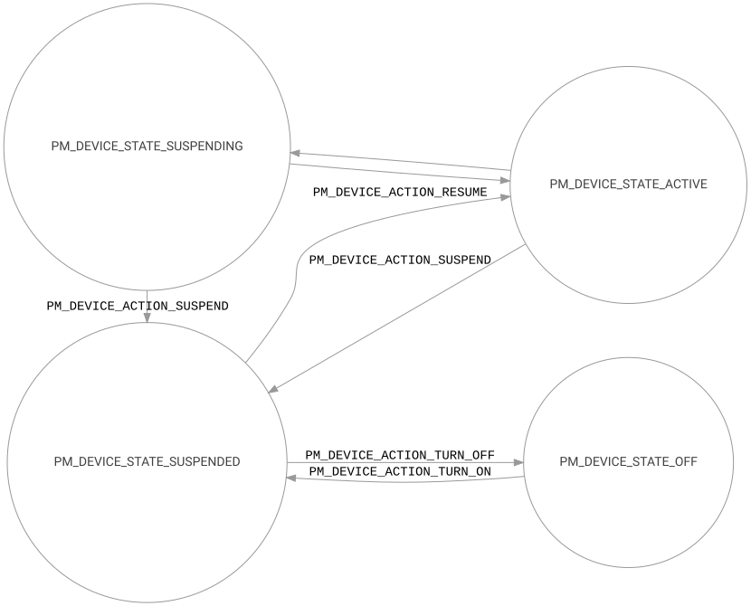

<!-- Copyright 2015-2026 Zephyr Project members and individual contributors. -->
<!-- SPDX-License-Identifier: Apache-2.0 -->
<!-- 中文翻译；阅读编号、导航和译注为本地新增。 -->

# 第3章\_设备电源管理

原文：[Device Power Management](https://docs.zephyrproject.org/latest/services/pm/device.html)。读取日期：2026-10-12，`latest`。

Zephyr **设备电源管理（Device Power Management）**以一致机制控制驱动需要执行的电源动作。控制依据是系统各组件提出的明确使用需求，以及设备之间的电源依赖。支持设备运行时 **电源管理（Power Management，PM）** 和系统管理的设备 PM 两种方式。

## 3.1\_设备运行时PM

运行时 PM 需要驱动、子系统、应用协作。驱动直接操作硬件挂起或恢复设备，上层也可影响何时需要设备。子系统使用引用计数决定挂起和恢复时机，各层不必了解其他层的具体实现。

驱动负责实际低功耗动作，并使用 Zephyr 的运行时 PM **应用程序编程接口（Application Programming Interface，API）** 管理使用需求。传感器、文件系统、网络等子系统可能更了解整体负载，例如预期即将有网络活动时保持接口供电。应用也可能要求持续工作，例如连续传输网络数据。

驱动未必知道上层即将执行一连串操作；此时上层可取得运行时 PM 引用，使设备一直活动到操作序列完成。系统 PM 不再花时间挂起和恢复已启用运行时 PM 的设备，因此可以更快改变系统电源状态。详见[设备运行时电源管理](P004_设备运行时电源管理.md)。

## 3.2\_系统管理的设备PM

启用 `CONFIG_PM_DEVICE_SYSTEM_MANAGED` 后，设备随 **中央处理器（Central Processing Unit，CPU）**/**片上系统（System on Chip，SoC）** 进入电源状态而挂起，主要处理发生在 `pm_system_suspend()` 内。

决定进入低功耗后，PM 检查该状态是否需要管理设备，再在切换状态前挂起设备，按与初始化关系匹配的顺序满足依赖。CPU 唤醒后，以与挂起相反的次序恢复。

> 译注：原文说“following their initialization order”，容易被理解为按初始化先后顺序挂起。本地 `pm_suspend_devices()` 逆序遍历设备，恢复再反向处理挂起列表；其目的是先停子设备、后停依赖设备，恢复时相反。移植时应以所用版本的实际依赖与实现核对。

是否挂起设备还取决于电源状态的 `zephyr,pm-device-disabled` 属性。下面定义两个低功耗状态，只有一个触发设备 PM：

```dts
/* Node in a DTS file */
cpus {
     power-states {
             state0: state0 {
                     compatible = "zephyr,power-state";
                     power-state-name = "standby";
                     min-residency-us = <5000>;
                     exit-latency-us = <240>;
                     zephyr,pm-device-disabled;
             };
             state1: state1 {
                     compatible = "zephyr,power-state";
                     power-state-name = "suspend-to-ram";
                     min-residency-us = <8000>;
                     exit-latency-us = <360>;
             };
     };
};
```

> 原文注意：系统 PM 的设备切换可能在空闲线程执行，此上下文不能阻塞。准备调用阻塞 API 的切换路径必须用 `k_can_yield()` 判断是否允许。

这种方式适合挂起/恢复均不需要阻塞的系统，实现相对简单；也适合设备无法自行决定电源状态、必须一直活动直到外部主机要求 SoC 一起休眠的场景。由于这些约束，原文优先推荐运行时设备 PM。

设备无法挂起时，CPU 不进入该低功耗状态。例如设备正进行不可中断事务，针对 `PM_DEVICE_ACTION_SUSPEND` 返回 `-EBUSY`。若启用 `CONFIG_PM_NEED_ALL_DEVICES_IDLE`，有设备被标为忙也会阻止进入低功耗。

多核系统仅在最后一个活动核心进入低功耗时挂起设备，由第一个恢复活动的核心恢复设备。

## 3.3\_设备状态与动作

PM 通过 `pm_device_state` 跟踪设备状态，驱动负责处理 `pm_device_action` 所要求的硬件操作。驱动实现 `pm_device_action_cb_t` 回调；启用 `CONFIG_PM_DEVICE` 后，这些回调暴露给 PM 子系统。



原图关系为：ACTIVE 可以进入 SUSPENDING，尚在挂起过程时也可能返回 ACTIVE；执行 SUSPEND 后，从 ACTIVE 或 SUSPENDING 到 SUSPENDED；RESUME 从 SUSPENDED 到 ACTIVE；TURN_ON 从 OFF 到 SUSPENDED；TURN_OFF 从 SUSPENDED 到 OFF。驱动不自行修改框架状态，而是完成各动作要求的硬件操作，由子系统跟踪状态转换。

## 3.4\_支持设备PM的设备模型

驱动使用设备定义宏初始化设备，见[设备驱动模型](../hardware/P003_设备驱动模型.md)。实现 PM 的驱动需要向宏提供相应参数。`PM_DEVICE_DEFINE` 或 `PM_DEVICE_DT_DEFINE` 分配 PM 所需的驱动上下文，再用 `PM_DEVICE_GET` 或 `PM_DEVICE_DT_GET` 取得指针，传给 `DEVICE_DEFINE` 或 `DEVICE_DT_DEFINE` 的 PM 字段。

以下完整示例演示挂起、恢复、断电、上电及初始化/反初始化。原文为简洁显式忽略部分返回值，真实驱动必须处理：

```c
#include <zephyr/pm/device.h>
#include <zephyr/pm/device_runtime.h>

#define DT_DRV_COMPAT dummy_device

struct dummy_driver_data {
        struct gpio_callback int_pin_callback;
        const struct device *dev;
};

struct dummy_driver_config {
        const struct device *bus;
        const struct gpio_dt_spec int_gpio;
        const struct gpio_dt_spec enable_pin;
};

static void dummy_driver_int_pin_handler(const struct device *dev,
                                         struct gpio_callback *cb,
                                         uint32_t pins)
{
        struct dummy_driver_data *dev_data =
                CONTAINER_OF(cb, struct dummy_driver_data, int_pin_callback);
        const struct device *dev = dev_data->dev;
        const struct dummy_driver_config *dev_config = dev->config;

        /* ... */
}

static int dummy_driver_pm_suspend(const struct device *dev)
{
        struct dummy_driver_data *dev_data = dev->data;
        const struct dummy_driver_config *config = dev->config;

        /* Request devices needed by device */
        (void)pm_device_runtime_get(config->enable_pin.port);

        /* Disable and remove interrupt pin interrupt */
        (void)gpio_pin_interrupt_configure_dt(&config->int_gpio, GPIO_INT_DISABLED);
        (void)gpio_remove_callback(config->int_pin.port, &data->int_pin_callback);

        /* Disable the device. In this case, we use the enable pin */
        (void)gpio_pin_set_dt(&config->enable_pin, 0);

        /* Release devices currently not needed by device */
        (void)pm_device_runtime_put(config->enable_pin.port);
        (void)pm_device_runtime_put(config->int_pin.port);

        /*
         * Note that we now have suspended the device and released all the
         * devices this device depends on. We are ready for the power
         * domain being suspended, the device being resumed again, or the
         * device driver being deinitialized.
         */

        return 0;
}

static int dummy_driver_pm_resume(const struct device *dev)
{
        struct dummy_driver_data *dev_data = dev->data;
        const struct dummy_driver_config *config = dev->config;

        /* Request devices needed by device */
        (void)pm_device_runtime_get(config->enable_pin.port);
        (void)pm_device_runtime_get(config->int_pin.port);
        (void)pm_device_runtime_get(config->bus);

        /* Enable the device. In this case, we use the enable pin */
        (void)gpio_pin_set_dt(&config->enable_pin, 1);

        /*
         * Write initial commands to device, in this case configuring
         * the device's interrupt output pin using the bus
         */

        /* ... */

        /* Add and enable interrupt pin interrupt */
        (void)gpio_add_callback(config->int_pin.port, &data->int_pin_callback);
        (void)gpio_pin_interrupt_configure_dt(&config->int_gpio, GPIO_INT_EDGE_TO_ACTIVE);

        /*
         * Release devices currently not needed by device. In this case, we
         * are releasing the bus and the enable pin.
         *
         * The device driver would keep the bus ACTIVE while the device is
         * ACTIVE in cases of high throughput or unsolicitet data on the
         * bus, to avoid inefficient RESUME/SUSPEND cycles of the bus
         * for every transaction, and allowing reception of unsolicited
         * data on buses like UART.
         */
        (void)pm_device_runtime_put(config->bus);
        (void)pm_device_runtime_put(config->enable_pin.port);

        /*
         * Note that the interrupt pin's port is kept resumed as it
         * it needs to service the GPIO interrupt we enabled.
         */

        return 0;
}

static int dummy_driver_pm_turn_off(const struct device *dev)
{
        const struct dummy_driver_config *config = dev->config;

        /* Request devices needed for configuring device */
        (void)pm_device_runtime_get(config->enable_pin.port);

        /*
         * We prepare the device for being powered off. In this case, we
         * have an active low enable pin, which could back power the device
         * once the power domain is suspended, so we configure it as
         * disconnected if supported, input otherwise.
         */
        if (gpio_pin_configure_dt(&config->enable_pin, GPIO_DISCONNECTED)) {
                (void)gpio_pin_configure_dt(&config->enable_pin, GPIO_INPUT);
        }

        /* Release devices needed for configuring device */
        (void)pm_device_runtime_put(config->enable_pin.port);

        /*
         * We have now prepared the device for being powered off and have
         * released all the devices this device depends on. We assume that
         * the enable pin will retain its configuration, even as we have
         * released the enable pin's port.
         */

         return 0;
}

static int dummy_driver_pm_turn_on(const struct device *dev)
{
        const struct dummy_driver_config *config = dev->config;

        /* Request devices needed for configuring device */
        (void)pm_device_runtime_get(config->enable_pin.port);
        (void)pm_device_runtime_get(config->int_gpio.port);

        /*
         * We ensure the device is suspended, and if possible in its reset
         * state. In this case we are using an enable pin, for other devices
         * we may need to reset them by toggling a reset pin, using an SoC
         * reset controller, or writing a reset command to them using their
         * bus.
         */
        (void)gpio_pin_configure_dt(&config->enable_pin, GPIO_OUTPUT_INACTIVE);

        /* We configure pins for suspended */
        (void)gpio_pin_configure_dt(&config->int_gpio, GPIO_INPUT);

        /* Release devices needed for configuring device */
        (void)pm_device_runtime_put(config->int_gpio.port);
        (void)pm_device_runtime_put(config->enable_pin.port);

        return 0;
}

static int dummy_driver_pm_action(const struct device *dev,
                                  enum pm_device_action action)
{
        int ret;

        switch (action) {
        case PM_DEVICE_ACTION_SUSPEND:
                ret = dummy_driver_pm_suspend(dev);
                break;
        case PM_DEVICE_ACTION_RESUME:
                ret = dummy_driver_pm_resume(dev);
                break;
        case PM_DEVICE_ACTION_TURN_OFF:
                ret = dummy_driver_pm_turn_off(dev);
                break;
        case PM_DEVICE_ACTION_TURN_ON:
                ret = dummy_driver_pm_turn_on(dev);
                break;
        default:
                ret = -EINVAL;
                break;
        }

        return ret;
}

static int dummy_init(const struct device *dev)
{
        struct dummy_driver_data *dev_data = dev->data;
        const struct dummy_driver_config *dev_config = dev->config;

        /*
         * We must ensure all devices we depend on, excluding a potential
         * power domain, are initialized.
         *
         * If CONFIG_PM_DEVICE=n, this also ensures the devices are ACTIVE.
         */
        if (!device_is_ready(dev_config->bus) ||
            !gpio_is_ready_dt(&dev_config->int_pin) ||
            !gpio_is_ready_dt(&dev_config->enable_pin)) {
                return -ENODEV;
        }

        /* We then initialize the device driver data structure */
        gpio_init_callback(&dev_data->int_pin_callback,
                           dummy_driver_int_pin_handler,
                           BIT(dev_config->int_pin.pin));

        dev_data->dev = dev;

       /*
        * This call must be the last call of the device init function.
        * It will initialize the device's PM_DEVICE context and use the
        * dummy_driver_pm_action callback to initialize the device into
        * the appropriate state.
         *
         * On success, :c:func:`pm_device_driver_init` returns 0.
         * If the callback fails (for example on ``PM_DEVICE_ACTION_RESUME``),
         * the error is propagated and the device is not marked ``ACTIVE``.
        */
       return pm_device_driver_init(dev, dummy_driver_pm_action);
}

#ifdef CONFIG_DEVICE_DEINIT_SUPPORT
static int dummy_deinit(const struct device *dev)
{
        int ret;

        /*
         * This call must be the first call of the device deinit function.
         * It will use the dummy_driver_pm_action callback to move the
         * device into, or verify the device is already in, an appropriate
         * state for deinitialization, and deinitialize the device's
         * PM_DEVICE context.
         */
        ret = pm_device_driver_deinit(dev, dummy_driver_pm_action);
        if (ret) {
                return ret;
        }

        /*
         * The device is now either SUSPENDED or OFF, all the devices this
         * device depends on have been released, and devices with persistent
         * configurations like GPIO pins have been configured to match the
         * device state.
         *
         * The device will be left in this state until a new "owner" takes
         * over.
         */

        /*
         * If we had allocated memory, DMA channels or other resources, we would
         * release them here.
         */

        return ret;
}
#endif

static struct dummy_driver_data data0;

static struct dummy_driver_config config0 = {
        .bus = DEVICE_DT_GET(DT_INST_PARENT(0)),
        .int_pin = GPIO_DT_SPEC_INST_GET(0, int_gpios),
        .enable_pin = GPIO_DT_SPEC_INST_GET(0, enable_gpios),
};

/* Define the device's PM DEVICE context */
PM_DEVICE_DT_INST_DEFINE(0, dummy_driver_pm_action);

/* Define the device, pointing to the device's PM DEVICE context */
DEVICE_DT_INST_DEINIT_DEFINE(
        0,
        &dummy_init,
        &dummy_deinit,
        PM_DEVICE_DT_INST_GET(0),
        &data0,
        &config0,
        POST_KERNEL,
        CONFIG_KERNEL_INIT_PRIORITY_DEFAULT,
        NULL
);
```

> 译注：该原例存在多处不能直接编译的问题：中断处理函数的参数 `dev` 又在函数体中被同名声明；配置结构声明 `int_gpio`，后面却混用 `int_pin`；回调操作使用未定义的 `data`，而本地变量名是 `dev_data`。实际实现应统一命名并补齐所需 **通用输入输出（General-Purpose Input/Output，GPIO）**、设备头文件，不要照抄为已验证驱动。

示例中，恢复时取得所需 GPIO 和总线设备，使能目标、配置中断，再释放暂时不用的总线和使能引脚端口；用于中断的 GPIO 端口保持活动。高吞吐或 **通用异步收发器（Universal Asynchronous Receiver-Transmitter，UART）** 等存在主动到达数据的场景，可能需要在目标活动期间持续持有总线，避免每笔事务反复挂起/恢复或丢失接收。

挂起时关闭中断和设备，释放依赖；TURN_OFF 在断电前把可能反向供电的低有效使能引脚改为断开或输入；TURN_ON 则使设备回到挂起或复位条件。初始化末尾调用 `pm_device_driver_init()`，按所需状态调用动作回调，错误向上传递，不会将失败设备标为 ACTIVE。反初始化开头调用 `pm_device_driver_deinit()`，先使设备处于适当状态，再释放内存、**直接内存访问（Direct Memory Access，DMA）** 等驱动资源。

> 译注：原代码注释中的 `:c:func:` 是来源渲染遗留，仍保留。示例假定释放 GPIO 端口后引脚配置仍保持，实际芯片/电源域必须满足这一假定，否则要调整依赖持有范围。

## 3.5\_部分PM支持的设备模型

未启用 `CONFIG_PM_DEVICE` 时，设备电源状态与初始化状态绑定。初始化通过 `pm_device_driver_init()` 调用驱动动作回调，按 OFF 状态的语义，先 TURN_ON 再 RESUME。回调失败则初始化失败，设备保留此前状态；支持 PM 的设备通常为 SUSPENDED 或 OFF。

电源域和总线本身也是设备，按设备树依赖序号先于子设备初始化并恢复。初始化某设备时，假定它已供电且依赖均为 ACTIVE。

反初始化通过 `pm_device_driver_deinit()` 将设备置为 SUSPENDED。假定电源域始终供电时，对应调用 SUSPEND。

## 3.6\_Shell命令

为测试可启用 `CONFIG_PM_DEVICE_SHELL`，用 `pm` 命令触发动作：

```text
uart:~$ device list
- buttons (active)
uart:~$ pm suspend buttons
uart:~$ device list
devices:
- buttons (suspended)
```

启用 `CONFIG_DEVICE_SHELL` 后，`device list` 显示 PM 状态：

```text
uart:~$ device list
devices:
- i2c@40003000 (active)
- buttons (active, usage=1)
- leds (READY)
```

这里 `leds` 不支持 PM；`i2c` 支持手动挂起/恢复，目前活动；`buttons` 支持运行时 PM，目前活动且有一个使用引用。

## 3.7\_忙状态

SoC 休眠时挂起设备可能丢失硬件状态。若设备正进行 Flash 写入等事务，挂起可能导致未定义行为或状态不一致。`pm_device_busy_set()` 将设备标记为忙，使系统管理的设备 PM 不挂起它；事务结束后用 `pm_device_busy_clear()` 清除。

> 译注：标忙主要阻止该设备被系统设备 PM 挂起；要确保整个 SoC 不进入会破坏事务的状态，还需考虑 `CONFIG_PM_NEED_ALL_DEVICES_IDLE` 或下一节的策略锁。标忙不等于自动锁住所有系统低功耗状态。

## 3.8\_设备与系统状态的配合

某些 SoC 低功耗状态会切断外设供电，即使设备没有被显式挂起，正在进行的操作仍可能失败。因此设备应在操作期间锁定会导致掉电的系统状态，完成后释放。

启用 `CONFIG_PM_POLICY_DEVICE_CONSTRAINTS=y` 后，可在设备树声明导致该设备失电的状态，再通过 API 自动取得/释放相应锁。原例 `test_dev` 指定 `state1`、`state2`：

```dts
power-states {
        state0: state0 {
                compatible = "zephyr,power-state";
                power-state-name = "suspend-to-idle";
                min-residency-us = <10000>;
                exit-latency-us = <100>;
        };

        state1: state1 {
                compatible = "zephyr,power-state";
                power-state-name = "standby";
                min-residency-us = <20000>;
                exit-latency-us = <200>;
        };

        state2: state2 {
                compatible = "zephyr,power-state";
                power-state-name = "suspend-to-ram";
                min-residency-us = <50000>;
                exit-latency-us = <500>;
        };

        state3: state3 {
                compatible = "zephyr,power-state";
                power-state-name = "suspend-to-ram";
                status = "disabled";
        };
};

test_dev: test_dev {
        compatible = "test-device-pm";
        status = "okay";
        zephyr,disabling-power-states = <&state1 &state2>;
};
```

通过 `pm_policy_device_power_lock_get()` 锁定，用 `pm_policy_device_power_lock_put()` 释放：

```c
static void timer_expire_cb(struct k_timer *timer)
{
       struct test_driver_data *data = k_timer_user_data_get(timer);

       data->ongoing = false;
       k_timer_stop(timer);
       pm_policy_device_power_lock_put(data->self);
}

void test_driver_async_operation(const struct device *dev)
{
       struct test_driver_data *data = dev->data;

       data->ongoing = true;
       pm_policy_device_power_lock_get(dev);

       /** Lets set a timer big enough to ensure that any deep
        *  sleep state would be suitable but constraints will
        *  make only state0 (suspend-to-idle) will be used.
        */
       k_timer_start(&data->timer, K_MSEC(500), K_NO_WAIT);
}
```

相同模式适用于可能产生零延迟中断的路径。零延迟 **中断服务例程（Interrupt Service Routine，ISR）** 不得调用 PM 或其他内核 API；若其依赖在某些系统状态下不可用，应由启用中断源的普通驱动路径在活动期间持有策略锁。停止该路径时，先屏蔽或关闭中断源，再释放锁。

> 译注：原例用一次异步操作与定时器演示配对，不代表可无条件重复启动同一操作。多次取得锁却只释放一次会留下约束，应按实际并发和错误路径保证配对。

## 3.9\_唤醒能力

有些设备可唤醒系统，应用可用 `pm_device_wakeup_enable()` 动态启用或禁用该能力。在设备树节点添加 `wakeup-source` 标识其支持唤醒，例如：

```dts
gpio0: gpio@40022000 {
        compatible = "ti,cc13xx-cc26xx-gpio";
        reg = <0x40022000 0x400>;
        interrupts = <0 0>;
        status = "disabled";
        label = "GPIO_0";
        gpio-controller;
        wakeup-source;
        #gpio-cells = <2>;
};
```

默认初始化时不自动启用唤醒功能，应用可随后调用 `pm_device_wakeup_enable()`。

> 原文注意：此属性仅帮助系统 PM 识别不应挂起的设备。实现真正唤醒所需的额外硬件配置，由驱动或应用负责。
>
> 译注：原片段保留了 `status = "disabled"`，只用来展示属性；实际启用目标设备还需将节点设为可用，并采用正确的地址、控制器和唤醒接线。它不是 HC32 的 GPIO 定义。

## 3.10\_示例

- [设备PM示例](https://github.com/zephyrproject-rtos/zephyr/blob/main/samples/subsys/pm/device_pm/)。
- [系统电源管理测试](https://github.com/zephyrproject-rtos/zephyr/blob/main/tests/subsys/pm/power_mgmt/)。
- [设备唤醒API测试](https://github.com/zephyrproject-rtos/zephyr/blob/main/tests/subsys/pm/device_wakeup_api/)。
- [设备驱动初始化测试](https://github.com/zephyrproject-rtos/zephyr/blob/main/tests/subsys/pm/device_driver_init/)。

接口见[设备 PM API](P036_设备电源管理接口.md)。

<!-- reading-navigation:start -->

**主线阅读**

[上一篇：系统电源管理](P002_系统电源管理.md) · [本模块主线目录](../reading/power.md) · [全部主线](../reading/README.md) · [下一篇：设备运行时电源管理](P004_设备运行时电源管理.md)

<details>
<summary>原册编号导航（含扩展参考）</summary>

[上一章：系统电源管理](P002_系统电源管理.md) · [下一章：设备运行时电源管理](P004_设备运行时电源管理.md) · [返回大纲](大纲.md)

</details>

<!-- reading-navigation:end -->
