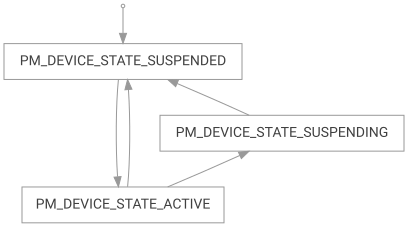
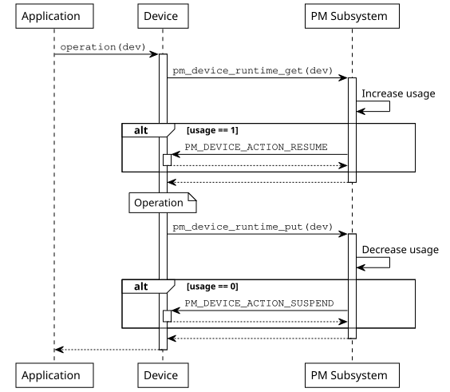
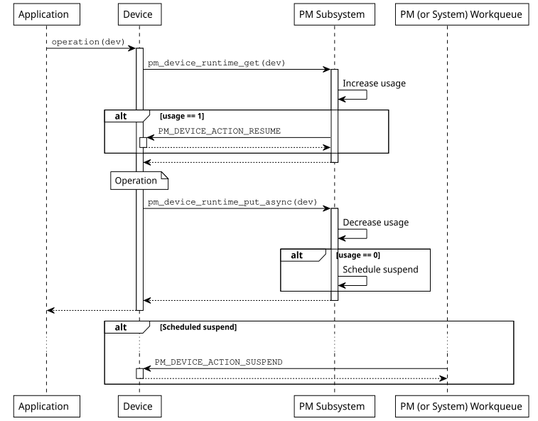

<!-- Copyright 2015-2026 Zephyr Project members and individual contributors. -->
<!-- SPDX-License-Identifier: Apache-2.0 -->
<!-- 中文翻译；阅读编号、导航和译注为本地新增。 -->

# 第4章\_设备运行时电源管理

原文：[Device Runtime Power Management](https://docs.zephyrproject.org/latest/services/pm/device_runtime.html)。读取日期：2026-10-12，`latest`。

**设备运行时电源管理（Device Runtime Power Management，设备运行时PM）**是主动式节能机制，不依赖系统整体状态，在设备空闲或未使用时挂起它，从而降低总功耗。通过 `CONFIG_PM_DEVICE_RUNTIME` 启用，驱动表明何时需要设备，由框架根据使用计数决定恢复或挂起。

## 4.1\_状态与电源域

设备启用运行时 PM 后，初始为 `PM_DEVICE_STATE_SUSPENDED`，表示未使用；首次请求使其恢复为 `PM_DEVICE_STATE_ACTIVE`，直到不再有使用者。同步挂起直接进入 SUSPENDED，异步挂起先进入 `PM_DEVICE_STATE_SUSPENDING`，操作执行后再变为 SUSPENDED。



设备树通过 `power-domains` 关联电源域时，子设备的 `pm_device_runtime_get()`、`pm_device_runtime_put()` 会自动尝试取得和释放电源域。要真正自动控制域状态，电源域设备本身也必须启用运行时 PM。可用 `CONFIG_PM_DEVICE_RUNTIME_DEFAULT_ENABLE` 全局启用，或对特定设备添加 `zephyr,pm-device-runtime-auto` 属性，也可以调用 `pm_device_runtime_enable()`。

框架希望以尽量少的应用工作降低设备功耗，由使用需求驱动状态，而非应用任意直接挂起/恢复。应用可以决定启用或禁用某设备的运行时 PM，例如希望设备一直活动时可禁用。

> 译注：原文称应用“不能手动挂起或恢复”，应理解为不能绕过使用计数强制改变状态；上一章明确允许应用、子系统通过 get/put 表达使用需求。自动电源域控制也不等于自动管理所有总线依赖。

## 4.2\_引用计数与依赖

启用运行时 PM 的设备不再随系统电源转换统一挂起或恢复，而通过 get/put 引用计数管理。多个传感器共用总线时，可以让总线一直活动到最后一个使用者结束。

> 原文注意：运行时 PM 目前不自动管理一般设备依赖。例如传感器依赖总线时，总线可能每次事务都恢复/挂起；如果子设备短时间内多次访问，保持父设备活动通常更高效。在此能力加入前，由设备手动取得和释放依赖。

`pm_device_runtime_get()` 增加使用计数，需要时同步恢复；`pm_device_runtime_put()` 减少使用计数，需要时同步挂起。原图展示同一设备上的同步调用与返回顺序：



同步模型简单，但应用要等挂起完成才得到结果。切换寄存器通常很快，通过慢总线发送挂起命令则可能明显增加延迟。因此可用 `pm_device_runtime_put_async()`：若不再有使用者，调度稍后执行挂起。



### 4.2.1\_异步工作队列

默认异步 PM 操作交给系统工作队列。驱动挂起过程不得在此进行阻塞操作，否则会阻滞系统工作队列、降低响应性。

需要时应用可启用 `CONFIG_PM_DEVICE_RUNTIME_USE_DEDICATED_WQ`，使用专用 PM 工作队列。驱动若必须等待慢外设或总线事务，应要求专用队列，可启用 `CONFIG_PM_DEVICE_DRIVER_NEEDS_DEDICATED_WQ`。资源有限且无须异步操作时，可禁用 `CONFIG_PM_DEVICE_RUNTIME_ASYNC`，减少内存与复杂度。

## 4.3\_驱动实现

先实现处理挂起、恢复的 PM 动作回调：

```c
static int mydev_pm_action(const struct device *dev,
                           enum pm_device_action action)
{
    switch (action) {
    case PM_DEVICE_ACTION_SUSPEND:
        /* suspend the device */
        ...
        break;
    case PM_DEVICE_ACTION_RESUME:
        /* resume the device */
        ...
        break;
    default:
        return -ENOTSUP;
    }

    return 0;
}
```

PM 子系统串行调用动作回调，因此这些 PM 回调之间不需要额外同步。

> 译注：串行化只描述框架管理的 PM 动作，不表示驱动的数据访问、应用事务、中断和其他工作项之间都自动互斥。

初始化时调用 `pm_device_runtime_enable()`。设备若是 ACTIVE，该函数会挂起它；若硬件本来就已挂起，应先调用 `pm_device_init_suspended()`：

```c
/* device driver initialization function */
static int mydev_init(const struct device *dev)
{
    int ret;
    ...

    /* OPTIONAL: mark device as suspended if it is physically suspended */
    pm_device_init_suspended(dev);

    /* enable device runtime power management */
    ret = pm_device_runtime_enable(dev);
    if (ret < 0) {
        return ret;
    }
}
```

> 译注：原例 `mydev_init()` 成功路径没有返回值，实际 `int` 初始化函数应补充成功返回，例如 `return 0;`。`pm_device_init_suspended()` 仅在硬件确实已挂起时调用，不能用它代替必要的硬件操作。

也可以在设备树节点上添加自动启用属性；设备初始化成功返回后会立即调用 `pm_device_runtime_enable()`：

```dts
foo {
    /* ... */
    zephyr,pm-device-runtime-auto;
};
```

操作 **应用程序编程接口（Application Programming Interface，API）** 中配对 get/put 的示例：

```c
static int mydev_operation(const struct device *dev)
{
    int ret;

    /* "get" device (increases usage count, resumes device if suspended) */
    ret = pm_device_runtime_get(dev);
    if (ret < 0) {
        return ret;
    }

    /* do something with the device */
    ...

    /* "put" device (decreases usage count, suspends device if no more users) */
    return pm_device_runtime_put(dev);
}
```

挂起很慢时改用异步 put：

```c
static int mydev_operation(const struct device *dev)
{
    int ret;

    /* "get" device (increases usage count, resumes device if suspended) */
    ret = pm_device_runtime_get(dev);
    if (ret < 0) {
        return ret;
    }

    /* do something with the device */
    ...

    /* "put" device (decreases usage count, schedule suspend if no more users) */
    return pm_device_runtime_put_async(dev, K_NO_WAIT);
}
```

> 译注：省略号处若新增会失败的操作，也必须处理相应引用释放和返回值，避免错误路径遗漏 put，或把主要操作错误覆盖成挂起操作返回值。

## 4.4\_示例

- [设备运行时API测试](https://github.com/zephyrproject-rtos/zephyr/blob/main/tests/subsys/pm/device_runtime_api/)。
- [设备电源域测试](https://github.com/zephyrproject-rtos/zephyr/blob/main/tests/subsys/pm/device_power_domains/)。
- [电源域测试](https://github.com/zephyrproject-rtos/zephyr/blob/main/tests/subsys/pm/power_domain/)。

接口见[运行时设备PM API](P037_设备运行时电源管理接口.md)。

<!-- reading-navigation:start -->

**主线阅读**

[上一篇：设备电源管理](P003_设备电源管理.md) · [本模块主线目录](../reading/power.md) · [全部主线](../reading/README.md) · [下一篇：电源域](P005_电源域.md)

<details>
<summary>原册编号导航（含扩展参考）</summary>

[上一章：设备电源管理](P003_设备电源管理.md) · [下一章：电源域](P005_电源域.md) · [返回大纲](大纲.md)

</details>

<!-- reading-navigation:end -->
