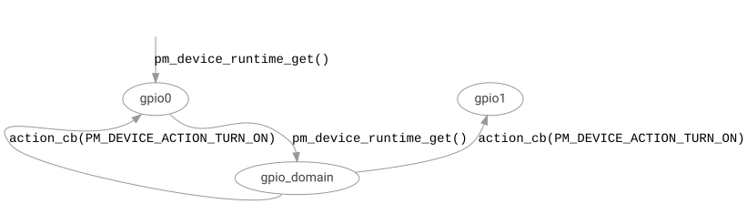

<!-- Copyright 2015-2026 Zephyr Project members and individual contributors. -->
<!-- SPDX-License-Identifier: Apache-2.0 -->
<!-- 中文翻译；阅读编号、导航和译注为本地新增。 -->

# 第5章\_电源域

原文：[Power Domain](https://docs.zephyrproject.org/latest/services/pm/power_domain.html)。读取日期：2026-10-12，`latest`。

**电源域（Power Domain）**抽象将由同一电源供电的设备分组，并以统一方式通知电源状态变化。使用设备 A 的应用无须了解设备 B 与它共享电源、也应配置到低功耗。

电源域是可选功能，通过 `CONFIG_PM_DEVICE_POWER_DOMAIN` 启用。电源域开启或关闭时，负责向所有使用它的设备发送 **电源管理（Power Management，PM）** 回调，动作分别为 `PM_DEVICE_ACTION_TURN_ON`、`PM_DEVICE_ACTION_TURN_OFF`。



图中，请求 `gpio0` 时，它进一步请求 `gpio_domain`；电源域开启后，向 `gpio0`、`gpio1` 都通知 TURN_ON。

## 5.1\_内部与外部电源域

多数 **片上系统（System on Chip，SoC）** 外设有独立电源控制，但仅靠设备 PM 仍不能消除所有静态漏电。因此 SoC 常把经常共同使用的设备划成区域，未使用时整体断电，进一步消除漏电。这些内部电源域可以分层、嵌套。

SoC 外部设备可能由开关、稳压器或专用电源芯片供电，同一来源供电的设备也组成电源域。这样可以让某些即使低功耗模式仍较耗电的器件，在不用时完全断电。

## 5.2\_实现电源域设备

原文以声明 `compatible = "power-domain"` 的 `gpio_domain` 为例：

```dts
gpio_domain: gpio_domain@4 {
        compatible = "power-domain";
        ...
};
```

电源域需要实现 PM 动作回调。恢复时先开启电源域，再通知子设备已上电；挂起时先通知子设备准备断电，再关闭域。自身 TURN_ON/TURN_OFF 则可处理控制引脚等资源：

```c
static int mydomain_pm_action(const struct device *dev,
                           enum pm_device_action action)
{
    switch (action) {
    case PM_DEVICE_ACTION_RESUME:
        /* resume the domain */
        ...
        /* notify children domain is now powered */
        pm_device_children_action_run(dev, PM_DEVICE_ACTION_TURN_ON, NULL);
        break;
    case PM_DEVICE_ACTION_SUSPEND:
        /* notify children domain is going down */
        pm_device_children_action_run(dev, PM_DEVICE_ACTION_TURN_OFF, NULL);
        /* suspend the domain */
        ...
        break;
    case PM_DEVICE_ACTION_TURN_ON:
        /* turn on the domain (e.g. setup control pins to disabled) */
        ...
        break;
    case PM_DEVICE_ACTION_TURN_OFF:
        /* turn off the domain (e.g. reset control pins to default state) */
        ...
        break;
    default:
        return -ENOTSUP;
    }

    return 0;
}
```

子设备在设备树 `power-domains` 属性中引用该域：

```dts
&gpio0 {
        compatible = "zephyr,gpio-emul";
        gpio-controller;
        power-domains = <&gpio_domain>;
};

&gpio1 {
        compatible = "zephyr,gpio-emul";
        gpio-controller;
        power-domains = <&gpio_domain>;
};
```

> 译注：原文叙述将属性写成单数 `power-domain`，示例使用的正确属性为复数 `power-domains`。`compatible = "power-domain"` 和省略号是概念片段，真实实例还需与具体电源域驱动及绑定相匹配。

## 5.3\_子设备通知

域改变状态时，所有子设备都收到 PM 动作回调，可执行额外准备工作。原文称不需要额外处理时也可以忽略这些通知。

```c
static int mydev_pm_action(const struct device *dev,
                           enum pm_device_action *action)
{
    switch (action) {
    case PM_DEVICE_ACTION_SUSPEND:
        /* suspend the device */
        ...
        break;
    case PM_DEVICE_ACTION_RESUME:
        /* resume the device */
        ...
        break;
    case PM_DEVICE_ACTION_TURN_ON:
        /* configure the device into low power mode */
        ...
        break;
    case PM_DEVICE_ACTION_TURN_OFF:
        /* prepare the device for power down */
        ...
        break;
    default:
        return -ENOTSUP;
    }

    return 0;
}
```

> 译注：此例参数误写为 `enum pm_device_action *action`，但直接对它执行 `switch`；正确的动作回调按值接收 `enum pm_device_action action`。原代码保留以便对照。只有硬件确实不需额外动作时才能忽略通知，不能忽略必要的断电防反灌或重新配置。

如果依赖域的某个设备被用作唤醒源，驱动或应用也负责把电源域设为唤醒源。

## 5.4\_示例

- [设备电源域测试](https://github.com/zephyrproject-rtos/zephyr/blob/main/tests/subsys/pm/device_power_domains/)。
- [电源域测试](https://github.com/zephyrproject-rtos/zephyr/blob/main/tests/subsys/pm/power_domain/)。

<!-- reading-navigation:start -->

**主线阅读**

[上一篇：设备运行时电源管理](P004_设备运行时电源管理.md) · [本模块主线目录](../reading/power.md) · [全部主线](../reading/README.md) · [下一篇：关机](P006_关机.md)

<details>
<summary>原册编号导航（含扩展参考）</summary>

[上一章：设备运行时电源管理](P004_设备运行时电源管理.md) · [下一章：关机](P006_关机.md) · [返回大纲](大纲.md)

</details>

<!-- reading-navigation:end -->
