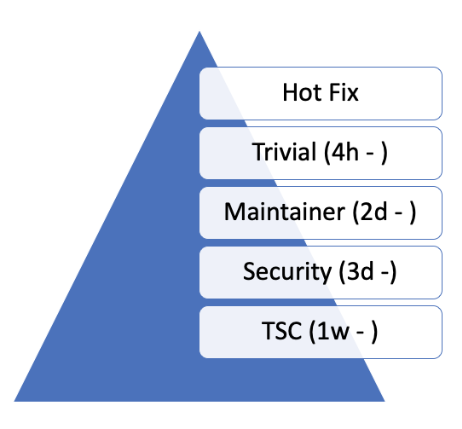

<!-- Copyright 2015-2026 Zephyr Project members and individual contributors. -->
<!-- SPDX-License-Identifier: Apache-2.0 -->
<!-- 中文翻译；编号、导航和明确标注的译注为本地新增。 -->

<a id="development-environment-and-tools"></a>

<a id="dev-environment-and-tools"></a>

# 第3章\_开发环境与工具（Development Environment and Tools）

原文：[官方页面](https://docs.zephyrproject.org/latest/project/dev_env_and_tools.html)。快照读取日期：2026-10-15；来源摘要见[来源记录](../SOURCES.md)。

<a id="code-review"></a>

## 3.1 代码评审（Code Review）

GitHub 提供在提交进入代码库前进行评审的框架。变更以 PR 形式上传，但只有通过评审、一系列持续集成（Continuous Integration，CI）检查并获维护者批准后，才正式成为项目的一部分。这支持开源项目常用的补丁提交方式：成员先评审补丁，再应用到代码库。

PR 应[使用适当标签](#gh-labels)，并链接相关[缺陷或功能跟踪 Issue](P005_缺陷报告.md#bug-reporting)。

项目使用 GitHub 评审代码并管理 Git 代码树。向任何 Zephyr 组件提交变更或增强时，应使用 GitHub。GitHub Actions 根据源码树中的 MAINTAINERS.yml，按组件自动分配负责人。评审完成后，仅有限的一组发布经理有权将 PR 合入 main。 相关链接：[`MAINTAINERS.yml`](https://github.com/zephyrproject-rtos/zephyr/blob/main/MAINTAINERS.yml)。

<a id="give-reviewers-time-to-review-before-code-merge"></a>

<a id="review-time"></a>

### 3.1.1 合并前给评审者足够时间

Zephyr 是全球项目，不局限于某个地区或时区，开发者和贡献者来自世界各地。提交 PR 后，应留出最低评审时间，让大家有机会审阅和评论。不同变更需要不同处理：部分必须由领域专家和子系统负责人评审；许多琐碎变更可由一般评审处理，无需等待维护者或代码负责人；另一些则需进一步讨论，并由 TSC 或安全工作组决策。下图给出各类变更建议的最短评审时间：

<a id="id1"></a>



> 译注——图中评审时间：原图保持官方字节不变。h、d、w 分别表示小时（Hour）、天（Day）、周（Week）；图示等待时间对应本页的评审分类，不能据此保证 PR 在该时间内完成合并。标签和流程按页面快照保留，本次没有独立核验 GitHub 当前自动化配置。

| 原图英文 | 中文含义 |
| --- | --- |
| Hot Fix | 紧急修复 |
| Trivial (4h - ) | 简单变更，4 小时起 |
| Maintainer (2d - ) | 维护者类别，2 天起 |
| Security (3d -) | 安全类别，3 天起 |
| TSC (1w - ) | 技术指导委员会类别，1 周起 |

**拉取请求分类（Pull request classes）**

<a id="workflow"></a>

#### 3.1.1.1 工作流（Workflow）

- 作者可在 PR 中建议变更所属类别。负责关注新变更的维护者或 TSC 成员可以调整标签，但应评论说明为何应归入另一类别。

- 项目使用标签系统对 PR 分类。

- 最低等待时间结束之前不应合并变更。

<a id="categories-labels"></a>

#### 3.1.1.2 类别与标签（Categories/Labels）

紧急修复（Hotfix）

修复妨碍开发者日常工作的问题，例如 CI 故障、测试故障，或影响用户体验的小型文档问题。

此类修复通过 CI 后可随时合并。根据修复内容、严重程度及是否有作者以外的评审者，在给出理由的情况下，可以不经项目负责人评审而合并。

琐碎变更（Trivial）

这类变更足够明显，无需维护者或代码负责人介入，不应改变子系统或组件的逻辑与设计。例如：

- 文档变更。

- 配置变更。

- 构建系统的小幅调整。

- 不改变逻辑的小幅代码优化。

- 测试变更和修复。

- 为支持更多配置或开发板而修改示例等。

维护者评审（Maintainer）

凡涉及子系统或组件逻辑、原始设计的变更，都需代码负责人或指定维护者评审。如果作者不是负责人，应将 PR 指派给代码负责人，由其向作者反馈并邀请其他开发者评审，推动 PR 达到可合并状态。

信息安全（Security）

可能影响系统整体信息安全的变更，需由安全工作组的专家评审。

TSC 与工作组（TSC and Working Groups）

引入新特性、新功能或改变系统整体工作方式的变更，需由 TSC 或相应工作组评审。例如，[破坏兼容性的 API 变更](../api_guides/P004_API生命周期.md#breaking-api-changes)需在架构会议中提出，使相关利益方知悉。

<a id="a-pull-request-should-have-an-assignee"></a>

### 3.1.2 拉取请求应有受指派负责人（Assignee）

- PR 的受指派负责人不应与作者相同。

- 受指派负责人负责推动 PR 达到可合并状态。

- 受指派负责人负责撤销过时评审，并邀请更多开发者和贡献者评审。

- 未经受指派负责人批准，不应合并 PR。

<a id="pull-request-should-not-be-merged-by-author-without-review"></a>

### 3.1.3 作者不应在未经评审的情况下合并自己的 PR

所有 PR 都需要评审，作者不应未经评审自行合并。以下情况例外：

- 紧急修复：CI 问题、回退及系统故障修复。

- 发布相关变更：修改版本文件、打标签，以及不涉及代码修改的发布活动。

开发者和贡献者始终应寻求评审，但也可能遇到无人可评审、又必须尽快将变更纳入代码树的情况。

<a id="reviewers-shall-not-request-changes-without-comments-or-justification"></a>

### 3.1.4 评审者提出“请求修改”（Request Changes）时必须给出意见或理由

对 PR 的修改请求（-1）都必须说明理由，不应无依据地阻塞。如果评审者认为未经自己评审不应合并，则应请求调整类别，例如：

- 从琐碎变更（Trivial）改为维护者评审（Maintainer）。

- 将 PR 指派给自己，意味着未经自己批准不应合并。

<a id="pull-requests-should-have-at-least-2-approvals-before-they-are-merged"></a>

### 3.1.5 合并前至少获得两次批准（Approval）

PR 仅在获得两次正面评审（批准）后才可合并。执行合并本身不算批准，仍需两次批准记录。合并者可以不批准而直接执行合并，也可以批准并合并，使批准总数达到两次。

<a id="reviewers-should-keep-track-of-pull-requests-they-have-provided-feedback-to"></a>

### 3.1.6 评审者应跟踪自己已反馈的 PR

如果评审者请求修改，就应持续关注 PR 状态或响应提及，确认反馈是否已处理。未跟进时，受指派负责人或仓库所有者可按以下条件撤销负面评审：

- 作者已明显解决反馈或疑虑。

- 作者多次提醒后，评审者两周内仍未重新查看 PR。

- 评审与代码变更无关，或无正当理由要求结构调整，例如：

  - 拆分 PR。

  - 顺带修复恰好出现在差异中的无关代码。

  - 修复无关问题。

  - 等等。

<a id="closing-stale-issues-and-pull-requests"></a>

### 3.1.7 关闭长期无活动的 Issue 和 PR

- GitHub 的 PR 和 Issue 区不是讨论论坛，而是需要推进直至关闭的工作项。一般讨论请使用邮件列表。

- 对 Issue 和 PR，原提交者都需要回答问题，并澄清缺陷或变更。请求发出后一周无响应时，将再次尝试联系贡献者；再过一周仍无响应，工作项可能被关闭，草稿和带 DNM 标签的 PR 除外。

<a id="continuous-integration"></a>

## 3.2 持续集成（Continuous Integration）

所有提交到 GitHub 的变更都会在模拟平台和架构上接受测试，以识别可立即发现的故障与回归。Twister 还会对所有开发板和平台进行构建测试。文档变更也通过评审和构建测试验证，确保文档能成功生成。

CI 测试失败会自动给出负面评审。开发者应修复问题、修改补丁后重新提交。

CI 基础设施当前运行以下检查：

- 运行 `checkpatch` 检查代码风格；发现错误时可投 -1，见后面的注意事项。

- Gitlint：根据项目要求检查 Git 提交风格。

- 许可证检查（License Check）：检查许可证冲突。

- 运行 `twister` 脚本。

  - 在 QEMU 中运行内核测试，出错时可投 -1。

  - 为不同开发板构建多种示例，出错时可投 -1。

- 验证文档可以正确构建。

注意（Note）

`checkpatch` 是 Perl 脚本，通过正则表达式提取原本需要 C 语言解析器才能准确处理的信息，因此有时产生误报。已知情况包括以下写法：

> ```text
> static uint8_t __aligned(PAGE_SIZE) page_pool[PAGE_SIZE * POOL_PAGES];
> IOPCTL_Type *base = config->base;
> ```

两行都会触发有关 `*` 两侧空格的诊断：第一行被误识别为指针类型声明，认为应写成 `PAGE_SIZE *POOL_PAGES`；第二行被误识别为乘法表达式，认为应写成 `IOPCTL_Type * base`。

CI 判断错误时，维护者可以覆盖其 -1 结果。

<a id="labeling-issues-and-pull-requests-in-github"></a>

<a id="gh-labels"></a>

## 3.3 在 GitHub 中为 Issue 和 PR 添加标签

项目使用 GitHub Issue 和 PR 跟踪日常及长期工作和贡献，用标签按领域、类型、优先级等分类组织，方便查找和统计。

所有 Issue 和 PR 都必须正确添加标签，通常会同时具有多个类别标签。维护者评审 PR 时，应修复缺失或错误标签。

这能节省搜索时间、降低工作项被遗忘的概率、加快评审并避免重复报告等。

当前标签按适用对象分组如下：

<a id="labels-applicable-to-issues-only"></a>

### 3.3.1 仅适用于 Issue 的标签

| 标签（Label） | 说明（Description） |
| --- | --- |
| `priority: {high\|medium\|low}`（优先级：高／中／低） | 按缺陷影响和重要性分类。优先级通常在缺陷分诊（Bug triage）或 TSC 会议上设置和调整。 |
| 回归（Regression） | 以前正常、现在不再正常的功能，属于缺陷子类型。 |
| 重复（Duplicate） | 与另一个 Issue 重复，应指出对应工作项。 |
| 适合首次贡献（Good first issue） | 适合首次贡献者接手。 |
| 发行说明（Release Notes） | 需要作为已知问题写入发行说明并补充信息的 Issue。 |

<a id="labels-applicable-to-pull-requests-only"></a>

### 3.3.2 仅适用于 PR 的标签

Issue 或 PR 描述对稳定 API 的变更。

| 标签（Label） | 说明（Description） |
| --- | --- |
| 紧急修复（Hotfix） | 修复阻碍开发的问题。 |
| 琐碎变更（Trivial） | 可缩短评审时间、由任何人评审的简单变更，例如拼写修正、含义直接的单行缺陷修复等。 |
| 维护者评审（Maintainer） | 需要维护者评审。 |
| 信息安全评审（Security Review） | 需由信息安全专家评审。 |
| 不要合并（Do Not Merge，DNM） | 该 PR 不应合并。对于尚在进行的工作，优先使用 GitHub 草稿（Draft）PR。 |
| 需要评审（Needs review） | PR 需要维护者关注。 |
| 回移（Backport） | 此 PR 是回移，或应当回移。 |
| 许可（Licensing） | PR 存在许可证问题，需要许可专家评审。 |

注意（Note）

对所有 PR 标签：标签与 PR 复杂程度共同决定合并前的等待时间，以保证充分评审，详见[评审流程](#review-time)。

<a id="labels-applicable-to-both-pull-requests-and-issues"></a>

### 3.3.3 同时适用于 PR 和 Issue 的标签

| 标签（Label） | 说明（Description） |
| --- | --- |
| `area: {area-name}`（领域标签） | 表示受影响的 Zephyr 子系统，例如 area: Kernel、area: I2C、area: Memory Management；项目功能，例如 area: Debugging、area: Documentation、area: Process；或其他类别，例如 area: Coding Style、area: MISRA-C。领域维护者应能按标签筛选相关的全部 Issue 和 PR。 |
| `platform: {platform-name}`（平台标签） | 只影响某个特定平台的 Issue 或 PR。 |
| 技术指导委员会（TSC） | TSC 是 Technical Steering Committee 的缩写。时间允许时，该 Issue 将在下一次 [TSC 会议](https://github.com/zephyrproject-rtos/zephyr/wiki/Technical-Steering-Committee-(TSC))讨论。 |
| 破坏兼容性的 API 变更（Breaking API Change） | Issue 或 PR 描述对稳定 API 的破坏性变更，更多说明见[引入破坏兼容性的 API 变更（Introducing breaking API changes）](../api_guides/P004_API生命周期.md#breaking-api-changes)。 |
| 缺陷（bug） | Issue 报告缺陷，或 PR 修复缺陷。 |
| Coverity | Coverity 检出的缺陷或相应修复。 |
| 等待响应（Waiting for response） | Zephyr 开发者正在等待提交者回答问题或处理反馈。 |
| 受阻（Blocked） | 被另一个 PR 或 Issue 阻塞。 |
| 长期无活动（Stale） | 看起来已被放弃、需要作者关注的 Issue 或 PR。 |
| 进行中（In progress） | 对 PR 表示尚未完成、不应合并；对 Issue 表示正在处理。 |
| 意见征求稿（Request for Comments，RFC） | 作者希望获得社区意见；PR 应视为草稿。 |
| 长期支持（LTS） | 与长期支持发布分支有关。 |
| 外部组件（EXT） | 与外部组件有关。 |

对应官方文档源码：[doc/project/dev_env_and_tools.rst](https://raw.githubusercontent.com/zephyrproject-rtos/zephyr/main/doc/project/dev_env_and_tools.rst)。

> 译注——源码跟踪：本仓库[对应源码](../../../doc/project/dev_env_and_tools.rst)可用于对照，版本可能与网页不同。本批仅翻译和核对文档，未执行Git工作流、构建、发布或连接设备。

<!-- reading-navigation:start -->

**主线阅读**

[上一篇：代码流与分支](P002_代码流与分支.md) · [本模块主线目录](../reading/project_governance.md) · [全部主线](../reading/README.md) · [下一篇：代码文档](P004_代码文档.md)

<details>
<summary>原册编号导航（含扩展参考）</summary>

[上一章](P002_代码流与分支.md) · [返回大纲](大纲.md) · [下一章](P004_代码文档.md)

</details>

<!-- reading-navigation:end -->
