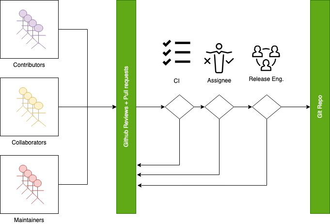
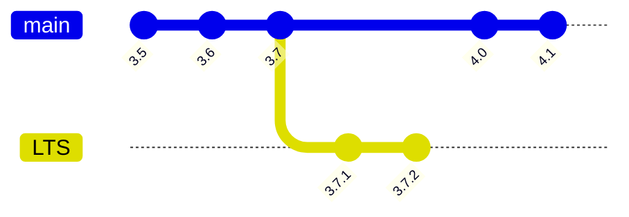
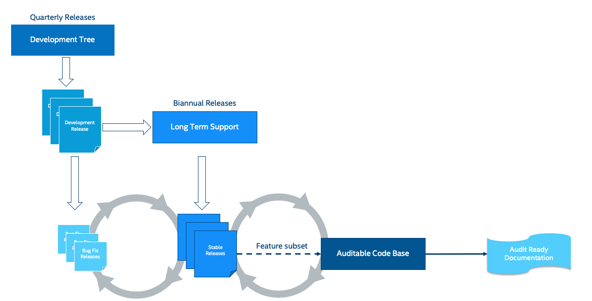

<!-- Copyright 2015-2026 Zephyr Project members and individual contributors. -->
<!-- SPDX-License-Identifier: Apache-2.0 -->
<!-- 中文翻译；编号、导航和明确标注的译注为本地新增。 -->

<a id="release-process"></a>

<a id="id1"></a>

# 第8章\_发布流程（Release Process）

原文：[官方页面](https://docs.zephyrproject.org/latest/project/release_process.html)。快照读取日期：2026-10-15；来源摘要见[来源记录](../SOURCES.md)。

Zephyr 项目按时间周期发布，而不是以功能完成情况驱动发布。每个 Zephyr 版本汇集社区内众多贡献者、企业和个人的工作。

按时间发布，使 Zephyr 能在最新技术与功能和整体质量之间取得平衡。约六个月的发布周期，让项目围绕实际已实现的功能协调开发，在保持整体发布质量的同时，避免因一两个尚未完成的功能而推迟发布。

> 译注——时间与范围：正文中的版本日期、发布周期、维护年限和门槛均按本次官方页面快照翻译。这里的历史示例不是本仓库的发布计划；产品选型应继续核对所用版本的支持状态。

<a id="release-phases-overview"></a>

## 8.1 发布阶段概览（Release Phases Overview）

每个发布周期包含开发阶段和随后的稳定化阶段。候选发布版本（Release Candidate，RC）在稳定化阶段生成。

开发阶段可以合并各类变更，因此也称主分支的合并窗口（Merge window）。稳定化阶段，项目及维护者集中修复缺陷、编写发布文档，通常不再接受新功能；主分支在此期间处于功能冻结（Feature freeze）状态。

<a id="id5"></a>


> 译注——原图说明：原始文件完整保留，下表解释英文标签。SVG 的 foreignObject 完整文字及截短回退文字均保留；不同阅读器可能采用不同显示路径。

| 原图英文 | 中文含义 |
| --- | --- |
| stable | 稳定版本（Stable） |
| rc1 | 第一个候选发布版本 |
| rc2 | 第二个候选发布版本 |
| rc3 | 第三个候选发布版本 |
| Stabilisation | 稳定化阶段 |
| Development | 开发阶段 |
| Stabilisa... | Stabilisation 的截短回退文字 |
| Developme... | Development 的截短回退文字 |
| Text is not SVG - cannot display | 文字不是 SVG，无法显示；原图查看器兼容性提示 |

**发布周期（Release Cycle）**

当前主版本的里程碑可在[官方 GitHub Wiki](https://github.com/zephyrproject-rtos/zephyr/wiki/Release-Management) 查看；以往发布的信息可通过[此处链接](https://docs.zephyrproject.org/latest/releases/index.html#zephyr-release-notes)查看。

注意（Note）

每次稳定版本发布后，都会为该版本创建新的发布分支（Release branch）。

例如，Zephyr 稳定版本 v4.4.0 宣布发布后，创建了 `v4.4-branch` 分支。面向 v4.4.x 补丁版本（v4.4.1、v4.4.2 等）的提交，应以该分支为目标提出。

本页目前未详细说明补丁版本（Point release）的发布流程。

<a id="merge-window-development-phase"></a>

<a id="merge-window"></a>

### 8.1.1 合并窗口：开发阶段（Merge Window / Development Phase）

为版本打标签后，发布经理会开放[主分支](https://github.com/zephyrproject-rtos/zephyr/tree/main)，开始下一发布周期的开发。这段时间称为各版本的合并窗口或开发阶段。窗口内，任何符合[拉取请求合并条件（Pull Request Merge Criteria）](#merge-criteria)的代码均可合入主分支；一个版本的大多数变更在此期间完成。

每个版本的合并窗口约持续五个月。

合并窗口结束后，发布团队为即将发布的版本创建首个候选版本标签。此时主分支停止接受大多数功能开发，项目进入下一版本的[功能冻结](#feature-freeze)期，详见下一节。

以下是合并窗口的时间线示例：

- 2025 年 11 月 13 日创建 [v4.3.0](https://github.com/zephyrproject-rtos/zephyr/tree/v4.3.0) 标签时，合并窗口开启。此时主分支开始接受下一版本 v4.4.0 的变更。

- 2026 年 3 月 24 日创建 [v4.4.0-rc1](https://github.com/zephyrproject-rtos/zephyr/tree/v4.4.0-rc1) 标签时，v4.4.0 的合并窗口关闭，项目进入该版本的功能冻结期。

<a id="feature-freeze-stabilization-phase"></a>

<a id="feature-freeze"></a>

### 8.1.2 功能冻结：稳定化阶段（Feature Freeze / Stabilization Phase）

创建首个候选版本标签时，该版本的合并窗口关闭，进入功能冻结或稳定化阶段。期间，未经[技术指导委员会（Technical Steering Committee，TSC）](P009_技术指导委员会.md#tsc)批准例外，不会为该版本合并新功能。

稳定化阶段等待新功能 PR 评审时，请保持耐心。

如前所述，功能冻结期间合并功能的例外流程需要理由说明和 TSC 批准。一般而言，若功能冻结宣布时 PR 尚未合入，最好等待下一个[合并窗口](#merge-window)。

若认为某项功能值得例外处理，应在冻结期合入，请联系 TSC。通用联系方式见 [TSC Wiki](https://github.com/zephyrproject-rtos/zephyr/wiki/Technical-Steering-Committee-%28TSC%29) 页面。

以下是功能冻结的时间线示例：

- 2026 年 3 月 24 日创建 [v4.4.0-rc1](https://github.com/zephyrproject-rtos/zephyr/tree/v4.4.0-rc1) 标签时，v4.4.0 功能冻结开始。此时新功能合入主分支需要 TSC 例外批准。

- 2026 年 4 月 14 日创建 [v4.4.0](https://github.com/zephyrproject-rtos/zephyr/tree/v4.4.0) 标签时，v4.4.0 功能冻结结束，主分支重新开放，进入下一版本的[合并窗口](#merge-window)。

后续小节进一步说明功能冻结。

<a id="allowed-changes"></a>

#### 8.1.2.1 允许的变更（Allowed Changes）

功能冻结后，只应接受与稳定化有关的变更：

- 修复功能缺陷的变更。

- 改善可靠性、构建稳定性或测试行为的稳定化修复。

- 文档更新，包括澄清、纠错和改进。

- 针对已有功能的测试，不启用新功能。

各类变更在何时可被接受，详见[表格](#release-milestones)。

对上述允许范围的例外很少，既需要明确理由，也需要 TSC 批准。一般而言，功能错过开发阶段窗口后，应等待下一个开发周期。

<a id="disallowed-changes"></a>

#### 8.1.2.2 不允许的变更（Disallowed Changes）

功能冻结后，不应接受以下变更：

- 新功能或功能增强。

- API 变更，除非为解决严重缺陷所必需。

- 与缺陷修复或稳定化工作无直接关系的重构。

- 新子系统、驱动、开发板或架构变更。

<a id="issue-tracking-during-feature-freeze"></a>

## 8.2 功能冻结期间的问题跟踪（Issue Tracking during Feature Freeze）

功能冻结期间，建议 PR 引用 GitHub Issue，但并非一律强制。

PR 必须清楚说明：

- 所解决的问题。

- 问题的影响。

- 变更如何解决该问题。

若 PR 的意图或范围不清楚，维护者和发布工程师可以要求进一步澄清。

<a id="mandatory-issue-usage"></a>

### 8.2.1 必须使用 Issue 的情形（Mandatory Issue Usage）

以下情况必须创建 GitHub Issue：

- 阻塞发布的问题（Release blockers）。

- 面向已发布分支维护工作的修复。

<a id="review-and-approval"></a>

### 8.2.2 评审与批准（Review and Approval）

所有 PR 均须遵循标准评审与批准流程。

维护者应确保：

- 变更符合本政策。

- 范围尽量小，并集中于稳定化。

- 风险适合当前发布阶段。

发布工程师可以：

- 根据风险评估拒绝或推迟变更。

- 要求修改或补充理由。

<a id="risk-expectations"></a>

### 8.2.3 风险要求（Risk Expectations）

稳定化期间接受的变更应当：

- 范围尽量小。

- 风险低。

- 经过充分测试。

即使属于缺陷修复，引入显著风险的变更仍可能推迟到未来版本。

<a id="pull-request-merge-criteria"></a>

<a id="merge-criteria"></a>

## 8.3 拉取请求合并条件（Pull Request Merge Criteria）

以下条件适用于所有发布阶段。



> 译注——原图说明：原始文件完整保留，下表解释英文标签。原始 PNG 含透明背景，深色阅读背景可能降低黑色线条和文字的可见性；文件未替换或重新绘制。

| 原图英文 | 中文含义 |
| --- | --- |
| Contributors | 贡献者 |
| Collaborators | 协作者 |
| Maintainers | 维护者 |
| GitHub Reviews + Pull requests | GitHub 评审与拉取请求 |
| CI | 持续集成（Continuous Integration） |
| Assignee | 指定负责人 |
| Release Eng. | 发布工程团队 |
| Git Repo | Git 仓库 |

- 必须满足全部 [PR 要求（PR Requirements）](../contributing/P003_贡献者职责.md#pr-requirements)。

- 至少获得两项批准，其中包括指定负责人的批准。

- PR 应由每个受影响领域的至少一名维护者或协作者评审；若某领域的变更足够简单，则其他受影响子系统的维护者或协作者批准即可。

- 在组织层面实行双人复核原则（Four eye principle）。项目已经要求至少两项批准，但若提交者与批准者来自同一组织，评审和批准仍可能无意中存在偏向。为支持整个项目范围的评审与批准，合并条件进一步规定：

  - 公共及共享代码的修改或新增，须获得不同组织的批准，其中至少一项来自与提交者不同的组织。公共及共享代码指不属于 `soc`、`boards` 和 `drivers/*/*` 的代码。

  - 硬件支持（驱动、SoC、开发板）的修改或新增，至少应由不同组织的人员执行合并。此规则仅适用于支持特定厂商硬件的 API 实现，不适用于 API 本身。

  - 若某领域的贡献主要来自一个组织，且无法取得其他组织的评审，发布工程师可以作例外处理，但仍须由不同组织的人员完成合并。此时必须严格遵守至少两天的最短评审期，为补充评审留出时间。

  - 发布工程师不得合并仅由本组织提出并评审的代码变更；要合并此类变更，至少需有一项来自不同组织的评审。

- 最短评审期为两个工作日；简单变更为四小时，参见“[代码合并前给评审者留出评审时间](P003_开发环境与工具.md#review-time)”。

- 紧急修复（Hotfix）在 CI 通过后可随时合并，不受上述大多数条件限制。

- 所有必需检查均通过：

  - 设备树（Device Tree）。

  - 文档（Documentation）

  - 代码检查工具（Code linters），如 Gitlint、Pylint、Ruff、Sphinx 等。

  - 身份与电子邮箱（Identity/Emails）。

  - Kconfig

  - 许可证检查（License checks）。

  - Checkpatch：编码风格（Coding Style）。

  - 通过 Twister 在仿真／模拟平台执行的集成测试（Integration Tests）。

  - 蓝牙模拟测试（Simulated Bluetooth Tests）。

<a id="release-quality-criteria"></a>

<a id="id3"></a>

## 8.4 发布质量条件（Release Quality Criteria）

明确必须满足的发布条件，是为了用多数人能够理解的方式定义何时算“完成”发布，并帮助新参与者理解流程、共同完成成功的发布：

- 发布条件记录每个 Zephyr 版本目标用户群的全部需求。

- 各版本的目标用户群可以不同，也可能重叠。

- 条件并非一成不变：可能有遗漏或新增需求，此时应扩展条件以覆盖所有需要。

每个版本应满足以下总体条件：

- 没有阻塞性缺陷或阻塞问题。

- 所有相关测试在 `Tier 0` 平台上通过。

- 所有相关测试在 Tier 0 和 Tier 1 平台上通过；每种架构、架构变体或硬件特性至少有一个平台。

- 所有适用示例和测试均可在 Tier 0、Tier 1、Tier 2 平台上构建。

- 所有高等级和严重等级的静态分析问题及安全问题均已处理。

- 发布说明（Release Notes）保持最新。

<a id="blocker-bugs"></a>

### 8.4.1 阻塞性缺陷（Blocker Bugs）

阻塞性缺陷流程在发布过程中启动，并于功能冻结里程碑后生效。标记为阻塞的问题会实际阻止发布；创建版本之前必须解决所有阻塞性缺陷。

被授予 `blocker` 状态的缺陷，其修复直到最终发布日期都可以合入 main 并纳入本次发布。

严重程度为中等及以上、且影响所有用户的缺陷，通常可考虑提升为阻塞性缺陷。

贡献者和发布工程团队成员应遵循以下阻塞性缺陷指南：

- 只有在软件（Zephyr）绝不能携带该缺陷发布时，才将其标为阻塞。

- 所有协作者都可以添加或移除阻塞标签。

- 根据严重程度和普遍程度，评估缺陷是否应成为阻塞问题。

- 添加或移除阻塞标签时，均须提供详细理由。

- 确保所有阻塞问题均标记了里程碑（Milestone）。

- 发布经理对阻塞状态拥有最终决定权；有疑问时应与其联系。

<a id="release-milestones"></a>

<a id="id4"></a>

## 8.5 发布里程碑（Release Milestones）

下表列出各版本的发布里程碑。

<a id="id6"></a>

**发布里程碑（Release Milestones）**

| 时间线（Timeline） | 检查点（Checkpoint） | 说明（Description） | 负责人（Owner） |
| --- | --- | --- | --- |
| T-5M | 规划（Planning） | 确定发布日期，指定发布负责人，并就本版本的项目总体目标达成一致。 | TSC |
| T-7W | 评审目标里程碑（Review target milestones） | 确定正在开发的功能的目标里程碑。 | 发布工程团队（Release Engineering） |
| T-5W | 发布公告（Release Announcement） | 发布负责人宣布功能冻结安排和发布日程。 | 发布经理（Release Manager） |
| T-4W | 发布日程提醒（Release Timeline reminder） | 发布负责人发出功能冻结和发布日程的提醒。 | 发布经理（Release Manager） |
| T-3W | 功能冻结（Feature Freeze，RC1） | RC1 后不得引入新功能。只允许稳定化、非功能性修整、缺陷修复、文档改进和针对已有功能的新测试。 | 发布工程团队（Release Engineering） |
| T-2W | 第二个候选发布版本（2nd Release Candidate） | RC2 后不允许新功能；只允许稳定化、非功能性修整、缺陷和文档修复。 | 发布经理（Release Manager） |
| T-1W | 严格冻结（Hard Freeze，RC3） | RC3 后只允许阻塞性缺陷修复、文档改进和发布说明变更。此检查点必须完成发布说明，并满足发布条件。 | 发布经理（Release Manager） |
| T-0W | 发布（Release） |  | 发布经理（Release Manager） |

> 译注——里程碑记法：表中 T 表示目标发布日期，M 为月（Month），W 为周（Week）；例如 T-3W 是发布前三周。RC1、RC2、RC3 分别为第一、第二、第三个候选版本。本表是常规发布概览，下文另说明 LTS 延长稳定化期的安排。

<a id="long-term-support-lts-releases"></a>

<a id="release-process-lts"></a>

## 8.6 长期支持发布版本（Long Term Support，LTS）

长期支持版本设计用于较长时间的支持和维护，是面向产品以及用于认证的可审计分支的推荐版本。

LTS 版本的特征是：

- 面向产品（Product focused）。

- 延长稳定化阶段（Extended Stabilisation period），为测试和缺陷修复提供更多时间。

- 稳定 API（Stable APIs）

- 以质量为导向的流程（Quality Driven Process）

- 长期维护，持续较长时间，至少五年。

<a id="product-focused"></a>

### 8.6.1 面向产品（Product Focused）

Zephyr LTS 是面向产品开发者的推荐版本，提供长期支持和维护，包括一般稳定性改进、缺陷修复和安全修复。

LTS 同时包含成熟功能和新功能；API 与功能的成熟度会被记录和跟踪。随着 LTS 版本迭代，成熟稳定 API 的覆盖范围不断扩大，使用户在逐步演进的稳定基础上使用前沿功能和新硬件。

<a id="extended-stabilisation-period"></a>

### 8.6.2 延长稳定化阶段（Extended Stabilisation Period）

Zephyr LTS 开发周期与常规发布不同，稳定化阶段更长。常规版本在计划发布日期前三至四周功能冻结；LTS 的稳定化阶段延长三周，于预计发布日期前六至七周冻结，因此代码冻结到发布之间的时间更长。

<a id="stable-apis"></a>

### 8.6.3 稳定 API（Stable APIs）

Zephyr LTS 为产品开发提供稳定而长久的基础。为保证 API 及其实现的稳定性，构成操作系统核心的发布软件必须经过 Zephyr API 生命周期，并在至少两个发布版本中完成稳定化。这使主要和核心功能能够以成熟实现和稳定 API 发布，并在该 LTS 生命周期内得到支持。

- API 冻结（API Freeze，LTS - 2）

  - 所有稳定 API 必须在 LTS 之前两个版本冻结。API 可以增加功能扩展，但核心实现不再修改。例如适用于以下子系统：

    - 设备驱动（Device Drivers），如 i2c.h、spi.h 等。

    - 内核（Kernel），即 k_*：

    - 操作系统服务（OS services），如日志、调试等。

    - DTS：API 和绑定（Bindings）稳定性。

    - Kconfig

  - 实验性功能的新 API 可以随时添加，前提是独立存在，并明确记录为实验性或不稳定功能／API。

- 功能冻结（Feature Freeze，LTS - 1）：涉及主要 LTS 功能的代码不再引入新功能，也不进行全面改造或重组。

  > - 内核与基础操作系统（Kernel + Base OS）。
>
> - 其他对外声明的 LTS 功能。

  - 位于基础操作系统及对外声明的 LTS 功能之上、或对它们作扩展的辅助功能，可随时添加；适用时应标为实验性。

<a id="quality-driven-process"></a>

### 8.6.4 以质量为导向的流程（Quality Driven Process）

Zephyr 项目遵循行业标准和流程，以提供注重质量的版本。为跟踪项目软件组件的进展、完整性和质量，会提供以下成果：

- 遵循已发布的编码指南、风格指南及命名约定，并记录偏离情况。

- 静态分析报告（Static analysis reports）。

  - 定期使用现有商业和开源工具分析整个代码树，记录偏离和误报。

- 已文档化的组件和 API。

- 需求目录（Requirements Catalog）。

- 验证计划（Verification Plans）。

- 验证报告（Verification Reports）。

- 覆盖率报告（Coverage Reports）。

- 需求追溯矩阵（Requirements Traceability Matrix，RTM）。

- SPDX 许可证报告（SPDX License Reports）。

每次发布均配套上述成果，用于记录发布时软件的质量和状态。

<a id="long-term-support-and-maintenance"></a>

### 8.6.5 长期支持与维护（Long Term Support and Maintenance）

LTS 每两年半至三年发布一次，建立独立分支，并在发布后约五年内独立于主代码树维护。

支持分为三个主要阶段：

- 第一阶段：最初两年，提供一般缺陷与安全修复，包括平台和驱动修复。

- 第二阶段：随后三年以上，仅提供安全和操作系统稳定性修复。

- 第三阶段：第三方可能提供延长支持，详情待定。

某 LTS 版本（LTS N）的支持持续到后续第二个 LTS 版本（LTS N+2）首次发布；LTS N 的最后一次发布会在 LTS N+2 首次发布后不久进行。

当前受支持的 LTS 版本及其停止支持日期（End-of-Life，EOL），可通过[此处链接](https://docs.zephyrproject.org/latest/releases/index.html#supported-releases)查看。

<a id="id7"></a>



**长期支持发布（Long Term Support Release）**

> 译注——分支图：上方保留官方 Mermaid 的 `gitGraph` 源码，表示主线 3.5、3.6、3.7 后分出 LTS 分支，分支上有 3.7.1、3.7.2，主线继续到 4.0、4.1。图是版本关系示意，不是可在终端执行的 Git 命令；不支持 Mermaid 的阅读器仍可查看完整源码。

变更和修复双向流动，但从主分支进入 LTS 分支的变更，只限于同时适用两个分支、且针对已有功能的修复。

适用于主线代码树的所有 LTS 分支修复，也必须提交到主线。

<a id="auditable-code-base"></a>

### 8.6.6 可审计代码库（Auditable Code Base）

可审计代码库将从 Zephyr OS 功能的明确子集中建立，范围有限。审计分支创建后，LTS、开发代码树与可审计代码库须保持同步；用于认证的审计分支添加新功能时，采用更严格的流程。

> 译注——认证边界：可审计（Auditable）表示按限定范围为审计准备代码和证据，并不等于全部 Zephyr、任意产品或本仓库已通过认证。图示流程与本段将来时均按原文保留。

新功能进入可审计代码库之前，须应用该流程。

首次及后续认证的目标由 Zephyr 项目理事会（Governing Board）决定。

达成所选认证的流程由信息安全和功能安全工作组（Security and Safety Working Groups）确定，并与 TSC 协调。

<a id="host-tools-support-policy"></a>

## 8.7 主机工具支持政策（Host Tools Support Policy）

本节说明开发 Zephyr 应用所需主机工具的相关政策。

<a id="python-version-policy"></a>

### 8.7.1 Python 版本政策（Python Version Policy）

Zephyr 确定最低支持 Python 版本时，会跟踪 [Python 上游发布日程](https://devguide.python.org/versions/)。

最低版本的选择需要平衡长期支持与主流、仍获积极支持的 Linux 发行版中的实际可获得性，例如当前 Ubuntu LTS 和 Debian Stable。

满足以下条件时，会考虑移除对某 Python 版本的支持：

- 该版本已接近或达到上游停止支持时间（EOL）；并且

- 较新的 Python 版本已在当前仍获积极支持的主要 Linux 发行版中广泛提供。

<a id="hardware-support-tiers"></a>

## 8.8 硬件支持层级（Hardware Support Tiers）

本节定义硬件平台的大致层级。目前尚未在开发板、架构或 SoC 层面正式执行或评估这些条件。

> 译注——支持层级边界：原文明确这些条件尚未在板、架构或 SoC 层面正式执行或评估。不要仅凭上游存在某块开发板的文件，就断定它满足某一层级或得到相应测试承诺。

<a id="tier-0-emulation-platforms"></a>

### 8.8.1 Tier 0：仿真平台（Emulation Platforms）

- CI 会在这些平台上构建并运行测试，因此运行时失败可以阻止 PR 合入。

- 由 Zephyr 项目本身支持，并承诺修复发布版本中的缺陷。

- 每种新增架构都必须具备一个 Tier 0 平台。

- 针对此层级平台报告的缺陷，应作为 Zephyr 通用缺陷评估和处理，并赋予最高优先级。

<a id="tier-1-supported-platforms"></a>

### 8.8.2 Tier 1：受支持平台（Supported Platforms）

- 有特定团队承诺定期使用 Twister 设备测试和开源、公开可获得的驱动，运行“Zephyr 兼容性测试套件”（详情待定）。

- 承诺及时为发布修复缺陷；并非由 Zephyr 项目本身提供支持。

- 通常可购买获得。

- 针对此层级平台报告的缺陷，应作为 Zephyr 通用缺陷评估和处理，优先级为中到高。

<a id="tier-2-community-platforms"></a>

### 8.8.3 Tier 2：社区平台（Community Platforms）

- 平台实现在上游可用，但无测试承诺，也不一定普遍可获得。

- 有专门维护者承诺响应 Issue 和评审补丁。

- 此层级平台报告的缺陷不视为 Zephyr 通用缺陷。

<a id="tier-3-deprecated-and-unsupported-platforms"></a>

### 8.8.4 Tier 3：已弃用且不受支持的平台（Deprecated and unsupported Platforms）

- 平台实现存在，但没有负责人，或负责人不响应。

- 没有支持承诺。

- 若无人使其达到 Tier 2 或更高层级，可能从上游移除。

- 此层级平台报告的缺陷不视为 Zephyr 通用缺陷。

<a id="release-procedure"></a>

## 8.9 发布操作流程（Release Procedure）

本节记录发布经理职责，为发布经理提供知识库。

> 译注——操作对象与前提：以下是官方发布经理的流程说明。实际操作使用 UCRT64 Bash 或 Linux Bash，当前位置为负责发布的 Zephyr Git 仓库根目录；先确认目标分支、已合入提交、VERSION 内容、签名配置和发布权限。`VERSION` 是官方已有文件，不在中文翻译目录新建。`$` 是提示符，不属于命令。命令成功后的检查对象分别是本地版本与签名标签、远端标签和发布页面；任一步版本、签名或权限检查失败，应回到相应前提处理。本次只翻译和核对流程，没有创建标签、推送或发送邮件。

<a id="release-checklist"></a>

### 8.9.1 发布检查清单（Release Checklist）

每次发布均有一个关联的 GitHub Issue，内含完整检查清单。一次发布完成后，会创建下一次发布的清单。

<a id="tagging"></a>

### 8.9.2 创建标签（Tagging）

Git 中的发布版本和标签应采用以下命名语法：

- 正式版本：Release [Major].[Minor].[Patch Level]，依次为主版本、次版本和补丁级别。

- 候选版本：Release Candidate [Major].[Minor].[Patch Level]-rc[RC Number]，末尾是候选版本编号。

- 标签格式（Tagging）：

  - v[Major].[Minor].[Patch Level]-rc[RC Number]

  - v[Major].[Minor].[Patch Level]

  - v[Major].[Minor].99：在主分支创建的标签，表示 v[Major].[Minor+1] 的开发已开始。例如，v1.8 开发开始时创建 v1.7.99 标签。标签对应开发中的主分支版本所定义的 VERSION_MAJOR、VERSION_MINOR、PATCHLEVEL 宏，使自动构建和 CI 工具常用的 git describe 能产生有意义的主分支版本描述。

<a id="id8"></a>



> 译注——原图说明：原始文件完整保留，下表解释英文标签。图内 Quarterly Releases、Biannual Releases 是旧图标注，与当前正文约六个月一次常规发布、每两年半至三年一次 LTS 的说明不一致；不能据图确定当前日期或支持期限。

| 原图英文 | 中文含义 |
| --- | --- |
| Quarterly Releases | 每季度发布（原图旧频率标签） |
| Development Tree | 开发代码树 |
| Development Release | 开发版本 |
| Biannual Releases | 原图发布频率标签；biannual 通常指每年两次，不能作为当前 LTS 周期 |
| Long Term Support | 长期支持 |
| Bug Fix Releases | 缺陷修复版本 |
| Stable Releases | 稳定版本 |
| Feature subset | 功能子集 |
| Auditable Code Base | 可审计代码库 |
| Audit Ready Documentation | 为审计准备的文档 |

**Zephyr 代码与发布（Zephyr Code and Releases）**

最终版本和每个候选版本都应按以下步骤创建标签：

注意（Note）

必须使用明确的 Git 命令创建标签，而不使用 GitHub 发布界面。原文说明，该界面无论正式发布还是预发布都会创建轻量标签（Lightweight tag），而非附注标签（Annotated tag）。由于以下步骤创建签名标签，还应将 GPG 公钥上传到 GitHub 账户；若没有 GPG 密钥，也可使用 SSH 密钥签名。

> 译注——标签与界面：附注标签（Annotated tag）保存标签对象及说明；签名标签（Signed tag）在其上包含密码学签名。原文关于 GitHub 按钮和标签创建行为的说明按快照保留，实际界面可能变化；已有签名标签与网页发布条目是不同对象。Git 的类型与签名选项可查[官方 git-tag 手册](https://git-scm.com/docs/git-tag)。

<a id="tab-0-0-0"></a>

**候选发布版本（Release Candidate）**

<a id="tab-0-0-1"></a>

**最终发布版本（Final Release）**

<a id="panel-0-0-0"></a>

注意（Note）

本节以 1.11.0-rc1 为例，应替换为实际候选版本号。

> 译注——候选版本步骤：下面示例以旧版 1.11.0-rc1 展示流程，`EXTRAVERSION = rc1` 是 VERSION 文件内容，不是终端命令。应在前述发布仓库中检查该文件；提交合入后再对目标提交创建签名标签。保留示例版本号不表示应重新发布这一历史版本。

1. 更新 Git 仓库根目录 [VERSION](https://github.com/zephyrproject-rtos/zephyr/blob/main/VERSION) 文件中的版本变量，使其匹配该候选版本。`EXTRAVERSION` 变量用于表示候选版本的 rc[RC Number] 值：

```text
EXTRAVERSION = rc1
```

2. 提交更新 [VERSION](https://github.com/zephyrproject-rtos/zephyr/blob/main/VERSION) 文件的 PR，以 `release: Zephyr 1.11.0-rc1` 为提交主题；CI 成功后合入该 PR。

3. 使用附注标签创建并推送版本：

```text
$ git pull
$ git tag -s -m "Zephyr 1.11.0-rc1" v1.11.0-rc1
```

4. 检查标签是否正确签名：标签的 `git show` 输出必须包含签名，查找其中的 `BEGIN PGP SIGNATURE` 或 `BEGIN SSH SIGNATURE` 标记：

> 译注——签名存在与验证成功：原文用 `git show` 查看签名块；看到 BEGIN 标记只能确认存在签名内容，不能单独证明签名有效或签名者受信任。实际验证还须依据所用签名后端、密钥和信任配置完成密码学检查；[Git 官方手册](https://git-scm.com/docs/git-tag)区分查看标签与验证签名。后面的最终版本示例同理。

```text
$ git show v1.11.0-rc1
```

5. 推送标签：

```text
$ git push git@github.com:zephyrproject-rtos/zephyr.git v1.11.0-rc1
```

6. 向邮件列表 `announce` 和 `devel` 发送包含发布链接的邮件。

<a id="panel-0-0-1"></a>

注意（Note）

本节以 1.11.0 为例，应替换为实际最终版本号。

> 译注——最终版本步骤：此部分仍在前述发布仓库根目录操作。`EXTRAVERSION =` 表示编辑已有 VERSION 文件，将该字段留空；不是可执行的 Shell 命令。其余数字字段应匹配本次实际版本，先检查文件及 PR 合入结果，再继续标签步骤。

当全部最终发布条件满足、最终发布说明获批并合入仓库后，按以下流程设置最终版本号并创建仓库标签：

1. 更新 Git 仓库根目录 [VERSION](https://github.com/zephyrproject-rtos/zephyr/blob/main/VERSION) 文件中的版本变量，将 `EXTRAVERSION` 设为空字符串，表示最终发布：

```text
EXTRAVERSION =
```

2. 提交更新 [VERSION](https://github.com/zephyrproject-rtos/zephyr/blob/main/VERSION) 文件的 PR，以 `release: Zephyr 1.11.0` 为提交主题；CI 成功后合入该 PR。

3. 使用两个附注标签创建并推送版本：

> 译注——原文数量不一致：本句写“两个附注标签”，但紧随的原始代码仅创建一个 `v1.11.0` 标签，推送示例也仅推送该标签。这里保留文字及代码，不自行补造第二个标签。

```text
$ git pull
$ git tag -s -m "Zephyr 1.11.0" v1.11.0
```

4. 检查标签是否正确签名：标签的 `git show` 输出必须包含签名，查找其中的 `BEGIN PGP SIGNATURE` 或 `BEGIN SSH SIGNATURE` 标记：

```text
$ git show v1.11.0
```

5. 推送标签：

```text
$ git push git@github.com:zephyrproject-rtos/zephyr.git v1.11.0
```

6. 在发布页面顶部找到新的 `v1.11.0` 标签，点击 `Edit tag` 按钮，按以下说明编辑发布：

  > - 将 docs/releases/release-notes-1.11.rst 的概述复制到发布说明文本框，并链接到 docs.zephyrproject.org 上的完整发布说明文件。

> 译注——旧路径与界面：原文写 `docs/releases/release-notes-1.11.rst`，本次官方源码对应文件位于 [doc/releases/release-notes-1.11.rst](https://raw.githubusercontent.com/zephyrproject-rtos/zephyr/main/doc/releases/release-notes-1.11.rst)，本仓库也可通过[相对源码链接](../../../doc/releases/release-notes-1.11.rst)对照。正式发布时应选实际版本的发布说明，不复制旧版内容；Edit tag 是原文按钮名称，现有界面需以实际页面为准。

7. 向邮件列表 `announce` 和 `devel` 发送包含发布链接的邮件。

对应官方文档源码：[doc/project/release_process.rst](https://raw.githubusercontent.com/zephyrproject-rtos/zephyr/main/doc/project/release_process.rst)。

> 译注——源码跟踪：本仓库[对应源码](../../../doc/project/release_process.rst)可用于对照，版本可能与网页不同。本批仅翻译和核对文档，未执行Git工作流、构建、发布或连接设备。

<!-- reading-navigation:start -->

**主线阅读**

[上一篇：沟通与协作](P007_沟通与协作.md) · [本模块主线目录](../reading/project_governance.md) · [全部主线](../reading/README.md) · [下一篇：技术指导委员会](P009_技术指导委员会.md)

<details>
<summary>原册编号导航（含扩展参考）</summary>

[上一章](P007_沟通与协作.md) · [返回大纲](大纲.md) · [下一章](P009_技术指导委员会.md)

</details>

<!-- reading-navigation:end -->
