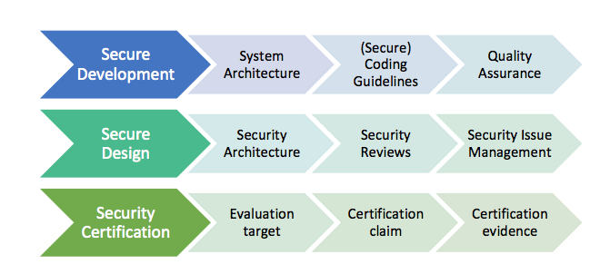
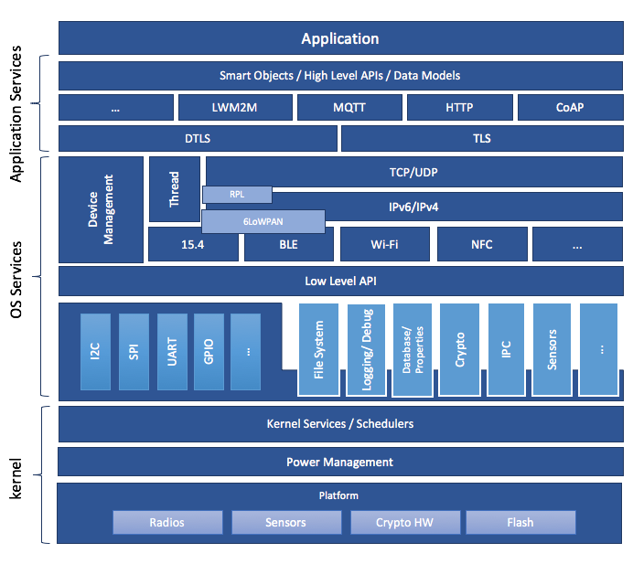

<!-- Copyright 2015-2026 Zephyr Project members and individual contributors. -->
<!-- SPDX-License-Identifier: Apache-2.0 -->
<!-- 中文翻译；编号、导航和明确标注的译注为本地新增。 -->

# 第2章\_Zephyr安全概览

原文：[官方页面](https://docs.zephyrproject.org/latest/security/security-overview.html)。读取日期：2026-10-14；保存的 latest 页面及 HTML 摘要见[来源记录](../SOURCES.md)。

## 2.1\_简介（Introduction）

本文概述 Zephyr 安全分委员会（Security Subcommittee）建立明确安全流程的步骤。这一流程帮助开发者构建更安全的软件，同时满足安全合规要求。本文介绍流程的核心理念，并列出需要编写的文档；流程实施、配套文档建立后，本文将作为总体概览和阅读入口。

### 2.1.1\_概览与范围（Overview and Scope）

首先从安全功能角度概述 Zephyr 开发流程，后续逐项详细说明。图 1 展示三个主要步骤：

- **安全开发（Secure Development）：** 确定系统架构和开发流程，确保遵循相关编码原则与质量保证程序。
- **安全设计（Secure Design）：** 定义安全程序并落实执行措施；建立系统和相关子模块的安全架构，识别威胁、设计对策，通过代码审查检查实现是否正确、威胁模型是否有效。最后，还应定义安全问题的报告、分类和缓解流程。
- **安全认证（Security Certification）：** 确定 Zephyr 实时操作系统（Real-Time Operating System，RTOS）中可认证的部分，包括评估目标、资产及保护方式；明确认证声明，并提供相应证据。

图 1 中三条流程的标识译文如下：

| 主步骤 | 图中后续项目 |
| --- | --- |
| 安全开发（Secure Development） | 系统架构（System Architecture）→安全编码指南（(Secure) Coding Guidelines）→质量保证（Quality Assurance）。 |
| 安全设计（Secure Design） | 安全架构（Security Architecture）→安全审查（Security Reviews）→安全问题管理（Security Issue Management）。 |
| 安全认证（Security Certification） | 评估目标（Evaluation Target）→认证声明（Certification Claim）→认证证据（Certification Evidence）。 |

### 2.1.2\_预期读者（Intended Audience）

本文为 Zephyr 安全分委员会和技术指导委员会（Technical Steering Committee）制定安全流程提供指导，也为安全工程师、其他工程师和架构师提供流程概览。

### 2.1.3\_术语约定（Nomenclature）

本文中的 `MUST`、`MUST NOT`、`REQUIRED`、`SHALL`、`SHALL NOT`、`SHOULD`、`SHOULD NOT`、`RECOMMENDED`、`MAY` 和 `OPTIONAL`，按 [RFC2119](P008_安全文献引用.md#rfc2119) 解释。

这些词分别表达绝对要求或禁止、强烈建议，以及真正可选的要求。RFC 2119 指出：这些术语常用来规定具有安全影响的行为。未实现 `MUST` 或 `SHOULD` 的要求，或实施了规范以 `MUST NOT` 或 `SHOULD NOT` 禁止的行为，其安全影响可能十分隐蔽。文档作者应花时间解释不遵守建议或要求的安全后果，因为多数实现者并未参与形成规范的经验积累与讨论。

### 2.1.4\_安全文档更新（Security Document Update）

本文持续演进。发现新需求、特性或变化时，通过以下流程更新：

1. 相关方通过拉取请求（pull request，PR）向 Zephyr 文档仓库提交变更。
2. 安全分委员会审查，反馈意见或接受变更。
3. 接受后，变更成为本文档的一部分。

## 2.2\_当前安全定义（Current Security Definition）

本节回顾 Zephyr RTOS 安全开发的状态。当前重点是安全功能和代码质量保证，同时也规划其他安全特性。已经实施的三类主要措施为：

- **安全功能（Security Functionality）：** 重点包括密码算法和协议；密码硬件支持计划在后续版本中提供。Zephyr 运行时采用单体二进制架构，不需要动态加载器，从而减少攻击暴露面。
- **质量保证（Quality Assurance）：** 开发流程要求所有代码进入公共仓库前经过审查。复用网络栈等经过验证的组件，可提高整体质量并保证 API 稳定；静态代码分析提供额外检查。
- **执行保护（Execution Protection）：** 包括线程隔离、栈和内存保护。上游 Zephyr 自 1.9.0 起提供栈保护；内存保护和线程隔离分别在 1.10.0 中加入 x86、在 1.11.0 中加入 ARM 与 ARC。

后续小节进一步说明这些内容。

> 译注：本概览保留了不同阶段形成的“当前”“计划”“后续版本”和安全分支表述。这里按原文翻译，不把这些规划当作当前所有平台的能力清单；判断具体功能时，还应参照对应版本的配置、架构实现及专门指南。例如本册[控制流完整性](P004_控制流完整性.md)另有当前功能说明。

### 2.2.1\_安全功能（Security Functionality）

Zephyr 的安全功能主要依托密码算法及单体系统设计。

密码功能由 PSA Crypto 提供，底层实现为 Mbed TLS。应用使用 PSA Crypto API，以标准化且安全的方式完成密码操作。Mbed TLS 支持广泛的密码算法，适合不同应用需求。

原文规划提供针对厂商专用密码硬件与软件知识产权模块（IP）的 API，包括安全访问模块（Secure Access Module，SAM）、可信平台模块（Trusted Platform Module，TPM）以及可信执行环境（Trusted Execution Environment，TEE）形式的安全密钥存储。

安全架构采用单体设计：Zephyr 内核与全部应用编译为单个静态二进制文件。系统调用实现为函数调用，不要求上下文切换；静态链接消除了动态加载恶意代码的可能性。

后续版本提供了额外保护：栈保护机制防御栈越界；应用可通过线程隔离，将系统分成特权与非特权执行环境；内存保护可对内存、外设地址空间等系统资源分区，并分配给单个线程或线程组。栈、线程执行级别和内存保护约束在上下文切换时实施。

> 译注：上段“系统调用不要求上下文切换”是原概览的架构描述，不应理解为启用用户模式后任何 API 都不会发生权限转换；本集已有[内核文档](../kernel/大纲.md)可用于继续跟踪实际线程与用户模式机制。

### 2.2.2\_质量保证（Quality Assurance）

Zephyr 使用自动化质量保证流程，目标是覆盖强制代码审查、功能与问题管理／跟踪，以及静态代码分析。

代码审查通过投票系统记录并落实，然后由相应子系统维护者将代码加入仓库。主要目标包括：

- 验证实现的功能正确性。
- 提高贡献代码的可读性与可维护性。
- 确保字符串和内存函数使用恰当。
- 验证使用者输入。
- 检查安全相关代码中的潜在问题。

当前编码原则主要关注代码风格与约定；功能正确性由构建系统和审查者经验保障。特别是对安全相关代码，还需要制定明确、详细并与开发者达成一致的指南，参见 [安全编码](P003_安全编码.md#secure-code)。

Zephyr 代码树定期运行静态代码分析，参见 [静态代码分析（Static Code Analysis）](../contributing/P002_贡献指南.md#static-analysis)。

缺陷与问题通过 GitHub 跟踪和管理。“生存能力（survivability）”一词涵盖主动安全任务，例如安全问题分类与管理。被确定为漏洞的问题通过 GitHub 安全公告管理。

静态分析发现的问题，如果要以“不是问题”关闭，应经过更严格的审查：至少另有一名了解安全流程的人同意这一判断。

安全分委员会已成立，负责详细制定安全流程；本文就是该流程的一部分。

### 2.2.3\_执行保护（Execution Protection）

执行保护支持以下几类任务：

- **内存隔离（Memory Separation）：** 将内存划分成区域，根据区域所有者赋予属性；线程只访问自己控制的区域。
- **栈保护（Stack Protection）：** 栈防护（stack guard）提供检测并捕获栈越界的机制；各线程应只能访问自己的栈。
- **线程隔离（Thread Separation）：** 每个线程只能访问自己的内存资源；调度到该线程时，只有它拥有的资源可访问。原文当前范围不包括程序流保护及其他防篡改措施。

### 2.2.4\_系统级安全（System Level Security）

系统级安全涉及生态等广泛领域，例如：安全／可信启动、空中更新（Over-the-Air，OTA）、外部通信、设备身份验证、板上资源访问控制、Flash 更新、安全存储、外设、信任根（root of trust）和攻击面缩减。

其中一些领域彼此关联，必须具备多个部分，才能形成应用需要的完整解决方案。

## 2.3\_安全开发流程（Secure Development Process）

开发安全代码应遵循一定准则，包括编码指南和开发流程，大致分为软件质量与软件安全两类。此外，应编写系统架构文档，并随未来开发持续更新。

### 2.3.1\_系统架构（System Architecture）

图 2 将系统分为操作系统部分——内核（Kernel）与操作系统服务（OS Services）——以及使用者专用部分，即应用服务（Application Services）。操作系统部分包含底层平台专用驱动，以及 I/O API、文件系统、内核功能和密码库的通用实现。

译注——原图标识对照：顶层 `Application` 为应用；`Smart Objects / High Level APIs / Data Models` 为智能对象／高层 API／数据模型；`Device Management` 为设备管理；`Low Level API` 为底层 API。下方的 `File System`、`Logging / Debug`、`Database / Properties`、`Crypto`、`IPC` 和 `Sensors` 分别为文件系统、日志／调试、数据库／属性、密码功能、进程间通信及传感器。`Kernel Services / Schedulers`、`Power Management` 和 `Platform` 分别为内核服务／调度器、电源管理和平台；平台中的 `Radios`、`Sensors`、`Crypto HW`、`Flash` 为无线电、传感器、密码硬件和 Flash。LWM2M、MQTT、HTTP、CoAP、DTLS、TLS、TCP/UDP、RPL、IPv6/IPv4、6LoWPAN、15.4、BLE、Wi-Fi、NFC、I2C、SPI、UART、GPIO 等协议或接口标识保留原图，`Thread` 在该图中是网络协议名称。

应编写系统架构与设计选择文档，并持续更新。文档包含 Zephyr 操作系统基础架构及重要子模块概览；每个模块应有专用架构文档，并对照实现进行评估。这些文档既是新开发者的入口，也是安全架构的基础。详细信息见 [Zephyr 子系统文档](../services_overview/P001_服务总览.md#os-services)。

### 2.3.2\_安全编码（Secure Coding）

开放软件系统的安全设计必须遵循明确标准。Zephyr 项目文档的[安全编码](P003_安全编码.md#secure-code)部分包含这些标准。[SALT75](P008_安全文献引用.md#salt75) 提出了以下广泛接受的保护机制原则，用于预防违规并限制影响：

1. **开放设计（Open Design）：** 广泛使用的系统无法依靠隐藏保护机制保持安全；应使用公开接受的密码算法和成熟密码库，而非秘密定制手段。
2. **机制简约（Economy of Mechanism）：** 设计尽量简单、精小，例如采用模块化代码和抽象 API，参见 [PAUL09](P008_安全文献引用.md#paul09)。
3. **完全仲裁（Complete Mediation）：** 对每个对象与进程的每次访问都先验证身份；尽可能避免保存访问条件的机制。
4. **默认安全拒绝（Fail-Safe Defaults）：** 默认限制访问，仅在系统保护方案规定的条件下允许，例如验证成功后；服务默认设置提供尽可能高的安全性，对应“默认安全（Secure by Default）”，见 [MS12](P008_安全文献引用.md#ms12)。
5. **权限分离（Separation of Privilege）：** 至少满足两个条件才授予访问；例如使用拆分密钥，见 [PAUL09](P008_安全文献引用.md#paul09)。
6. **最小权限（Least Privilege）：** 用户、程序和线程仅获得完成任务所需的最小权限子集，以正向安全模型尽量缩小攻击面。
7. **最少共用机制（Least Common Mechanism）：** 除非确有必要，不共享多个用户或进程共用的机制。[SALT75](P008_安全文献引用.md#salt75) 的例子是使用各用户分别执行的共享库，而不是所有用户共用的特权过程。
8. **心理可接受性（Psychological Acceptability）：** 安全功能应便于开发者使用，以确保采用并正确应用。

安全 RTOS 开发还包括以下特定要求：

- **互补安全／纵深防御（Complementary Security / Defense in Depth）：** 不依赖单一威胁缓解方式。互补安全由底层平台承担部分保护；平台未提供或其机制不可信时，使用纵深防御，见 [MS12](P008_安全文献引用.md#ms12)。
- **不常用服务默认关闭：** 为减少攻击暴露，较少使用的功能不应默认启用；[MS12](P008_安全文献引用.md#ms12) 给出 80% 阈值。每项功能和模块应表示为需显式启用的配置选项，使特定用途不需要的功能、协议、驱动都可关闭。已启用但应用未使用的底层选项和 API 应通知使用者。
- **变更管理（Change Management）：** 每次变更应经过请求、影响分析、批准、实现、验证，并在各阶段提供文档。提交必须关联问题跟踪系统中的缺陷报告或变更请求，没有有效关联应拒绝。

应据此及公认最佳实践制定、发布安全开发指南，并纳入 Zephyr 开发流程，详见“安全设计”。

### 2.3.3\_质量保证（Quality Assurance）

质量保证包含以下准则：

1. **遵循编码约定（Coding Conventions）：** 包括代码风格，以及模块、函数、变量等命名方式，提升可读性并便利审查；提交前由自动脚本检查执行。
2. **遵循部署指南（Deployment Guidelines）：** 保证发行一致，功能集有充分文档，安全问题列表可追溯。
3. **代码审查（Code Reviews）：** 每项拟议变更在提交前，至少由一名独立于作者的审查者检查。由子系统维护者和开发者在功能层面进行，与“安全设计”所述安全审查区分。详见 [项目与治理](https://docs.zephyrproject.org/latest/project/index.html#development-model)。
4. **静态代码分析（Static Code Analysis）：** 工具可高效发现大型代码库中的常见错误。所有代码在合入主仓库前应使用适当工具分析；这不是每次提交都单独分析，而是按一定间隔对特定分支运行。每次发行前必须消除全部发现，或对可能的误报进行豁免（waiver）。豁免既要集中记录，也要写入源码注释；记录包含工具及版本、分析日期、分支及父修订号、豁免理由、代码作者和批准者。至少覆盖主发行分支及安全分支，确保每次发行没有未处理的静态分析问题，已批准豁免也计入处理结果。详见 [项目与治理](https://docs.zephyrproject.org/latest/project/index.html#development-model)。
5. **复杂度分析（Complexity Analyses）：** 纳入开发流程，评估圈复杂度（cyclomatic complexity）等度量，主要目标是让代码尽可能简单。
6. **自动化（Automation）：** 审查流程与编码规则检查是提交前检查的强制部分，应通过自动化保证一致应用。在合入子系统的大块代码之前，除审查与风格检查外，必须已运行全部静态分析并解决问题。

### 2.3.4\_发行与生命周期管理（Release and Lifecycle Management）

生命周期管理包含多个方面：

- **设备管理（Device Management）：** 能够为现场的 Zephyr 设备更新操作系统或安全相关子系统。
- **生命周期管理（Lifecycle Management）：** 在系统状态图中定义并记录各阶段及其转换。出于安全考虑，包括检测到攻击时锁定设备，以及寿命结束时终止使用。
- **发行管理（Release Management）：** 定义发行周期、记录发行内容，维护已知漏洞与缓解措施。尤其在认证场景中，需要保证发行完整性，使后续篡改，例如植入后门，能够容易地被检测。
- **权限管理与保密协议（Rights Management and NDAs）：** 若所选认证要求，应通过合适的权限管理，例如独立源码仓库，以及相关方之间的保密协议（Non-Disclosure Agreement，NDA），确保机密性和完整性。多方共享仓库时，应采取措施防止恶意代码进入。

上述各点都应评估其对 Zephyr 开发流程的影响。

## 2.4\_安全设计（Secure Design）

为获得可认证系统或产品，必须明确安全流程，并监督、推动其执行。流程覆盖安全模块的全部开发阶段和已报告安全问题的管理；还应针对当前及未来攻击向量建立威胁模型，分析并缓解系统影响，详见[安全编码](P003_安全编码.md#secure-code)。

软件安全流程包括：

- **遵循安全开发编码要求：** 避免单个组件破坏系统安全，减少各模块漏洞。自动测试只能实现部分目标；安全关键模块中，对策等安全特性的正确实现仍必须人工检查。
- **安全审查（Security Reviews）：** 每次准备面向安全的发行，以及每次修改安全相关模块时，由安全架构师审查。验证防护措施有效性、是否遵守总体安全策略与架构，并在需要时准备认证审计。
- **安全问题管理（Security Issue Management）：** 评估潜在漏洞并缓解，参见 [安全问题管理流程](P007_安全漏洞报告.md#reporting)。

这些任务应融入安全软件开发流程，并尽可能自动化。Zephyr 安全分支的系统整体和每个安全模块，都应指定直接负责的安全架构师来指导开发。

### 2.4.1\_安全架构（Security Architecture）

上述指南应配套系统及模块层面的安全架构设计。高层考虑包括：

- 识别安全与合规需求。
- 安全功能，例如在适用时使用密码功能。
- 为已知攻击向量设计对策。
- 记录与安全有关、可供审计的事件。
- 支持 TPM 和 TEE。
- 提供现场更新 Zephyr 设备的机制。
- 任务调度与隔离。

安全架构开发以总体系统架构结构中识别出的资产（asset）为基础，具体步骤为：

1. 识别资产，例如使用者数据、身份验证与加密密钥、随机数生成器（Random Number Generator，RNG）产生的密钥生成数据，以及安全相关状态信息。
2. 识别针对资产的威胁，例如机密性受损、使用者数据被篡改。
3. 定义资产安全和保护要求，例如对策或内存保护方案。

应协调安全架构与现有系统架构及实现，找出偏差并缓解现有弱点。集成到 Zephyr 安全分支的新子模块，应各自提供安全架构文档，同时考虑并记录对系统级安全的影响。

### 2.4.2\_安全漏洞报告（Security Vulnerability Reporting）

报告安全漏洞的方法见 [安全漏洞报告](P007_安全漏洞报告.md#reporting)。

### 2.4.3\_威胁建模与缓解（Threat Modeling and Mitigation）

对 Zephyr RTOS 的安全威胁建模，是形成准确安全架构及满足多数认证方案的必要工作。先定义系统需要保护的资产，再描述保护方式和存在的威胁。识别威胁后，为其建立模型，包含资产、系统漏洞及潜在利用方式，并估计对资产、所在模块和整个系统的影响。模块及系统安全架构随后据此定义对策，缓解威胁或限制漏洞利用的影响。

威胁建模可分为以下步骤，改编自 [OWASP](P008_安全文献引用.md#owasp)：

1. 定义资产。
2. 分解应用，建立适当的数据流图（Data Flow Diagram，DFD）。
3. 使用 [STRIDE09](P008_安全文献引用.md#stride09) 与 [CVSS](P008_安全文献引用.md#cvss) 方法识别并分类威胁。
4. 确定对策及其他缓解方法。

此流程应在模块设计阶段，以及模块或系统架构重大变更前进行。发现新漏洞或利用方式时，应建立新模型或更新既有模型；安全审查中，负责的安全架构师应评估模型与缓解技术。

应从威胁模型和缓解技术导出验证对策有效性的测试，并集成进持续集成（Continuous Integration，CI）流程，避免回归损害安全性。

### 2.4.4\_漏洞分析（Vulnerability Analyses）

为找出软件实现弱点，应进行漏洞分析（Vulnerability Analysis，VA），重点关注密码算法、关键操作系统任务和连接协议。

在软件层面包括：

- 在特定硬件平台上对 RTOS 进行渗透测试（penetration testing），将相应 Zephyr 配置与硬件作为一个系统测试。
- 考虑侧信道攻击（side-channel attack），例如时间与功耗是否保持不变。密码算法和模块必须确保时间不变性，以减少攻击面；这既适用于软件实现，也适用于密码硬件。
- 对暴露的 API 和协议进行模糊测试（fuzzing）。

以上只是示例。每个模块及完整 Zephyr 系统，通常对应某个具体硬件平台，都应制定并执行合适的 VA 计划。发现的问题进入安全问题管理流程；所得经验形成指南，纳入安全编码文档。能够自动化的测试，例如模糊测试，应尽可能进入 CI。

## 2.5\_安全认证（Security Certification）

创建 Zephyr RTOS 安全分支的目标之一，是形成可认证系统或子模块。原文指出认证范围和方案尚待确定；但许多认证，例如通用准则（Common Criteria），都要求证据证明评估声明成立，见 [CCITSE12](P008_安全文献引用.md#ccitse12)。因此下文先给出通用流程，待选择方案和评估级别后再细化。

### 2.5.1\_通用认证流程（Generic Certification Process）

认证或预认证（precertification）的步骤通常如下，可对照 [MICR16](P008_安全文献引用.md#micr16)：

1. 定义 Zephyr 内需要保护的资产，例如密码密钥等机密信息、通信日志等使用者数据，以及厂商或制造商的知识产权。
2. 建立威胁模型和安全架构，防止利用系统漏洞攻击资产。完整模型包含硬件在内的整个产品，因此可以采用分拆模型：先预认证 Zephyr 安全分支，再由厂商用于认证完整产品。
3. 形成评估目标，包含需要评估与认证的资产安全声明，以及运行条件假设。
4. 提供声明成立的证据，包括一致的安全开发流程文档等。

前文已覆盖其中一部分。区别在于，认证流程只考虑纳入认证的组件；系统级安全架构则可能包含与认证无关的资产。

### 2.5.2\_认证选项（Certification Options）

可以采用以下三种方案：

1. **把 Zephyr 作为纯软件系统进行抽象预认证。** 对底层硬件及上层最终应用作出假设；硬件与应用满足假设时，完整认证更容易。这最灵活，但产品厂商承担的工作最多。
2. **针对特定硬件平台认证 Zephyr，不预设具体应用。** 硬件厂商在规定的应用假设下认证安全平台；最终应用满足假设时，产品认证所需工作较少。
3. **认证实际产品。** 将具体硬件、Zephyr RTOS 和应用组成的完整产品一起认证。

三种情况下都必须确定认证方案，例如 FIPS 140-2（[NIST02](P008_安全文献引用.md#nist02)）或通用准则（[CCITSE12](P008_安全文献引用.md#ccitse12)）；明确范围，是主线 Zephyr、安全分支还是特定模块；并确定认证／保证级别。

前两类部分认证需要硬件或软件假设，可包括以下条件，见 [GHS10](P008_安全文献引用.md#ghs10)：

- 硬件平台及其环境具有适当物理安全保障。
- 硬件平台及所有连接设备充分保护存储信道和时间信道；原文说明这里未提及远程连接。
- 设备上只运行可信、具有保证的应用。
- 设备与软件栈由经过适当培训、可信且无恶意意图的人员配置和操作。

这些假设应写入安全声明与评估目标文档。

对应官方文档源码：[doc/security/security-overview.rst](https://raw.githubusercontent.com/zephyrproject-rtos/zephyr/main/doc/security/security-overview.rst)。

本仓库的[对应源码](../../../doc/security/security-overview.rst)可用于跟踪，版本可能与网页不同；本批仅翻译和核对文档，没有执行固件构建、模拟运行或烧录。

<!-- reading-navigation:start -->

**主线阅读**

[上一篇：安全文档入口](P001_安全文档入口.md) · [本模块主线目录](../reading/security.md) · [全部主线](../reading/README.md) · [下一篇：安全编码](P003_安全编码.md)

原册编号导航（含扩展参考）

[上一章](P001_安全文档入口.md) · [返回大纲](大纲.md) · [下一章](P003_安全编码.md)

<!-- reading-navigation:end -->
