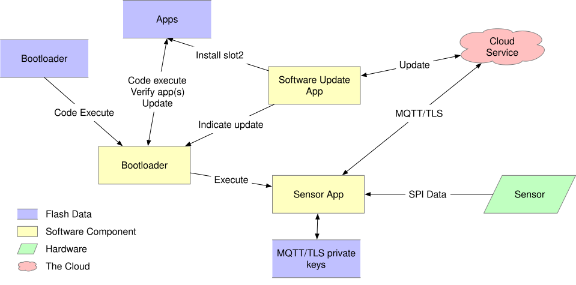

<!-- Copyright 2015-2026 Zephyr Project members and individual contributors. -->
<!-- SPDX-License-Identifier: Apache-2.0 -->
<!-- 中文翻译；编号、导航和明确标注的译注为本地新增。 -->

# 第6章\_传感器设备威胁模型

原文：[官方页面](https://docs.zephyrproject.org/latest/security/sensor-threat.html)。读取日期：2026-10-14；保存的 latest 页面及 HTML 摘要见[来源记录](../SOURCES.md)。

## 6.1\_模型范围

本文描述物联网（Internet of Things，IoT）传感器设备的威胁模型（threat model）。明确模型可以指导开发投入，也能帮助安排优先级。

设备包含某种传感器，例如温度传感器或管道压力传感器，将数据发送给带微控制器的片上系统（System on Chip，SoC）。微控制器连接云服务并转发传感器数据；云服务也能够向设备发送配置数据及软件更新镜像。总体结构见图 1。

译注——原图标识对照：`Apps` 为应用集合；`Sensor App` 为传感器应用；`Sensor` 为传感器；`Cloud Service` 为云服务；`Bootloader` 为引导加载程序；`Software Update App` 为软件更新应用。箭头上的 `Code execute`／`Code Execute`、`Verify app(s)`、`Update`、`Install slot2`、`Indicate update`、`Execute`、`SPI Data` 分别表示代码执行、验证应用、更新、安装 slot2、指示更新、执行和 SPI 数据。`MQTT/TLS private keys` 为 MQTT/TLS 私钥。图例 `Flash Data`、`Software Component`、`Hardware`、`The Cloud` 分别为 Flash 数据、软件组件、硬件和云端；MQTT/TLS 保留为协议标识。

在本模型中，传感器通过串行外设接口（Serial Peripheral Interface，SPI）连接 SoC，SoC 使用网络接口与云服务通信。接口的具体实现可能以意想不到的方式影响威胁模型，因此还需考虑变体，例如通过某种总线连接独立的网络接口 SoC。

本文重点考虑通过传输层安全协议（Transport Layer Security，TLS）承载 MQTT 的通信，即 MQTT-over-TLS，因为原文认为其应用广泛，见注释 1。

## 6.2\_资产（Assets）

威胁模型需要考虑设备运行涉及的资产。本模型包含以下资产。

### 6.2.1\_引导加载程序（Bootloader）

它是设备 Flash 中首先运行的小型代码／数据镜像。为建立信任根（root of trust），该镜像必须不可变。本模型假定 SoC 能保护一段 Flash，使其无法再次写入；在生产早期将引导镜像写入后，应启用保护，见 [th-imboot](#th-imboot)。

### 6.2.2\_应用固件镜像（Application Firmware Image）

这是微控制器执行的其余固件。将其单独区分，是因为发现安全漏洞后，这部分需要定期更新。更新要求为：

- 只能用经过授权的镜像替换，见 [th-authrepl](#th-authrepl)。
- 获得授权替代镜像后，应及时更新，见 [th-timely-update](#th-timely-update)。
- 更新必须表现为原子操作（atomic）：运行时 Flash 中要么是完整新镜像，要么是完整旧镜像，见 [th-atomic-update](#th-atomic-update)。

### 6.2.3\_根证书列表（Root Certificate List）

设备要验证云服务端身份，必须拥有允许签发服务器证书的根证书列表。云服务提供商通常提供该列表。根证书可能过期或被撤销，因此列表需要定期更新，见 [th-root-certs](#th-root-certs) 和 [th-root-check](#th-root-check)。

### 6.2.4\_客户端秘密（Client Secrets）

客户端要向服务证明身份，必须持有某种秘密，通常是 RSA 私钥或椭圆曲线（Elliptic Curve，EC）私钥。建立通信时，设备用它参与 TLS 建连，或为通信消息签名。

秘密通常由服务提供商或其他位置运行的软件生成，并安全安装到设备中。策略可能要求定期替换，因此应有更新机制。服务通常允许同时存在两到三个有效密钥，使旧密钥仍可使用时完成更新。

必须防止秘密被读取，只有必需的最少代码能够访问，见 [th-secret-storage](#th-secret-storage)。

### 6.2.5\_当前日期与时间（Current Date/Time）

TLS 证书验证需要知道当前日期和时间，以判断是否处于证书有效期。基于令牌（token）的客户端身份验证，通常还要求客户端签署包含令牌有效时间窗口的消息。原模型认为，证书验证要求设备时间大致准确到一天左右，而令牌生成一般要求准确到 5～10 分钟。

设备可能通过查询外部时间服务器近似获得安全时间。安全网络时间协议（secure NTP）可能超出某些 IoT 设备的能力。时间错误的主要风险包括拒绝服务（设备拒绝有效证书）及生成时间无效的令牌。攻击者也可能诱骗设备生成未来有效的令牌，但若要截获它，还必须伪造服务器证书，见 [th-time](#th-time)。

> 译注：上述精度是原模型的讨论值，不是 TLS 或所有云服务统一允许的时间误差。实际有效期和令牌窗口仍由所用协议、证书及服务决定。

### 6.2.6\_传感器数据（Sensor Data）

从传感器接收到的数据应原样传递给服务，不被修改或篡改。

### 6.2.7\_设备配置（Device Configuration）

设备需保存服务主机名、时间服务器地址、向服务发送传感器数据的频率及参数等配置。配置变化时需要更新，且只有授权方可以更新，见 [th-conf](#th-conf)。

### 6.2.8\_日志（Logs）

设备应记录安全相关事件，以协助分析。IoT 存储资源通常有限，必须仔细选择记录内容；也可以将事件发送到云服务，在资源更充裕的环境保存。应记录的事件包括：

- 固件镜像更新：记录新镜像下载，以及镜像成功更新的时刻。
- 客户端秘密变更：记录变更和新增秘密。
- 设备配置变更。

见 [th-logs](#th-logs)。

> 译注：“记录秘密变更”应与前述秘密存储保护要求一起理解，即记录变更事件，不是把私钥或其他秘密正文写入日志。

## 6.3\_通信（Communication）

除资产之外，模型还考虑系统实体之间传输数据或资产的位置。

### 6.3.1\_Flash内容（Flash Contents）

Flash 包含多个区域，SoC 的 CPU 可以通过程序修改其中内容。

**引导加载程序区域。** 如“资产”所述，它是一小段保存初始执行代码的 Flash。应在设备生命周期早期写入，并永久禁止修改；保护配置还应阻止通过 JTAG 或串行线调试（Serial Wire Debug，SWD）等外部接口修改。

引导加载程序负责验证应用镜像签名，并在需要时将更新镜像安装为应用镜像。安装前必须验证更新镜像签名，而且只接受版本号比当前镜像更高的更新。

**应用镜像区域。** 保存设备正常运行时的代码。运行前，引导加载程序应验证其数字签名，避免执行被篡改镜像。Flash 或系统应配置为：引导加载程序完成后，CPU 无法写入应用镜像。

**更新镜像区域。** 保存新版本应用镜像。正常运行的应用下载并存储镜像；完成后触发重启，由引导加载程序安装新镜像。

**秘密存储（Secret Storage）。** 一部分应用代码读写专用 Flash 区域中的客户端秘密。应用应保护该区域，阻止不需要访问的代码读取或写入，并考虑应用大部分代码中可能存在的漏洞利用。秘密泄露会使攻击者能够冒充设备。

初始秘密应在与正常运行不同的设备预置（provisioning）过程中写入。后续更新可由服务通过安全信道发送的通信指令控制。

**配置存储（Configuration Storage）。** 应有区域保存其他配置。在资源受限设备上，可以与秘密存储共用区域；但这会增加能访问秘密区域的代码，也就增加了必须严格审查的代码量。

**日志存储（Log Storage）。** 设备可以提供保存日志事件的 Flash 区域。

### 6.3.2\_传感器／执行器接口（Sensor/Actuator Interface）

传感器或执行器通过 SPI 等总线与 SoC 通信。硬件设计应使攻击者难以截获总线。所需技术取决于数据敏感性和用途，从将传感器与微控制器（Microcontroller Unit，MCU）安装在同一印制电路板（Printed Circuit Board，PCB），到对整个设备进行环氧树脂灌封，均可考虑。

### 6.3.3\_与云服务通信（Communication with Cloud Service）

设备通过公共互联网连接云服务，应假定攻击者能够任意截获信道，例如返回伪造的 DNS 解析结果，或尝试中间人攻击（man-in-the-middle attack）。

与云服务的全部通信都应使用 TLS，见 [th-all-tls](#th-all-tls)。TLS 栈只允许普遍认可为安全的密码套件（cipher suite），包括前向保密（forward secrecy），见注释 2。以下各项共同保护通信。

**密码套件选择（Cipher Suite Selection）。** 设备仅允许使用公认安全的密码套件，见 [th-tls-ciphers](#th-tls-ciphers)。

**服务器证书验证（Server Certificate Verification）。** 必须验证服务器呈现的证书，见 [th-root-check](#th-root-check)，包括：

- **名称（Naming）：** 证书应标明云服务器提供的主机与服务。[RFC 6125](https://datatracker.ietf.org/doc/html/rfc6125.html) 描述相关最佳实践。只要服务能提供满足条件的证书，设备可以要求比该 RFC 更严格的限制。
- **路径验证（Path Validation）：** 验证从设备内根证书到服务端证书之间存在有效签名路径。[RFC 4158](https://datatracker.ietf.org/doc/html/rfc4158.html) 给出一般说明。只要服务器证书符合，设备可以要求更受限的路径。
- **有效期（Validity Period）：** 用设备所能取得的最可靠当前时间，检查全部呈现证书的有效期。

**客户端身份验证（Client Authentication）。** 客户端使用仅该设备知晓的秘密向服务证明身份。具体方法通常由服务提供商决定，见 [th-tls-client-auth](#th-tls-client-auth)：

- **TLS 客户端证书（TLS Client Certificates）：** 客户端提供证书，并证明持有对应秘密。服务提供商通常保存这些证书；证书可自签名，也可由证书颁发机构（Certificate Authority，CA）签名。服务商维护有效证书列表并将其映射到设备身份，因此 CA 签名本身不额外增强此模型下的身份安全，但可能便利证书管理。
- **基于令牌的身份验证（Token-Based Authentication）：** 客户端也可通过 MQTT `CONNECT` 报文的密码字段验证身份，但不得在报文中传输秘密本身。可改用 [RFC 7519](https://datatracker.ietf.org/doc/html/rfc7519.html) 的 JSON Web Token（JWT）等令牌协议。令牌通常有效期较短，例如一小时，以防截获后重复使用。设备验证服务器身份之前，不得发送令牌。

**随机数／熵源（Random/Entropy Source）。** 密码通信需要安全伪随机数。设备应使用现代、公认的密码随机位生成器（Random Bit Generator，RBG）：可以使用 SoC 内部硬件实现的非确定性随机位生成器（Non-Deterministic RBG，True RBG），或由 SoC 内部熵源播种的确定性随机位生成器（Deterministic RBG，Pseudo RBG）。认可的生成器见 NIST SP 800-90A，熵源测试见 NIST SP 800-90B；对应要求为 [th-entropy](#th-entropy)。

### 6.3.4\_与时间服务通信（Communication with the Time Service）

理想情况下，设备有能够维护安全时间的硬件，但原文指出多数所用 SoC 不具备此支持，因此需要外部时间服务。[RFC 4330](https://datatracker.ietf.org/doc/html/rfc4330.html) 及其引用文档描述简单网络时间协议（Simple Network Time Protocol，SNTP），可用于查询网络时间服务器。

### 6.3.5\_设备生命周期（Device Lifecycle）

IoT 设备经历从生产到销毁、处置的生命周期。影响安全的阶段包括初始预置、正常运行、重新预置和销毁。

**初始预置（Initial Provisioning）。** 写入引导加载程序、初始应用镜像、设备秘密和初始配置，见 [th-initial-provision](#th-initial-provision)；还应启用引导区域的 Flash 保护。其中只有设备秘密必须逐台不同。秘密必须安全保管，写入后销毁设备之外所有位置的副本，见 [th-initial-secret](#th-initial-secret)。

**正常运行（Normal Operation）。** 包括本文其他部分描述的行为。

**重新预置（Re-Provisioning）。** 设备有时需要改作其他用途。可以保留同一设备秘密，替换配置及云端关联数据；也可以写入新秘密，但必须安全执行，写入后销毁外部副本，见 [th-reprovision](#th-reprovision)。

**销毁／退役（Destruction）。** 为防止秘密被用于冒充设备，退役时必须使该设备秘密失效，见 [th-destruction](#th-destruction)。可能的方法包括：

- 物理销毁硬件。
- 安全擦除包含秘密的 Flash 区域，见注释 3。
- 从服务中移除设备身份和证书。

## 6.4\_其他考虑（Other Considerations）

联网设备通常还需要配置其所处网络环境的方法。方法很多，但不能绕过前文的安全要求。

## 6.5\_威胁与对应要求（Threats）

以下保留原文的威胁标识，方便与资产及通信部分相互引用。

| 标识 | 原文要求译文 |
| --- | --- |
| [`th-imboot`](#id2) | 必须从不可变的引导加载程序启动。 |
| [`th-authrepl`](#id3) | 应用镜像只能被授权镜像替换。 |
| [`th-timely-update`](#id4) | 必须及时完成应用更新。 |
| [`th-atomic-update`](#id5) | 应用更新必须是原子的。 |
| [`th-root-certs`](#id6) | TLS 必须具备可信根证书列表。 |
| `th-root-check` | TLS 必须验证服务器所用根证书有效。 |
| [`th-secret-storage`](#id8) | 必须有安全保存客户端秘密的机制；只有必需的最少代码能够访问。 |
| [`th-time`](#id9) | 系统必须掌握适度准确的当前日期与时间。 |
| [`th-conf`](#id10) | 系统必须接收并保存配置数据。 |
| [`th-logs`](#id11) | 系统必须记录安全事件，并在本地保存或发送给服务。 |
| [`th-all-tls`](#id12) | 与云服务的全部通信都必须使用 TLS。 |
| [`th-tls-ciphers`](#id14) | TLS 只能允许公认的安全密码套件，包括前向保密。 |
| [`th-tls-client-auth`](#id16) | 设备使用前文方法之一向云提供商验证自身身份。 |
| [`th-entropy`](#id17) | TLS 层使用由 SoC 内熵源播种的现代、公认密码随机位生成器。 |
| [`th-initial-provision`](#id18) | 部署前，每台设备都应载入独有秘密。 |
| [`th-initial-secret`](#id19) | 初始秘密应安全保管，设备完成预置后立即销毁所有外部副本。 |
| [`th-reprovision`](#id20) | 重新预置必须安全进行。 |
| [`th-destruction`](#id21) | 退役时必须使设备秘密失效。 |

## 6.6\_注释（Notes）

**注释 1：** 参见 [2018 年 IoT 开发者调查](https://www.slideshare.net/kartben/iot-developer-survey-2018)。原文撰写时，三大 IoT 云服务提供商 AWS IoT、Google Cloud IoT 和 Microsoft Azure IoT 都提供 MQTT over TLS。一些反馈认为 UDP 协议及不同网络中的路由问题较难处理。这里保留原文的时间限定，不把该名单当作当前服务可用性清单。

**注释 2：** 新的漏洞利用方式被发现后，被认为安全的配置也可能改变。[SSL Labs](https://www.ssllabs.com/) 等组织提供有关 TLS 安全配置的最新观点。

**注释 3：** 仅仅擦除这一 Flash 区域，很可能并不足够。

对应官方文档源码：[doc/security/sensor-threat.rst](https://raw.githubusercontent.com/zephyrproject-rtos/zephyr/main/doc/security/sensor-threat.rst)。

本仓库的[对应源码](../../../doc/security/sensor-threat.rst)可用于跟踪，版本可能与网页不同；本批仅翻译和核对文档，没有执行固件构建、模拟运行或烧录。

<!-- reading-navigation:start -->

**主线阅读**

[上一篇：安全加固工具](P005_安全加固工具.md) · [本模块主线目录](../reading/security.md) · [全部主线](../reading/README.md) · [下一篇：安全漏洞报告](P007_安全漏洞报告.md)

原册编号导航（含扩展参考）

[上一章](P005_安全加固工具.md) · [返回大纲](大纲.md) · [下一章](P007_安全漏洞报告.md)

<!-- reading-navigation:end -->
