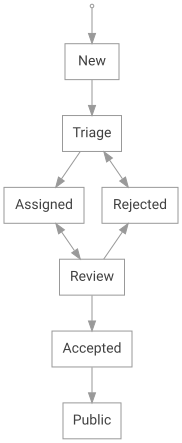

<!-- Copyright 2015-2026 Zephyr Project members and individual contributors. -->
<!-- SPDX-License-Identifier: Apache-2.0 -->
<!-- 中文翻译；编号、导航和明确标注的译注为本地新增。 -->

# 第7章\_安全漏洞报告

原文：[官方页面](https://docs.zephyrproject.org/latest/security/reporting.html)。读取日期：2026-10-14；保存的 latest 页面及 HTML 摘要见[来源记录](../SOURCES.md)。

## 7.1\_简介（Introduction）

发现 Zephyr 漏洞时，优先在仓库的[安全公告页面](https://github.com/zephyrproject-rtos/zephyr/security/advisories)创建一份[安全公告（security advisory）](https://docs.github.com/en/code-security/how-tos/report-and-fix-vulnerabilities/report-privately)草稿。也可以向项目安全事件响应团队发送电子邮件：[vulnerabilities@zephyrproject.org](mailto:vulnerabilities%40zephyrproject.org)。响应团队会在一周内确认并分析报告。

所有漏洞都通过 GitHub 上的 Zephyr 安全公告页面跟踪和管理。原始报告者会获准查看自己报告的问题。

> 译注：原页引用的 GitHub 说明已重定向，旧章节锚点不再存在；上述说明链接改为已核实的当前官方页面。流程正文仍按 Zephyr 原页翻译。

## 7.2\_漏洞报告指南（Vulnerability Reporting Guidelines）

安全研究和漏洞报告是对 Zephyr 有价值的贡献。为使所有参与者都能安全、有效地开展工作，报告及相关活动必须遵循项目[行为准则（Code of Conduct）](https://github.com/zephyrproject-rtos/zephyr/blob/main/CODE_OF_CONDUCT.md)。

以下说明研究和报告 Zephyr 漏洞时的要求。

### 7.2.1\_报告应包含什么（Reporting Expectations）

为帮助响应团队有效分诊并解决问题，报告应：

- 说明受影响的组件、版本、开发板或平台，以及复现所需的配置。
- 提供清晰的逐步复现说明，并尽可能附上最小概念验证（proof of concept，PoC）。
- 解释安全影响，例如机密性、完整性或可用性的损失，并说明已知缓解方法。
- 避免包含破坏性载荷或其他在报告意外公开时可能伤害使用者或系统的组件。

报告者应善意配合，在公开披露前给项目合理的调查和修复机会，并遵循后文的披露禁限期（embargo）与披露流程。

## 7.3\_安全问题管理（Security Issue Management）

问题在跟踪系统中按下图流转：

| 状态 | 含义及处理 |
| --- | --- |
| 新建（New） | 报告者直接录入的新报告。若由响应团队根据收到的邮件录入，应直接转入 Triage。 |
| 分诊（Triage） | 等待响应团队分析。团队确定责任人、进行分配，并转入 Assigned；设置优先级也是分诊的一部分。 |
| 已分配（Assigned） | 已指定责任人，等待修复。 |
| 审查（Review） | 出现对应的 Zephyr 拉取请求（pull request，PR）后，将 PR 链接加入问题评论，并转入此状态。 |
| 已接受（Accepted） | 修复已合入 Zephyr 的相应分支。 |
| 已公开（Public） | 禁限期结束。问题公开可见，相关通用漏洞披露编号（Common Vulnerabilities and Exposures，CVE）更新，文档漏洞页面补充详细信息。 |

> 图示译注：原图另有“已拒绝（Rejected）”状态，正文没有单独定义；图中显示 Triage 与 Rejected 双向连通，Review 也可转入 Rejected。Assigned 与 Review 同样双向连通。保留原始 SVG，没有用重新绘制的图替换。

由于报告敏感，安全公告保持私密，只对以下相关方可见：

- 项目安全事件响应团队（Project Security Incident Response Team，PSIRT）邮件列表成员。
- 报告者。
- 由 Zephyr 安全分委员会提出并批准的其他人员；通常包括负责修复的代码所有者，以及受影响发行版本的负责人。

安全分委员会在任何超过三人出席的会议中都应审查已报告漏洞，决定新问题是否需要禁限披露。判断依据包括问题严重性和可利用性；委员会认定无需禁限的问题，会复制到普通 Zephyr 缺陷跟踪系统中。

安全敏感漏洞应在最长 90 天的禁限期之后公开。其目标是给 Zephyr 项目 30 天修复问题，再给采用 Zephyr 构建产品的外部相关方 60 天，以应用并分发修复。

代码修复通过 Zephyr GitHub 项目的 PR 完成。开发者应尽量不暴露修复事项的敏感性质，不引用已分配的 CVE 编号，而只描述修复了什么。

安全分委员会会在 GitHub 安全公告中维护禁限期 CVE 与这些 PR 的对应关系，并定期报告安全问题状态。

每个被认定为安全漏洞的问题都应分配 CVE 编号。在修复过程中，可能需要额外分配编号，或撤销已分配的编号。

## 7.4\_漏洞通知（Vulnerability Notification）

每个 Zephyr 发行版都应附带本次修复的 CVE 报告。由于漏洞敏感，发行说明仅列出已修复的 CVE。禁限期结束后，再在漏洞页面补充详细信息。除非报告者明确要求匿名，否则页面应向报告者致谢。

项目应维护 `vulnerability-alerts` 邮件列表，初始成员包括每个项目成员的一名联系人。其他相关方可通过 [漏洞登记（Vulnerability Registry）](https://www.zephyrproject.org/vulnerability-registry/)表单申请加入；项目主管会审核其是否确有必要在禁限期内知晓漏洞。

安全分委员会定期向此列表发送已知禁限问题及项目内回移（backport）状态，帮助相关方判断是否需要将修复回移到内部代码树。

完成问题分诊后，向列表通知：

- Zephyr 项目 GitHub 安全公告链接。
- 已分配的 CVE 编号。
- 涉及的子系统。
- 问题严重程度。

修复 PR 被接受并合入后，除上述信息外，还通知：

- CVE 编号与修复 PR 的对应关系。
- Zephyr 项目内部的回移计划。

## 7.5\_安全修复回移（Backporting of Security Vulnerabilities）

Zephyr 中每个已修复的安全问题都应回移到：

- 当前长期稳定版本（Long Term Stable，LTS）。
- 最近两个发行版。

修复开发者负责必要的回移，并将修复应用到上述分支；只有修复不适用时例外，例如漏洞在该版本发行后才引入。关于[漏洞修复](#vulnerability-fix-recommendations)的全部建议也适用于回移 PR 及关联问题。此外，建议私下告知相应发行负责人：该回移 PR 和问题涉及安全漏洞。

回移进展记录在安全公告中。

## 7.6\_按需知情（Need to Know）

由于漏洞敏感，细节与修复只应提供给确有知情需要的相关方。禁限期结束前，需要了解漏洞细节的人员包括：

- 维护者：仅访问自己负责领域中的全部信息。
- 当前发行负责人，以及受影响历史版本的发行负责人，参见回移部分。
- PSIRT：可访问全部信息。PSIRT 由白金成员的代表和其他成员中参与分诊的志愿者组成。

如有需要，可邀请发行负责人和维护者参加额外的安全会议，讨论漏洞。

> 译注：本页是官方报告流程的翻译；其中时间承诺、可见性和组织职责均属于原文规定。本批没有提交安全公告、发送邮件或申请加入列表。

对应官方文档源码：[doc/security/reporting.rst](https://raw.githubusercontent.com/zephyrproject-rtos/zephyr/main/doc/security/reporting.rst)。

本仓库的[对应源码](../../../doc/security/reporting.rst)可用于跟踪，版本可能与网页不同；本批仅翻译和核对文档，没有执行固件构建、模拟运行或烧录。

<!-- reading-navigation:start -->

**主线阅读**

[上一篇：传感器设备威胁模型](P006_传感器设备威胁模型.md) · [本模块主线目录](../reading/security.md) · [全部主线](../reading/README.md) · [下一篇：安全文献引用](P008_安全文献引用.md)

原册编号导航（含扩展参考）

[上一章](P006_传感器设备威胁模型.md) · [返回大纲](大纲.md) · [下一章](P008_安全文献引用.md)

<!-- reading-navigation:end -->
