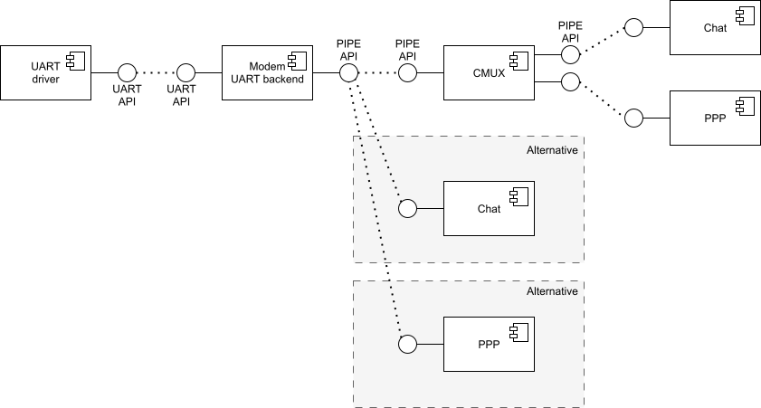
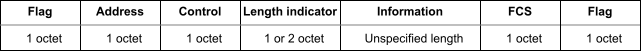
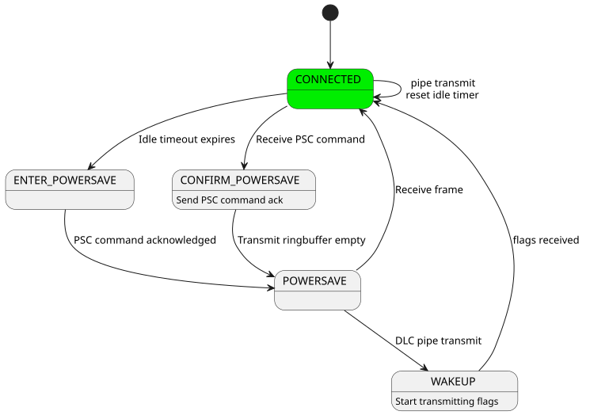

<!-- Copyright 2015-2026 Zephyr Project members and individual contributors. -->
<!-- SPDX-License-Identifier: Apache-2.0 -->
<!-- 中文翻译；编号、导航和明确标注的译注为本地新增。 -->

<a id="modem-modules"></a>
<a id="modem"></a>

# 第7章\_调制解调器模块

原文：[官方页面](https://docs.zephyrproject.org/latest/services/connectivity/modem/index.html)。读取日期：2026-10-14；保存的 latest 页面及 HTML 摘要见[来源记录](../SOURCES.md)。

## 7.1\_模块概览

本服务提供与调制解调器（modem）通信所需的模块。调制解调器是自包含设备，实现射频（Radio-Frequency，RF）通信所需的软硬件，例如全球导航卫星系统（Global Navigation Satellite System，GNSS）、蜂窝网络和 Wi-Fi。

各模块通过数据输入／输出管道（data-in/data-out pipe）动态互连，因此能独立测试，具备较高灵活性，并保证稳定性和可扩展性。

<a id="modem-pipe"></a>

## 7.2\_调制解调器管道（Modem Pipe）

该模块以线程安全方式，抽象 通用异步收发器（Universal Asynchronous Receiver/Transmitter，UART）、CMUX 数据链路连接标识符（Data Link Connection Identifier，DLCI）通道等不同机制上的数据输入和输出通信。

调制解调器后端（modem backend）内部包含一个 `modem_pipe` 结构体实例，以及屏蔽底层机制所需的缓冲区和其他结构。



后端初始化后，返回其内部 `modem_pipe` 的指针，供调用者通过管道 API 与后端交互。

接口参考：[调制解调器管道 API](https://docs.zephyrproject.org/latest/doxygen/html/group__modem__pipe.html)。

相关示例：[AT 命令客户端（AT Command Client）](../driver_samples/P019_AT命令客户端示例.md#at_client)，在控制台和调制解调器之间创建双向 UART 桥接，用于 AT 命令通信。

<a id="modem-ppp"></a>

## 7.3\_调制解调器PPP（Modem PPP）

该模块定义一个第二层（Layer 2，L2）点对点协议（Point-to-Point Protocol，PPP）网络接口，并将其绑定到调制解调器后端；L2 说明见 [L2 层管理](../networking/P024_二层管理.md#net-l2-interface)。

L2 PPP 接口发送和接收网络数据包；数据包通过后端传输前必须封装成 PPP 帧，本模块负责封装。

接口参考：[调制解调器 PPP API](https://docs.zephyrproject.org/latest/doxygen/html/group__modem__ppp.html)。

<a id="modem-cmux"></a>

## 7.4\_调制解调器CMUX（Modem CMUX）

该模块按照 3GPP 27.010 规范实现 CMUX 多路复用协议（multiplexing protocol），使单一连接承载多个称为 DLCI 通道的双向数据流。模块连接到一个调制解调器后端，向上暴露多个后端，每个代表一条 DLCI 通道。

协议用简单帧格式将每条数据链路连接（Data Link Connection，DLC）拆成小块数据。Zephyr 实现基本帧类型，最大传输单元（Maximum Transmission Unit，MTU）大小在构建时配置。



对于支持的调制解调器，本模块还通过 CMUX 节能命令（Power Saving Command，PSC）实现节能，详见后面的“CMUX 节能”。

接口参考：[调制解调器 CMUX API](https://docs.zephyrproject.org/latest/doxygen/html/group__modem__cmux.html)。

<a id="modem-pipelink"></a>

## 7.5\_管道链接（Modem Pipelink）

该模块在全局共享调制解调器管道，将设备驱动中的管道创建与设置，与管道使用方解耦。设备驱动和应用之间的用法可参考 [`drivers/modem/modem_at_shell.c`](https://github.com/zephyrproject-rtos/zephyr/blob/main/drivers/modem/modem_at_shell.c) 和 [`drivers/modem/modem_cellular.c`](https://github.com/zephyrproject-rtos/zephyr/blob/main/drivers/modem/modem_cellular.c)。

接口参考：[调制解调器 pipelink API](https://docs.zephyrproject.org/latest/doxygen/html/group__modem__pipelink.html)。

<a id="modem-chat"></a>

## 7.6\_脚本化命令交互（Modem Chat）

该模块实现脚本化 AT 命令通信。AT 命令组织成脚本，每个脚本是一系列命令—响应交互：先通过管道发送命令字符串，然后等待符合某个预期模式的响应。匹配后，可以调用可选回调并传入已解析的参数。

脚本在构建时通过 [`MODEM_CHAT_SCRIPT_DEFINE`](https://docs.zephyrproject.org/latest/doxygen/html/group__modem__chat.html#gad15f82648a073883c5956d6b14f4e41a) 和 [`MODEM_CHAT_SCRIPT_CMDS_DEFINE`](https://docs.zephyrproject.org/latest/doxygen/html/group__modem__chat.html#gab807fffae2007bc03a8e87ba73921888) 定义。每个条目将请求字符串与一个或多个 [`modem_chat_match`](https://docs.zephyrproject.org/latest/doxygen/html/structmodem__chat__match.html) 模式配对。模式通过指定分隔字符，例如 `","`，支持参数解析，方便提取 `+CSQ: 20,99` 等响应中的字段。

除脚本交互之外，模块还持续监测主动上报响应（unsolicited response），即没有前置命令、由调制解调器主动发出的消息，例如 `+CEREG:` 网络注册状态更新。这类消息由 chat 实例初始化时注册的独立匹配模式处理。

chat 可以连接任意调制解调器管道，因此能在原始 UART 后端与 CMUX DLCI 通道之间切换。

接口参考：[调制解调器 chat API](https://docs.zephyrproject.org/latest/doxygen/html/group__modem__chat.html)。

<a id="cellular-modem"></a>
<a id="id1"></a>

## 7.7\_蜂窝调制解调器（Cellular Modem）

通用蜂窝驱动 [`drivers/modem/modem_cellular.c`](https://github.com/zephyrproject-rtos/zephyr/blob/main/drivers/modem/modem_cellular.c) 组合前述模块，提供完整且与具体硬件无关的蜂窝数据连接。它暴露标准 Zephyr 网络接口，应用通过 [BSD 套接字（sockets）API](../networking/P040_BSD套接字.md#bsd-sockets-interface) 通信，无需编写调制解调器专用代码。

<a id="architecture-overview"></a>

### 7.7.1\_架构概览（Architecture Overview）

驱动将各模块组织成分层管道架构：

1. **UART 后端：** [`modem_backend_uart`](https://docs.zephyrproject.org/latest/doxygen/html/structmodem__backend__uart.html) 实例提供最底层管道，将物理 UART 外设抽象为管道 API，执行线程安全、中断驱动的传输。
2. **CMUX：** `modem_cmux` 实例连接 UART 管道，按 3GPP 27.010 复用为两条 DLCI 通道。
3. **DLCI 通道 1，数据通道：** 初始化时承载 AT 命令，连接建立后承载 PPP 封装的 IP 数据。
4. **DLCI 通道 2，命令通道：** 数据连接活跃时专门承载 AT 命令，使驱动能查询信号质量、注册状态等参数而不打断数据流。
5. **Modem chat：** [`modem_chat`](https://docs.zephyrproject.org/latest/doxygen/html/structmodem__chat.html) 实例执行 AT 脚本。CMUX 启动前直接连接 UART；启动后先移到 DLCI 1 运行初始化脚本，再移到 DLCI 2 定期监测。
6. **Modem PPP：** `modem_ppp` 实例将 Zephyr IP 包封装成 PPP 帧，通过 DLCI 1 发送；接收时去除 PPP 帧封装，将包交给网络栈。

两条 DLCI 同时使用是关键：DLCI 1 全速传输 IP 数据时，驱动仍可在后台通过 DLCI 2 交换 AT 命令。

<a id="connection-lifecycle"></a>

### 7.7.2\_连接生命周期（Connection Lifecycle）

驱动内部状态机依次经过以下阶段。

<a id="power-on-and-hardware-reset"></a>

**上电与硬件复位（Power-On and Hardware Reset）。** 若设备树（Devicetree）定义了复位和电源 GPIO，驱动会产生相应脉冲，并等待调制解调器能够响应。

<a id="initial-at-configuration"></a>

**初始AT配置（Initial AT Configuration）。** chat 直接连接 UART，执行设备专用 `init_chat_script`。脚本通常关闭回显、查询 IMEI、型号和固件版本，并配置主动响应上报。此时仍是普通 UART AT 通信，CMUX 尚未启用。

<a id="cmux-bring-up"></a>

**启动CMUX（CMUX Bring-Up）。** 初始化脚本成功后发送 `AT+CMUX`，切换至多路复用模式。CMUX 连接 UART 并打开 DLCI 1、DLCI 2；此后全部通信封装在 CMUX 帧中。

<a id="apn-configuration-and-dialing"></a>

**APN配置与拨号（APN Configuration and Dialing）。** chat 连接 DLCI 1，运行动态生成的接入点名称（Access Point Name，APN）脚本 `AT+CGDCONT`，再执行拨号脚本 `ATD*99#` 或等价命令。成功后，DLCI 1 进入数据模式。

<a id="data-connection"></a>

**数据连接（Data Connection）。** PPP 连接 DLCI 1，chat 移到 DLCI 2。收到 `+CEREG`、`+CREG` 或 `+CGREG` 主动上报、确认已注册网络后，驱动调用 `net_if_carrier_on()`。网络栈通过 DLCI 1 协商 PPP 会话，应用即可正常使用套接字；DLCI 2 上的周期脚本继续监测信号质量和注册状态。

<a id="shutdown"></a>

**关机（Shutdown）。** 驱动执行关机脚本，并通过关机 GPIO 脉冲正常关闭调制解调器；状态机返回空闲。

<a id="adding-support-for-a-new-modem"></a>

### 7.7.3\_增加新调制解调器支持（Adding Support for a New Modem）

通用驱动通过设备树兼容标识（compatible）的绑定和关联 chat 脚本获得各型号配置。新增支持需要三项材料：

- 包含通用蜂窝调制解调器基础绑定的设备树绑定文件。
- 定义初始化、拨号、周期监测以及可选关机序列的 chat 脚本。
- 将脚本与硬件配置关联起来的设备实例化宏。

管道连接、CMUX 管理、PPP 帧处理和状态机逻辑由驱动自动完成。

<a id="supported-modems"></a>

### 7.7.4\_已支持型号（Supported Modems）

[`drivers/modem/modem_cellular.c`](https://github.com/zephyrproject-rtos/zephyr/blob/main/drivers/modem/modem_cellular.c) 已支持：

- Fibocom LE250。
- Quectel BG95、BG96。
- Quectel EG25-G、EG800Q。
- SIMCom SIM7080、A76xx。
- u-blox SARA-R4、SARA-R5、LARA-R6。
- Sierra Wireless HL7800。
- Telit ME910G1、ME310G1、LE910C1 Thread-x、LEx10Q1。
- Nordic Semiconductor nRF91 SLM。
- Sequans GM02S。

各型号使用相同的一组宏定义，例如 [`MODEM_CHAT_SCRIPT_CMDS_DEFINE`](https://docs.zephyrproject.org/latest/doxygen/html/group__modem__chat.html#gab807fffae2007bc03a8e87ba73921888)、[`MODEM_CHAT_SCRIPT_DEFINE`](https://docs.zephyrproject.org/latest/doxygen/html/group__modem__chat.html#gad15f82648a073883c5956d6b14f4e41a)、`MODEM_CELLULAR_DEFINE_INSTANCE`。完整初始化、拨号、周期和关机脚本见该驱动。公共设备树属性见 [`dts/bindings/modem/zephyr,cellular-modem-device.yaml`](https://github.com/zephyrproject-rtos/zephyr/blob/main/dts/bindings/modem/zephyr,cellular-modem-device.yaml)。

<a id="out-of-tree-modem"></a>

### 7.7.5\_树外调制解调器（Out-of-Tree Modem）

驱动宏与数据结构由 [`include/zephyr/drivers/modem/modem_cellular.h`](https://github.com/zephyrproject-rtos/zephyr/blob/main/include/zephyr/drivers/modem/modem_cellular.h) 导出，因此可以在 Zephyr 树外，例如应用源码中，定义全新调制解调器而无需修改上游文件。这适合为特定用途调整 AT 序列，或在上游提交前开发新型号支持。

先创建包含公共基础绑定的设备树绑定，再用 `modem_cellular.h` 中的宏编写驱动源码。下面三个文件即可实现示例。

设备树绑定 `app/dts/bindings/my,modem.yaml`：

```yaml
compatible: "my,modem"

include: zephyr,cellular-modem-device.yaml
```

设备树覆盖文件 `app.overlay` 的局部内容：

```dts
&uart30 {
    modem: modem {
        compatible = "my,modem";
        status = "okay";
        mdm-power-gpios = <&gpio1 13 GPIO_ACTIVE_HIGH>;
    };
};
```

驱动源码 `app/src/my_modem.c`：

```c
#include <zephyr/drivers/modem/modem_cellular.h>
#include <zephyr/device.h>

MODEM_CELLULAR_COMMON_CHAT_MATCHES();
MODEM_CHAT_MATCHES_DEFINE(my_modem_unsol,
    MODEM_CELLULAR_COMMON_UNSOL_MATCHES);

/* Init script — configure the modem, enable unsolicited LTE
 * registration notifications, then switch to CMUX.
 */
MODEM_CHAT_SCRIPT_CMDS_DEFINE(init_chat_script_cmds,
    MODEM_CHAT_SCRIPT_CMD_RESP("ATE0",              ok_match),
    MODEM_CHAT_SCRIPT_CMD_RESP("AT+CEREG=1",        ok_match),
    MODEM_CHAT_SCRIPT_CMD_RESP("AT+CMUX=0,0,5,127", ok_match));

MODEM_CHAT_SCRIPT_DEFINE(init_chat_script, init_chat_script_cmds,
    abort_matches, modem_cellular_chat_callback_handler, 1);

/* Dial script — enable the radio and open data mode */
MODEM_CHAT_SCRIPT_CMDS_DEFINE(dial_chat_script_cmds,
    MODEM_CHAT_SCRIPT_CMD_RESP("AT+CFUN=1", ok_match),
    MODEM_CHAT_SCRIPT_CMD_RESP("ATD*99#",   connect_match));

MODEM_CHAT_SCRIPT_DEFINE(dial_chat_script, dial_chat_script_cmds,
    dial_abort_matches, modem_cellular_chat_callback_handler, 60);

static const struct modem_cellular_vendor_config my_modem_vendor = {
    .scripts = {
        .init = &init_chat_script,
        .dial = &dial_chat_script,
    },
    .unsol_matches = {
        .matches = my_modem_unsol,
        .size = ARRAY_SIZE(my_modem_unsol),
    },
    .chat_delimiter = "\r",
    .chat_filter = "\n",
    .power_pulse_duration_ms = 1000,
    .reset_pulse_duration_ms = 100,
    .startup_time_ms = 5000,
    .shutdown_time_ms = 5000,
};

/* Macro for defining a DT instance */
#define MY_MODEM_DEVICE(inst)                                                   \
    MODEM_DT_INST_PPP_DEFINE(inst,                                              \
        MODEM_CELLULAR_INST_NAME(ppp, inst), NULL, 1500, 64);                   \
                                                                                \
    static struct modem_cellular_data                                           \
        MODEM_CELLULAR_INST_NAME(data, inst);                                   \
                                                                                \
    MODEM_CELLULAR_DEFINE_AND_INIT_USER_PIPES(inst,                             \
        (user_pipe_0, 3), (user_pipe_1, 4))                                     \
                                                                                \
    MODEM_CELLULAR_DEFINE_INSTANCE(inst, &my_modem_vendor, NULL)

#define DT_DRV_COMPAT my_modem
DT_INST_FOREACH_STATUS_OKAY(MY_MODEM_DEVICE)
#undef DT_DRV_COMPAT
```

原例注释译文：初始化脚本配置设备、启用 LTE 主动注册通知，再切换到 CMUX；拨号脚本启用无线功能并进入数据模式；`Macro for defining a DT instance` 表示“定义设备树实例的宏”。

该例很精简，但足以在通用蜂窝调制解调器上启动 PPP 连接。更完整的示例见 [`drivers/modem/modem_cellular.c`](https://github.com/zephyrproject-rtos/zephyr/blob/main/drivers/modem/modem_cellular.c)。

> 译注：`app/` 表示示例应用目录，三个文件由采用树外方案的开发者创建；`uart30`、GPIO 引脚和各时序参数是原例配置，应根据实际硬件及设备要求确定。这些是原始配置与源码示例，本批没有创建对应驱动、编译固件或连接调制解调器。

<a id="board-specific-init-script"></a>

### 7.7.6\_板级初始化脚本（Board-Specific Init Script）

初始化、网络和拨号脚本按厂商范围组织，以设备树 compatible 为键。因此，同型号设备在不同开发板上的差异，例如射频调谐器频段路由，本来可能需要复制修改厂商驱动。

开发板可改用 [`MODEM_CELLULAR_BOARD_INIT_DEFINE`](https://docs.zephyrproject.org/latest/doxygen/html/group__modem__driver__macros.html#ga5b16137fbab1b7199075e88422a0b9b4) 注册自己的 chat 脚本。脚本在 CMUX 建立之后、APN 和网络配置之前，通过 AT 控制通道执行。未注册脚本的板不会增加 ROM 或 RAM 占用。

驱动会覆盖脚本的完成回调，使用推进连接序列的回调；脚本原先设置的回调会被忽略。

```c
MODEM_CHAT_MATCH_DEFINE(board_init_ok_match, "OK", "", NULL);
MODEM_CHAT_SCRIPT_CMDS_DEFINE(board_init_cmds,
    MODEM_CHAT_SCRIPT_CMD_RESP("AT+QCFG=\"rf/tuner_cfg\",0,\"12,28\"", board_init_ok_match));
MODEM_CHAT_SCRIPT_NO_ABORT_DEFINE(board_init, board_init_cmds, NULL, 10);

MODEM_CELLULAR_BOARD_INIT_DEFINE(DT_NODELABEL(modem), &board_init);
```

<a id="cmux-power-saving"></a>
<a id="id2"></a>

## 7.8\_CMUX节能（CMUX Power Saving）

3GPP TS 27.010 定义了 CMUX 节能机制，设备支持时可在 Zephyr 中使用。规范相关章节为：

- 5.2.5，帧间填充（Inter-frame Fill）。
- 5.4.6.3.2，节能控制消息（Power Saving Control，PSC）。
- 5.4.7，电源控制与唤醒机制（Power Control and Wake-up Mechanisms）。

该机制允许对 CMUX 使用的 UART 进行运行时电源管理（runtime power management）。所有 DLCI 通道均无数据收发时，经过可配置超时后 CMUX 进入空闲，发送 PSC 消息请求调制解调器进入低功耗。随后可以关闭管道；若启用了运行时电源管理，UART 便可断电。

任一 DLCI 通道需要收发数据时，CMUX 退出空闲，并持续发送标志字符（flag character），直到收到对端标志字符，以唤醒调制解调器。

有些设备通过 CMUX 之外的硬件信号控制睡眠与唤醒，而不使用带内协议。设备树属性 `cmux-no-powersave-handshake` 可跳过进入和退出时的两段握手：进入时不交换 PSC 帧，直接节能；退出时不交换标志字符，管道重新打开后直接进入 `connected`。下一个发送帧会自行恢复帧同步。

某些设备只有在数据终端就绪（Data Terminal Ready，DTR）信号撤销时才允许 UART 断电。此时可以使用支持 DTR 的 UART，根据 UART 电源状态控制 DTR。

UART 断电后若要由接收数据唤醒主机，需要调制解调器支持 RING 信号。驱动处理该信号，检测到后打开管道，让 CMUX 唤醒设备并处理数据。

[`subsys/modem/modem_cmux.c`](https://github.com/zephyrproject-rtos/zephyr/blob/main/subsys/modem/modem_cmux.c) 使用下列状态机实现节能：



已连接状态下，`modem_cmux_process_received_byte()` 必须按规范 5.2.5 回复重复的标志字符。空闲计时器持续运行，每次发送或接收帧时清零；到期后开始进入节能状态。

在 `POWERSAVE` 状态，所有 DLC 管道保持打开，但朝向 UART 的管道被阻塞或关闭，因此数据缓存在 CMUX 环形缓冲区，等待唤醒。该状态下也会回复重复标志字符，使对端按 5.4.7 完成唤醒。若管道关闭且启用了运行时电源管理，UART 可以断电。

当 `CONNECTED` 的空闲计时器到期，CMUX 会阻塞全部 DLC 管道，发送 PSC 命令让对端开始进入 `POWERSAVE`；收到 PSC 回复后，自身转入节能模式。

对端也可以在 `CONNECTED` 状态发送 PSC，主动发起节能。CMUX 阻塞全部 DLC 管道并返回 PSC 响应；发送缓冲区清空后，进入 `POWERSAVE`。

在 `POWERSAVE` 中，任一 DLC 管道尝试发送时，CMUX 先缓存数据，再进入 `WAKEUP`，按规范 5.4.7 连续发送标志字符。对端回复标志字符表明已准备好接收，CMUX 随后停止发送标志字符、返回 `CONNECTED`，恢复正常工作。

图中 `CONNECTED`、`ENTER_POWERSAVE`、`CONFIRM_POWERSAVE`、`POWERSAVE`、`WAKEUP` 分别为已连接、进入节能、确认节能、节能和唤醒。边上的 `pipe transmit`／`DLC pipe transmit` 为管道发送，`reset idle timer` 为重置空闲计时器，`Idle timeout expires` 为空闲超时，`PSC command acknowledged` 为 PSC 命令获确认，`Receive PSC command` 为接收 PSC 命令，`Transmit ringbuffer empty` 为发送环形缓冲区已空，`flags received` 为收到标志字符，`Receive frame` 为收到帧；状态动作 `Send PSC command ack` 为发送 PSC 确认，`Start transmitting flags` 为开始发送标志字符。

通过以下设备树属性配置：

```yaml
cmux-enable-runtime-power-save:
  type: boolean
  description: Enable runtime power saving using CMUX PSC commands.
               This requires modem to support CMUX and PSC commands while keeping the data
               connection active.
cmux-close-pipe-on-power-save:
  type: boolean
  description: Close the modem pipe when entering power save mode.
              When runtime power management is enabled, this closes the UART.
              This requires modem to support waking up the UART using RING signal.
cmux-idle-timeout-ms:
  type: int
  description: Time in milliseconds after which CMUX will enter power save mode.
  default: 10000
```

属性说明译文：

| 属性 | 类型、用途与条件 |
| --- | --- |
| `cmux-enable-runtime-power-save` | 布尔值。通过 CMUX PSC 启用运行时节能；设备必须能在保持数据连接的同时支持 CMUX 与 PSC。 |
| `cmux-close-pipe-on-power-save` | 布尔值。节能时关闭管道；启用运行时电源管理时会关闭 UART。设备必须能通过 RING 唤醒 UART。 |
| `cmux-idle-timeout-ms` | 整数。进入节能前的空闲时间，单位毫秒，默认 `10000`。 |

使用节能 CMUX 的设备树示例：

```dts
&uart1 {
  status = "okay";
  zephyr,pm-device-runtime-auto;

  uart_dtr: uart-dtr {
    compatible = "zephyr,uart-dtr";
    dtr-gpios = <&interface_to_nrf9160 4 GPIO_ACTIVE_LOW>;
    status = "okay";
    zephyr,pm-device-runtime-auto;

    modem: modem {
      compatible = "nordic,nrf91-slm";
      status = "okay";
      mdm-ring-gpios = <&interface_to_nrf9160 5 (GPIO_PULL_UP | GPIO_ACTIVE_LOW)>;
      zephyr,pm-device-runtime-auto;
      cmux-enable-runtime-power-save;
      cmux-close-pipe-on-power-save;
      cmux-idle-timeout-ms = <5000>;
    };
  };
};
```

该例由支持 DTR 的 UART 连接支持 CMUX 与 PSC 的调制解调器。DTR 用于控制 UART 电源状态；设备输出的 RING 信号用于在调制解调器子系统断电时将其唤醒。


对应官方文档源码：[doc/services/connectivity/modem/index.rst](https://raw.githubusercontent.com/zephyrproject-rtos/zephyr/main/doc/services/connectivity/modem/index.rst)。

> 译注——源码跟踪：本仓库的[对应源码](../../../doc/services/connectivity/modem/index.rst)可用于跟踪，版本可能与网页不同；本批仅翻译和核对文档，没有执行固件构建、模拟运行或烧录。

<!-- reading-navigation:start -->

**主线阅读**

[上一篇：LoRa与LoRaWAN](P006_LoRa与LoRaWAN.md) · [本模块主线目录](../reading/services_overview.md) · [全部主线](../reading/README.md) · [下一篇：框架入口](P008_框架入口.md)

<details>
<summary>原册编号导航（含扩展参考）</summary>

[上一章](P006_LoRa与LoRaWAN.md) · [返回大纲](大纲.md) · [下一章](P008_框架入口.md)

</details>

<!-- reading-navigation:end -->
