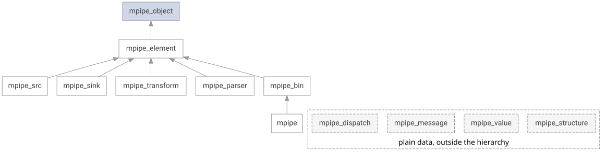
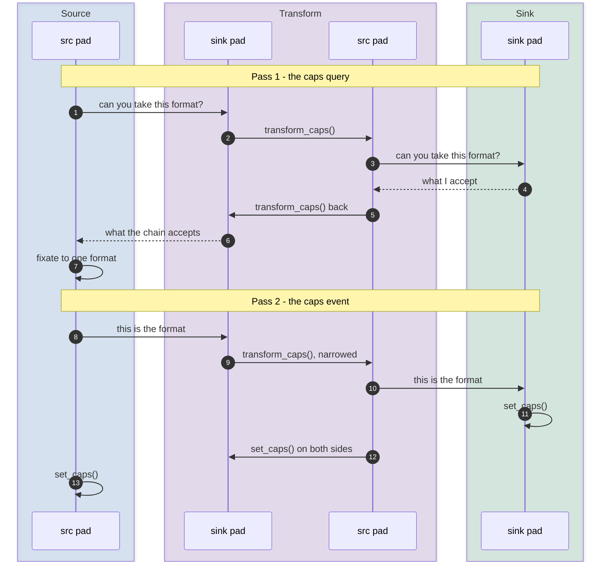
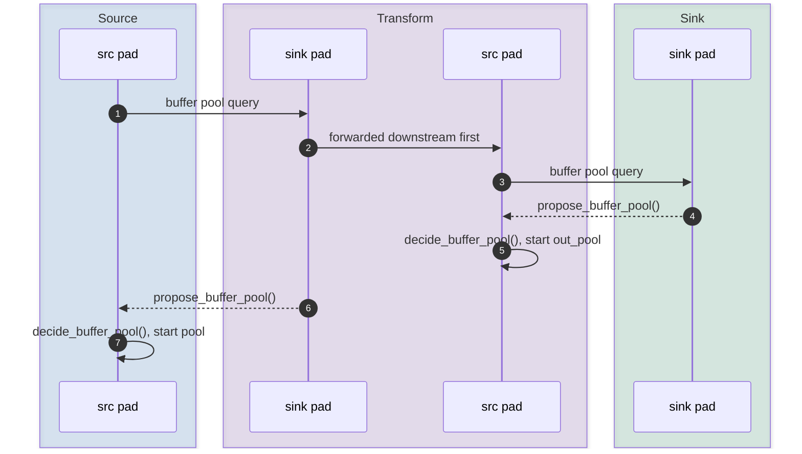

<!-- Copyright 2015-2026 Zephyr Project members and individual contributors. -->
<!-- SPDX-License-Identifier: Apache-2.0 -->
<!-- 中文翻译；编号、导航和明确标注的译注为本地新增。 -->

<a id="multimedia-pipeline-mpipe"></a>
<a id="mpipe"></a>

# 第12章\_多媒体流水线

原文：[官方页面](https://docs.zephyrproject.org/latest/services/mpipe/index.html)。读取日期：2026-10-14；保存的 latest 页面及 HTML 摘要见[来源记录](../SOURCES.md)。

<a id="overview"></a>

## 12.1\_概览（Overview）

多媒体流水线（Multimedia Pipeline，mpipe）用称为元素（element）的独立处理组件构成媒体流。应用声明所需元素，将它们链接成图（graph），再通过状态机驱动这张图。mpipe 负责协商相邻元素的数据格式、确定由哪个缓冲池提供缓冲区，并将缓冲区从一个元素传递给下一个。


流水线是一张通过端口（pad）连接的元素图。图中 `source` 为数据源，`transform` 为转换器，`sink` 为数据汇；`src pad` 和 `sink pad` 分别为输出端口与输入端口，`negotiated format` 表示协商后的格式。

mpipe 提供组件及组合规则，而非完整成品方案。组装流水线类似搭积木：同一张图绑定不同设备即可换板运行；新增需求通常只需增加一个元素，而不是重写系统。

元素位于按媒体领域分组的插件（plugin）中。每个插件有自己的目录、Kconfig 和头文件；构建系统会发现它，无需修改框架。因此芯片厂商或中间件提供者可以交付元素而不改动核心。

mpipe 不进行动态分配：缓冲区来自启动流水线时确定规模的池；协商路径中的对象为固定大小，按值保存。代价转移到了线程栈。协商发生在 [`mpipe_element_set_state()`](https://docs.zephyrproject.org/latest/doxygen/html/group__mpipe__element.html#gafb59f995c7a2bd799316d187ec252632) 内，由调用该函数的线程执行，同时保留多份能力描述（capability）。应为该线程预留相应栈空间；下面示例中是执行 `main` 的线程。

mpipe 是可选组件，并不适用于所有场景。只驱动单个设备的应用直接使用设备 API 更合适；需要多个设备就格式达成一致、彼此交接缓冲区时，mpipe 才发挥作用。

<a id="building-a-pipeline"></a>

## 12.2\_构建流水线（Building a Pipeline）

应用只需包含 `<zephyr/mpipe/mpipe.h>` 即可访问全部核心 API；每种实例化的元素再包含各自头文件。

元素是应用拥有的普通对象，mpipe 不替应用分配。各元素类型有自己的初始化函数，接受类型对象和标识 `id`：

```c
/* Concrete element types come from plugins; each has its own header. */
static struct mpipe pipe;
static struct my_src source;
static struct my_sink sink;

ret = mpipe_pipeline_init(&pipe, PIPE_ID);
ret = my_src_init(&source, SRC_ID);
ret = my_sink_init(&sink, SINK_ID);
```

原例注释译文：“具体元素类型来自插件；每种类型有自己的头文件。”

标识只需在该流水线内唯一。元素通过属性（property）配置，使调用者不必了解具体类型即可设置元素：

```c
ret = mpipe_object_set_properties((struct mpipe_object *)&source,
                                  MY_SRC_PROP_PATH, "/SD:/in.bin",
                                  MPIPE_PROP_LIST_END);
```

随后以任意顺序加入流水线，再按数据流顺序链接：

```c
ret = mpipe_bin_add((struct mpipe_bin *)&pipe,
                    (struct mpipe_element *)&source,
                    (struct mpipe_element *)&sink, NULL);

ret = mpipe_element_link((struct mpipe_element *)&source,
                         (struct mpipe_element *)&sink, NULL);
```

这些类型转换有明确定义，因为每个元素都将基类结构嵌入为第一个成员。若两个元素的能力描述不可能相交，链接会被拒绝；不可能成立的图在组装时即可失败，而不必等到启动。

将流水线设置为 `MPIPE_STATE_PLAYING` 并不是直接跳转。流水线及其子元素依次经过 `READY`、`PAUSED`、`PLAYING`，因此途中会完成格式协商和缓冲池启动。

应用随后监测流水线消息通道，了解运行如何结束并处理错误。错误消息会指出出错元素及当时阶段，例如报告“元素 3 的能力协商失败”，而不只是“运行已停止”。将图返回 `MPIPE_STATE_READY` 会拆除运行资源：

```c
/* Needs CONFIG_ZBUS_MSG_SUBSCRIBER=y */
ZBUS_MSG_SUBSCRIBER_DEFINE(main_sub);

struct zbus_channel *bus = mpipe_element_get_bus_chan((struct mpipe_element *)&pipe);

ret = zbus_chan_add_obs(bus, &main_sub, K_FOREVER);

if (mpipe_element_set_state((struct mpipe_element *)&pipe, MPIPE_STATE_PLAYING) != 0) {
        /* the element that refused is still in its previous state */
}

do {
        ret = zbus_sub_wait_msg(&main_sub, &chan, &msg, K_FOREVER);
} while ((msg.type & (MPIPE_MESSAGE_ERROR | MPIPE_MESSAGE_EOS)) == 0);

(void)mpipe_element_set_state((struct mpipe_element *)&pipe, MPIPE_STATE_READY);
```

原例注释译文：需要 `CONFIG_ZBUS_MSG_SUBSCRIBER=y`；拒绝状态切换的元素仍停留在之前的状态。

> 译注：本节是官方 API 组合片段，不是可独立编译的完整应用。`my_src`、`my_sink`、各 ID、属性标识及消息变量需由实际插件或应用定义；`/SD:/in.bin` 是原例设备文件系统中的输入路径，不是宿主仓库地址。本批保留原始代码，没有创建媒体应用或运行设备。

<a id="elements-pads-and-links"></a>

## 12.3\_元素、端口与链接（Elements, Pads and Links）

每个元素将 [`mpipe_object`](https://docs.zephyrproject.org/latest/doxygen/html/structmpipe__object.html) 嵌入为第一个成员，从而派生。对象层保存框架管理对象所需的信息：标识、所属容器、链表连接和属性回调。其上，[`mpipe_element`](https://docs.zephyrproject.org/latest/doxygen/html/structmpipe__element.html) 增加状态机与端口，再由各元素基类进行专门化。

仅承载数据的能力描述、消息和分发对象（dispatch），则是层次之外的普通结构体：



图中 `plain data, outside the hierarchy` 表示“位于继承层次之外的普通数据”。框内 [`mpipe_structure`](https://docs.zephyrproject.org/latest/doxygen/html/structmpipe__structure.html)、[`mpipe_value`](https://docs.zephyrproject.org/latest/doxygen/html/structmpipe__value.html)、`mpipe_message`、`mpipe_dispatch` 保持源码名称。

这种继承通过结构体嵌入实现，因此向上转换（upcasting）就是普通 C 类型转换。

| 类型 | 职责 |
| --- | --- |
| [`mpipe_src`](https://docs.zephyrproject.org/latest/doxygen/html/structmpipe__src.html) | 产生缓冲区，只有输出端口；位于图的起点，因此也驱动协商。 |
| [`mpipe_sink`](https://docs.zephyrproject.org/latest/doxygen/html/structmpipe__sink.html) | 消费缓冲区，只有输入端口。 |
| [`mpipe_transform`](https://docs.zephyrproject.org/latest/doxygen/html/structmpipe__transform.html) | 各有一个输入、输出端口，将输入转为输出。 |
| [`mpipe_parser`](https://docs.zephyrproject.org/latest/doxygen/html/structmpipe__parser.html) | 将无结构的字节流切成完整帧；这不同于把一种格式转换成另一种。 |
| [`mpipe_bin`](https://docs.zephyrproject.org/latest/doxygen/html/structmpipe__bin.html) | 容纳其他元素，并按状态转换要求的顺序向它们传递状态变化。 |
| [`mpipe`](https://docs.zephyrproject.org/latest/doxygen/html/structmpipe.html) | 顶层容器，拥有流处理线程和消息通道。 |

[`mpipe_pad`](https://docs.zephyrproject.org/latest/doxygen/html/structmpipe__pad.html) 是两个元素相接的位置。它保存方向（source 或 sink）、连接的对端、协商出的能力，以及框架分发到的回调：`chain_fn` 接收缓冲区，`query_fn` 回答查询，`event_fn` 处理事件。链接两个元素就是将一个输出端口连接到一个输入端口，数据流每经过一跳就通过这样一对端口。

<a id="the-state-machine"></a>

## 12.4\_状态机（The State Machine）

元素有三种状态，每次在相邻状态之间移动一步：


图中动作译文如下：

| 转换 | 动作 |
| --- | --- |
| `READY → PAUSED` | 协商格式，确定并启动缓冲池。 |
| `PAUSED → PLAYING` | 启动数据源线程。 |
| `PLAYING → PAUSED` | 暂停数据源线程，保留已排队内容。 |
| `PAUSED → READY` | 清空，停止缓冲池，丢弃已协商的格式。 |

`READY` 表示已构造并链接，但没有格式或缓冲区。主要准备工作发生在 `READY → PAUSED`：数据源驱动全图能力协商；缓冲池查询确定提供者和缓冲区数量；随后启动池。

转换方向决定容器处理子元素的顺序：

- 状态向上推进时，从数据汇向数据源转换，使下游先就绪，再向其推送数据。
- 状态向下回退时，从数据源向数据汇转换，避免继续向已拆除的元素生产数据。

状态转换失败不会自动回滚。拒绝转换的元素停留原状态，已经转换的元素保持新状态。这是有意设计的：最终图的状态能明确显示哪个元素在哪次转换中拒绝。

<a id="capability-negotiation"></a>

## 12.5\_能力协商（Capability Negotiation）

能力描述链路上传递的数据：媒体类型加上一组字段，每个字段由 [`mpipe_caps_field`](https://docs.zephyrproject.org/latest/doxygen/html/group__mpipe__structure.html#ga0165db3d65894c7832dc455e8014deb5) 标识及一个 [`mpipe_value`](https://docs.zephyrproject.org/latest/doxygen/html/structmpipe__value.html) 配对组成。它使用固定大小、按值保存的 [`mpipe_structure`](https://docs.zephyrproject.org/latest/doxygen/html/structmpipe__structure.html)：

```c
struct mpipe_structure s;

mpipe_structure_init_fields(&s, MPIPE_MEDIA_VIDEO,
    MPIPE_CAPS_PIXEL_FORMAT, MPIPE_TYPE_UINT, VIDEO_PIX_FMT_RGB565,
    MPIPE_CAPS_IMAGE_WIDTH, MPIPE_TYPE_UINT_RANGE, 16, 1280, 2,
    MPIPE_CAPS_IMAGE_HEIGHT, MPIPE_TYPE_UINT_RANGE, 16, 720, 2,
    MPIPE_CAPS_END);
```

字段可保存单值，也可保存 `[min, max, step]` 范围。因此，上例覆盖从 16 到 1280、步长为 2 的全部宽度。

两个能力描述相交，需要媒体类型相同、至少存在一个共同字段，并且全部共同字段的值均能相交。结果包含双方字段的并集：共同字段保存交集值；仅一方包含的字段原样保留。这样，某项约束能够沿着本身不关心该约束的元素链继续传递。

`ANY` 能力不施加约束，可与任何能力相交；端口协商前持有的就是它。空能力不包含字段，与任何能力都不相交。

数据源在 `READY → PAUSED` 时驱动两遍协商：



图示：由数据源在 `READY → PAUSED` 期间驱动能力协商。原始 Mermaid 时序源码保留英文；参与者 `Source`、`Transform`、`Sink` 分别为数据源、转换器、数据汇，`src pad`、`sink pad` 为输出、输入端口。

**第一遍：能力查询（caps query）。** 查询向下游传播；每个元素先根据自身支持情况收窄范围，再询问下游。返回结果是整条链共同支持的范围。图中 `can you take this format?` 为“能接受这种格式吗”，`what I accept` 为“我接受的格式”，`what the chain accepts` 为“整条链接受的格式”。某个元素拒绝时，数据源会尝试下一个支持的格式，而不是立即令整个协商失败。

转换器是特殊情况，因为输入和输出格式可能不同，例如解码器接收一种格式、输出另一种。也可以相同：原地处理（in-place）元素直接重写缓冲区，格式不变。格式不同时，`transform_caps` 钩子把元素一侧的能力映射成另一侧可能具有的能力；查询通过它向下游传播，再将返回结果映射回输入侧。图中 `transform_caps() back` 表示反向转换。

**第二遍：能力事件（caps event）。** 返回结果可能仍有范围，数据源会将其固定（fixate），即把每个范围收窄到一个值，然后向下游发布“这就是所用格式（this is the format）”。图中的 `transform_caps(), narrowed` 表示转换并收窄能力；各元素通过 `set_caps` 钩子应用自身一侧的配置，转换器在两侧应用，硬件也在这里实际配置。

端口保存一个能力，而不是能力集合。支持多种格式的元素按索引遍历：框架查询能力 0、1 等，直到没有更多。格式来自设备的元素会在每次索引查询时询问驱动，无需提前生成整个集合。

<a id="buffer-pool-negotiation"></a>

## 12.6\_缓冲池协商（Buffer Pool Negotiation）

仅有格式还不能确定需要多少缓冲区、大小和对齐要求，以及由谁的池提供。格式确定后，在同一次状态转换中，第二类查询立即解决这些问题：



图示：格式固定之后立即协商缓冲池。`buffer pool query` 为缓冲池查询，`forwarded downstream first` 为先转发下游；`start out_pool` 和 `start pool` 分别为启动输出池和启动缓冲池。

查询先到数据汇，返回途中逐级填写建议。因此，每个元素做决定之前，都已取得下游建议。

转换器两侧分别确定：`decide_buffer_pool` 根据下游建议确定输出池；`propose_buffer_pool` 回答上游查询，说明输入侧需要什么。直通模式（passthrough）是例外，同一个缓冲区穿过元素，只需确定一个池。

建议可以是完整缓冲池，也可以只是配置。提供池可让上游直接采用它，避免复制；只提供配置则是表达要求，不转交池。不论哪种方式，对仍属于提出方的缓冲池提出要求，都必须经过 [`mpipe_buffer_pool_set_config()`](https://docs.zephyrproject.org/latest/doxygen/html/group__mpipe__buffer.html#gab718120f2a3c3f2a13107fd14d9385ec)，由池所有者验证、限制到可接受范围，或拒绝。

谁启动池，谁就在 `PAUSED → READY` 时停止它。这样的对称性使停止后重新播放能表现得像首次运行。

<a id="buffer-flow"></a>

## 12.7\_缓冲区流转（Buffer Flow）

缓冲区传递采用零复制（zero-copy）。每个生产数据的元素拥有一个 [`mpipe_buffer_pool`](https://docs.zephyrproject.org/latest/doxygen/html/structmpipe__buffer__pool.html)；池本质上是一组虚函数表（vtable）操作：`configure`、`set_config`、`start`、`stop`、`acquire_buffer`、`release_buffer`，屏蔽实际存储后端。

这一间接层让插件能交出驱动已经拥有的缓冲区，而不是其副本；摄像头采集的帧可以直接到达显示设备，无需移动像素。元素间传递的是引用。

缓冲区通过 Zephyr [`net_buf`](https://docs.zephyrproject.org/latest/doxygen/html/structnet__buf.html) 分配，并附带 [`mpipe_buffer_meta`](https://docs.zephyrproject.org/latest/doxygen/html/structmpipe__buffer__meta.html)，记录框架所需元数据：所属池、有效数据量和时间戳。

[`mpipe_push_buffer()`](https://docs.zephyrproject.org/latest/doxygen/html/group__mpipe__pipeline.html#ga4d4ef57dabea505630b4503ee25ec40a) 沿下游遍历：每一跳取得输出端口的对端，检查其清空门控（flushing gate），调用 `chain_fn`，再将元素产生的缓冲区继续交给下一元素。输出为 `NULL` 表示缓冲区已经被消费，遍历结束。链处理函数拥有收到的缓冲区，即使失败也负责释放，因此所有权不取决于走哪条错误路径。

<a id="pipeline-runtime"></a>

## 12.8\_流水线运行（Pipeline Runtime）

流水线自己的线程驱动数据源：取得缓冲区并向下游推送，直到数据源报告结束；随后向下游发送流结束事件（end-of-stream，EOS），并暂停自身。如果需要把图的两部分解耦到不同线程，可在两者之间放置排队元素。

拆除运行中的图时，顺序必须谨慎，以避免丢数据或死锁：

- `PLAYING → PAUSED` 仅暂停数据源线程，保留已排队内容，恢复后可无损继续。这是暂停，不是资源拆除。
- `PAUSED → READY` 先在所有端口上设置清空门控，再让子元素拆除各自池。仍在传递中的缓冲区会被丢弃，避免进入已拆除的元素。只有子元素排空之后才等待流线程结束（join）；否则，若某个子元素因队列已满而阻塞该线程，join 会死锁。

应用通过流水线消息通道接收消息。这是一个 zbus 通道，可用 [`mpipe_element_get_bus_chan()`](https://docs.zephyrproject.org/latest/doxygen/html/group__mpipe__element.html#gadd1c172f5ce2f4eb6fffeb40ecc931b6) 取得。消息记录发生位置，即发出消息的元素，以及事件类型；失败时还带有指出失败阶段的域（domain）和说明原因的 `errno`。

消息不携带供人阅读的字符串。完整错误句子应由发现错误的位置写入日志；应用则根据 domain 和 errno 分支处理。

具有多个数据汇的流水线，每个数据汇各产生一次 EOS 消息。流水线统计这些消息，只转发最后一次，使应用只收到一次通知，不会在某条分支仍运行时提前拆除全图。

<a id="writing-an-element"></a>

## 12.9\_编写元素（Writing an Element）

元素在框架之外编写，无需修改框架。将某个基类嵌入为第一个成员，用自身 ID 调用基类初始化，再覆盖关心的操作：

```c
struct my_sink {
        struct mpipe_sink sink;   /* must be first */
        const struct device *dev;
};

int my_sink_init(struct my_sink *self, uint8_t id)
{
        int ret = mpipe_sink_init(&self->sink, id);

        if (ret != 0) {
                return ret;
        }

        self->sink.sink_pad.enum_caps_fn = my_sink_enum_caps;
        self->sink.set_caps = my_sink_set_caps;

        return 0;
}
```

原例注释 `must be first` 表示“必须是第一个成员”。

覆盖 `change_state` 的元素必须继续调用基类处理，因为基类负责每个元素都需要的能力重置和缓冲池拆除。

另一半工作是描述元素支持的能力。构建时已知的能力可保存为 `static const struct mpipe_structure` 并在查询时复制；`MPIPE_STRUCTURE_DEFINE` 将其放入 `.rodata`，多种能力则组成数组。设备支持的元素在 `enum_caps_fn` 中询问驱动并生成各能力；由应用配置的元素则从属性取得能力。

<a id="configuration-options"></a>

## 12.10\_配置选项（Configuration Options）

| 选项 | 作用与规模依据 |
| --- | --- |
| [`CONFIG_MPIPE`](https://docs.zephyrproject.org/latest/kconfig.html#CONFIG_MPIPE) | 启用框架。每个插件还有自身选项及 Kconfig 文件。 |
| [`CONFIG_MPIPE_STRUCTURE_MAX_FIELDS`](https://docs.zephyrproject.org/latest/kconfig.html#CONFIG_MPIPE_STRUCTURE_MAX_FIELDS) | 决定单份能力描述的规模。按一次交集中可能相遇的最大字段并集确定，而不是只数单个元素设置的字段，因为仅由一方约束的字段也会保留。 |
| [`CONFIG_MPIPE_NET_BUF_POOL_COUNT`](https://docs.zephyrproject.org/latest/kconfig.html#CONFIG_MPIPE_NET_BUF_POOL_COUNT) | 决定共享 [`net_buf`](https://docs.zephyrproject.org/latest/doxygen/html/structnet__buf.html) 池规模，需覆盖所有流水线在途缓冲区数量之和。 |
| [`CONFIG_MPIPE_BIN_MAX_CHILDREN`](https://docs.zephyrproject.org/latest/kconfig.html#CONFIG_MPIPE_BIN_MAX_CHILDREN) | 限制单个容器中的元素数量，并决定状态变化时排序所用数组的大小。 |
| [`CONFIG_MPIPE_THREADS_NUM`](https://docs.zephyrproject.org/latest/kconfig.html#CONFIG_MPIPE_THREADS_NUM)、[`CONFIG_MPIPE_THREAD_STACK_SIZE`](https://docs.zephyrproject.org/latest/kconfig.html#CONFIG_MPIPE_THREAD_STACK_SIZE)、[`CONFIG_MPIPE_THREAD_DEFAULT_PRIORITY`](https://docs.zephyrproject.org/latest/kconfig.html#CONFIG_MPIPE_THREAD_DEFAULT_PRIORITY) | 配置供流水线使用的线程池数量、栈大小与默认优先级。 |
| [`CONFIG_MPIPE_WORKQUEUE`](https://docs.zephyrproject.org/latest/kconfig.html#CONFIG_MPIPE_WORKQUEUE) | 允许元素把有限工作项交给共享优先级工作队列。 |
| [`CONFIG_MPIPE_RPC`](https://docs.zephyrproject.org/latest/kconfig.html#CONFIG_MPIPE_RPC) | 构建将处理工作放到另一个处理器核执行的客户端元素。 |
| [`CONFIG_MPIPE_FAKE_SRC`](https://docs.zephyrproject.org/latest/kconfig.html#CONFIG_MPIPE_FAKE_SRC) | 提供合成数据源，在真实数据源需要硬件时用于测试图。 |

<a id="api-reference"></a>

## 12.11\_API参考（API Reference）

[mpipe 框架 API（Framework）](https://docs.zephyrproject.org/latest/doxygen/html/group__mpipe__framework.html)。


对应官方文档源码：[doc/services/mpipe/index.rst](https://raw.githubusercontent.com/zephyrproject-rtos/zephyr/main/doc/services/mpipe/index.rst)。

> 译注——源码版本：本仓库的参照版本尚无 `doc/services/mpipe/index.rst`、`include/zephyr/mpipe/mpipe.h` 和 `subsys/mpipe/Kconfig`。本页按所保存的官方 latest 页面翻译；跟踪实现请以所需 Zephyr 版本的官方源码为准，不把当前仓库当作同版本实现。本批只核对文档，没有执行固件构建、模拟运行或烧录。

<a id="contents"></a>
<a id="id6"></a>
<a id="id7"></a>
<a id="id8"></a>
<a id="id9"></a>
<a id="id10"></a>
<a id="id11"></a>
<a id="id12"></a>
<a id="id13"></a>
<a id="id14"></a>
<a id="id15"></a>
<a id="id16"></a>
<a id="id1"></a>
<a id="id2"></a>
<a id="id3"></a>
<a id="id4"></a>
<a id="id5"></a>

<!-- reading-navigation:start -->

**主线阅读**

[上一篇：进程间通信入口](P011_进程间通信入口.md) · [本模块主线目录](../reading/services_overview.md) · [全部主线](../reading/README.md) · [下一篇：电源管理服务](P013_电源管理服务.md)

<details>
<summary>原册编号导航（含扩展参考）</summary>

[上一章](P011_进程间通信入口.md) · [返回大纲](大纲.md) · [下一章](P013_电源管理服务.md)

</details>

<!-- reading-navigation:end -->
