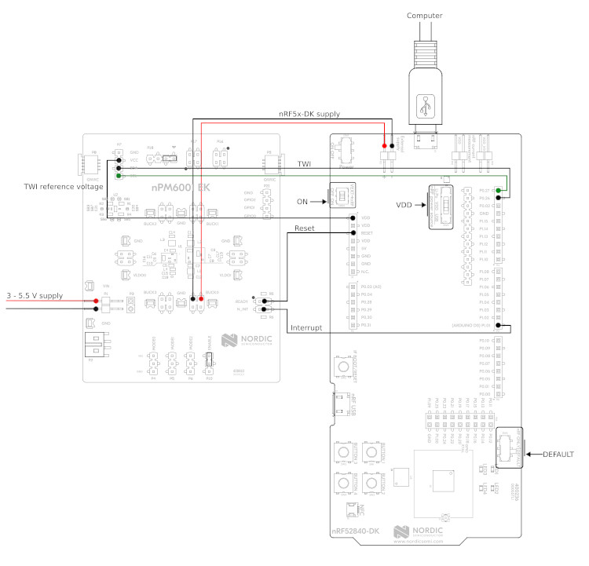

<!-- Copyright 2015-2026 Zephyr Project members and individual contributors. -->
<!-- SPDX-License-Identifier: Apache-2.0 -->
<!-- 中文翻译；编号、导航和明确标注的译注为本地新增。 -->

<a id="npm6001_ek"></a>

# 第6章\_nPM6001 评估套件（nPM6001 EK）

原文：[官方页面](https://docs.zephyrproject.org/latest/samples/shields/npm6001_ek/index.html)。快照读取日期：2026-10-15；来源摘要见[来源记录](../SOURCES.md)。

[在 GitHub 浏览源码（Browse source code on GitHub）](https://github.com/zephyrproject-rtos/zephyr/blob/main//samples/shields/npm6001_ek/index.rst/..)

<a id="overview"></a>

## 6.1 概述（Overview）

本示例用于测试 nPM6001 EK，提供 Shell 接口以测试 nPM6001 PMIC 的多项功能，包括： 相关链接：[nPM6001 评估套件（nPM6001 EK）](https://docs.zephyrproject.org/latest/boards/shields/npm6001_ek/doc/index.html#npm6001-ek)。

- 稳压器（Regulators）：BUCK0／1／2／3 和 LDO0／1

- 通用输入输出（GPIO）

- 看门狗（Watchdog）

<a id="requirements"></a>

## 6.2 硬件与配置要求（Requirements）

扩展板需要连接到支持 Arduino 接口的主开发板。以下为 nRF52840 DK 的接线示例：

> 译注——原图保留：下图是官方 JPEG 原文件，存放在本册 images 目录并通过相对路径引用。图内 Supply 表示供电，Reset 表示复位，Interrupt 表示中断，TWI 表示双线接口（Two-Wire Interface）。原图的连接对象和引脚标注保持不变。

<a id="id1"></a>



**nRF52840 DK 与 nPM6001 EK 接线示例**

<a id="building-and-running"></a>

## 6.3 构建与运行（Building and Running）

> 译注——执行前提：主机命令在读者自己的 Zephyr 源码根目录，使用 UCRT64 Bash 或 Linux Bash 执行；先按[入门指南](../getting_started/大纲.md)准备模块和工具链，再核对本页指定主开发板、扩展板、接线与配置。设备 Shell 命令在目标板串口执行。遇到构建或设备就绪错误，先回查所选 board／shield 与接线；下方日志是官方预期示例。本次仅核对文档与源码，未构建、烧录、擦写存储或进行实板测量。

本示例按可适配任意平台设计。例如，为 nRF52840 DK 构建时可使用以下命令：

```text
west build -b nrf52840dk/nrf52840 samples/shields/npm6001_ek
```

本示例自动将 `SHIELD` 设为 `npm6001_ek`。烧录后应进入 Shell 接口，可使用 `npm6001` 命令测试 PMIC。各子命令说明如下。

<a id="regulators"></a>

### 6.3.1 稳压器（Regulators）

`npm6001` Shell 接口的 `regulator` 子命令用于测试 PMIC 内部稳压器，即 BUCK0／1／2／3 和 LDO0／1。以下为命令示例。

> 译注——接口区别：本页使用应用自己注册的 npm6001 子命令，电压 set 参数以毫伏（mV）输入，源码再乘 1000 转为微伏（µV）。这与前两章通用 regulator vset/vget 命令不同。下方设置 BUCK0 后的读取命令却写成 get BUCK3，是原文通道不一致；核对该次设置应读取 BUCK0。

```text
# list all the available regulators
npm6001 regulator list
BUCK0
BUCK1
BUCK2
BUCK3
LDO0
LDO1
```

```text
# list all the supported voltages by BUCK2
npm6001 regulator voltages BUCK2
1200 mV
1250 mV
1300 mV
1350 mV
1400 mV
```

```text
# enable BUCK3
npm6001 regulator enable BUCK3
# disable BUCK3
npm6001 regulator disable BUCK3
```

```text
# set BUCK3 voltage to exactly 3000 mV
npm6001 regulator set BUCK3 3000
# obtain the actual BUCK3 configured voltage
npm6001 regulator get BUCK3
3000 mV
# set BUCK0 voltage to a value between 2350 mV and 2450 mV
npm6001 regulator set BUCK0 2350 2450
# obtain the actual BUCK0 configured voltage
npm6001 regulator get BUCK3
2400 mV
```

```text
# set BUCK0 to hysteretic mode
npm6001 regulator modeset BUCK0 hys
# set BUCK0 to PWM mode
npm6001 regulator modeset BUCK0 pwm
```

```text
# get BUCK0 mode
npm6001 regulator modeget BUCK0
Hysteretic
```

```text
# get active errors on BUCK0
npm6001 regulator errors BUCK0
Overcurrent:    [ ]
Overtemp.:      [ ]
```

<a id="gpio"></a>

### 6.3.2 通用输入输出（GPIO）

`npm6001` Shell 接口的 `gpio` 子命令用于测试 PMIC 提供的 GPIO 功能。以下为命令示例。

> 译注——输入方向差异：当前 cmd_gpio_configure() 识别的输入方向字符串是 in，而下方原文三处使用 input。按本次源码应改为 -d in；否则不会设置 GPIO_INPUT 标志。原文命令保留以便追溯，使用前应先对照实际版本。

```text
# configure GPIO 0 as output
npm6001 gpio configure -p 0 -d out
# configure GPIO 0 as output (init high)
npm6001 gpio configure -p 0 -d outh
# configure GPIO 0 as output (init low)
npm6001 gpio configure -p 0 -d outl
# configure GPIO 0 as output with high-drive mode enabled
npm6001 gpio configure -p 0 -d out --high-drive
# configure GPIO 1 as input
npm6001 gpio configure -p 1 -d input
# configure GPIO 1 as input with pull-down enabled
npm6001 gpio configure -p 1 -d input --pull-down
# configure GPIO 1 as input with CMOS mode enabled
npm6001 gpio configure -p 1 -d input --cmos
```

```text
# get GPIO 1 level
npm6001 gpio get 1
```

```text
# set GPIO 0 high
npm6001 gpio set 0 1
# set GPIO 0 low
npm6001 gpio set 0 0
```

```text
# toggle GPIO 0
npm6001 gpio toggle 0
```

<a id="watchdog"></a>

### 6.3.3 看门狗（Watchdog）

`npm6001` Shell 接口的 `wdt` 子命令用于测试 PMIC 的看门狗功能。以下为命令示例。

> 译注——超时单位差异：原文用 enable 8000 表示 8 秒，但当前 cmd_wdt_enable() 会把输入乘 1000，写入以毫秒计的 window.max，因而 8000 会成为 8000000 ms，即 8000 秒。对应本次源码，8 秒应传入 8。驱动按 4000 ms 粒度向上取整并编码到硬件寄存器；不要按原文参数等待 8 秒就认定看门狗失败。本次没有连接复位线或执行看门狗。

```text
# enable watchdog, timeout set to 8 seconds. Timeout will be rounded up to
# the resolution of the watchdog, e.g. 10s -> 12s.
npm6001 wdt enable 8000
# disable watchdog
npm6001 wdt disable
# kick/feed watchdog
npm6001 wdt kick
```

注意（Note）

将看门狗复位引脚连接到开发板复位端后，在看门狗超时到期时可以看到 Zephyr 重启。

> 译注——源码入口：[src/main.c](../../../samples/shields/npm6001_ek/src/main.c)；[CMakeLists.txt](../../../samples/shields/npm6001_ek/CMakeLists.txt)；[prj.conf](../../../samples/shields/npm6001_ek/prj.conf)；[drivers/watchdog/wdt_npm6001.c](../../../drivers/watchdog/wdt_npm6001.c)；[include/zephyr/drivers/watchdog.h](../../../include/zephyr/drivers/watchdog.h)。本地源码使用相对链接；上游快照摘要见来源记录，本地版本可能不同。

对应官方文档源码：[samples/shields/npm6001_ek/index.rst](https://raw.githubusercontent.com/zephyrproject-rtos/zephyr/main/samples/shields/npm6001_ek/index.rst)。

> 译注——源码跟踪：本仓库[对应源码](../../../samples/shields/npm6001_ek/index.rst)可用于对照，版本可能与网页不同。本批仅翻译和核对文档，未构建、烧录、擦写存储或连接设备。

[上一章](P005_nPM2100电源评估套件示例.md) · [返回大纲](大纲.md) · [下一章](P007_Renesas电容触摸扩展板.md)
