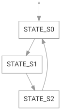
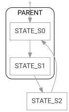
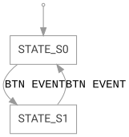
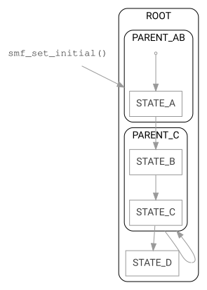

<!-- Copyright 2015-2026 Zephyr Project members and individual contributors. -->
<!-- SPDX-License-Identifier: Apache-2.0 -->
<!-- 中文翻译；编号、导航和明确标注的译注为本地新增。 -->

# 第1章\_状态机框架

原文：[官方页面](https://docs.zephyrproject.org/latest/services/smf/index.html)。本次读取日期：2026-10-14；基线为保存的`latest`页面，HTML摘要见[来源记录](../SOURCES.md)。

<a id="state-machine-framework"></a>
<a id="smf"></a>

<a id="overview"></a>

## 1.1\_概述（Overview）

状态机框架（State Machine Framework，SMF）不依赖具体应用，为开发者提供了将状态机（State Machine）集成到应用中的简便方式。启用[`CONFIG_SMF`](https://docs.zephyrproject.org/latest/kconfig.html#CONFIG_SMF)选项，即可将该框架加入项目。

<a id="state-creation"></a>

## 1.2\_创建状态（State Creation）

一个状态由三个函数表示，分别实现进入动作（Entry Action）、运行阶段动作（Run Action）和退出动作（Exit Action）。进入与退出函数的原型为`void funct(void *obj)`，运行动作的原型为`enum smf_state_result funct(void *obj)`。其中`obj`是用户定义的结构体，其第一个成员必须是状态机上下文（State Machine Context）[`smf_ctx`](P008_状态机上下文.md)。例如：

```c
struct user_object {
   struct smf_ctx ctx;
   /* All User Defined Data Follows */
};
```

[`smf_ctx`](P008_状态机上下文.md)必须放在首位，因为框架函数通过[`SMF_CTX`](P005_状态机API参考.md#ga0bccd3bf96e0887e8a610c1b06e22237)宏将用户定义的对象转换为[`smf_ctx`](P008_状态机上下文.md)类型。例如，可以使用`SMF_CTX(&user_obj)`替代`(struct smf_ctx *)&user_obj`。

默认情况下，状态没有祖先状态（Ancestor State），形成扁平状态机（Flat State Machine）。若要创建层次状态机（Hierarchical State Machine，HSM），必须启用[`CONFIG_SMF_ANCESTOR_SUPPORT`](https://docs.zephyrproject.org/latest/kconfig.html#CONFIG_SMF_ANCESTOR_SUPPORT)。

运行动作的返回值[`smf_state_result`](P005_状态机API参考.md#ga01e4e2d2f35a9ec790d5e3c5b9b91b55)决定事件是否继续传播给父状态的运行动作：`SMF_EVENT_PROPAGATE`表示继续传播，`SMF_EVENT_HANDLED`表示该动作已经处理事件。扁平状态机没有父状态动作，因此忽略该返回值；建议返回`SMF_EVENT_HANDLED`。

调用[`smf_set_state()`](P005_状态机API参考.md#ga3e5ac3e2ad105d1a01b4cf0b1a8a6fcb)会阻止父状态运行动作的调用，即使随后返回`SMF_EVENT_PROPAGATE`也如此。

默认情况下，层次状态机在进入复合父状态（Superstate）时，不支持向子状态执行初始转换（Initial Transition）。要使用此功能，必须启用[`CONFIG_SMF_INITIAL_TRANSITION`](https://docs.zephyrproject.org/latest/kconfig.html#CONFIG_SMF_INITIAL_TRANSITION)。

可以使用以下宏方便地创建状态：

| 宏 | 用途 |
| --- | --- |
| [`SMF_CREATE_STATE`](P005_状态机API参考.md#ga5760b98a36ed1ac55eba700cf44c7e1e) | 创建状态（Create a State）。 |

<a id="state-machine-creation"></a>

## 1.3\_创建状态机（State Machine Creation）

定义以枚举（Enum）为索引的状态表（State Table），即可创建状态机。例如，下面创建三个扁平状态：

```c
enum demo_state { S0, S1, S2 };

const struct smf_state demo_states[] = {
   [S0] = SMF_CREATE_STATE(s0_entry, s0_run, s0_exit, NULL, NULL),
   [S1] = SMF_CREATE_STATE(s1_entry, s1_run, s1_exit, NULL, NULL),
   [S2] = SMF_CREATE_STATE(s2_entry, s2_run, s2_exit, NULL, NULL)
};
```

下面创建三个层次状态：

```c
enum demo_state { S0, S1, S2 };

const struct smf_state demo_states[] = {
   [S0] = SMF_CREATE_STATE(s0_entry, s0_run, s0_exit, parent_s0, NULL),
   [S1] = SMF_CREATE_STATE(s1_entry, s1_run, s1_exit, parent_s12, NULL),
   [S2] = SMF_CREATE_STATE(s2_entry, s2_run, s2_exit, parent_s12, NULL)
};
```

下面创建三个层次状态，并定义从父状态`S0`到子状态`S2`的初始转换：

```c
enum demo_state { S0, S1, S2 };

/* Forward declaration of state table */
const struct smf_state demo_states[];

const struct smf_state demo_states[] = {
   [S0] = SMF_CREATE_STATE(s0_entry, s0_run, s0_exit, NULL, demo_states[S2]),
   [S1] = SMF_CREATE_STATE(s1_entry, s1_run, s1_exit, demo_states[S0], NULL),
   [S2] = SMF_CREATE_STATE(s2_entry, s2_run, s2_exit, demo_states[S0], NULL)
};
```

> 译注：上例按官方原文保留，但其中`demo_states[S0]`和`demo_states[S2]`作为宏的父状态／初始状态参数时缺少取地址符`&`。这两个参数对应`const struct smf_state *`成员，应传状态对象地址；下文完整示例使用了`&demo_states[...]`。参见[官方源码浏览页](P007_状态机头文件源码.md)中的`parent`、`initial`声明。该片段不能不加核对地当作可直接编译的完整程序。

设置初始状态应调用[`smf_set_initial()`](P005_状态机API参考.md#ga4389086c6aa3167e8c49226323ae208d)。从一个状态转换到另一个状态应使用[`smf_set_state()`](P005_状态机API参考.md#ga3e5ac3e2ad105d1a01b4cf0b1a8a6fcb)。

> 注意：若未启用[`CONFIG_SMF_INITIAL_TRANSITION`](https://docs.zephyrproject.org/latest/kconfig.html#CONFIG_SMF_INITIAL_TRANSITION)，不要向[`smf_set_initial()`](P005_状态机API参考.md#ga4389086c6aa3167e8c49226323ae208d)和[`smf_set_state()`](P005_状态机API参考.md#ga3e5ac3e2ad105d1a01b4cf0b1a8a6fcb)传入父状态，因为父状态不知道应进入哪个子状态。如果已经定义进入子状态的初始转换，则可以转换到父状态。结构正确的HSM应为所有父状态定义初始转换。

> 注意：状态机运行期间，只应从进入函数或运行函数调用[`smf_set_state()`](P005_状态机API参考.md#ga3e5ac3e2ad105d1a01b4cf0b1a8a6fcb)。从退出函数调用它会产生日志警告，并且不会发生转换。

<a id="state-machine-execution"></a>

## 1.4\_执行状态机（State Machine Execution）

应用应按自身需要调用[`smf_run_state()`](P005_状态机API参考.md#ga8399cfa9e793a7f188b4ed4fec9f4f90)运行状态机。如果该函数返回非零值，应用应停止继续调用`smf_run_state`。

<a id="state-machine-termination"></a>

## 1.5\_终止状态机（State Machine Termination）

调用[`smf_set_terminate()`](P005_状态机API参考.md#gaae28c66f0652c99ba8e843eeaf02aaf7)终止状态机。进入、运行或退出动作都可以调用它。该函数接收一个用户定义的非零值，随后[`smf_run_state()`](P005_状态机API参考.md#ga8399cfa9e793a7f188b4ed4fec9f4f90)将返回这个值。

<a id="retrieving-the-current-state"></a>

## 1.6\_获取当前状态（Retrieving the Current State）

叶状态（Leaf State）是层次状态机中不包含子状态的状态。它位于层次结构中最细的一级，不能继续分解。

正在执行的状态（Executing State）是指状态机当前正在执行其进入、运行或退出动作的状态。根据当前操作，它可能是父状态，也可能是叶状态。

调用[`smf_get_current_leaf_state()`](P005_状态机API参考.md#gabbb84eb59e5991b1ab51840f08a6a13f)获取当前叶状态。例如：

```c
const struct smf_state *leaf_state = smf_get_current_leaf_state(SMF_CTX(&s_obj));
```

> 注意：如果没有启用[`CONFIG_SMF_INITIAL_TRANSITION`](https://docs.zephyrproject.org/latest/kconfig.html#CONFIG_SMF_INITIAL_TRANSITION)，或者没有定义父状态的初始状态，必须始终将目标设置为叶状态。否则，状态机可能直接进入父状态，[`smf_get_current_leaf_state()`](P005_状态机API参考.md#gabbb84eb59e5991b1ab51840f08a6a13f)也可能返回父状态。为所有父状态正确配置初始转换，以避免结构不正确的层次状态机。

使用[`smf_get_current_executing_state()`](P005_状态机API参考.md#gae74fa0c5be2756cee5e1112a5c7b6da8)获取当前正在执行其进入、运行或退出动作的状态。

<a id="uml-state-machines"></a>

## 1.7\_UML状态机（UML State Machines）

SMF的转换遵循统一建模语言（Unified Modeling Language，UML）的层次状态机规则：转换时不执行最近公共祖先（Least Common Ancestor）的进入与退出动作，但自转换（Transition to Self）除外。

UML状态机规范位于[UML规范](https://www.omg.org/spec/UML/)第14章。

SMF在以下方面与UML规则不同：

- 转换关联的动作在源状态（Source State）的上下文中执行，而不是等退出动作完成后执行。
- 只允许面向自身的外部转换（External Transition），不允许面向子状态的外部转换。从复合父状态到子状态的转换按局部转换（Local Transition）处理。
- 禁止在退出动作中使用[`smf_set_state()`](P005_状态机API参考.md#ga3e5ac3e2ad105d1a01b4cf0b1a8a6fcb)进行转换。

除初始伪状态（Initial Pseudostate）外，SMF不提供其他伪状态。可以在“终止”状态的进入动作中调用[`smf_set_terminate()`](P005_状态机API参考.md#gaae28c66f0652c99ba8e843eeaf02aaf7)，来表示终止伪状态（Terminate Pseudostate）。对每个区域分别调用[`smf_run_state()`](P005_状态机API参考.md#ga8399cfa9e793a7f188b4ed4fec9f4f90)，可以表示正交区域（Orthogonal Regions）。

<a id="state-machine-examples"></a>

## 1.8\_状态机示例（State Machine Examples）

<a id="flat-state-machine-example"></a>

### 扁平状态机示例（Flat State Machine Example）

本例使用SMF将以下状态图转换为代码，初始状态为`S0`。

<a id="id1"></a>



代码：

```c
#include <zephyr/smf.h>

/* Forward declaration of state table */
static const struct smf_state demo_states[];

/* List of demo states */
enum demo_state { S0, S1, S2 };

/* User defined object */
struct s_object {
        /* This must be first */
        struct smf_ctx ctx;

        /* Other state specific data add here */
} s_obj;

/* State S0 */
static void s0_entry(void *o)
{
        /* Do something */
}
static enum smf_state_result s0_run(void *o)
{
        smf_set_state(SMF_CTX(&s_obj), &demo_states[S1]);
        return SMF_EVENT_HANDLED;
}
static void s0_exit(void *o)
{
        /* Do something */
}

/* State S1 */
static enum smf_state_result s1_run(void *o)
{
        smf_set_state(SMF_CTX(&s_obj), &demo_states[S2]);
        return SMF_EVENT_HANDLED;
}
static void s1_exit(void *o)
{
        /* Do something */
}

/* State S2 */
static void s2_entry(void *o)
{
        /* Do something */
}
static enum smf_state_result s2_run(void *o)
{
        smf_set_state(SMF_CTX(&s_obj), &demo_states[S0]);
        return SMF_EVENT_HANDLED;
}

/* Populate state table */
static const struct smf_state demo_states[] = {
        [S0] = SMF_CREATE_STATE(s0_entry, s0_run, s0_exit, NULL, NULL),
        /* State S1 does not have an entry action */
        [S1] = SMF_CREATE_STATE(NULL, s1_run, s1_exit, NULL, NULL),
        /* State S2 does not have an exit action */
        [S2] = SMF_CREATE_STATE(s2_entry, s2_run, NULL, NULL, NULL),
};

int main(void)
{
        int32_t ret;

        /* Set initial state */
        smf_set_initial(SMF_CTX(&s_obj), &demo_states[S0]);

        /* Run the state machine */
        while(1) {
                /* State machine terminates if a non-zero value is returned */
                ret = smf_run_state(SMF_CTX(&s_obj));
                if (ret) {
                        /* handle return code and terminate state machine */
                        break;
                }
                k_msleep(1000);
        }
}
```

<a id="hierarchical-state-machine-example"></a>

### 层次状态机示例（Hierarchical State Machine Example）

本例使用SMF将以下状态图转换为代码。`S0`与`S1`共享父状态，初始状态为`S0`。

<a id="id2"></a>



代码：

```c
#include <zephyr/smf.h>

/* Forward declaration of state table */
static const struct smf_state demo_states[];

/* List of demo states */
enum demo_state { PARENT, S0, S1, S2 };

/* User defined object */
struct s_object {
        /* This must be first */
        struct smf_ctx ctx;

        /* Other state specific data add here */
} s_obj;

/* Parent State */
static void parent_entry(void *o)
{
        /* Do something */
}
static void parent_exit(void *o)
{
        /* Do something */
}

/* State S0 */
static enum smf_state_result s0_run(void *o)
{
        smf_set_state(SMF_CTX(&s_obj), &demo_states[S1]);
        return SMF_EVENT_HANDLED;
}

/* State S1 */
static enum smf_state_result s1_run(void *o)
{
        smf_set_state(SMF_CTX(&s_obj), &demo_states[S2]);
        return SMF_EVENT_HANDLED;
}

/* State S2 */
static enum smf_state_result s2_run(void *o)
{
        smf_set_state(SMF_CTX(&s_obj), &demo_states[S0]);
        return SMF_EVENT_HANDLED;
}

/* Populate state table */
static const struct smf_state demo_states[] = {
        /* Parent state does not have a run action */
        [PARENT] = SMF_CREATE_STATE(parent_entry, NULL, parent_exit, NULL, NULL),
        /* Child states do not have entry or exit actions */
        [S0] = SMF_CREATE_STATE(NULL, s0_run, NULL, &demo_states[PARENT], NULL),
        [S1] = SMF_CREATE_STATE(NULL, s1_run, NULL, &demo_states[PARENT], NULL),
        /* State S2 do not have entry or exit actions and no parent */
        [S2] = SMF_CREATE_STATE(NULL, s2_run, NULL, NULL, NULL),
};

int main(void)
{
        int32_t ret;

        /* Set initial state */
        smf_set_initial(SMF_CTX(&s_obj), &demo_states[S0]);

        /* Run the state machine */
        while(1) {
                /* State machine terminates if a non-zero value is returned */
                ret = smf_run_state(SMF_CTX(&s_obj));
                if (ret) {
                        /* handle return code and terminate state machine */
                        break;
                }
                k_msleep(1000);
        }
}
```

设计层次状态机时，应考虑以下几点：

- 祖先状态的进入动作先于下层状态的进入动作执行。例如，先调用`parent_entry`，再调用`s0_entry`。（译注：原文使用“sibling entry actions”这一措辞，示例表达的是祖先与子状态的执行顺序。）
- 在共享祖先的兄弟状态（Sibling States）之间转换，不会重新执行祖先的进入动作，也不会执行其退出动作。例如，从`S0`转换到`S1`时，既不调用`parent_entry`，也不调用`parent_exit`。
- 祖先状态的退出动作在当前状态退出动作之后执行。例如，先调用`s1_exit`，再调用`parent_exit`。
- 只有子状态的`child_run`既没有调用[`smf_set_state()`](P005_状态机API参考.md#ga3e5ac3e2ad105d1a01b4cf0b1a8a6fcb)、也没有返回`SMF_EVENT_HANDLED`时，才执行`parent_run`。
- 若没有启用[`CONFIG_SMF_INITIAL_TRANSITION`](https://docs.zephyrproject.org/latest/kconfig.html#CONFIG_SMF_INITIAL_TRANSITION)，或者父状态没有定义初始状态，始终转换到叶状态，避免构成不正确的层次状态机。

<a id="event-driven-state-machine-example"></a>

### 事件驱动状态机示例（Event Driven State Machine Example）

事件（Event）不是SMF显式提供的组成部分，但可以使用[Zephyr事件机制（Zephyr Events）](../kernel/P012_事件.md)实现事件驱动状态机。

<a id="id3"></a>



图中的`BTN EVENT`表示按钮事件（Button Event）。代码：

```c
#include <zephyr/kernel.h>
#include <zephyr/drivers/gpio.h>
#include <zephyr/smf.h>

#define SW0_NODE        DT_ALIAS(sw0)

/* List of events */
#define EVENT_BTN_PRESS BIT(0)

static const struct gpio_dt_spec button =
        GPIO_DT_SPEC_GET_OR(SW0_NODE, gpios, {0});

static struct gpio_callback button_cb_data;

/* Forward declaration of state table */
static const struct smf_state demo_states[];

/* List of demo states */
enum demo_state { S0, S1 };

/* User defined object */
struct s_object {
        /* This must be first */
        struct smf_ctx ctx;

        /* Events */
        struct k_event smf_event;
        int32_t events;

        /* Other state specific data add here */
} s_obj;

/* State S0 */
static void s0_entry(void *o)
{
        printk("STATE0\n");
}

static enum smf_state_result s0_run(void *o)
{
        struct s_object *s = (struct s_object *)o;

        /* Change states on Button Press Event */
        if (s->events & EVENT_BTN_PRESS) {
                smf_set_state(SMF_CTX(&s_obj), &demo_states[S1]);
        }
        return SMF_EVENT_HANDLED;
}

/* State S1 */
static void s1_entry(void *o)
{
        printk("STATE1\n");
}

static enum smf_state_result s1_run(void *o)
{
        struct s_object *s = (struct s_object *)o;

        /* Change states on Button Press Event */
        if (s->events & EVENT_BTN_PRESS) {
                smf_set_state(SMF_CTX(&s_obj), &demo_states[S0]);
        }
        return SMF_EVENT_HANDLED;
}

/* Populate state table */
static const struct smf_state demo_states[] = {
        [S0] = SMF_CREATE_STATE(s0_entry, s0_run, NULL, NULL, NULL),
        [S1] = SMF_CREATE_STATE(s1_entry, s1_run, NULL, NULL, NULL),
};

void button_pressed(const struct device *dev,
                struct gpio_callback *cb, uint32_t pins)
{
        /* Generate Button Press Event */
        k_event_post(&s_obj.smf_event, EVENT_BTN_PRESS);
}

int main(void)
{
        int ret;

        if (!gpio_is_ready_dt(&button)) {
                printk("Error: button device %s is not ready\n",
                        button.port->name);
                return;
        }

        ret = gpio_pin_configure_dt(&button, GPIO_INPUT);
        if (ret != 0) {
                printk("Error %d: failed to configure %s pin %d\n",
                        ret, button.port->name, button.pin);
                return;
        }

        ret = gpio_pin_interrupt_configure_dt(&button,
                GPIO_INT_EDGE_TO_ACTIVE);
        if (ret != 0) {
                printk("Error %d: failed to configure interrupt on %s pin %d\n",
                        ret, button.port->name, button.pin);
                return;
        }

        gpio_init_callback(&button_cb_data, button_pressed, BIT(button.pin));
        gpio_add_callback(button.port, &button_cb_data);

        /* Initialize the event */
        k_event_init(&s_obj.smf_event);

        /* Set initial state */
        smf_set_initial(SMF_CTX(&s_obj), &demo_states[S0]);

        /* Run the state machine */
        while(1) {
                /* Block until an event is detected */
                s_obj.events = k_event_wait(&s_obj.smf_event,
                                EVENT_BTN_PRESS, true, K_FOREVER);

                /* State machine terminates if a non-zero value is returned */
                ret = smf_run_state(SMF_CTX(&s_obj));
                if (ret) {
                        /* handle return code and terminate state machine */
                        break;
                }
        }
}
```

> 译注：此处完整保留官方代码。`int main(void)`中的几处错误分支使用无返回值的`return;`，实际编译时应按所用编译器诊断和返回值约定处理。此外，原例先配置按钮中断，再初始化事件对象；用于实际硬件前，应核对事件对象初始化与中断可能触发之间的时序。这里没有把该片段认定为本项目实板验证结果。

<a id="state-machine-example-with-initial-transitions-and-transition-to-self"></a>

### 初始转换与自转换示例（Initial Transitions and Transition to Self）

`tests/lib/smf/src/test_lib_self_transition_smf.c`定义了一个状态机，用于测试父状态中的初始转换和自转换。该测试的状态图如下。

<a id="id4"></a>



译注：可从仓库中的[测试源码](../../../tests/lib/smf/src/test_lib_self_transition_smf.c)跟踪对应实现；仓库版本与官网`latest`版本应分别核对。图中`ROOT`为根状态，`PARENT_AB`、`PARENT_C`为父状态，字母状态名称与源码保持一致。

<a id="test-instrumentation"></a>

## 1.9\_测试观测钩子（Test Instrumentation）

SMF提供可选观测钩子（Instrumentation Hooks），用于在测试期间观察状态机行为。启用[`CONFIG_SMF_INSTRUMENTATION`](https://docs.zephyrproject.org/latest/kconfig.html#CONFIG_SMF_INSTRUMENTATION)即可使用。

启用后，可以通过`smf_set_hooks()`在状态机上下文上注册三种钩子回调：

- `on_action`：在每次进入、运行或退出动作执行之前调用。
- `on_transition`：在当前状态指针更新之后、新状态的进入动作执行之前调用。
- `on_error`：检测到无效操作时调用，例如转换目标为`NULL`，或尝试在退出动作中转换状态。

> 重要：必须先调用[`smf_set_initial()`](P005_状态机API参考.md#ga4389086c6aa3167e8c49226323ae208d)，再调用`smf_set_hooks()`，因为[`smf_set_initial()`](P005_状态机API参考.md#ga4389086c6aa3167e8c49226323ae208d)会将钩子指针重置为`NULL`。因此，初始化期间执行的进入动作，包括初始状态及其祖先的进入动作，不会被这些钩子捕获。

示例：

```c
#include <zephyr/smf.h>

static void on_action(struct smf_ctx *ctx,
                      const struct smf_state *state,
                      smf_action_type action_type)
{
        /* Log or record the action */
}

static void on_transition(struct smf_ctx *ctx,
                          const struct smf_state *source,
                          const struct smf_state *dest)
{
        /* Log or record the transition */
}

static const struct smf_hooks hooks = {
        .on_action = on_action,
        .on_transition = on_transition,
        /* .on_error = NULL — any member may be NULL */
};

void test_example(void)
{
        struct s_object s_obj;

        /* Set the initial state first */
        smf_set_initial(SMF_CTX(&s_obj), &demo_states[S0]);

        /* Install hooks after init — initial entry actions are not captured */
        smf_set_hooks(SMF_CTX(&s_obj), &hooks);

        /* Run the state machine — hooks fire on every action and transition */
        while (!smf_run_state(SMF_CTX(&s_obj))) {
                /* ... */
        }
}
```

> 译注：上例的`smf_action_type action_type`按原文保留。官方C头文件将该类型声明为`enum smf_action_type`，没有同名`typedef`；用C编译这一回调时应写出`enum`。见[头文件源码](P007_状态机头文件源码.md)。

未启用[`CONFIG_SMF_INSTRUMENTATION`](https://docs.zephyrproject.org/latest/kconfig.html#CONFIG_SMF_INSTRUMENTATION)时，全部观测代码会被编译排除，不产生运行时开销（Runtime Overhead）。

<a id="api-reference"></a>

## 1.10\_API参考与相关示例

- [状态机框架API（State Machine Framework API）](P005_状态机API参考.md)。
- [基于PSiCC2的层次状态机示例](P003_层次状态机示例.md)：使用SMF实现事件驱动层次状态机。
- [SMF计算器](P004_状态机计算器.md)：使用状态机框架创建简单桌面计算器。

## 1.11\_代码注释译注

上述原代码及其英文注释保持原样，常见注释对应含义如下。`S0`、`S1`、`S2`、`PARENT`为原例的状态标识符。

| 原注释用语 | 中文说明 |
| --- | --- |
| All User Defined Data Follows / Other state specific data add here | 用户自定义数据放在上下文之后；在指定位置加入其他状态专用数据。 |
| Forward declaration of state table / Populate state table | 前向声明状态表／填写状态表。 |
| List of demo states / User defined object / This must be first | 示例状态列表／用户定义对象／该成员必须位于首位。 |
| State S0 / State S1 / State S2 / Parent State | 状态S0／S1／S2／父状态。 |
| Do something | 在此执行应用需要的操作。 |
| State S1 does not have an entry action / State S2 does not have an exit action | S1没有进入动作／S2没有退出动作。 |
| Parent state does not have a run action / Child states do not have entry or exit actions | 父状态没有运行动作／子状态没有进入或退出动作。 |
| State S2 do not have entry or exit actions and no parent | S2既没有进入、退出动作，也没有父状态。 |
| Set initial state / Run the state machine | 设置初始状态／运行状态机。 |
| State machine terminates if a non-zero value is returned | 返回非零值时终止状态机。 |
| handle return code and terminate state machine | 处理返回码并终止状态机。 |
| List of events / Events / Initialize the event | 事件列表／事件／初始化事件对象。 |
| Change states on Button Press Event / Generate Button Press Event | 收到按钮按下事件时切换状态／产生按钮按下事件。 |
| Block until an event is detected | 阻塞等待，直到检测到事件。 |
| Log or record the action / Log or record the transition | 输出日志或记录动作／输出日志或记录转换。 |
| any member may be NULL | 任意钩子成员都可以为NULL。 |
| Set the initial state first / Install hooks after init — initial entry actions are not captured | 先设置初始状态／初始化后安装钩子，初始进入动作不会被捕获。 |
| Run the state machine — hooks fire on every action and transition | 运行状态机，每个动作和转换都会触发相应钩子。 |

原状态图均以官方SVG原件保存，未重新绘制或转换成静态截图。

<!-- reading-navigation:start -->

**主线阅读**

[本模块主线目录](../reading/smf.md) · [全部主线](../reading/README.md)

<details>
<summary>原册编号导航（含扩展参考）</summary>

[返回大纲](大纲.md) · [下一章](P002_状态机示例目录.md)

</details>

<!-- reading-navigation:end -->
