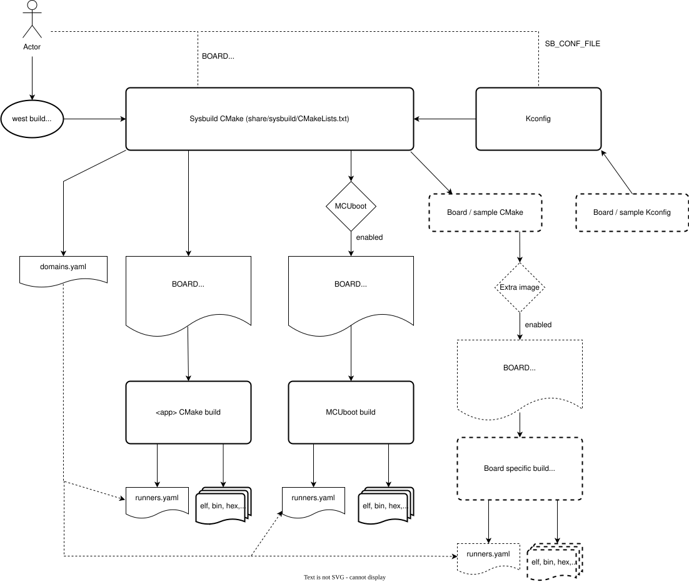

<!-- Copyright 2015-2026 Zephyr Project members and individual contributors. -->
<!-- SPDX-License-Identifier: Apache-2.0 -->
<!-- 中文翻译；阅读编号、导航和译注为本地新增。 -->

<a id="sysbuild"></a>

# 第1章\_系统构建

原文：[Sysbuild (System build)](https://docs.zephyrproject.org/latest/build/sysbuild/index.html)。读取日期：2026-10-12，`latest`。

**系统构建（System Build，Sysbuild）**是在其他构建系统之上组织工作的更高层构建系统。它把一个或多个 Zephyr 构建系统以及可选的其他构建系统组合成有层次的整体。例如，可以一起构建 Zephyr 应用与 MCUboot 引导加载器，将两者烧录到设备，再调试结果。

Sysbuild 至少配置并构建一个 Zephyr 应用，还可以加入任意多个附加项目。这些项目既可以是其他 Zephyr 应用，也可以是希望一并执行的其他构建。与 [Zephyr构建系统](../build_system/P001_CMake构建系统.md)一样，Sysbuild 使用 CMake 编写，并通过 Kconfig 配置。

> 译注：本章译文保留原文各个 west、CMake、Ninja 和 Make 分支。示例中的 `reel_board`、`my_sample` 等是原文目标或占位名称；使用前应确认相应应用、开发板、模块和工具链已经存在。这里没有运行构建、烧录或调试。

## 1.1\_基本概念

| 原文概念 | 中文含义与范围 |
| --- | --- |
| Single-image build | **单镜像构建**：Sysbuild 只创建和管理一个 Zephyr 应用的构建系统。 |
| Multi-image build | **多镜像构建**：Sysbuild 管理多个构建系统。之所以称“镜像”，是因为通常希望从各构建系统获得固件应用的二进制镜像。 |
| Domain | **构建域**：由 Sysbuild 管理的每一个 Zephyr CMake 构建系统。 |
| Multi-domain | **多构建域**：Sysbuild 管理不止一个 Zephyr CMake 构建系统。 |

## 1.2\_架构概览

下图显示 Sysbuild 的输入、输出以及用户接口：



图中体现以下能力：

1. 可通过 `west build` 或直接调用 `cmake` 运行 Sysbuild。
2. 可从各个构建系统生成应用镜像，包括 **可执行与可链接格式（Executable and Linkable Format，ELF）**、**原始二进制文件（Binary，BIN）**和 **Intel十六进制文件（Intel HEX）**。
3. 可通过配置变量控制 Sysbuild 自身或其管理的构建系统。变量使用**命名空间（Namespace）**，使 Sysbuild 能把设置交给正确对象；`BOARD` 等部分变量在多个构建系统之间共享。
4. Sysbuild 自身也使用 Kconfig。例如，Sysbuild 的 Kconfig 文件可以启用 MCUboot，并让主 Zephyr 应用按可由 MCUboot 引导的镜像方式构建和链接。
5. Sysbuild 与 [west构建、烧录和调试命令](../west/P007_构建烧录与调试.md)集成。它管理各 Zephyr 构建系统的运行器配置，特别是各自的 `runners.yaml`，并生成、管理汇总文件 `domains.yaml`，描述如何烧录和调试各构建域。
6. 构建目标名称可带“目标名加下划线”前缀。例如 Sysbuild 使用 `sysbuild_`，MCUboot 使用 `mcuboot_`。因此可在相应构建目录执行 `ninja sysbuild_menuconfig` 配置 Sysbuild，或执行 `make mcuboot_menuconfig` 配置 MCUboot。

> 译注：**运行器（Runner）**负责把 west 操作适配到具体主机工具；`runners.yaml` 与 `domains.yaml` 是构建系统生成的文件，不要求读者手工新建。主应用中部分目标仍可不带前缀，见本章“构建目标”。

## 1.3\_使用Sysbuild构建

可通过 west 或直接调用 CMake 配置同一套 Sysbuild 项目，下面分别保留两条入口。

### 1.3.1\_使用west

在 Zephyr 源码根目录，以下命令构建官方 Hello World 示例；详细说明见 [west的多构建域构建](https://docs.zephyrproject.org/latest/develop/west/build-flash-debug.html#west-multi-domain-builds)：

```sh
west build -b reel_board --sysbuild samples/hello_world
```

若希望以后的 `west build` 默认使用 `--sysbuild`，执行：

```sh
west config build.sysbuild True
```

因为 Sysbuild 同时支持单镜像和多镜像构建，可以一直使用它，而不必先区分构建类型。需要关闭默认行为时，在生成构建系统之前执行：

```sh
west config build.sysbuild False
```

只想在某一次命令中关闭，可以使用：

```sh
west build --no-sysbuild ...
```

> 译注：`build.sysbuild` 是 west 配置项，不是应用的 Kconfig 选项。它影响后续构建入口的选择；`...` 表示省略的应用与其他参数，不是直接输入的命令文本。已有构建目录保存了配置结果，更换构建方式时应使用匹配的新构建目录或按 west 文档进行 pristine 构建。

### 1.3.2\_直接使用CMake和Ninja

在 Zephyr 源码根目录执行：

```sh
cmake -Bbuild -GNinja -DBOARD=reel_board -DAPP_DIR=samples/hello_world share/sysbuild
ninja -Cbuild
```

直接用 CMake 时，源目录必须指向 Sysbuild 项目，即这里的 `share/sysbuild`；此外通过 `-DAPP_DIR=<path-to-sample>` 或环境变量 `APP_DIR` 指定主应用目录。`APP_DIR` 表示 Sysbuild 管理的主 Zephyr 应用源码位置，不是构建输出目录。

使用 CMake 与 Ninja 时，可通过环境变量 [CMAKE_BUILD_PARALLEL_LEVEL](https://cmake.org/cmake/help/latest/envvar/CMAKE_BUILD_PARALLEL_LEVEL.html#envvar:CMAKE_BUILD_PARALLEL_LEVEL) 和 [VERBOSE](https://cmake.org/cmake/help/latest/envvar/VERBOSE.html#envvar:VERBOSE) 控制构建过程。

要为所有镜像指定 Ninja 并行任务数，在已配置的构建目录中通过 `cmake --build` 执行；下例为 Bash 形式，`<n>` 需替换为正整数：

```sh
CMAKE_BUILD_PARALLEL_LEVEL=<n> cmake --build .
```

要显示所有镜像的详细构建命令，执行：

```sh
VERBOSE=1 cmake --build .
```

## 1.4\_配置命名空间

不使用 Sysbuild 构建单个 Zephyr 应用时，命令行的 `-D<var>=<value>` CMake 缓存设置和 `-DCONFIG_<var>=<value>` Kconfig 设置都交给该 Zephyr 构建系统处理。

Sysbuild 组合多个构建系统后，还会有仅属于 Sysbuild 自身的 Kconfig 选项。因此它使用命名空间，区分设置应交给 Sysbuild 自身，还是交给某个具体应用。

例如，为 [Hello World](../getting_started/P005_HelloWorld示例.md) 启用 MCUboot，并给两个镜像都启用调试优化。Kconfig 配置项 `SB_CONFIG_BOOTLOADER_MCUBOOT` 属于 Sysbuild，`CONFIG_DEBUG_OPTIMIZATIONS` 属于主应用，带 `mcuboot_` 前缀的同名选项属于 MCUboot。

west 分支：

```sh
west build -b reel_board --sysbuild samples/hello_world -- -DSB_CONFIG_BOOTLOADER_MCUBOOT=y -DCONFIG_DEBUG_OPTIMIZATIONS=y -Dmcuboot_CONFIG_DEBUG_OPTIMIZATIONS=y
```

CMake/Ninja 分支：

```sh
cmake -Bbuild -GNinja -DBOARD=reel_board -DAPP_DIR=samples/hello_world -DSB_CONFIG_BOOTLOADER_MCUBOOT=y -DCONFIG_DEBUG_OPTIMIZATIONS=y -Dmcuboot_CONFIG_DEBUG_OPTIMIZATIONS=y share/sysbuild
ninja -Cbuild
```

### 1.4.1\_CMake变量命名空间

CMake 变量可通过 `-D<var>=<value>` 设置；Kconfig 选项也可经 CMake 以 `-DCONFIG_<var>=<value>` 或 `-D<namespace>_CONFIG_<var>=<value>` 传入。因为 Sysbuild 是入口且本身也是 CMake 项目，所有 CMake 变量首先由 Sysbuild 处理。

Sysbuild 为每个构建域建立命名空间，前缀就是该域的应用名称；名称的来源见本章“添加Zephyr应用”。在指定命名空间中设置变量的一般格式为：

```text
-D<namespace>_<var>=<value>
```

例如，将应用 `my_sample` 的 CMake 变量 `FOO` 设为 `BAR`。west 写法：

```sh
west build --sysbuild ... -- -Dmy_sample_FOO=BAR
```

CMake 写法：

```sh
cmake -Dmy_sample_FOO=BAR ...
```

### 1.4.2\_Kconfig命名空间

要把 Sysbuild 的 Kconfig 选项 `<var>` 设为 `<value>`，使用：

```text
-DSB_CONFIG_<var>=<value>
```

其中 `SB_CONFIG` 是 Sysbuild Kconfig 选项的前缀。要设置某个 Zephyr 应用的 Kconfig 选项，则使用：

```text
-D<namespace>_CONFIG_<var>=<value>
```

这里的 `<namespace>` 是前述应用名称。例如，把 `my_sample` 的 Kconfig 选项 `FOO` 设为 `BAR`，west 写法：

```sh
west build --sysbuild ... -- -Dmy_sample_CONFIG_FOO=BAR
```

CMake 写法：

```sh
cmake -Dmy_sample_CONFIG_FOO=BAR ...
```

不提供命名空间时，Kconfig 设置会传给主 Zephyr 应用。若主应用名为 `my_sample`，`-DCONFIG_<var>=<value>` 与 `-Dmy_sample_CONFIG_<var>=<value>` 等效。因此同一应用有无 Sysbuild 时，可以沿用相同的 Kconfig 命令行语法：

```sh
west build -b <board> my_sample -- -DCONFIG_FOO=BAR
```

```sh
west build -b <board> --sysbuild my_sample -- -DCONFIG_FOO=BAR
```

> 译注：上述“省略前缀即主应用”的说明针对这里的 Kconfig 设置，不能泛化为所有 CMake 变量都会只传给主应用。`FOO`、`BAR` 是原文语法示意，实际配置项及值必须存在并符合其类型。

## 1.5\_烧录与调试

调用 `west flash` 烧录多镜像构建时，各镜像依次烧录。`--runner jlink` 等附加参数会传给每一次调用，详情见[多构建域烧录](https://docs.zephyrproject.org/latest/develop/west/build-flash-debug.html#west-multi-domain-flashing)。

无论是否启用 Sysbuild，`west debug` 都可按已有方式调试主应用。若要调试其他构建域，例如 MCUboot，使用 `--domain` 选择：

```sh
west debug --domain mcuboot
```

详情见[多构建域调试](https://docs.zephyrproject.org/latest/develop/west/build-flash-debug.html#west-multi-domain-debugging)。

## 1.6\_与MCUboot一起构建示例

Sysbuild 原生支持 **MCUboot（面向微控制器的安全引导加载器项目）**。为 Hello World 启用 MCUboot，可用 west：

```sh
west build -b reel_board --sysbuild samples/hello_world -- -DSB_CONFIG_BOOTLOADER_MCUBOOT=y
```

或者 CMake/Ninja：

```sh
cmake -Bbuild -GNinja -DBOARD=reel_board -DAPP_DIR=samples/hello_world -DSB_CONFIG_BOOTLOADER_MCUBOOT=y share/sysbuild
ninja -Cbuild
```

原文将此流程描述为：为 `reel_board` 构建 `hello_world` 与 `mcuboot`，随后把两个应用镜像烧录到板上。更详细说明见 [MCUboot与Zephyr](https://docs.mcuboot.com/readme-zephyr)。

> 译注：上面实际列出的命令只执行构建，没有调用烧录。要进行原文所说的后续烧录，还需要在目标与探针正确配置后执行 `west flash`；不能把编译完成误认为设备已更新。

> 原文注意：MCUboot 已弃用的 Kconfig 选项 `CONFIG_ZEPHYR_TRY_MASS_ERASE` 会在烧录时执行整片擦除。若启用了它，即使只执行 `west flash --domain mcuboot`，也可能擦掉整个闪存，包括主应用镜像。

## 1.7\_Sysbuild的Kconfig配置文件

可通过配置文件为单个应用指定 Sysbuild Kconfig 选项。默认查找应用顶层的 `sysbuild.conf`。下面目录结构中的文件由应用维护者创建，`<home>` 只是用户目录占位符：

```text
<home>/application
├── CMakeLists.txt
├── prj.conf
└── sysbuild.conf
```

在 `sysbuild.conf` 中写入以下内容，便会在使用 Sysbuild 时加入 MCUboot 的构建与烧录流程：

```kconfig
SB_CONFIG_BOOTLOADER_MCUBOOT=y
```

也可通过 CMake 参数 `-DSB_CONF_FILE=<sysbuild-conf-file>` 选择其他配置文件。例如先创建 `sysbuild-mcuboot.conf`，再用 west 指定它：

```sh
west build -b reel_board --sysbuild samples/hello_world -- -DSB_CONF_FILE=sysbuild-mcuboot.conf
```

或者使用 CMake/Ninja：

```sh
cmake -Bbuild -GNinja -DBOARD=reel_board -DAPP_DIR=samples/hello_world -DSB_CONF_FILE=sysbuild-mcuboot.conf share/sysbuild
ninja -Cbuild
```

> 译注：`sysbuild.conf` 使用 `SB_CONFIG_` 前缀，主应用的 `prj.conf` 使用 `CONFIG_` 前缀；文件名相似不表示由同一个 Kconfig 实例读取。

## 1.8\_构建目标

Sysbuild 为各镜像以及自身提供 `menuconfig`、`hardenconfig`、`guiconfig` 构建目标，分别用于终端配置、加固配置检查和图形配置。主应用可与不使用 Sysbuild 时一样，直接使用无前缀目标；其他镜像和 Sysbuild 自身使用镜像名加下划线，例如 `sysbuild_`、`mcuboot_`，通过 Ninja 或 Make 调用。

### 1.8.1\_仅属于特定镜像的目标

并非所有镜像构建目标都会映射成顶层带前缀目标。例如 `ram_report`、`rom_report`、`footprint`、`puncover`、`pahole` 没有这样暴露；它们用于内存占用或代码、类型布局分析。使用[可信固件M构建系统](../tfm/P004_TFM构建系统.md#tfm-build-system)时，`tfm_` 与 `bl2_` 前缀目标也没有暴露，例如 `tfm_rom_report`、`bl2_ram_report`。

> 译注：**可信固件M（Trusted Firmware-M，TF-M）**提供安全侧固件框架，**二级引导加载器（Boot Loader stage 2，BL2）**是其中相关的引导阶段；这里讨论它们的报告目标，不要求普通应用启用该框架。

调用这些目标时，把镜像自己的构建目录和目标名交给 west、Ninja 或 Make。

**west：**假设已在默认 `build` 目录配置并构建带 MCUboot 的 Sysbuild 项目，从原调用目录执行 MCUboot 的只读存储器占用报告：

```sh
west build -d build/mcuboot -t rom_report
```

TF-M 目标使用应用自己的构建目录：

```sh
west build -d build/<app_name> -t tfm_rom_report
```

**Ninja：**假设已通过 CMake 配置并使用 Ninja 构建；以下原例以 Sysbuild 构建根目录为当前位置：

```sh
ninja -C mcuboot rom_report
```

TF-M 原例：

```sh
ninja -C <app_name> -t tfm_rom_report
```

**Make：**假设使用 Make 生成器，同样在 Sysbuild 构建根目录：

```sh
make -C mcuboot rom_report
```

TF-M 原例：

```sh
make -C <app_name> -t tfm_rom_report
```

> 译注：上面两个 TF-M 示例中的 `-t` 沿用原文，但 Ninja 的 `-t` 用于选择内置工具，Make 的 `-t` 表示触碰目标时间戳，都不是 west 的“执行指定构建目标”选项。实际运行普通构建目标时应分别写成 `ninja -C <app_name> tfm_rom_report` 或 `make -C <app_name> tfm_rom_report`；并确认当前构建使用了相应生成器。`<app_name>` 替换为实际应用构建目录名。

## 1.9\_添加Zephyr应用

使用 CMake 函数 [ExternalZephyrProject_Add()](https://docs.zephyrproject.org/latest/build/cmake-ref/module/sysbuild_extensions.html#command:externalzephyrproject-add-application) 将 Zephyr 应用加入为构建域。调用放在应用的 `sysbuild.cmake`，或其他确定会在 Sysbuild CMake 过程中执行的文件中。

还可使用 [ExternalZephyrVariantProject_Add()](https://docs.zephyrproject.org/latest/build/cmake-ref/module/sysbuild_extensions.html#command:externalzephyrvariantproject-add-application) 创建**变体镜像（Variant Image）**：复制项目中已有镜像，允许少量配置差异。例如只改变镜像选中的闪存节点，其余配置与基础镜像相同。这类变体不会在 Sysbuild 或镜像自身额外生成 `menuconfig`、`guiconfig`、`hardenconfig`、`traceconfig` 等 Kconfig 目标，可通过基础镜像查看或调整这些配置。

### 1.9.1\_使用相同开发板目标

把 `my_sample` 加为另一个构建域，并沿用主镜像开发板目标。函数参数 `APPLICATION` 指定镜像名称，`SOURCE_DIR` 指定其源码目录：

```cmake
ExternalZephyrProject_Add(
  APPLICATION my_sample
  SOURCE_DIR <path-to>/my_sample
)
```

例如，当开发板需要在主应用之外构建、烧录特定**片上系统（System on Chip，SoC）**的引导加载器时，可采用此方式。

### 1.9.2\_使用不同开发板目标

在 Sysbuild 和 Zephyr CMake 中，“开发板”可能表示：

- 含单核 SoC 的物理板。
- 多核 SoC 板上的一个特定核心，例如 [nRF5340 DK](https://docs.zephyrproject.org/latest/boards/nordic/nrf5340dk/doc/index.html#nrf5340dk)。
- 含多个 SoC 的板上的特定 SoC，例如 [nRF9160 DK的nRF9160](https://docs.zephyrproject.org/latest/boards/nordic/nrf9160dk/doc/index.html#nrf9160dk-nrf9160)与 [nRF52840](https://docs.zephyrproject.org/latest/boards/nordic/nrf9160dk/doc/index.html#nrf9160dk-nrf52840)。

若主应用面向 `mps2/an521/cpu0`，辅助应用面向 `mps2/an521/cpu1`，调用如下：

```cmake
ExternalZephyrProject_Add(
  APPLICATION my_sample
  SOURCE_DIR <path-to>/my_sample
  BOARD mps2/an521/cpu1
)
```

这适用于主应用需要另一个运行在 SoC 不同核心上的 Zephyr 辅助应用，并希望一起构建和烧录的情况。

### 1.9.3\_通过Kconfig有条件地添加

可由 Kconfig 控制是否加入附加构建域。若附加应用只服务于特定开发板或应用，可创建 `sysbuild.cmake` 和 `Kconfig.sysbuild`。应用目录示例：

```text
<home>/application
├── CMakeLists.txt
├── prj.conf
├── Kconfig.sysbuild
└── sysbuild.cmake
```

`sysbuild.cmake` 内容如下，通过 Sysbuild 配置项 `SB_CONFIG_SECOND_SAMPLE` 决定是否添加：

```cmake
if(SB_CONFIG_SECOND_SAMPLE)
  ExternalZephyrProject_Add(
    APPLICATION second_sample
    SOURCE_DIR <path-to>/second_sample
  )
endif()
```

`Kconfig.sysbuild` 原例：

```kconfig
source "sysbuild/Kconfig"

config SECOND_SAMPLE
        bool "Second sample"
        default y
```

这会默认加入 `second_sample`，同时允许通过 Kconfig 选项 `SECOND_SAMPLE` 关闭；命令行前缀按本章“Kconfig命名空间”规则处理。

> 译注：这一原例使用 `source "sysbuild/Kconfig"`，而下一章的原例使用 `share/sysbuild/Kconfig` 或 `$(ZEPHYR_BASE)/share/sysbuild/Kconfig`。引用路径必须符合当前 Kconfig 源根；应核对所用源码中的 `share/sysbuild/Kconfig` 和加载环境，不能为凑路径手工复制一套 Kconfig。此处保留原文差异供对照。

### 1.9.4\_只构建而不默认烧录

通过函数参数 `BUILD_ONLY` 将 `my_sample` 标为**仅构建应用（Build-only Application）**：

```cmake
ExternalZephyrProject_Add(
  APPLICATION my_sample
  SOURCE_DIR <path-to>/my_sample
  BUILD_ONLY TRUE
)
```

该域仍参与 Sysbuild 构建，但从 `west flash` 默认镜像序列中排除。产物可用于其他目的，例如制作**设备固件更新（Device Firmware Upgrade，DFU）**所需次级镜像，或将多个镜像合并。

`TRUE` 也可换成其他 CMake 布尔值，例如 Kconfig 选项，使该属性有条件生效。

> 原文注意：仍可用 `west flash --domain my_sample` 手工烧录。因此 `BUILD_ONLY` 只控制 `west flash` 的默认行为，不是禁止烧录的安全限制。

## 1.10\_配置Zephyr应用镜像

把 MCUboot 等应用加入 Sysbuild 时，默认使用该应用自身的配置。集成多个应用通常需要调整附加镜像；Sysbuild 允许叠加 **Kconfig配置片段（Kconfig Fragment）**与**设备树覆盖文件（Devicetree Overlay）**，也允许更换[应用配置目录](https://docs.zephyrproject.org/latest/develop/application/index.html#application-configuration-directory)，从而完整控制某镜像的配置来源。

### 1.10.1\_追加配置片段和覆盖文件

在主应用的 `sysbuild` 子目录创建 `<image>.conf` 或 `<image>.overlay`。例如附加镜像名为 `my_sample`，则创建 `sysbuild/my_sample.conf` 或 `sysbuild/my_sample.overlay`。配置片段示例：

```kconfig
# sysbuild/my_sample.conf
CONFIG_FOO=n
```

这些文件与附加应用默认配置一起使用。

### 1.10.2\_替换应用配置目录

在主应用下创建 `sysbuild/<image>/` 目录，它会成为构建该镜像时的 `APPLICATION_CONFIG_DIR`。例如创建 `sysbuild/my_sample/`，并按普通应用配置目录的组织方式放入文件：

```text
<home>/application
├── CMakeLists.txt
├── prj.conf
└── sysbuild
    └── my_sample
        ├── prj.conf
        ├── app.overlay
        └── boards
            ├── <board_A>.conf
            ├── <board_A>.overlay
            ├── <board_B>.conf
            └── <board_B>.overlay
```

加入 `my_sample` 后，将使用这个目录下的配置文件，忽略 `my_sample` 默认的配置文件。这让主应用集成者完整控制附加镜像配置。

> 译注：上一小节是追加配置；本小节是更换配置目录。不要仅因二者都放在 `sysbuild` 下，就认为其覆盖规则相同。

## 1.11\_配置文件后缀

Sysbuild 支持 CMake 变量 `FILE_SUFFIX`，应用侧规则见[文件后缀](https://docs.zephyrproject.org/latest/develop/application/index.html#application-file-suffixes)。全局设置会传给所有镜像；镜像配置文件也使用这个值寻找带后缀的文件，存在时按该后缀而不是构建类型选择。

例如项目目录为：

```text
<home>/application
├── CMakeLists.txt
├── prj.conf
├── sysbuild.conf
├── sysbuild_test_key.conf
└── sysbuild
    ├── mcuboot.conf
    ├── mcuboot_max_log.conf
    └── my_sample.conf
```

同时加入 `mcuboot` 和 `my_sample` 时，各种情况如下：

| `FILE_SUFFIX` | MCUboot片段 | my_sample片段 | Sysbuild自身配置 |
| --- | --- | --- | --- |
| 未设置 | `mcuboot.conf` | `my_sample.conf` | `sysbuild.conf` |
| `max_log` | `mcuboot_max_log.conf` | 回退到 `my_sample.conf` | 回退到 `sysbuild.conf` |
| `test_key` | 回退到 `mcuboot.conf` | 回退到 `my_sample.conf` | `sysbuild_test_key.conf` |

最后一种情况可切换 Sysbuild 配置，例如让 MCUboot 与主应用签名共同使用另一把签名密钥。

也可在变量名前加镜像名，只为单个镜像设置后缀。west 示例：

```sh
west build -b reel_board --sysbuild file_suffix_example -- -DSB_CONFIG_BOOTLOADER_MCUBOOT=y -Dmcuboot_FILE_SUFFIX="max_log"
```

CMake/Ninja 示例：

```sh
cmake -Bbuild -GNinja -DBOARD=reel_board -DAPP_DIR=<app_dir> -DSB_CONFIG_BOOTLOADER_MCUBOOT=y -Dmcuboot_FILE_SUFFIX="max_log" share/sysbuild
ninja -Cbuild
```

`file_suffix_example` 和 `<app_dir>` 都应指向已经创建、具有相应配置文件的应用。

## 1.12\_应用之间的依赖关系

多镜像构建中，有时需要特定配置或烧录顺序。例如，一个应用的构建信息被另一个应用使用，就应添加**配置依赖（Configuration Dependency）**；某 SoC 或运行器要求特定烧录顺序，则应添加**烧录依赖（Flashing Dependency）**。

默认情况下，Sysbuild 按 CMake 处理 `ExternalZephyrProject_Add()` 调用的加入顺序配置和烧录应用。可用 [sysbuild_add_dependencies()](https://docs.zephyrproject.org/latest/build/cmake-ref/module/sysbuild_extensions.html#command:sysbuild-add-dependencies) 调整，其用法类似 CMake 的 [add_dependencies()](https://cmake.org/cmake/help/latest/command/add_dependencies.html#command:add_dependencies)。

添加 `my_sample` 的配置依赖：

```cmake
sysbuild_add_dependencies(IMAGE CONFIGURE my_sample sample_a sample_b)
```

同一次构建中，会先为 `sample_a`、`sample_b` 运行 CMake，再配置 `my_sample`；两个前置应用彼此的先后顺序未由此指定。

使用依赖阶段参数 `FLASH` 添加烧录依赖：

```cmake
sysbuild_add_dependencies(IMAGE FLASH my_sample sample_a sample_b)
```

同一次烧录中，`my_sample` 在 `sample_a`、`sample_b` 之后烧录；两个前置应用之间的顺序仍未指定。

> 原文注意：不能为仅构建应用添加烧录依赖。若创建 `my_sample` 时设置了 `BUILD_ONLY TRUE`，上面添加烧录依赖的调用将报错。

## 1.13\_合并HEX文件

Sysbuild 支持生成**合并HEX文件（Merged HEX File）**。启用 Kconfig 选项 [SB_CONFIG_MERGED_HEX_FILES](https://docs.zephyrproject.org/latest/kconfig.html#SB_CONFIG_MERGED_HEX_FILES) 后，每个不同的开发板目标生成一个文件，名称格式为 `merged_<NORMALIZED_BOARD_TARGET>.hex`。这种产物适合生产部署，要求全部镜像都输出 HEX 文件。

若项目针对同一个开发板目标构建多个镜像，但它们实际用于不同设备，例如测试中的三块同型号板，应保持该选项关闭。

HEX 按配置的烧录顺序合并。若后加入文件的数据与前面文件的某些地址重叠且冲突，后加入文件会覆盖先加入文件；如何设置顺序见上一节。

> 译注：合并行为本身不代表已验证各镜像内存布局互不冲突。

## 1.14\_添加非Zephyr应用

可通过标准 CMake 模块 [ExternalProject](https://cmake.org/cmake/help/latest/module/ExternalProject.html#module:ExternalProject) 将非 Zephyr 应用加入多镜像构建，具体用法见 CMake 文档。

这些应用会参与 Sysbuild 构建，但 `west flash` 与 `west debug` 不会感知它们，烧录和调试仍需自行处理。

## 1.15\_配置Sysbuild自身状态

Sysbuild 是独立的 CMake 项目，用自己的 CMake 代码建立构建环境。因此，仅在应用 `CMakeLists.txt` 中设置 `BOARD_ROOT` 等变量，不一定能影响更早配置的 Sysbuild 自身。应使用[模块构建设置](https://docs.zephyrproject.org/latest/develop/modules.html#modules-build-settings)，或在应用中创建 `sysbuild/CMakeLists.txt` 自定义 Sysbuild 项目入口。

下面模板把需要提前设置的内容放在 `find_package(Sysbuild)` 之前。`list(APPEND ...)` 的 `APPEND` 表示向列表追加；`CACHE INTERNAL` 把值保存为内部缓存项；`$ENV{...}` 读取环境变量。包查找参数 `REQUIRED` 表示缺少该包时失败，`HINTS` 给出搜索提示，`project(... LANGUAGES)` 的 `LANGUAGES` 后没有语言名，表示顶层项目不启用编译语言。注释分别说明修改 Sysbuild 变量、列表，以及通过缓存向其他镜像传配置的位置：

```cmake
# Place pre-sysbuild configuration items here

# For changing configuration that sysbuild itself uses:
# set(<var> <value>)
# list(APPEND <list> <value>)

# For changing configuration of other images:
# set(<image>_<var> <value> CACHE INTERNAL "<description>")

# Finds the sysbuild project and includes it with the new configuration
find_package(Sysbuild REQUIRED HINTS $ENV{ZEPHYR_BASE})

project(sysbuild LANGUAGES)
```

其中 `ZEPHYR_BASE` 是当前 Zephyr 源码根环境变量；`project(sysbuild LANGUAGES)` 声明顶层项目。添加开发板搜索根 `BOARD_ROOT` 的示例：

```cmake
list(APPEND BOARD_ROOT ${CMAKE_CURRENT_SOURCE_DIR}/../<extra-board-root>)

find_package(Sysbuild REQUIRED HINTS $ENV{ZEPHYR_BASE})

project(sysbuild LANGUAGES)
```

`CMAKE_CURRENT_SOURCE_DIR` 在这里表示该 CMake 入口所在的源码目录，`<extra-board-root>` 是要替换的相对目录名。设置会传给项目全部镜像，无需在各镜像的 `CMakeLists.txt` 中重复。

## 1.16\_扩展Sysbuild

其他模块可给 Sysbuild 增加功能、配置或镜像，例如加入另一种引导加载器或外部签名方法。

普通[模块CMake与Kconfig接入](https://docs.zephyrproject.org/latest/develop/modules.html#module-yml)会把相应文件纳入项目中各个镜像。也可使用 [Sysbuild专用模块接入文件](https://docs.zephyrproject.org/latest/develop/modules.html#sysbuild-module-integration)，让 CMake、Kconfig 文件只进入顶层 Sysbuild；特定板或 SoC 的附加镜像可以在这里加入。具体镜像配置见[下一章](P002_系统构建镜像.md)。

## 1.17\_CMake预设

**CMake预设（CMake Presets）**可与 Sysbuild 配合，但并非所有预设宏都按应用直接构建时的方式解析。原文要求 CMake 3.27 或更高版本。

因为 Sysbuild 是更高层构建系统，预设先由 Sysbuild 消费和处理，再把结果传给应用。原文使用名为 `release` 的预设，west 示例为：

```sh
west build -b reel_board --sysbuild -- --preset=release samples/hello_world
```

CMake/Ninja 分支，在 Bash 中运行：

```sh
APP_DIR=samples/hello_world cmake -Bbuild -GNinja -DBOARD=reel_board --preset=release share/sysbuild
ninja -Cbuild
```

直接调用 CMake 时必须在环境中设置 `APP_DIR`，使 Sysbuild 能找到并包含主应用的 `CMakePresets.json`。

> 译注：west 示例把应用路径放在 `--` 后；按 west 参数分隔规则，该部分属于传给 CMake 的参数。实际应把应用参数放到分隔符之前，例如 `west build -b reel_board --sysbuild samples/hello_world -- --preset=release`，同时确保该应用确实提供了预设。

> 译注：本仓库源码的 `share/sysbuild/CMakePresets.json` 声明最低 CMake 3.28，并包含 `$penv{APP_DIR}/sysbuild/CMakePresets.json`。这与网页概括的最低版本及应用预设位置存在差异；请以实际使用版本的该文件为准，不把网页要求视为已在本仓库验证。这里保留原文说明并指出差异。

Sysbuild 将顶层 CMake 项目切换到自己的目录，应用预设按原样被包含。因此，相对路径以及按源码目录解析的宏，例如 `${sourceDir}`，会相对于 `share/sysbuild` 解析，结果可能不符合预期。原文建议用 `${fileDir}` 构造相对于应用目录的可移植路径；具体到预设文件位于应用子目录时，还应按该文件实际目录计算。

更多预设语法见 [CMake预设手册](https://cmake.org/cmake/help/latest/manual/cmake-presets.7.html)。

<!-- reading-navigation:start -->

**主线阅读**

[本模块主线目录](../reading/sysbuild.md) · [全部主线](../reading/README.md) · [下一篇：系统构建镜像](P002_系统构建镜像.md)

<details>
<summary>原册编号导航（含扩展参考）</summary>

[上一模块：烧录与调试](../debugging/大纲.md) · [下一章：系统构建镜像](P002_系统构建镜像.md) · [返回大纲](大纲.md)

</details>

<!-- reading-navigation:end -->
