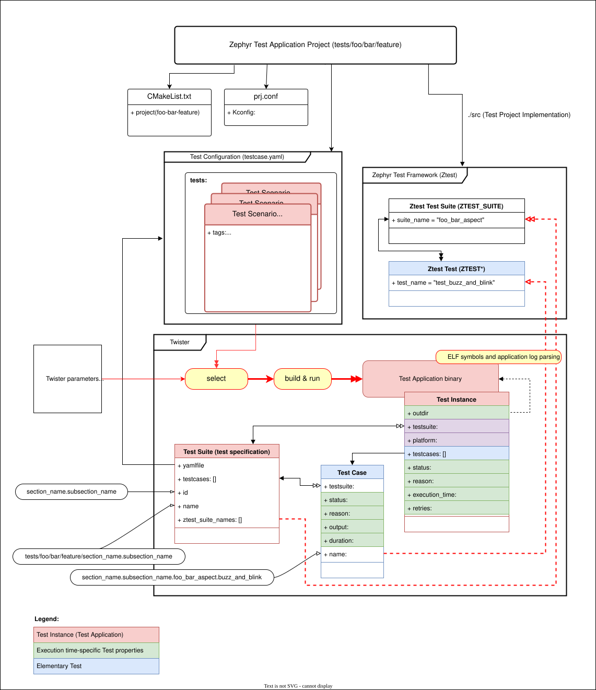
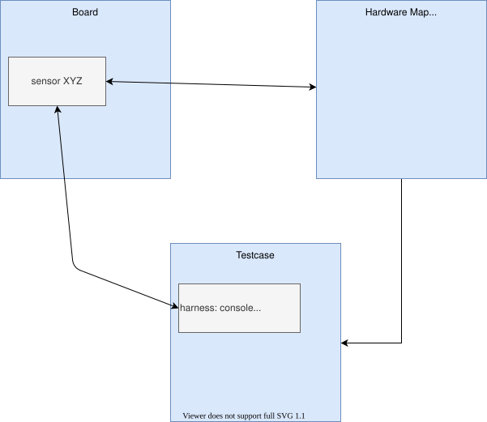

<!-- Copyright 2015-2026 Zephyr Project members and individual contributors. -->
<!-- SPDX-License-Identifier: Apache-2.0 -->
<!-- 中文翻译；阅读编号、导航和译注为本地新增。 -->

<a id="twister-script"></a>

# 第1章\_Twister测试运行器

原文：[Test Runner (Twister)](https://docs.zephyrproject.org/latest/develop/twister/index.html)。读取日期：2026-10-12，`latest`。

**Twister（Zephyr测试运行器）**扫描 Git 仓库中的测试应用并尝试执行。默认在开发板定义中标为默认的平台上构建大部分测试；如果目标架构或配置有可用模拟环境，再在其中运行。

这种覆盖范围有限，不能保证本地修改一定通过完整构建环境，但它在不同板和配置上构建示例与测试，有助于保持代码树可构建。

使用至少一个 `-v` 参数时，控制台逐应用显示测试通过 `qemu`、`native_sim` 等方式运行，还是只构建二进制。结果也写入 `twister.json` 等报告；状态含义见 [Twister状态](P005_Twister状态.md)。下列情况可能只构建、不执行：

- 测试 YAML 配置声明 `build_only: true`。
- 配置指定了**测试支撑程序（Harness）**，但相应程序不存在或尚未配置。
- 目标设备没有连接，无法烧录。
- 命令行或上层自动化使用了 `--build-only`。

准备好所用 Zephyr 工作区及构建依赖后，在该源码根目录运行：

```sh
$ west twister
```

> 原文说明：本页使用 west 扩展命令 `west twister`，各主机系统的形式一致，是推荐入口。Windows 也可直接执行 `python .\scripts\twister ...`，但须先通过适合当前终端的 `zephyr-env.sh` 或 `zephyr-env.cmd` 建立环境。两种形式接受相同选项。

> 译注：命令中的 `$` 是终端提示符，不输入。以下是官方操作与配置参考，本次翻译没有运行测试，也没有创建示例设备或硬件映射。文件路径按实际所用 Zephyr 源码根解析，硬件步骤使用各自示例平台，不等于本项目实板已经支持。

通过 `--platform` 限制构建和运行的平台，可多次指定；`--platform board@revision` 选择某块板的具体修订。完整选项可用 `west twister --help` 查看，或阅读 [Twister命令行选项](P002_Twister命令行选项.md)。其他专题包括 [pytest集成](P003_集成pytest测试框架.md)与 [Twister黑盒测试](P004_Twister黑盒测试.md)。

## 1.1\_开发板配置

为了构建指定板的测试，并在硬件或 **QEMU（机器模拟器项目）**中执行，Twister 需要开发板配置文件。它提前提供板清单及属性，避免必须等到构建阶段才知道这些信息，也可供其他需要板清单的任务使用。

板目录内的元数据采用 **YAML（YAML Ain't Markup Language，配置数据格式）**。以下原文示例使用恩智浦（NXP）的 FRDM-K64F 开发板型号：

```yaml
identifier: frdm_k64f
name: NXP FRDM-K64F
type: mcu
arch: arm
toolchain:
  - zephyr
  - gnuarmemb
supported:
  - arduino_gpio
  - arduino_i2c
  - netif:eth
  - adc
  - i2c
  - nvs
  - spi
  - gpio
  - usb_device
  - watchdog
  - can
  - pwm
testing:
  default: true
```

### 1.1.1\_身份与模拟器

| 字段 | 解释 |
| --- | --- |
| `identifier` | 与构建系统使用的板标识一致，供 `west build` 或 CMake 选择目标。 |
| `name` | 开发板在产品资料中的正式名称。 |
| `vendor` | 厂商名称，供场景的 `vendor_allow`、`vendor_exclude` 过滤使用。 |
| `tier` | 可选整数，表示开发板支持等级，用于报告和按支持程度分组。 |
| `type` | 平台类型，可选 `mcu`、`qemu`、`sim`、`unit`、`native`。 |
| `arch` | 板所属的处理器架构。 |

`identifier` 对应构建时使用的名字，例如：

```sh
# with west
west build -b reel_board
# with cmake
cmake -DBOARD=reel_board ..
```

> 译注：`mcu` 表示**微控制器（Microcontroller Unit，MCU）**类硬件，`sim` 是模拟配置，`unit` 是单元测试目标，`native` 是主机原生目标。上面的 CMake 形式假定当前目录是适当的构建目录、上一级为应用；它与在应用目录调用 west 的当前位置要求不同。

`simulation` 列出用于模拟平台的模拟器，可有多项：

```yaml
simulation:
  - name: qemu
  - name: armfvp
    exec: FVP_Some_Platform
  - name: custom
    exec: AnotherBinary
```

默认使用数组第一项，也可通过 `--simulation <simulation_name>` 另选。可选字段 `exec` 指定应存在的模拟器程序；设了它但程序不可用时，只构建测试。未设置它而所需模拟器实际不存在时，执行会失败。模拟器名称必须与构建变量 `SUPPORTED_EMU_PLATFORMS` 的某个元素一致。

### 1.1.2\_工具链、容量与能力

`toolchain` 是允许构建该板的**工具链（Toolchain）**列表，其值对应 `ZEPHYR_TOOLCHAIN_VARIANT` 的变体名。选中的工具链不在列表中时，Twister 过滤该实例，除非使用 `--force-toolchain`。这个字段声明兼容性，并不负责选择工具链。

`preferred_toolchain` 指定没有更高优先级选择时应使用的工具链，适合名义上支持多种工具链、测试时却希望固定一种的板。

`build_toolchains` 可选地列出每个分配到该平台的测试都要使用的工具链。Twister 为每一项建立独立实例及构建目录，例如让 `native_sim` 同时使用 **GNU编译器集合（GNU Compiler Collection，GCC）**和 Clang：

```yaml
build_toolchains:
  - host/gnu
  - host/llvm
```

由于会成倍增加构建工作，通常不写进通用板定义，而只在**持续集成（Continuous Integration，CI）**所用的 Twister 配置文件中启用。工具链选择顺序见下一节。

| 字段 | 默认值与用途 |
| --- | --- |
| `ram` | 可用**随机存取存储器（Random-Access Memory，RAM）**，按 KB 表示；未给出时为 128 KB，与测试需求比较。 |
| `flash` | 可用**闪存（Flash）**容量，按 KB 表示；未给出时为 512 KB，与测试需求比较。 |
| `sysbuild` | 默认 `False`；为 `True` 时平台应用默认使用**系统构建（System Build，sysbuild）**。 |
| `twister` | 默认 `True`；为 `False` 时 Twister 完全忽略该平台，不构建也不运行。 |

`supported` 是板能力列表，可使用单独能力名，或“能力类别:具体变体”。例如声明 **外设组件互连（Peripheral Component Interconnect，PCI）**：

```yaml
supported:
  - pci
```

或者声明**网络接口（Network Interface，netif）**的**以太网（Ethernet，eth）**变体及传感器型号：

```yaml
supported:
  - netif:eth
  - sensor:bmi16
```

场景可依赖 `eth` 以只测以太网，也可依赖 `netif` 以覆盖任意提供网络接口的板。

### 1.1.3\_testing与其他板属性

`testing` 下的字段控制适合该板的测试覆盖：

| 字段 | 解释 |
| --- | --- |
| `binaries` | 为设备测试保留的自定义二进制文件列表。 |
| `default` | 标为默认板时，优先测试，并纳入不带额外范围参数的简化 Twister 运行。 |
| `ignore_tags` | 不构建、因而也不运行带这些标签的测试。 |
| `only_tags` | 仅在该平台执行带这些标签的测试。 |
| `timeout_multiplier` | 浮点超时倍率，默认 1；调节慢速硬件或精细但运行缓慢的模拟器所需时间。 |
| `flash_before` | 默认 `False`；pytest/shell 硬件测试中，为 `True` 时先烧录再打开串口，避免烧录复位导致串口断开，例如使用 USB CDC 的板。 |
| `renode` | Renode 模拟器配置：`uart` 指定连接的 UART 外设，如 `sysbus.uart0`；`resc` 指定建立模拟机器的 `.resc` 脚本。 |

> 译注：**通用串行总线（Universal Serial Bus，USB）**的**通信设备类（Communications Device Class，CDC）**可提供主机看到的串行通信接口。**通用异步收发器（Universal Asynchronous Receiver-Transmitter，UART）**则是另一类常见串行外设；这里都可能承担测试输出通道，但不能据名称把二者当作同一硬件。

`env` 列出必需的环境变量。只有全部已设置，Twister 才使用该平台，否则跳过；可借此表明某种所需软件或硬件存在。

`variants` 将板的变体、即**限定符（Qualifier）**名称映射到各自覆盖配置。每个条目本身是平台定义，可覆盖上述字段，其余值继承顶层定义。

## 1.2\_工具链选择

影响工具链的选项分为三类：选择工具链、过滤不适用的实例、以及把一个测试展开成多个构建。

Twister 先调用 `cmake/verify-toolchain.cmake` 确定整次运行的默认工具链；该脚本读取环境变量 `ZEPHYR_TOOLCHAIN_VARIANT`。启动日志以 `Using '<toolchain>' toolchain variant` 报告这个运行默认值。

这里 `posix` 指基于**可移植操作系统接口（Portable Operating System Interface，POSIX）**的主机平台类别，`unit` 指单元测试平台。对每个“测试场景、平台”组合，依次采用第一条适用规则：

1. 场景设置了 `integration_toolchains`：按其中每种工具链分别构建。
2. 平台通过板定义或 Twister 配置文件设置了 `build_toolchains`：按其中每种工具链分别构建。
3. 对 `posix` 和 `unit` 平台，运行默认值是 `host/llvm` 时使用它，否则使用 `host/gnu`。
4. 平台设置了 `preferred_toolchain`：使用它。
5. 使用运行默认值；无法确定时回退到 `zephyr`。

因此 `ZEPHYR_TOOLCHAIN_VARIANT` 只改变最后一层的运行默认值，不能覆盖平台的首选或多工具链设置，也不能覆盖场景的 `integration_toolchains`。

选择完成后仍可能过滤实例：若工具链不在板的 `toolchain` 支持列表中，则过滤，除非使用 `--force-toolchain` 禁止该项检查。匹配还可按 `/` 前缀进行，因此 `host/gnu` 可匹配支持列表中的 `host`。场景的 `toolchain_allow` 与 `toolchain_exclude` 也会对已选工具链过滤。

`integration_toolchains` 和 `build_toolchains` 都按工具链生成实例，增加构建时间。后者通常只在 CI 专用配置文件中启用。

## 1.3\_测试应用、场景、套件与用例

Twister 通过应用项目目录中的 `tests.yaml` 发现测试；原文已将 `sample.yaml` 和 `testcase.yaml` 支持标为弃用。配置中 `tests:` 的每个条目定义一个**测试场景（Test Scenario）**。

下图是官方的测试应用项目关系图，展示这些名称对应的层级：



**测试场景（Test Scenario）**是一组构建和执行条件及变量；在这些条件下运行一组**测试套件（Test Suite）**。套件包含相关或应共同执行的**测试用例（Test Case）**，以验证软件满足某些要求。测试与示例的 YAML 采用相同基本结构。

命名遵循以下规则：

- 场景标识由点号分隔的多段组成，不含空格；段内允许字母、数字、下划线和等号。
- 开头为功能分类及子分类，例如内核信号量测试以 `kernel.semaphore` 开始。
- 同一次 Twister 执行范围内的场景名必须唯一。
- 套件完整规范名为 `<测试应用项目路径>/<测试场景标识>`。
- 用例标识至少由三段构成。Ztest 使用 `<场景标识>.<Ztest套件名>.<Ztest用例名>`；独立测试及示例使用场景标识，末段代表独立用例名，例如 `debug.coredump.logging_backend`。

下面是原文的测试配置示例。构建变量 `CONF_FILE` 选择应用配置文件，Kconfig 选项 `CONFIG_DEBUG` 控制调试配置：

```yaml
tests:
  bluetooth.gatt:
    build_only: true
    platform_allow:
      - qemu_cortex_m3
      - qemu_x86
    tags:
      - bluetooth
  bluetooth.gatt.br:
    build_only: true
    extra_args:
      -CONF_FILE="prj_br.conf"
    filter: not CONFIG_DEBUG
    platform_exclude:
      -up_squared
    platform_allow:
      - qemu_cortex_m3 qemu_x86
    tags:
      - bluetooth
```

> 译注：原块存在明显的列表格式问题，例如 `-up_squared` 少了列表标记后的空格、`- qemu_cortex_m3 qemu_x86` 会被读成一个含空格的值，`-CONF_FILE=...` 也不是通常的单元素列表写法。实际配置应按下文列表字段逐项填写平台与参数，不能将原例的排版错误原样用作有效配置。

示例应用还可以增加 `sample:` 信息，说明名称及演示内容；示例用 Kconfig 选项 `CONFIG_BT` 判断是否启用蓝牙配置：

```yaml
sample:
  name: hello world
  description: Hello World sample, the simplest Zephyr application
tests:
  sample.basic.hello_world:
    build_only: true
    tags:
      - tests
    min_ram: 16
  sample.basic.hello_world.singlethread:
    build_only: true
    extra_args: CONF_FILE=prj_single.conf
    filter: not CONFIG_BT
    tags:
      - tests
    min_ram: 16
```

`tests:` 字典以场景标识作为键；下面介绍各场景可以设置的键和值。

### 1.3.1\_标签、附加参数与配置

| 字段 | 解释 |
| --- | --- |
| `tags` | 必填，字符串标签列表，通常表示功能领域，也可按其他目的分类；命令行可按标签筛选。 |
| `skip` | 默认 `False`；为 `True` 时无条件跳过，例如暂时无法工作的测试。 |
| `slow` | 默认 `False`；为 `True` 时仍构建，但只有传入 `--enable-slow` 或 `--enable-slow-only` 才运行，适合耗时的每日测试。 |
| `extra_args` | 构建或运行场景时传给构建工具的附加参数列表。 |

`extra_args` 可用命名空间限制只对指定架构、平台或模拟器生效。下例 Kconfig 选项 `CONFIG_ADC_ASYNC` 涉及模数转换器异步支持，`CONFIG_MPU` 涉及内存保护单元；构建变量 `SHIELD` 选择扩展板。双语名称与作用在随后译注中补充：

```yaml
common:
  tags:
   - drivers
   - adc
tests:
  test:
    depends_on: adc
  test_async:
    extra_args:
      - arch:x86:CONFIG_ADC_ASYNC=y
      - platform:qemu_x86:CONFIG_DEBUG=y
      - platform:mimxrt1060_evk:SHIELD=rk043fn66hs_ctg
      - simulation:qemu:CONFIG_MPU=y
```

`extra_configs` 列出构建或运行时与主要 `prj.conf` 合并的附加 Kconfig 选项：

```yaml
common:
  tags:
    - drivers
    - adc
tests:
  test:
    depends_on: adc
  test_async:
    extra_configs:
      - CONFIG_ADC_ASYNC=y
```

它也可按架构或平台限定配置，例如：

```yaml
common:
  tags:
    - drivers
    - adc
tests:
  test:
    depends_on: adc
  test_async:
    extra_configs:
      - arch:x86:CONFIG_ADC_ASYNC=y
      - platform:qemu_x86:CONFIG_DEBUG=y
```

> 译注：示例中的 `CONFIG_ADC_ASYNC`、`CONFIG_DEBUG`、`CONFIG_MPU` 是 Kconfig 配置项，分别涉及**模数转换器（Analog-to-Digital Converter，ADC）**异步能力、调试及**内存保护单元（Memory Protection Unit，MPU）**。`SHIELD` 是选择扩展板的构建变量。它们是否可用仍取决于具体平台与配置依赖。

还可直接使用文件列表字段，避免把文件参数塞进 `extra_args`。以下字段都会拼接 `common` 与场景中的条目：

| 字段 | 对应内容及替代写法 |
| --- | --- |
| `extra_conf_files` | 额外 Kconfig 片段，替代经 `extra_args` 传 `CONF_FILE=`；原文推荐优先使用此字段。 |
| `extra_overlay_confs` | 额外 Kconfig 覆盖片段，替代 `OVERLAY_CONFIG=`。 |
| `extra_dtc_overlay_files` | 额外**设备树覆盖文件（Devicetree Overlay File）**，替代 `DTC_OVERLAY_FILE=`。 |

### 1.3.2\_构建、资源与过滤范围

| 字段 | 解释 |
| --- | --- |
| `build_only` | 默认 `False`；为 `True` 时即使平台可运行也不执行。此字段用于只验证代码能否构建的测试，例如驱动能否正确启用和编译，不能用这种测试证明驱动功能正常。 |
| `build_on_all` | 默认 `False`；为 `True` 时尝试在所有平台构建，主要用于 CI 覆盖。原文明确要求新测试不要再使用它。 |
| `depends_on` | 能力列表，只在声明支持所需能力的板或平台上启用测试。 |
| `levels` | 所属测试级别列表，可经 `--level <级别名>` 选择。 |
| `min_ram` | 估计构建和运行所需最小 RAM，按 KB 表示，与板元数据比较。 |
| `min_flash` | 估计所需最小**只读存储空间（Read-Only Memory，ROM）**，按 KB 表示，与板元数据比较。 |
| `timeout` | 执行超时秒数，默认 60；超过后终止测试。 |
| `arch_allow` / `arch_exclude` | 允许或排除的架构列表，如 `x86`、`arm`、`arc`。 |
| `toolchain_allow` / `toolchain_exclude` | 允许或排除的工具链变体列表，按实例实际选用的工具链过滤。 |
| `vendor_allow` | 只接受板定义中列出的厂商；未列入或没有厂商属性的板均排除。 |
| `vendor_exclude` | 排除指定厂商的板。 |
| `platform_allow` | 只接受列出的平台，应用于测试确实只能在这些平台运行的情况。不要仅为减少 CI 时间或资源而使用它。 |
| `integration_platforms` | 在 `--integration` 模式下把范围限制为该列表；若目的是控制时间和资源，应优先用它。 |

### 1.3.3\_多工具链与其他平台限制

`integration_toolchains` 展开工具链维度。通常每个平台只使用环境决定的一种工具链；声明多种后，每个平台与每种工具链形成独立测试配置，例如：

```yaml
integration_toolchains:
  - toolchain1
  - toolchain2
```

原来“场景→平台1→工具链1”和“场景→平台2→工具链1”两种配置，会展开为两个平台各自使用工具链1、工具链2，共四种组合。

> 原文注意：这个展开始终生效，不仅限于 `--integration` 模式。场景的 `integration_toolchains` 优先于平台的 `build_toolchains`；若希望某平台上的全部测试都扩展工具链，应使用后者。

`platform_exclude` 排除指定平台。`platform_type` 仅允许指定平台类型，支持值为 `mcu`、`qemu`、`sim`、`unit`、`native`，与板元数据的 `type` 对应。

`simulation_exclude` 排除模拟器，支持 `qemu`、`simics`、`xt-sim`、`renode`、`nsim`、`mdb-nsim`、`tsim`、`armfvp`、`native`、`custom`。

`extra_sections` 列出额外二进制**节（Section）**名称。统计大小时，Twister 遇到未预期的节会报错，除非在此声明；这些额外节不纳入大小计算。

场景的 `sysbuild` 默认 `False`，启用后使用系统构建。过滤只读取主项目生成的设备树与 Kconfig。硬件测试必须通过硬件映射或 `west flash` 加载镜像，不支持 `west flash` 的 `--erase`；使用不支持的选项会导致需要 sysbuild 的测试跳过。

### 1.3.4\_支撑程序与平台去重

`harness` 选择 Twister 中负责判断测试是否通过的处理机制。有些名称只是尚未实现的占位，例如需要键盘交互才能判定的 `keyboard`，不能因配置中出现名称就认为能够自动执行。

原文列出的已支持名称为 `ztest`、`test`、`console`、`pytest`、`gtest`、`robot`、`ctest`、`shell`、`power`、`display_capture`、`script`、`bsim`。各类用途见后面的支撑程序小节。

`platform_key` 按平台属性组合去重。例如某库只依赖架构，每种架构测试一个平台就足够；也可按架构与模拟器组合各运行一次：

```yaml
platform_key:
  - arch
  - simulation
```

原文还提出可将**片上系统（System on Chip，SoC）**名、SoC 家族或外设 **知识产权模块（Intellectual Property Block，IP Block）**等属性用于分类，例如每种不同的 **串行外设接口（Serial Peripheral Interface，SPI）**硬件模块各测一次。这里的 IP Block 指可复用硬件实现单元。

`harness_config` 保存额外支撑程序配置，用于选择设备、声明外部依赖、按**正则表达式（Regular Expression）**匹配控制台等。

| `harness_config` 字段 | 解释 |
| --- | --- |
| `fixture` | 字符串或列表，声明外部设备或接线依赖，并识别满足依赖的测试装置，如 `i2c_hts221`、`i2c_bme280`、`i2c_FRAM`、`ble_fw`、`gpio_loop`。自动化环境按实际装置及板选择逻辑匹配。 |
| `ztest_suite_repeat` | 整个套件重复次数，默认 1。 |
| `ztest_test_repeat` | 每个用例重复次数，默认 1。 |
| `ztest_test_shuffle` | 默认 `False`；启用后随机打乱用例顺序。 |

> 译注：此处**硬件测试装置（Fixture）**表示满足外设、连线等条件的设备组合，与 pytest 用于提供依赖对象的同名“测试夹具”概念有关，但配置对象不同。`i2c` 代表**集成电路间总线（Inter-Integrated Circuit，I²C）**，`FRAM` 是**铁电随机存取存储器（Ferroelectric Random-Access Memory）**，`ble` 通常指**低功耗蓝牙（Bluetooth Low Energy）**；这些名字是装置标签，不会自动建立接线或刷入固件。

Robot Framework 支撑程序可在 `robot_testsuite` 指定一个测试套件：

```yaml
tests:
  robot.example:
    harness: robot
    harness_config:
      robot_testsuite: [robot file path]
```

也可以使用列表指定多个套件：

```yaml
tests:
  robot.example:
    harness: robot
    harness_config:
      robot_testsuite:
        - [robot file path 1]
        - [robot file path 2]
        - [robot file path n]
```

通过 `robot_option` 传入一个或多个 Robot Framework 选项：

```yaml
tests:
  robot.example:
    harness: robot
    harness_config:
      robot_testsuite: [robot file path]
      robot_option:
        - --exclude tag
        - --stop-on-error
```

> 译注：`[robot file path]` 等是原文占位，实际应填写符合字段格式的套件文件路径；不要把方括号说明本身当作实际文件名。

### 1.3.5\_过滤表达式

`filter` 通过表达式决定场景是否运行。可访问架构 `ARCH`、平台 `PLATFORM`、该测试生成的配置中的全部 `CONFIG_*` 键值，以及环境变量：

```text
{ ARCH : <architecture>,
  PLATFORM : <platform>,
  <all CONFIG_* key/value pairs in the test's generated defconfig>,
  *<env>: any environment variable available
}
```

Twister 先分析表达式，判断能否用 `package_helper` CMake 脚本进行有限配置。出现 `dt_*` 表明需要**设备树（Devicetree，DT）**，出现 `CONFIG*` 表明需要 Kconfig；若没有其他类型的项，可不生成完整构建系统而完成过滤。存在其他类型时，则需要完整 CMake 配置。

表达式语法如下，`symbol` 表示符号，`constant` 表示数值或字符串常量，`list` 表示列表，词法标记 `NUMBER` 表示数值，`STRING` 表示字符串：

```text
expression : expression 'and' expression
           | expression 'or' expression
           | 'not' expression
           | '(' expression ')'
           | symbol '==' constant
           | symbol '!=' constant
           | symbol '<' NUMBER
           | symbol '>' NUMBER
           | symbol '>=' NUMBER
           | symbol '<=' NUMBER
           | symbol 'in' list
           | symbol ':' STRING
           | symbol
           ;

list : '[' list_contents ']';

list_contents : constant (',' constant)*;

constant : NUMBER | STRING;
```

表达式只有一个符号时，该符号被定义为非空字符串才为真。优先级从低到高为 `or`、`and`、`not`、全部比较运算符；前两者左结合，`not` 右结合，比较运算不结合。

`arch_allow`、`arch_exclude`、`platform_allow`、`platform_exclude` 是对应过滤表达式的便捷形式。例如原文写法：

```text
arch_exclude = x86 arc
```

等价于：

```text
filter = not ARCH in ["x86", "arc"]
```

> 译注：这两段是原文的等价关系记法，不是可直接粘贴到 YAML 的完整条目。实际 YAML 应使用冒号及前述列表结构。

冒号运算符 `:` 将右侧字符串编译为正则表达式，匹配左侧符号在环境中的值。例如 `CONFIG_SOC="stm32f107xc"` 可被下式匹配：

```text
filter = CONFIG_SOC : "stm.*"
```

### 1.3.6\_必需配置片段与应用依赖

`required_snippets` 列出必须使用的**配置片段（Snippet）**。Twister 与普通应用一样，从 Zephyr 基础片段目录和测试应用目录发现它们。片段必须与测试平台兼容，不是可有可无的建议；不兼容的平台会被过滤。例如：

```yaml
tests:
  snippet.example:
    required_snippets:
      - cdc-acm-console
      - user-snippet-example
```

`required_applications` 默认空列表，声明当前测试开始前必须构建的应用，允许场景共享其他应用的构建产物。每项包含：

| 字段 | 解释 |
| --- | --- |
| `application` | 必填，所需应用的测试场景标识。 |
| `name` | `application` 的弃用别名，仅为兼容保留，新配置应使用 `application`。 |
| `platform` | 可选目标平台，默认使用当前测试的平台。 |
| `path` | 可选搜索目录，未指定则在引用方 YAML 所在目录查找；相对路径也以该目录为基准。支持环境变量与 Zephyr 模块目录变量展开。 |

Twister 自动发现并先构建依赖应用，主测试等待其完成，再将构建目录交给支撑程序。pytest 使用 `--required-build` 接收这些目录，通过 `required_build_dirs` 夹具访问。使用 `--no-clean` 等方式复用构建目录时，也可在当前构建目录找到依赖应用。

下例环境变量 `ZEPHYR_BASE` 指向所用 Zephyr 源码根。配合 `build: false`，当前场景完全跳过自身构建，使用第一个依赖应用的产物作为测试镜像，适合只负责测试另一场景生成镜像的情况：

```yaml
tests:
  # Requires two applications, second one from a different path and with a fixed platform
  sample.required_app_demo:
    harness: pytest
    required_applications:
      - application: sample.shared_app
      - application: other.app
        path: ../other_app
        platform: native_sim
  # No self build, use the first required application as the test image
  sample.no_self_build:
    build: false
    harness: pytest
    required_applications:
      - application: sample.basic.helloworld
        path: $ZEPHYR_BASE/samples/hello_world
  sample.shared_app:
    build_only: true
```

此功能不支持 `--runtime-artifact-cleanup`，因为主测试仍需依赖应用的产物；也不支持 `--subset`，因为依赖应用和使用方可能被分到不同子集，执行时取不到产物。

`build` 默认 `True`。设为 `False` 时，`required_applications` 必须非空，只支持基于 pytest 的支撑程序，如 `pytest`、`shell`，以及 `bsim`；不支持 QEMU 平台。

> 译注：原文允许 `path` 使用绝对位置；可移植配置优先按上述 YAML 所在目录写相对路径，或使用已经明确指向源码或模块根的变量。示例中的 `$ZEPHYR_BASE` 是变量引用，不是固定机器目录。

### 1.3.7\_其余场景字段与参数文件

| 字段 | 默认值与含义 |
| --- | --- |
| `expect_reboot` | 默认 `False`；声明测试会重启，抑制意外重复运行套件或用例的警告。 |
| `modules` | 所需模块名列表；缺少任意模块则过滤该场景。 |
| `type` | 默认 `integration`；设为 `unit` 时用 `unit_testing` 板构建主机单元测试，不使用完整 Zephyr 构建系统。 |
| `testcases` | 显式列出用例名；通常可自动从 Ztest 等源码发现，仅不能内省的支撑程序需要填写。 |
| `ignore_faults` | 默认 `False`；启用后不因运行输出中发现故障而将场景标为失败。 |
| `ignore_qemu_crash` | 默认 `False`；启用后不因 QEMU 崩溃而将场景标为失败。 |

实际执行范围由场景文件与命令行共同决定。若不明白某场景为何被过滤，使用 `-v` 或检查 `testplan.json`。

可用 `+文件名` 从文件加载参数；文件中每个有效参数以换行分隔，不是以空格分隔。多数日常调用可直接使用默认参数。

### 1.3.8\_模块目录变量展开

场景路径字段，如 `required_applications` 的路径、`harness_config` 下的 `pytest_root`，使用前会展开环境变量及 Zephyr 模块目录变量。后者对应每个模块的 CMake 变量：

- `ZEPHYR_<MODULE>_MODULE_DIR`：模块根目录的完整位置。
- `ZEPHYR_<MODULE>_MODULE_NAME`：模块名称。

`<MODULE>` 转为大写，非字母数字字符替换为下划线，与 CMake 一致。例如 `hal_nordic` 对应 `$ZEPHYR_HAL_NORDIC_MODULE_DIR`。未知引用保持原样。

### 1.3.9\_超时如何叠加

场景的 `timeout`、板配置的 `timeout_multiplier`、本次命令行的 `--timeout-multiplier` 三者相乘，得到最终场景执行超时。最后一项适合按当前主机速度、负载或模拟精度临时调整，不必修改公共场景配置。

## 1.4\_设备树过滤表达式

`dt_*` 表达式根据设备树的兼容字符串、别名、节点标签、属性与选定节点等条件筛选平台。实现位于 `scripts/pylib/twister/expr_parser.py`。

这里 `compat` 是 **兼容字符串（Compatible String）**，标识节点对应的硬件编程接口；`alias` 是 `aliases` 节点中的**别名（Alias）**；`label` 是**节点标签（Node Label）**；`prop` 是属性名；`chosen` 是 `chosen` 节点中的选择属性名；参数 `node_id` 接受节点别名或节点路径。

| 表达式 | 判断条件 |
| --- | --- |
| `dt_compat_enabled(compat)` | 存在具有指定兼容字符串且已启用的节点。 |
| `dt_alias_exists(alias)` | 别名对应的节点存在且已启用。 |
| `dt_enabled_alias_with_parent_compat(alias, compat)` | 别名对应节点已启用，且父节点具有指定兼容字符串；适合自己没有 compatible 的 `gpio-leds` 子节点。 |
| `dt_label_with_parent_compat_enabled(label, compat)` | 指定标签节点存在、已启用，父节点具有指定兼容字符串。 |
| `dt_label_compat_enabled(label, compat)` | 指定标签节点存在、已启用，且自身具有指定兼容字符串。 |
| `dt_chosen_enabled(chosen)` | 指定 chosen 属性存在，且其指向节点已启用。 |
| `dt_nodelabel_enabled(label)` | 指定标签节点存在且已启用。 |
| `dt_nodelabel_prop_enabled(label, prop)` | 指定标签节点存在、已启用，且指定属性具有非空值。 |
| `dt_node_has_prop(node_id, prop)` | 按别名或节点路径 `node_id` 找到的节点具有指定属性，不检查节点状态；适合没有 status 的 `zephyr,user` 等节点。 |

原文使用如下示意表达式：

```yaml
tests:
  - test: my_test
    filter: dt_compat_enabled("my-compat-string")
```

其意图是仅为启用了 `my-compat-string` 节点的平台构建 `my_test`。

> 译注：本原块把 `tests` 写成列表，而本页前面定义的是以场景名为键的字典；实际配置应使用 `tests:` 下的 `my_test:` 条目，再写 `filter:`。这里完整保留原表达式例子并指出结构不一致。

## 1.5\_测试支撑程序

镜像构建并启动后，支撑程序负责与目标交互：提供输入、捕获输出，或把执行交给外部测试框架，再解释结果并赋予用例状态。场景用 `harness:` 选择机制，以 `harness_config` 调整行为；未指定时使用默认 `test` 支撑程序。

`ztest`、`gtest`、`console` 通过解析输出及匹配特定内容工作；前两者识别各自框架定义的通过、失败等结果帧。其他机制可以调用 pytest、Robot Framework、ctest 等外部框架。原文列出的 `keyboard`、`net`、`bluetooth` 分别是键盘、网络、蓝牙交互支撑程序的占位名称，尚不支持。

下面的控制台测试使用 HTS221 温湿度传感器型号，匹配温度和相对湿度两行，顺序不限，并声明需要名为 `i2c_hts221` 的测试装置：

```yaml
sample:
  name: HTS221 Temperature and Humidity Monitor
common:
  tags:
    - sensor
  harness: console
  harness_config:
    type: multi_line
    ordered: false
    regex:
      - "Temperature:(.*)C"
      - "Relative Humidity:(.*)%"
    fixture: i2c_hts221
tests:
  test:
    tags:
      - sensors
    depends_on: i2c
```

各类支撑程序及专有选项分别见官方 [Ctest](https://docs.zephyrproject.org/latest/develop/twister/harness/ctest.html)、[Gtest](https://docs.zephyrproject.org/latest/develop/twister/harness/gtest.html)、[Pytest](https://docs.zephyrproject.org/latest/develop/twister/harness/pytest.html)、[Console](https://docs.zephyrproject.org/latest/develop/twister/harness/console.html)、[Robot](https://docs.zephyrproject.org/latest/develop/twister/harness/robot.html)、[Power](https://docs.zephyrproject.org/latest/develop/twister/harness/power.html)、[Display capture](https://docs.zephyrproject.org/latest/develop/twister/harness/display_capture.html)、[Script](https://docs.zephyrproject.org/latest/develop/twister/harness/script.html)、[Bsim](https://docs.zephyrproject.org/latest/develop/twister/harness/bsim.html)、[Shell](https://docs.zephyrproject.org/latest/develop/twister/harness/shell.html)。

## 1.6\_配套主机资源

有些测试需要主机在整个运行期间提供资源，例如供模拟目标通信的守护进程、运行后读回的共享内存，或目标连接的网络接口。**配套资源服务（Sidecar）**描述这种主机侧准备工作，由场景的 `sidecar:` 选择。

它与支撑程序职责独立：支撑程序解释目标输出，Sidecar 管理运行前后的主机资源。因此任意支撑程序都可与任意 Sidecar 组合，例如：

```yaml
tests:
  some.test:
    harness: ztest
    sidecar: <name>
```

每个测试实例的生命周期由 Twister 驱动：

1. **配置（Configure）**：从实例及 `sidecar_config` 读取设置，此时尚未提供资源。
2. **主机检查（Host Check）**：在测试计划阶段检查所需条件，如守护进程二进制是否安装；不满足时只构建、不执行，与缺少模拟器类似。
3. **准备（Setup）**：测试处理器执行镜像前，启动守护进程、创建接口等。若仍无法建立资源，例如权限不足，报告不可用，Twister 跳过执行而非将测试判为失败。
4. **清理（Teardown）**：处理器返回后在 `finally` 块中执行，即使失败或超时也清理资源；还可收集目标留下的数据，例如将共享内存读回构建目录。

由于资源提供与输出处理分开，Twister 也可自行给实例附加 Sidecar，不要求测试显式选择，例如将没有其他主机传输方式的目标覆盖率数据导出。

配置按 Sidecar 名称分组，只读取与场景 `sidecar:` 相匹配的块。例如 `virtiofs` 从模板准备并共享主机目录：

```yaml
tests:
  some.test:
    harness: console
    sidecar: virtiofs
    sidecar_config:
      virtiofs:
        shared: shared
```

## 1.7\_选择平台范围与集成模式

Twister 最初为 Zephyr CI 设计，需要在大量平台和测试之间选择有意义的范围。它先按命令行与测试配置确定初始平台集合，再排除不满足 RAM 等条件的平台。

`--force-platform` 可越过场景中的 `platform_allow`、`platform_exclude`、`arch_allow`、`arch_exclude` 过滤；它不表示其他条件也全部无效。

| 范围选项 | 初始平台集合 |
| --- | --- |
| `-p` / `--platform <平台>`，可重复 | 仅显式指定的平台。 |
| `-l` / `--all` | 全部可用平台。 |
| `-G` / `--integration` | 当前场景的 `integration_platforms`；未声明时采用范围推定。 |
| 没有范围参数 | 采用范围推定。 |

**范围推定（Scope Presumption）**先使用 Twister 默认平台；过滤后若没有剩余平台，再以 `platform_allow` 列表作为初始范围。

**集成模式（Integration Mode）**通过 `--integration` 启用，面向 CI 等自动环境，以场景选择的平台缩小构建和执行范围，尽快给开发者反馈。

> 译注：原文集成模式概述称配置键为 `integration`，但前后详细字段和范围规则使用 `integration_platforms`；实际应按所用版本的配置模式核对，不能新建一个仅名为 `integration` 的字段替代它。

## 1.8\_自定义模拟器与随机顺序

除了 QEMU 等现有模拟环境，也可以在板的 `board.cmake` 中接入树外模拟器。首先，在自行提供的 `custom_board/custom_board.yaml` 中声明：

```yaml
simulation:
  - name: custom
    exec: <name_of_emu_binary>
```

使模拟器程序可通过系统可执行文件搜索路径 `PATH` 找到，再在 `custom_board/board.cmake` 设置构建变量：

```cmake
set(SUPPORTED_EMU_PLATFORMS custom)
```

最后实现名为 `run_custom` 的构建目标。CMake 参数 `COMMAND` 指定命令，`WORKING_DIRECTORY` 指定工作目录，`DEPENDS` 指定依赖，`USES_TERMINAL` 请求终端。构建变量 `BOARD` 是目标板，`APPLICATION_BINARY_DIR` 是应用构建目录。原文示意如下：

```cmake
add_custom_target(run_custom
  COMMAND
  <name_of_emu_binary to invoke during 'run'>
  <any args to be passed to the command, i.e. ${BOARD}, ${APPLICATION_BINARY_DIR}/zephyr/zephyr.elf>
  WORKING_DIRECTORY ${APPLICATION_BINARY_DIR}
  DEPENDS ${logical_target_for_zephyr_elf}
  USES_TERMINAL
  )
```

> 译注：尖括号是待替换的程序和参数说明。`APPLICATION_BINARY_DIR` 是应用构建目录，`logical_target_for_zephyr_elf` 表示对应**可执行与可链接格式（Executable and Linkable Format，ELF）**产物的构建依赖目标；这些变量由相应版本的构建上下文提供，不能把示意段当成已创建的模拟器适配。

若要随机化测试顺序，启用 Ztest 的 Kconfig 选项 `CONFIG_ZTEST_SHUFFLE`，有助于找出用例之间隐含的状态依赖。`native_sim` 平台还可通过 `--seed=value` 指定随机数种子，详见 [Ztest测试框架](../testing/P002_Ztest测试框架.md)。

## 1.9\_在硬件上运行测试

Twister 也支持在真实设备上运行多数测试，为每次运行生成详细通过、失败报告。以下步骤以已连接且能正确烧录的目标为前提。

### 1.9.1\_单设备执行

Linux 示例使用主机可访问的串口设备节点：

```sh
west twister --device-testing --device-serial /dev/ttyACM0 \
--device-serial-baud 115200 -p frdm_k64f  -T tests/kernel
```

Windows 示例改用名为 `COM1` 的串口：

```sh
west twister --device-testing --device-serial COM1 \
--device-serial-baud 115200 -p frdm_k64f  -T tests/kernel
```

> 译注：Windows 原块仍采用 `\` 续行，适合能调用 Windows 工具的 Bash 终端，不是 PowerShell 或 CMD 的续行语法。`/dev/...` 是操作系统设备节点，不是文档作者的固定工作目录。

`--device-serial` 指定板连接的串口，运行 Twister 的用户必须能访问它。这种调用一次针对一块板，通过 `--platform` 选择。平台提供多个串口时，可重复传入 `--device-serial`，连接将交给 pytest 支撑程序；也可使用后文的硬件映射。

默认波特率为 115200，只有目标使用其他波特率时才必须设置 `--device-serial-baud`。

没有物理串口的设备可以使用 `--device-serial-pty`，让用户脚本传送日志，供 Twister 判断测试状态。**伪终端（Pseudo Terminal，PTY）**方式的 Linux 示例为：

```sh
west twister --device-testing --device-serial-pty "script.py" \
-p intel_adsp/cavs25 -T tests/kernel
```

这项 PTY 功能不支持 Windows。`script.py` 由用户提供，不是 Twister 自动生成的文件。

`--device-flash-timeout` 显式设置烧录超时，适合烧录耗时较长的设备。`--device-flash-with-test` 表明烧录过程同时执行测试，Twister 会在烧录超时上增加场景执行超时。

### 1.9.2\_生成并完善硬件映射

多块设备连接同一主机时，使用**硬件映射（Hardware Map）**记录串口、波特率及可识别的设备 ID。先生成映射：

```sh
$ west twister --generate-hardware-map map.yml
```

原文 Unix 类系统示例生成如下 `map.yml`。其中 **CMSIS调试访问端口（CMSIS Debug Access Port，CMSIS-DAP）**是调试探针协议名称，DAPLink 是提供这类调试功能的固件；CMSIS 指 **Cortex微控制器软件接口标准（Cortex Microcontroller Software Interface Standard）**：

```yaml
- connected: true
  id: "OSHW000032254e4500128002ab98002784d1000097969900"
  platform: unknown
  product: DAPLink CMSIS-DAP
  runner: pyocd
  serial: /dev/cu.usbmodem146114202
- connected: true
  id: "000683759358"
  platform: unknown
  product: J-Link
  runner: unknown
  serial: /dev/cu.usbmodem0006837593581
```

Windows 示例分别使用串口名 `COM1` 和 `COM2`：

```yaml
- connected: true
  id: "OSHW000032254e4500128002ab98002784d1000097969900"
  platform: unknown
  product: unknown
  runner: unknown
  serial: COM1
- connected: true
  id: "000683759358"
  platform: unknown
  product: unknown
  runner: unknown
  serial: COM2
```

> 译注：官网把第一个分支标为 Linux，但其中 `/dev/cu.usbmodem...` 更像 macOS 的设备名；实际填写当前系统枚举出的串口。示例中的 DAPLink、CMSIS-DAP、J-Link 是调试固件、协议或探针名称，`runner` 指 west 的**烧录运行器（Runner）**，如 pyOCD、nrfjprog，不可仅照抄样例序列号匹配设备。

所有 `unknown` 都应按连接硬件补齐，包括平台、产品与运行器。原文以 `reel_board` 和 `nrf52840dk/nrf52840` 为例，Unix 类系统修订结果为：

```yaml
- connected: true
  id: "OSHW000032254e4500128002ab98002784d1000097969900"
  platform: reel_board
  product: DAPLink CMSIS-DAP
  runner: pyocd
  serial: /dev/cu.usbmodem146114202
  baud: 9600
- connected: true
  id: "000683759358"
  platform: nrf52840dk/nrf52840
  product: J-Link
  runner: nrfjprog
  serial: /dev/cu.usbmodem0006837593581
  baud: 9600
```

Windows 修订结果为：

```yaml
- connected: true
  id: "OSHW000032254e4500128002ab98002784d1000097969900"
  platform: reel_board
  product: DAPLink CMSIS-DAP
  runner: pyocd
  serial: COM1
  baud: 9600
- connected: true
  id: "000683759358"
  platform: nrf52840dk/nrf52840
  product: J-Link
  runner: nrfjprog
  serial: COM2
  baud: 9600
```

只有不是 115200 波特率时才需要 `baud`。映射文件已存在时，生成命令会添加新条目并更新已有条目，因此可维护一份主映射，运行前更新连接状态和串口。

使用准备好的映射，Unix 类终端调用：

```sh
west twister --device-testing --hardware-map map.yml -T samples/hello_world/
```

Windows 路径形式为：

```sh
west twister --device-testing --hardware-map map.yml -T samples\hello_world
```

Twister 为映射中的平台构建测试，再逐目标烧录、运行。原文此处列出的硬件映射运行器支持包括 `pyocd`、`nrfjprog`、`jlink`、`openocd`、`dediprog`；其他运行器仍需开发适配。

> 译注：同页后续又给出 `intel_adsp` 等示例，说明这份概括列表并不能替代所用版本的运行器实际支持情况；接入前需核对当前 Twister 与相应 runner。

映射字段 `flash-timeout`、`flash-with-test` 对应同名功能的命令行选项；针对某设备，映射中的设置优先于命令行。

### 1.9.3\_PTY、运行器参数与自定义烧录

PTY 也可在硬件映射中配置：

```yaml
- connected: true
  id: None
  platform: intel_adsp/cavs25
  product: None
  runner: intel_adsp
  serial_pty: path/to/script.py
  runner_params:
    - --remote-host=remote_host_ip_addr
    - --key=path/to/key.pem
```

`runner_params` 将额外参数交给 west 运行器，等效于如下调用形式：

```sh
west flash --remote-host remote_host_ip_addr --key path/to/key.pem

west twister -p intel_adsp/cavs25 --device-testing --device-serial-pty script.py
--west-flash="--remote-host=remote_host_ip_addr,--key=path/to/key.pem"
```

> 译注：两段中的密钥文件位置改为相对占位 `path/to/key.pem`，需替换为实际文件。第二条 Twister 命令在原文展示时没有续行符，实际执行应合并为一行，或按 Bash 规则补续行。PTY 方式不支持 Windows。

`--generate-hardware-map` 不能自动发现并正确生成 PTY 映射，必须手动填写；因为伪终端端口是在运行时动态分配的。

如果 west 不可用或没有目标所需烧录机制，可用 `--flash-command` 指定自定义命令。Twister 调用它时附加 `--build-dir` 指向当前构建目录，并用 `--board-id` 区分硬件映射中的具体设备。Linux 原例为：

```sh
west twister -p npcx9m6f_evb --device-testing --device-serial /dev/ttyACM0
--flash-command './custom_flash_script.py,--flag,"complex, argument"'
```

> 译注：原文 Windows 分支以普通文字给出，且混用排版长横线和弯引号。应改为命令行直引号及双短横线，例如在源码根的 UCRT64 Bash 中单行调用 `west twister -p npcx9m6f_evb --device-testing --device-serial COM1 --flash-command 'custom_flash_script.py,--flag,"complex, argument"'`。Linux 原块也需合并行或补续行。脚本由使用者自行提供。

最终脚本收到 `--build-dir <构建目录> --board-id <设备标识> --flag "complex, argument"`；参数中的逗号属于复杂参数内容，不应被误拆成两个参数。

### 1.9.4\_装置依赖

有些测试要求特定外设或接线，不满足时运行可能失败。场景声明所需 fixture，再通过命令行或硬件映射匹配提供该装置的板。

在硬件映射中用 `fixtures` 列表声明，例如 GPIO 回环接线：

```yaml
- connected: true
  fixtures:
    - gpio_loopback
  id: "0240000026334e450015400f5e0e000b4eb1000097969900"
  platform: frdm_k64f
  product: DAPLink CMSIS-DAP
  runner: pyocd
  serial: /dev/ttyACM9
```

使用 `--device-testing` 时，Twister 将此装置与场景要求匹配，只在提供匹配装置的板上运行相关测试。要把某块板专门留给依赖装置的场景，可设置 `run_with_fixture_only: true`；没有装置要求的场景不会占用它：

```yaml
- connected: true
  fixtures:
    - gpio_loopback
  run_with_fixture_only: true
  id: 0240000026334e450015400f5e0e000b4eb1000097969900
  platform: frdm_k64f
```

下图保留官方装置关系图：



也可重复使用 `--fixture` 形成装置列表。这些命令行装置会赋给本次指定的所有板，表示这些板都能运行相应场景；因此必须确实满足其外部条件。

某些装置名后可用冒号附加配置字符串，匹配场景时只比较冒号前的装置名。

### 1.9.5\_注释、探针标识与板变体

用字符串字段 `notes` 为映射保留额外信息，例如探测结果与实际板不一致、需要手动选择某个串口：

```yaml
- connected: false
  fixtures:
    - gpio_loopback
  id: "000683290670"
  notes: An nrf5340dk/nrf5340 is detected as an nrf52840dk/nrf52840 with no serial
    port, and three serial ports with an unknown platform.  The board id of the serial
    ports is not the same as the board id of the development kit.  If you regenerate
    this file you will need to update serial to reference the third port, and platform
    to nrf5340dk/nrf5340/cpuapp or another supported board target.
  platform: nrf52840dk/nrf52840
  product: J-Link
  runner: jlink
  serial: null
```

此例的说明是：nRF5340 DK 被识别成无串口的 nRF52840 DK，另出现三个平台未知的串口，而且串口设备 ID 与开发套件 ID 不同；重新生成文件后应将 `serial` 指向第三个端口，并把 `platform` 改为 `nrf5340dk/nrf5340/cpuapp` 或其他支持目标。

映射的 `id` 通常用于烧录参数 `--board-id`。若自动检测的 ID 不是烧录应使用的标识，例如使用外接 J-Link，可通过 `probe_id` 覆盖这一用途：

```yaml
- connected: false
  id: "0229000005d9ebc600000000000000000000000097969905"
  platform: mimxrt1060_evk
  probe_id: "000609301751"
  product: DAPLink CMSIS-DAP
  runner: jlink
  serial: null
```

`platform` 可以是名称列表，或用空格分隔多个名字的字符串，让同一物理板覆盖多个变体，无需每次重写映射：

```yaml
- connected: true
  id: "001234567890"
  platform:
  - nrf5340dk/nrf5340/cpuapp
  - nrf5340dk/nrf5340/cpuapp/ns
  product: J-Link
  runner: nrfjprog
  serial: /dev/ttyACM1
```

### 1.9.6\_多核测试

**多核测试（Multi-core Testing）**可使同一设备的不同核通过各自 UART 交互，目前仅支持 `harness: pytest`。硬件映射为同一物理设备提供多条连接记录：

```yaml
- connected: true
  id: "001234567890"
  serial: /dev/ttyACM0
- connected: true
  id: "001234567890"
  platform:
  - nrf54l15dk/nrf54l15/cpuapp
  product: J-Link
  runner: nrfutil
  serial: /dev/ttyACM1
```

这些条目共享设备 ID、使用不同串口，每个连接独立处理并生成各自日志，因此测试能同时和多个核交互。

### 1.9.7\_多设备测试

**多被测设备测试（Multi-DUT Testing）**是一个场景需要多台 **被测设备（Device Under Test，DUT）**，区别于上一节同一设备的多个核。它也仅支持 `harness: pytest`，执行环境为真实硬件或 `native_sim`。

在 `harness_config` 下用列表字段 `required_devices` 声明附加设备，每个条目是一台额外 DUT；空字典 `{}` 表示再预留一台与主设备使用同平台、同应用的设备：

```yaml
tests:
  multidut.basic:
    harness: pytest
    harness_config:
      required_devices:
        - {}
```

硬件映射至少为每台所需设备提供一个匹配平台和串口的条目：

```yaml
- connected: true
  id: "01"
  platform: nrf52840dk/nrf52840
  serial: /dev/ttyACM0
- connected: true
  id: "02"
  platform: nrf52840dk/nrf52840
  serial: /dev/ttyACM1
```

硬件执行命令为：

```sh
$ west twister -vv -ll debug -T tests/subsys/testsuite/multidut \
  --device-testing --hardware-map map.yaml
```

原生模拟不需要硬件映射：

```sh
$ west twister -vv -ll debug -T tests/subsys/testsuite/multidut -p native_sim
```

Twister 预留全部设备，或为 `native_sim` 建立占位条目，再向 pytest 传入平台、串口、烧录产物等信息。完整示例位于 `tests/subsys/testsuite/multidut`；附加选项见官方 [`required_devices`](https://docs.zephyrproject.org/latest/develop/twister/harness/pytest.html#required-devices)。

### 1.9.8\_隔离问题测试

**隔离清单（Quarantine List）**指定暂时跳过的测试或平台，并在报告中标明。大规模硬件测试中，一项失败可能使板进入异常状态并影响后续测试，隔离可以减少这种连带影响。

通过 `--quarantine-list <隔离YAML路径>` 指定，可使用多个文件；再加 `--quarantine-verify` 则反向选择，仅验证清单中的测试，跳过其余项。

隔离 YAML 是字典序列，每个字典至少包含场景列表字段 `scenarios`、平台列表字段 `platforms`、架构列表字段 `architectures`、模拟器列表字段 `simulations` 中之一，也可组合。可选说明字段 `comment` 保存问题链接等说明，并进入报告。支持正则表达式，例如 `kernel.*` 匹配内核测试。

```yaml
- scenarios:
    - sample.basic.helloworld
  comment: "Link to the issue: https://github.com/zephyrproject-rtos/zephyr/pull/33287"

- scenarios:
    - kernel.common
    - kernel.common.(misra|tls)
    - kernel.common.nano64
  platforms:
    - .*_cortex_.*
    - native_sim

- platforms:
    - qemu_x86
  comment: "filter out qemu_x86"

- architectures:
    - riscv

- simulations:
    - armfvp
```

## 1.10\_输出和报告

默认输出进入当前工作目录下新建的 `twister-out`，可用 `-O` / `--outdir` 更改。每次运行会清理输出目录，除非传入 `--no-clean`；`--clobber-output` 控制清理方式。

### 1.10.1\_顶层报告

| 文件 | 内容 |
| --- | --- |
| `twister.json` | 主要机器可读报告，逐套件和用例保存状态、平台、执行时间、内存占用、记录数据及本次环境和选项。采用 **JavaScript对象表示法（JavaScript Object Notation，JSON）**。 |
| `testplan.json` | 解析后的测试计划，包含考虑过的每个场景与平台实例及过滤原因；用于排查为何运行或未运行，可通过 `--load-tests` 复用选择。 |
| `twister.xml` | 适合 CI 的 JUnit **可扩展标记语言（Extensible Markup Language，XML）**摘要。 |
| `twister_report.xml` | 包含全部用例的 JUnit XML 报告。 |
| `twister_suite_report.xml` | 按套件分组的 JUnit XML 报告。 |
| `twister.log` | 整次运行的人类可读日志。 |
| `twister_footprint.json` | ROM/RAM **内存占用（Memory Footprint）**报告，仅在使用 `--footprint-report` 时生成。 |

`--report-name` 修改报告基础名 `twister`，`--report-suffix` 在生成文件名附加后缀，如版本或提交 ID。`-o` / `--report-dir` 将报告写入独立目录；`--platform-reports` 额外生成每个平台的 `<platform>.json` 和 `<platform>.xml`。`--report-summary` 不重新构建，只输出最近运行的失败摘要。

### 1.10.2\_单个实例的产物

每个实例在输出目录下有独立构建目录，原文形式为 `twister-out/<platform>/<test path>/<scenario>/`。除 `zephyr/zephyr.elf` 等正常构建产物，还可能包含：

| 文件 | 内容 |
| --- | --- |
| `build.log` | 当前实例的构建输出。 |
| `handler.log` | 测试运行时从硬件或模拟器捕获的控制台输出。 |
| `twister_harness.log` | `pytest`、`shell` 等基于 pytest 的支撑程序日志。 |
| `recording.csv` | 配置控制台支撑程序的 `record` 后捕获的数据字段，采用**逗号分隔值（Comma-Separated Values，CSV）**格式。 |

## 1.11\_实时查看运行进度

长时间运行时，滚动日志不便观察队列、各任务阶段及失败原因。`--console-monitor` 在交互终端中显示全屏进度面板：

```sh
$ west twister -T tests/kernel --console-monitor
```

面板包含整体进度、通过/失败/错误/过滤统计及预计剩余时间，显示正在处理的实例及配置阶段 `cmake`、构建阶段 `build`、执行阶段 `run`，并用可滚动表格列出整个计划，包括静态过滤项。普通日志同时写入 `twister.log`。

下面是终端面板的按键名称及功能，字母表示相应键盘快捷键：

| 按键 | 作用 |
| --- | --- |
| `Tab` | 切换全部、活动、失败、通过、排队、已过滤视图。 |
| `f` | 直接跳到失败视图。 |
| `/`，再用 `Esc` 清除 | 按实例名及失败原因增量搜索。 |
| 方向键或 `j` / `k` | 移动选择；详情中用于滚动。 |
| `Enter` | 打开实例详情：阶段时间线、失败用例及原因、日志尾部。 |
| 详情中的 `l` | 切换可用日志。 |
| 详情中的 `g` / `G` | 跳到开头或末尾；停在末尾时跟随新输出。 |
| `q` | 退出面板；运行尚未结束时回到普通控制台，运行已结束时继续写报告并正常退出 Twister。 |

运行结束后面板仍保持打开，方便检查失败，直到按 `q`。非交互环境如 CI 中，该选项被忽略。监视器只观察运行，不改变执行；监视事件尽力传递，忙时丢弃事件，不允许拖慢构建或执行流程。

## 1.12\_整次运行的配置文件

`--test-config` 选择 `test_config.yaml`，定制整次 Twister 运行的默认选项、平台范围、测试级别及过滤行为。它与各应用 `tests.yaml` 的场景描述是两个不同层级。

配置文件可定义**测试级别（Test Level）**，将测试归入一个或多个级别，通过命令行只执行选定级别；还可声明级别依赖、按正则表达式纳入完整组件，或从同一配置文件导入其他级别，即使场景本身没有这些分类信息也可集中管理。

它尤其适合上游 CI 之外的环境：忽略板定义的默认平台，设置本地默认列表，覆盖某些场景的 `build_on_all` 行为，使其像普通测试一样只构建指定平台，并控制默认平台不适用时的自动扩展范围。

### 1.12.1\_平台配置

| `platforms` 下的字段 | 解释 |
| --- | --- |
| `override_default_platforms` | 默认 `False`；为 `True` 时不使用板定义中的 `default`，改用本文件给出的默认平台列表。 |
| `increased_platform_scope` | 默认 `True`；关闭后不自动扩大覆盖范围，只构建和运行所指定平台。 |
| `default_platforms` | 附加默认平台列表；根据 `override_default_platforms`，替换或扩展原默认列表。 |
| `build_toolchains` | 平台名到工具链列表的映射，设置或覆盖板定义的同名字段；空列表可关闭该板请求的多工具链构建。 |

多工具链会成倍增加工作量，通常仅在 `tests/test_config_ci.yaml` 等 CI 文件启用，让普通本地运行仍只构建一次。例如：

```yaml
platforms:
  override_default_platforms: true
  increased_platform_scope: false
  default_platforms:
    - qemu_x86
  build_toolchains:
    native_sim:
      - host/gnu
      - host/llvm
```

> 译注：`default_platforms` 是否替换原列表由 `override_default_platforms` 决定；不是由 `increased_platform_scope` 决定，后者控制自动扩大范围。

### 1.12.2\_级别配置

下面定义自定级别，加入线程、定时器、中断及开发板相关测试。`name` 是级别名，`description` 是说明，`adds` 按名称或正则表达式加入场景：

```yaml
levels:
  - name: my-test-level
    description: >
      my custom test level
    adds:
      - kernel.threads.*
      - kernel.timer.behavior
      - arch.interrupt
      - boards.*
```

### 1.12.3\_组合平台与级别

平台和级别可放在同一配置中：

```yaml
platforms:
  override_default_platforms: true
  default_platforms:
    - frdm_k64f
levels:
  - name: smoke
    description: >
        A plan to be used verifying basic zephyr features.
  - name: unit
    description: >
        A plan to be used verifying unit test.
  - name: integration
    description: >
        A plan to be used verifying integration.
  - name: acceptance
    description: >
        A plan to be used verifying acceptance.
  - name: system
    description: >
        A plan to be used verifying system.
  - name: regression
    description: >
        A plan to be used verifying regression.
```

该例以 `frdm_k64f` 为默认平台，定义 **冒烟测试（Smoke Test）**、**单元测试（Unit Test）**、**集成测试（Integration Test）**、**验收测试（Acceptance Test）**、**系统测试（System Test）**与**回归测试（Regression Test）**级别。它们分别针对基本功能、独立单元、组合行为、验收要求、整体系统及避免既有能力退化；具体场景仍需归入相应级别。

使用这份文件并选择冒烟级别：

```sh
$ west twister --test-config=<path to>/test_config.yaml -T tests --level="smoke"
```

> 译注：`<path to>` 是原文占位，执行时替换为所保存配置文件的相对目录。运行范围是配置中默认平台与所选级别场景共同决定的结果，并不因定义一个级别名就自动产生测试用例。

<!-- reading-navigation:start -->

**主线阅读**

[本模块主线目录](../reading/twister.md) · [全部主线](../reading/README.md) · [下一篇：Twister命令行选项](P002_Twister命令行选项.md)

<details>
<summary>原册编号导航（含扩展参考）</summary>

[下一章：Twister命令行选项](P002_Twister命令行选项.md) · [返回大纲](大纲.md)

</details>

<!-- reading-navigation:end -->
