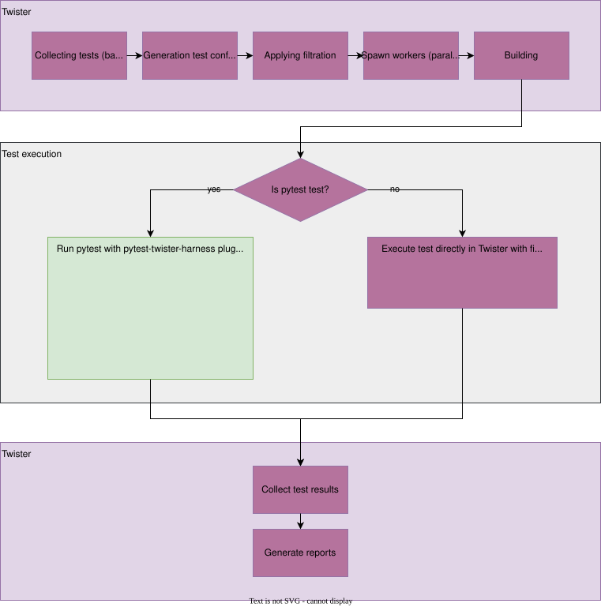

<!-- Copyright 2015-2026 Zephyr Project members and individual contributors. -->
<!-- SPDX-License-Identifier: Apache-2.0 -->
<!-- 中文翻译；阅读编号、导航和译注为本地新增。 -->

<a id="integration-with-pytest"></a>

# 第3章\_集成pytest测试框架

原文：[Integration with pytest test framework](https://docs.zephyrproject.org/latest/develop/twister/pytest.html)。读取日期：2026-10-12，`latest`。

Twister 与 pytest 的集成仍在持续开发，并非所有平台类型都已支持。遇到问题或有改进建议时，原文建议向 Zephyr 提交 GitHub 问题或功能建议。

## 3.1\_pytest与Twister如何配合

[pytest](https://docs.pytest.org/en/7.3.x/) 是 Python 测试框架，既适合小而易读的测试，也能扩展到应用和库的复杂功能测试。Python 提供丰富的库，适合编写脚本；pytest 通过**插件（Plugin）**与**测试夹具（Fixture）**提高扩展性及复用性。夹具负责为测试提供依赖对象及相应的准备、清理过程。

Zephyr 提供 `pytest-twister-harness` 插件，让测试使用 pytest 功能，同时继续以 Twister 作为总体测试框架。

默认情况下，无需另行安装该插件。它作为 Zephyr 源码树的一部分开发；Twister 扩展 Python 模块搜索环境变量 `PYTHONPATH`，加入插件路径，并在调用 pytest 时添加 `-p twister_harness.plugin`。若希望使用已经安装的插件版本，应在 Twister 命令中加入 `--allow-installed-plugin`。

pytest 测试套件的发现方式与其他 Twister 测试一致：通过测试描述 YAML 文件识别，其中的 `harness` 字段决定如何处理测试。使用 `harness: pytest` 时，套件发现、并行调度、构建和报告流程基本不变，变化发生在执行阶段。

下图是官方简化关系图，展示构建由 Twister 管理、执行转交 pytest 的过程：



Twister 将 pytest 作为**子进程（Subprocess）**启动，通过 YAML 配置文件传入构建目录、设备等参数。pytest 完成后，Twister 读取它生成的 `results.xml` 报告，据此设置测试结果。

> 译注：**YAML（YAML Ain't Markup Language，配置数据格式）**在此保存测试及设备配置。原文概述使用 `tests.yaml`，后续示例使用 `testcase.yaml`；应按所用版本的测试发现规则和对应示例文件核对，不能仅凭名称自行重命名。后文保留原文各处名称。

## 3.2\_建立pytest测试

测试目录可以包含 Python 测试、应用源码和 Twister 配置，例如：

```text
test_foo/
├─── pytest/
│    └─── test_foo.py
├─── src/
│    └─── main.c
├─── CMakeList.txt
├─── prj.conf
└─── testcase.yaml
```

> 译注：上面是示例布局，不是本译文创建的应用。目录树原文把 CMake 文件写成了 `CMakeList.txt`；Zephyr 应用通常要求 `CMakeLists.txt`，实际创建时应使用后者。

官方示例见 [test_shell.py](https://github.com/zephyrproject-rtos/zephyr/blob/main/samples/subsys/testsuite/pytest/shell/pytest/test_shell.py)。Twister 按 `testcase.yaml` 构建 `src` 中的应用；配置含 `harness: pytest` 时，再在独立子进程中调用 pytest。配置片段如下：

```yaml
tests:
   some.foo.test:
      harness: pytest
      tags: foo
```

默认情况下，pytest 到应用目录下、与 `src` 并列的 `pytest` 目录查找测试。可在 `harness_config` 下设置 [`pytest_root`](https://docs.zephyrproject.org/latest/develop/twister/harness/pytest.html#pytest-root)，指定其他文件、目录或具体测试。pytest 按自身的[默认发现规则](https://docs.pytest.org/en/7.1.x/explanation/goodpractices.html#conventions-for-python-test-discovery)扫描这些位置。

### 3.2.1\_传入额外参数

可以在 YAML 的 `harness_config` 下设置 [`pytest_args`](https://docs.zephyrproject.org/latest/develop/twister/harness/pytest.html#pytest-args)，也可以在 Twister 命令行使用 `--pytest-args`。后者适合临时选择套件内某个用例，例如在 Zephyr 源码根、具备相应构建依赖的 Bash 终端执行：

```sh
$ west twister --platform native_sim -T samples/subsys/testsuite/pytest/shell \
-s samples/subsys/testsuite/pytest/shell/sample.pytest.shell \
--pytest-args='-k test_shell_print_version'
```

`-k` 按名称表达式筛选 pytest 用例。命令行参数扩展 YAML 中的参数；同一参数同时出现时，原文规定命令行值优先。

> 译注：代码块中的 `$` 是终端提示符，不作为命令输入。`native_sim` 是原生主机模拟目标，本例不是 HC32 实板运行命令。示例及后文命令均为官方用法说明，本次没有实际构建、烧录或执行测试。

## 3.3\_单设备夹具

**被测设备（Device Under Test，DUT）**是测试要控制、读取输出的目标，可以是硬件，也可以是支持的模拟目标。插件用统一的**应用程序编程接口（Application Programming Interface，API）**处理不同设备类型，使测试尽量不依赖具体目标。

### 3.3.1\_dut

`dut` 夹具提供 `DeviceAdapter` 类型的对象，是插件的核心。它负责启动被测设备，包括初始化日志、烧录硬件、连接串口等，并按请求类型返回准备好的设备。类型可以是 `native`、`qemu`、`hardware` 等；可用类型仍受插件支持范围约束。

夹具**作用域（Scope）**决定准备及清理对象的频率，由 `harness_config` 内的 [`pytest_dut_scope`](https://docs.zephyrproject.org/latest/develop/twister/harness/pytest.html#pytest-dut-scope) 控制。

```python
from twister_harness import DeviceAdapter

def test_sample(dut: DeviceAdapter):
   dut.readlines_until(regex='Hello world')
```

此例通过 `readlines_until()` 持续读取设备输出，直到匹配 `Hello world`。

### 3.3.2\_shell

`shell` 夹具提供 `Shell` 类对象，用于和目标的**命令解释器（Shell）**交互。它依赖 `dut`，先等待设备的**提示符（Prompt）**出现，再让测试开始执行命令，并增加适合 Shell 交互的方法。需要命令交互的测试可以使用它；作用域同样由 `pytest_dut_scope` 指定。

```python
from twister_harness import Shell

def test_shell(shell: Shell):
   shell.exec_command('help')
```

> 译注：原文夹具说明将等待方法拼为 `wait_for_promt`；本页接口参考列出的正确名称为 `wait_for_prompt()`，实际调用应按后者核对。

### 3.3.3\_mcumgr

`mcumgr` 是包装同名设备管理命令行工具的示例夹具，返回 `McuMgr` 对象。工具用于管理远程设备，完整背景见 [MCUmgr设备管理](https://docs.zephyrproject.org/latest/services/device_mgmt/mcumgr.html#mcu-mgr)。使用前必须使 `mcumgr` 可通过系统可执行文件搜索路径 `PATH` 找到。

该夹具只包装 MCUmgr 的部分功能。以下例子先释放串口，再上传已签名镜像、取得镜像哈希、设置试用镜像并远程复位：

```python
from twister_harness import DeviceAdapter, Shell, McuMgr

def test_upgrade(dut: DeviceAdapter, shell: Shell, mcumgr: McuMgr):
   # free the serial port for mcumgr
   dut.disconnect()
   # upload the signed image
   mcumgr.image_upload('path/to/zephyr.signed.bin')
   # obtain the hash of uploaded image from the device
   second_hash = mcumgr.get_hash_to_test()
   # test a new upgrade image
   mcumgr.image_test(second_hash)
   # reset the device remotely
   mcumgr.reset_device()
   # continue test scenario, check version etc.
```

> 译注：`path/to/zephyr.signed.bin` 是待替换的文件位置；被测固件、引导程序、传输方式和签名必须已满足升级前提。这个例子没有替读者建立或验证升级环境。

### 3.3.4\_unlaunched_dut

`unlaunched_dut` 与 `dut` 类似，但不初始化设备，便于测试更细致地控制构建或启动过程。调用设备初始化成为测试自身的责任：

```python
from twister_harness import DeviceAdapter

def test_sample(unlaunched_dut: DeviceAdapter):
   unlaunched_dut.launch()
   unlaunched_dut.readlines_until(regex='Hello world')
```

## 3.4\_多设备夹具

**多被测设备（Multi-DUT）**夹具分别对应单设备的 `unlaunched_dut`、`dut` 与 `shell`，但返回对象列表。它们支持硬件与 `native_sim` 目标，不支持 QEMU。

这类测试要求生成的 `twister_pytest_config.yaml` 配置文件含有 `duts` 条目。Twister 自动生成该文件；对模拟目标，它创建占位设备条目，因此不要求硬件映射文件。脱离 Twister 手动重新调用 pytest 时，复用同一配置文件，见后文。详细配置见 [Multi-DUTs testing support](https://docs.zephyrproject.org/latest/develop/twister/index.html#twister-multi-duts-testing)。

### 3.4.1\_unlaunched_duts

返回 `DeviceAdapter` 对象列表，每个对象对应一台已预留的设备；日志文件已经初始化，设备尚未启动：

```python
from twister_harness import DeviceAdapter

def test_sample(unlaunched_duts: list[DeviceAdapter]):
   for dut in unlaunched_duts:
      dut.launch()
   unlaunched_duts[0].readlines_until(regex='Hello world')
```

### 3.4.2\_duts

返回已经启动的设备对象列表。硬件设备并行烧录以缩短准备时间；如果测试要求依次烧录，应在测试的 `conftest.py` 中覆盖这个夹具：

```python
from twister_harness import DeviceAdapter

def test_sample(duts: list[DeviceAdapter]):
   assert len(duts) > 1
   duts[0].readlines_until(regex='Hello world')
   duts[1].readlines_until(regex='Hello world')
```

### 3.4.3\_shells

返回 `Shell` 对象列表，每台预留设备对应一个对象，均已等待到相应提示符：

```python
from twister_harness import Shell

def test_sample(shells: list[Shell]):
   assert len(shells) > 1
   shells[0].exec_command('help')
   shells[1].exec_command('help')
```

## 3.5\_DeviceAdapter接口

类签名为 `twister_harness.DeviceAdapter(device_config: DeviceConfig)`。它为硬件、模拟器和 QEMU 统一提供收集输出、发送数据的接口，`DeviceConfig` 对象保存设备配置。

### 3.5.1\_启动与关闭

`launch() → None` 在目标上启动测试应用，执行完整初始化过程：

1. 关闭仍在运行的旧应用，清理之前的状态。
2. 如果尚未设置执行命令，生成命令。
3. 将额外测试参数加入命令。
4. 启动读取线程，捕获设备输出。
5. 启动应用：硬件执行烧录，模拟器执行相应程序。

硬件的启动过程包含烧录和串口连接；按设备配置，连接可以在烧录之前或之后建立。QEMU 或相应模拟器启动子进程，使用 **先入先出通信通道（First-In, First-Out，FIFO）**或管道通信；原生模拟器执行二进制文件，并通过进程管道连接。

`close() → None` 断开连接、关闭设备及读取线程。

### 3.5.2\_读取输出

`readline(connection_index: int = 0, **kwargs) → str` 读取一行输出，返回值去除末尾换行。参数 `connection_index` 选择连接端口，例如 0 是主 **通用异步收发器（Universal Asynchronous Receiver-Transmitter，UART）**，1 可以是第二核端口；`kwargs` 接受 `timeout`、`print_output` 等额外关键字参数。

`readlines(connection_index: int = 0, **kwargs) → list[str]` 从内部缓冲区取出当前所有可用输出行。

`readlines_until(connection_index: int = 0, **kwargs) → list[str]` 持续收集输出，直到满足条件。它可以等待匹配模式、读取固定行数，或取得当前已有行。参数如下：

| 参数 | 含义 |
| --- | --- |
| `connection_index` | 默认 0；硬件可选择主 UART、第二核 UART 等。QEMU 与原生目标只有一个连接，应使用 0。 |
| `regex` | 要查找的**正则表达式（Regular Expression）**模式。 |
| `num_of_lines` | 要读取的确切行数。 |
| `timeout` | 最多等待的秒数，未提供时使用 `base_timeout`。 |
| `print_output` | 是否逐行记录读取的输出，默认 `True`。 |

返回值为去除末尾换行的字符串列表。条件满足前发生超时，则抛出 `AssertionError` 异常。

### 3.5.3\_写入数据

`write(data: bytes, connection_index: int = 0) → None` 向目标发送原始字节。`data` 是字节串，`connection_index` 选择连接，默认 0。

底层通道随设备类型变化：硬件写串口或 UART，QEMU 写 FIFO 队列，原生模拟器写进程的**标准输入（Standard Input，stdin）**管道。

## 3.6\_Shell接口

类签名为 `twister_harness.Shell(device: DeviceAdapter, prompt: str = 'uart:~$', timeout: float | None = None)`。它持有设备适配器、提示符和可选超时，用于和目标 Shell 应用交互。

### 3.6.1\_执行命令

方法签名为 `exec_command(command: str, timeout: float | None = None, print_output: bool = True, *, get_full_output: bool = False, full_output_timeout: float | None = None) → list[str]`。

该方法向设备发送命令，追加两次回车：第一次执行命令，第二次用于取得下一个提示符，作为命令已完成的信号。返回值是命令打印内容。

当 `get_full_output=True` 时，看见提示符后仍继续读取，直到 `full_output_timeout` 指定的实际时间过去。这适合提示符之后还陆续出现解码日志等输出的场景。`full_output_timeout` 单位为秒；启用完整输出而未提供这个值时，使用 `timeout`，或进一步使用 `base_timeout`。

### 3.6.2\_等待提示符

`wait_for_prompt(timeout: float | None = None) → bool` 每隔 0.5 秒向设备发送一次回车。看见提示符则返回 `True`；超过超时则返回 `False`。

### 3.6.3\_过滤输出

`get_filtered_output(command_lines: list[str]) → list[str]` 接受 `exec_command()` 返回的行列表，去除提示符与日志，只保留命令输出。例如：

```python
>>> # equivalent to `lines = shell.exec_command("kernel version")`
>>> lines = [
>>>    'uart:~$',                    # filter prompts
>>>    'Zephyr version 3.6.0',       # keep this line
>>>    'uart:~$ <dbg> debug message' # filter log messages
>>> ]
>>> filtered_output = shell.get_filtered_output(output)
>>> filtered_output
['Zephyr version 3.6.0']
```

> 译注：原例建立的列表变量是 `lines`，调用时却写成 `output`；实际使用应将参数改为已定义的 `lines`，或先定义 `output`。保留原块便于对照，但不把这个变量不一致当作可直接运行的例子。

## 3.7\_Zephyr中的pytest示例

- [pytest Shell应用测试](../testing/P009_Pytest测试Shell应用.md#pytest_shell)。
- [MCUmgr测试](https://github.com/zephyrproject-rtos/zephyr/blob/main/tests/boot/with_mcumgr)：设备管理相关测试。
- [LwM2M测试](https://github.com/zephyrproject-rtos/zephyr/blob/main/tests/net/lib/lwm2m/interop)：**轻量级机器到机器协议（Lightweight Machine to Machine，LwM2M）**互操作测试。
- [GDB stub测试](https://github.com/zephyrproject-rtos/zephyr/blob/main/tests/subsys/debug/gdbstub)：**GNU调试器（GNU Debugger，GDB）**目标端调试代理的测试。

## 3.8\_常见问题

下面分别说明夹具作用域、用例选择、类型判断、复跑及并行限制，用于在基本测试建立后调整执行方式。

### 3.8.1\_每个pytest会话只烧录或启动一次

`dut` 负责烧录或启动应用，默认作用域为 `function`，即按测试函数准备。可在 YAML 的 `harness_config` 中把 `pytest_dut_scope` 设为 `session`，改为每个 pytest **会话（Session）**准备一次：

```yaml
harness: pytest
harness_config:
   pytest_dut_scope: session
```

更详细的作用域选项见 [`pytest_dut_scope`](https://docs.zephyrproject.org/latest/develop/twister/harness/pytest.html#pytest-dut-scope)。

### 3.8.2\_只运行某个Python用例

可在 `pytest_root` 列表中以文件及用例标识精确选择：

```yaml
harness: pytest
harness_config:
   pytest_root:
      - "pytest/test_shell.py::test_shell_print_help"
```

也可使用 pytest 的 [`-k`名称过滤](https://docs.pytest.org/en/latest/example/markers.html#using-k-expr-to-select-tests-based-on-their-name)，在 YAML 的 `pytest_args` 中加入：

```yaml
harness: pytest
harness_config:
   pytest_args:
      - "-k test_shell_print_help"
```

或者在 Twister 命令行传入，覆盖 YAML 中的对应参数：

```sh
$ west twister ... --pytest-args='-k test_shell_print_help'
```

> 译注：这里的 `...` 代表沿用实际 Twister 命令的其他参数，不是字面输入。

### 3.8.3\_在测试中判断设备类型

从 `dut` 的设备配置取得类型字符串，例如：

```python
device_type: str = dut.device_config.type
if device_type == 'hardware':
   ...
elif device_type == 'native':
   ...
```

`hardware` 表示实物硬件，`native` 表示原生模拟类型；省略号处补入相应测试处理逻辑。

### 3.8.4\_不重新构建而复跑pytest

一种方法是在原 Twister 命令中加入 `--test-only`。另一种方法是先用最高详细级别 `-vv` 运行 Twister，再从以 `Running pytest command:` 开头的日志中复制启动 pytest 的实际命令。

原文首先用 Twister 运行如下场景。命令采用 Linux Bash、Zephyr 源码根目录，串口 `/dev/ttyACM1` 与板目标均是示例中的实际选择：

```sh
$ west twister -vv -ll debug -T samples/subsys/testsuite/pytest/shell \
-s sample.pytest.shell --device-testing -p nrf54l15dk/nrf54l15/cpuapp --device-serial \
/dev/ttyACM1 --west-flash=--erase
```

> 译注：这条命令包含 `--west-flash=--erase`，执行时会要求烧录工具擦除目标，必须先确认连接的设备、固件和保留数据要求；不要把原例 Nordic 板目标直接换成尚未验证的 HC32 环境。这里仅保留原文操作说明。

Twister 在构建目录自动生成 `twister_pytest_config.yaml`，其中包括设备及其他测试参数。然后，在同一 Bash 环境中设置插件模块搜索路径；`ZEPHYR_BASE` 应已指向所用 Zephyr 源码根：

```sh
$ export PYTHONPATH=$ZEPHYR_BASE/scripts/pylib/pytest-twister-harness/src
```

最后运行 pytest，复用上述配置：

```sh
$ pytest -s -v -p twister_harness.plugin \
--twister-config=twister-out/.../sample.pytest.shell/twister_pytest_config.yaml \
samples/subsys/testsuite/pytest/shell/pytest
```

> 译注：`twister-out/.../` 是原文路径省略，须用本次 Twister 输出中真实的相对构建目录替换。环境变量只影响当前终端及其子进程；该命令使用赋值形式，会替换当前 `PYTHONPATH`，若原有路径另有用途，需按实际环境保留。

### 3.8.5\_能否并行运行pytest测试

插件设计时没有以 pytest 内部并行运行测试为目标，尤其是硬件测试。它假定 Twister 负责并行调度，以及任务和可用硬件的资源管理。原文提示：若自行使用 [pytest-xdist](https://pytest-xdist.readthedocs.io/en/stable/) 等方式并行，需要自行承担资源竞争及适配责任，不能视为插件已保证的能力。

## 3.9\_限制

插件尚未支持全部平台类型。单 DUT 可支持某种类型，也不意味着多 DUT 场景同样支持；多设备部分明确排除 QEMU，应分别核对。

<!-- reading-navigation:start -->

**主线阅读**

[上一篇：Twister命令行选项](P002_Twister命令行选项.md) · [本模块主线目录](../reading/twister.md) · [全部主线](../reading/README.md) · [下一篇：Twister黑盒测试](P004_Twister黑盒测试.md)

<details>
<summary>原册编号导航（含扩展参考）</summary>

[上一章：Twister命令行选项](P002_Twister命令行选项.md) · [下一章：Twister黑盒测试](P004_Twister黑盒测试.md) · [返回大纲](大纲.md)

</details>

<!-- reading-navigation:end -->
