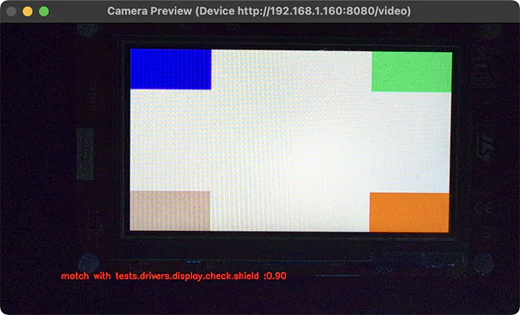

<!-- Copyright 2015-2026 Zephyr Project members and individual contributors. -->
<!-- SPDX-License-Identifier: Apache-2.0 -->
<!-- 中文翻译；阅读编号、导航和译注为本地新增。 -->

# 第12章\_显示捕获支撑程序

原文：[Display capture](https://docs.zephyrproject.org/latest/develop/twister/harness/display_capture.html)。读取日期：2026-10-12，`latest`。

`display_capture` **测试支撑程序（Harness）**用摄像头捕获、分析显示输出，验证显示驱动功能。它与 pytest 集成，使用**视频指纹（Video Fingerprint）**开展自动化视觉测试：将画面特征与已知正确的参考结果比较。

以下保留官方原始 WebP 文件。原文图注说明：这是一次名为 `compare` 的比较操作窗口，当前指纹与参考的匹配度为 90%。



## 12.1\_硬件布置

需要以下设备和条件：

- 兼容 **USB视频设备类（USB Video Class，UVC）**的摄像头，至少约 200 万像素，例如 1080p。USB 指**通用串行总线（Universal Serial Bus）**。
- 遮光箱或黑色遮光布，使照明保持一致。
- 连接摄像头的主机，用于捕获显示画面。
- **被测设备（Device Under Test，DUT）**接到同一主机，以便烧录及读取串口控制台。

> 译注：摄像头的能力要求与下面配置选择的实际采集分辨率不同；示例按 1280×720 采集，并不取消前面的设备能力要求。本次只保存官方资料，未连接摄像头或执行显示验证。

## 12.2\_摄像头、交互与指纹配置

自行创建的 `display_config.yaml` 使用 **YAML（YAML Ain't Markup Language，配置数据格式）**描述摄像头、测试交互和视频分析参数。典型配置如下：

```yaml
 case_config:
   device_id: 0
   res_x: 1280
   res_y: 720
   fps: 30
   run_time: 20
 test:
   timeout: 30
   prompt: "screen starts"
   expect: ["tests.drivers.display.check.shield"]
 plugins:
   - name: signature
     module: plugins.signature_plugin
     class: VideoSignaturePlugin
     status: enable
     config:
       operations: "compare"  # or "generate"
       metadata:
         name: "tests.drivers.display.check.shield"
         platform: "frdm_mcxn947"
       directory: "./fingerprints"
       duration: 100
       method: "combined"
       threshold: 0.65
       phash_weight: 0.35
       dhash_weight: 0.25
       histogram_weight: 0.2
       edge_ratio_weight: 0.1
       gradient_hist_weight: 0.1
```

### 12.2.1\_case_config：摄像头与持续时间

| 字段 | 默认值及含义 |
| --- | --- |
| `device_id` | 默认 0。接受 OpenCV 图像处理库支持的摄像头标识：本地摄像头整数序号、Linux `/dev/video0` 一类设备节点，或网络视频流地址。 |
| `res_x` | 水平像素数，整数，默认 1280。 |
| `res_y` | 垂直像素数，整数，默认 720。 |
| `fps` | **每秒帧数（Frames per Second，FPS）**，整数，默认 30。 |
| `run_time` | 测试持续秒数，整数，默认 20。 |

本地序号 0 是第一台摄像头，1 是第二台，依此类推。网络摄像头可使用原文示例形式 `rtsp://192.168.1.100:8554/stream`；**实时流协议（Real Time Streaming Protocol，RTSP）**地址需要替换成实际设备提供的地址，并非文档作者本地文件路径。

### 12.2.2\_test：设备交互

| 字段 | 默认值及含义 |
| --- | --- |
| `timeout` | 等待目标 UART 输出中出现提示模式的最长秒数，整数，默认 30。 |
| `prompt` | 开始捕获前等待的字符串模式，可为正则表达式；默认 `uart:~$`。 |
| `expect` | 应与应用返回结果匹配的字符串列表，默认 `['PASS']`，其中 `PASS` 是通过状态标记；结果匹配此列表时测试通过。 |

**通用异步收发器（Universal Asynchronous Receiver-Transmitter，UART）**在此传送设备运行状态，摄像头传送实际画面，两路信息用途不同。**正则表达式（Regular Expression）**用于描述要等待的输出模式。

### 12.2.3\_plugins：视频分析

`plugins` 配置处理摄像头帧的插件。当前只支持 `VideoSignaturePlugin` **视频签名插件（Video Signature Plugin）**，示例的模块入口为 `plugins.signature_plugin`。其配置包括：

| 字段 | 含义 |
| --- | --- |
| `operations` | 必须是 `generate` 或 `compare`，分别生成参考指纹、与参考比较。 |
| `metadata` | 可选身份信息，其中 `name` 是测试用例名，`platform` 是目标平台名。 |
| `directory` | 指纹保存目录，默认 `./fingerprints`。 |
| `duration` | 要分析的帧数，整数；更多帧耗时更长，原文说明可形成更准确指纹。这里不是秒数。 |
| `method` | 指纹方法，默认 `combined`；允许 `phash`、`dhash`、`histogram`、`combined`。 |
| `threshold` | 相似度高于此值时认为匹配，可选浮点数，默认 0.65。 |

四种方法分别侧重不同画面特征：

| 方法 | 作用 |
| --- | --- |
| `phash`：**感知哈希（Perceptual Hash）** | 捕获整体视觉结构和布局，适合识别**用户界面（User Interface，UI）**元素位置错误等明显渲染问题。 |
| `dhash`：**差异哈希（Difference Hash）** | 识别亮度分布和梯度，对亮度、对比度变化敏感。 |
| `histogram`：**颜色直方图（Color Histogram）** | 分析颜色分布，快速发现颜色交换等明显色彩问题。 |
| `combined`：**组合方法（Combined Method）** | 原文推荐，按权重结合多种特征，兼顾明显和细微问题。 |

组合权重为可选浮点数：

| 字段 | 对应特征 | 默认值 |
| --- | --- | --- |
| `phash_weight` | 感知哈希 | 0.35 |
| `dhash_weight` | 差异哈希 | 0.25 |
| `histogram_weight` | 颜色直方图 | 0.2 |
| `gradient_hist_weight` | **梯度直方图（Gradient Histogram）** | 0.1 |
| `edge_ratio_weight` | **边缘比例（Edge Ratio）** | 0.1 |

> 译注：原文组合方法概述提到 `method_weight`，但实际列出的是上表五个独立字段，并没有在此定义一个同名通用字段。按实际插件版本及字段说明配置，不凭概述自行新增键。

## 12.3\_让Twister找到配置

在测试 `testcase.yaml` 中，通过 `display_capture_config` 指向配置文件；原例使用环境变量 `DISPLAY_TEST_DIR` 保存配置目录：

```yaml
harness: display_capture
harness_config:
  pytest_dut_scope: session
  fixture: fixture_display
  display_capture_config: "${DISPLAY_TEST_DIR}/display_config.yaml"
```

`fixture_display` 是硬件显示测试装置名，应与实际硬件映射匹配；`pytest_dut_scope: session` 表示同一 pytest 会话共享设备准备过程。

## 12.4\_生成参考，再比较

先用已知正确的显示输出建立参考。以下原文命令采用 Bash、Zephyr 源码根；先为实际目标构建并烧录显示检查应用，将配置中的 `operations` 改为 `generate`，再调用 Twister：

```sh
# Build and flash the display test
west build -b <board> tests/drivers/display/display_check
west flash

# Configure for fingerprint generation mode by setting the 'operations' field to 'generate'
# in the configuration file.

# Generate fingerprints
export DISPLAY_TEST_DIR=<path-to-config-directory>
west twister --device-testing --hardware-map map.yml \
    -T tests/drivers/display/display_check/
```

> 译注：`<board>`、`<path-to-config-directory>` 是占位；应替换为已支持且连接正确的板、保存 `display_config.yaml` 的相对目录。`map.yml` 是已核对的硬件映射。将占位写成字面尖括号会被终端解释为重定向，不能原样执行。`DISPLAY_TEST_DIR` 的赋值只影响当前终端及其子进程。

指纹写入配置 `directory` 指定的位置，按 `metadata` 中的测试名及平台组织。

生成后将 `operations` 改为 `compare`，再次运行：

```sh
# Set the 'operations' field to 'compare' in the configuration file.

export DISPLAY_TEST_DIR=<path-to-fingerprints-parent-directory>
west twister --device-testing --hardware-map map.yml \
    -T tests/drivers/display/display_check/
```

> 译注：原文第二段把环境变量占位描述为“指纹父目录”，但前面的 YAML 实际读取 `${DISPLAY_TEST_DIR}/display_config.yaml`。该变量必须仍能定位配置文件；参考指纹位置由配置的 `directory` 决定，只有布局满足两者关系时才能直接采用同一个目录。

支撑程序按配置的方法和阈值比较捕获视频与参考指纹，相似度超过阈值时通过。还需注意：

- DUT 测试 YAML 中的测试名必须与指纹元数据的 `name` 一致。
- 一个目录可保存多个指纹以扩大验证范围，但比较时间随之增加。
- 指纹同时依赖测试场景和平台，不能不加核对地跨平台复用。

<!-- reading-navigation:start -->

**主线阅读**

[上一篇：功耗测试支撑程序](P011_功耗测试支撑程序.md) · [本模块主线目录](../reading/twister.md) · [全部主线](../reading/README.md) · [下一篇：脚本支撑程序](P013_脚本支撑程序.md)

<details>
<summary>原册编号导航（含扩展参考）</summary>

[上一章：功耗测试支撑程序](P011_功耗测试支撑程序.md) · [下一章：脚本支撑程序](P013_脚本支撑程序.md) · [返回大纲](大纲.md)

</details>

<!-- reading-navigation:end -->
