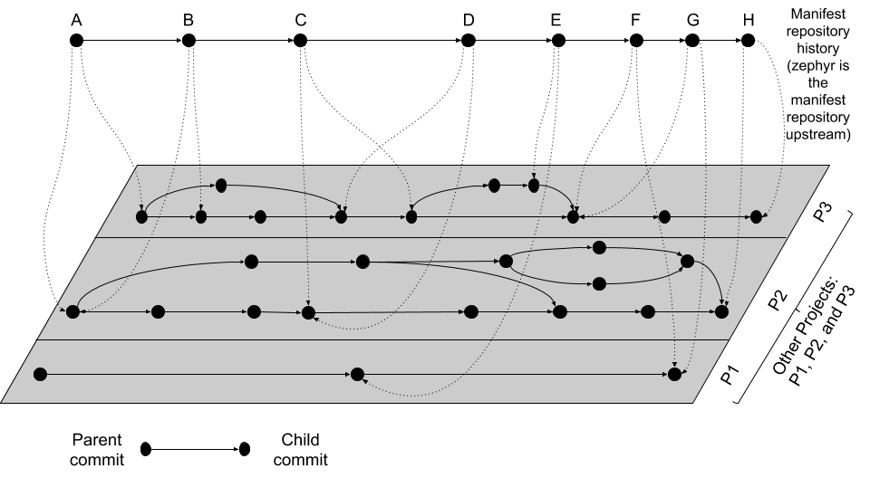

<!-- Copyright 2015-2026 Zephyr Project members and individual contributors. -->
<!-- SPDX-License-Identifier: Apache-2.0 -->
<!-- 中文翻译；阅读编号、导航和明确标注的译注为本地新增。 -->

# 第13章\_west清单文件

原文：[官方页面](https://docs.zephyrproject.org/latest/develop/west/manifest.html)。本次读取日期：2026-10-14；依据保存的 `latest` 页面，HTML摘要见[来源记录](../SOURCES.md)。

本页详细介绍 west 的**多仓库模型（Multiple Repository Model）**、**清单文件（Manifest File）**与 `west manifest` 命令。Python模块接口见 [west.manifest](https://docs.zephyrproject.org/latest/develop/west/west-apis.html#module-west.manifest)，一般概念与命令概览见[基本概念](P002_基本概念.md)。

## 13.1\_多仓库模型

west 对工作区内各仓库及其历史的组织方式如下图所示；其中部分示例细节属于 Zephyr 上游的使用方式。



灰色平面上方“悬浮”的 Git 提交线表示**清单仓库（Manifest Repository）**历史，实线箭头由父提交指向子提交。平面上包含工作区各项目仓库的提交历史，每个仓库用矩形框围住，内部的父子提交关系也用实线表示。

清单仓库的每个提交都包含一份清单文件；Zephyr 上游的清单仓库就是 `zephyr` 本身。每份清单指定各项目仓库应配套使用的提交，图中用虚线从清单仓库提交指向对应项目提交。

需要注意：

- 项目可以加入或移除，例如清单提交 D 到 E 之间加入 P1、移除 P2。
- 项目历史与清单历史不必同步前进或后退：A→B 时 P2 不变、P3 前进；F→G 时 P1 和 P3 不变；C→D 时 P3 后退。回退到引入回归之前的项目修订，是撤销回归的一种方式。
- 项目提交可以跨越，例如 B→C 时 P3 一次前进多个提交。
- 图中每个项目在某一清单状态只对应一个修订；每份清单对其关心的项目各引用一个提交。使用分支名作为清单修订可以放宽这种固定关系，但会牺牲对清单仓库历史进行**二分定位（Bisection）**的能力。

## 13.2\_清单文件

west 清单采用 YAML，顶层 `manifest` 部分包含若干子部分：

```yaml
manifest:
  remotes:
    # short names for project URLs
  projects:
    # a list of projects managed by west
  defaults:
    # default project attributes
  self:
    # configuration related to the manifest repository itself,
    # i.e. the repository containing west.yml
  version: "<schema-version>"
  group-filter:
    # a list of project groups to enable or disable
```

从 YAML 角度看，整个文件是含 `manifest` 键的映射，其他顶层键及其内容被忽略。west v0.5 还要求 `west` 键，从 v0.6 起忽略它。`manifest` 的值也是映射，`defaults`、`remotes`、`projects`、`self` 等是其键；从 west v0.10 起，这些子部分全部可选。

`projects` 列出 west 管理的仓库及元数据。先介绍可帮助简化项目列表中 URL 的 `remotes`。

### 13.2.1\_remotes：远端地址基础部分

`remotes` 是一个序列，每项含名称和 **URL基础部分（URL Base）**，用于构造项目完整的 Git 获取地址：在基础 URL 后追加项目专用路径。项目也可以直接声明完整 URL。

```yaml
manifest:
  # ...
  remotes:
    - name: remote1
      url-base: https://git.example.com/base1
    - name: remote2
      url-base: https://git.example.com/base2
```

| 键 | 含义 |
| --- | --- |
| `name` | 必填，远端的唯一名称。 |
| `url-base` | 使用该远端的项目获取 URL 的前缀。 |

上例中 `remote1`、`remote2` 的基础地址分别是 `https://git.example.com/base1` 和 `https://git.example.com/base2`。也支持 SSH 形式，例如 `git@example.com:base1`；只要 Git 接受该地址即可。

### 13.2.2\_projects：项目列表

`projects` 序列描述工作区的项目仓库，每个项目有唯一名称，可指定克隆／获取地址、跟踪修订和本地存放位置。注意 **west项目（West Project）**与 **Zephyr模块（Zephyr Module）**并非同一概念，模块说明见[模块与外部项目](../modules/P001_模块与外部项目.md)。

以下使用上一节的远端定义：

```yaml
manifest:
  # [... same remotes as above...]
  projects:
    - name: proj1
      description: the first example project
      remote: remote1
      path: extra/project-1
    - name: proj2
      description: |
        A multi-line description of the second example
        project.
      repo-path: my-path
      remote: remote2
      revision: v1.3
    - name: proj3
      url: https://github.com/user/project-three
      revision: abcde413a111
    - name: proj4
      url: https://github.com/user/project-four
      revision: pull/69/head # GitHub Pull Request
```

`proj1` 使用 `remote1`，获取地址由基础 URL、斜线和项目名组成，即 `https://git.example.com/base1/proj1`。显式 `path` 使其克隆到工作区根目录下的 `extra/project-1`。未声明 `revision`，默认使用 `master`，下次更新会获取分支顶端并以分离 HEAD 检出。

`proj2` 同时使用 `remote2` 和 `repo-path`，获取地址为 `https://git.example.com/base2/my-path`；`repo-path` 替代项目名参与 URL 拼接。未给出 `path` 时以名称为目录，即 `proj2`；更新时检出标签 `v1.3` 指向的提交。

`proj3` 显式指定 `url`，从 `https://github.com/user/project-three` 获取；本地目录默认为 `proj3`，下次更新检出提交 `abcde413a111`。代码还展示了以 GitHub PR 引用 `pull/69/head` 作为第四个项目的修订。

| 键 | 含义与限制 |
| --- | --- |
| `name` | 必填，清单内唯一；不能使用保留名称 `west` 或 `manifest`。 |
| `description` | 可选，描述项目信息；west v1.2.0加入。 |
| `remote`、`url` | 二者不能同时设置。`remote` 引用远端定义，通过基础URL与项目名或 `repo-path` 组合获取地址；`url` 是完整地址。如果二者都省略，必须由 `defaults.remote` 提供远端，否则清单无效。 |
| `repo-path` | 可选，替代项目名追加到远端 `url-base`；不得与 `url` 同时使用。 |
| `revision` | 可选，`west update` 应检出的 Git 修订。默认分离HEAD，以免与本地分支名称冲突。省略时用 `defaults.revision`，仍无指定则为 `master`。可使用可获取的分支、标签、SHA、PR等 Git引用；`HEAD~0` 可使 west 保持项目当前状态，原因见下方脚注。 |
| `path` | 可选，相对于工作区顶层的本地克隆路径；省略时用项目名称作目录名。 |
| `clone-depth` | 可选，正整数，将初次克隆的浅历史限制为指定提交数；仅适用于修订是分支或标签的情况。 |
| `west-commands` | 可选，项目内扩展命令声明YAML文件的相对路径；惯例名称为 `west-commands.yml`，见[扩展机制](P012_扩展命令机制.md)。 |
| `import` | 可选；设为 `true` 时从该仓库中的清单导入项目。其他形式见后文“清单导入”。 |
| `groups` | 可选，项目所属组列表，见后文。 |
| `submodules` | 可选，使 `west update` 同时更新项目的Git子模块，见后文。 |
| `userdata` | 可选，任意YAML值，见“仓库用户数据”。 |

**原文脚注：**Git 中 `HEAD` 是引用，`HEAD~<n>` 是有效修订但不是引用。west 会获取 `refs/heads/main`、`HEAD` 等引用及本地没有的提交，不会获取本地已有的提交。`HEAD~0` 解析为本地已经存在的具体提交，因此 west 只检出该本地提交。

### 13.2.3\_defaults：默认项目属性

`defaults` 可以提供默认远端名和修订。前述清单可采用如下写法：

```yaml
manifest:
  defaults:
    remote: remote1
    revision: v1.3

  remotes:
    - name: remote1
      url-base: https://git.example.com/base1
    - name: remote2
      url-base: https://git.example.com/base2

  projects:
    - name: proj1
      description: the first example project
      path: extra/project-1
      revision: master
    - name: proj2
      description: |
        A multi-line description of the second example
        project.
      repo-path: my-path
      remote: remote2
    - name: proj3
      url: https://github.com/user/project-three
      revision: abcde413a111
```

| 键 | 含义 |
| --- | --- |
| `remote` | 可选，在项目未设 `url` 和 `remote` 时使用。 |
| `revision` | 可选，在项目未设修订时使用；这里也未指定则默认为 `master`。 |

> 译注：原页称其为同一清单的另一写法，但此代码未再列出上一例的 `proj4`；这里保留官方两个示例的实际内容，不自行补造缺失项目。项目默认 `master` 也不同于 `west init --mr` 省略时选择清单仓库默认分支的规则。

### 13.2.4\_self：清单仓库本身

`self` 控制清单仓库。例如 Zephyr 的 `west.yml` 片段：

```yaml
manifest:
  # ...
  self:
    path: zephyr
    west-commands: scripts/west-commands.yml
```

这使仓库克隆到 `zephyr` 路径；从默认官方 URL 克隆时，即使省略此设置也会取得同样的目录名。由于该仓库提供扩展命令，还声明了相对于仓库根的扩展描述文件位置。

| 键 | 含义 |
| --- | --- |
| `path` | 可选，`west init` 克隆清单仓库的路径，相对于工作区顶层。省略时使用清单仓库URL路径的最后一段，例如 `https://git.example.com/project-repo` 对应 `project-repo`。 |
| `west-commands` | 可选，与普通项目中的同名键含义类似。 |
| `import` | 可选，与项目中的导入类似，但从清单仓库的其他文件导入项目。 |

`self.userdata` 的支持版本与用途见后面的版本表和用户数据一节。

### 13.2.5\_version：清单格式版本

`version` 表示清单使用某个 west 版本引入的格式功能。较旧 west 加载它时会报错，说明所需最低版本。例如：

```yaml
manifest:
  # Marks that this file uses version 0.10 of the west manifest
  # file format.
  #
  # An attempt to load this manifest file with west v0.8.0 will
  # fail with an error message saying that west v0.10.0 or
  # later is required.
  version: "0.10"
```

该例要求格式0.10；west v0.8.0加载时会报告需要 v0.10.0 或更新版本。west 源码的 `manifest-schema.yml` 是用于验证 `manifest` 部分的 **pykwalify模式（pykwalify Schema）**。

| 有效版本值 | 引入的功能 |
| --- | --- |
| `"0.7"` | 初次支持 `version`。本表未单独列出的其他功能都在west v0.7.0或更早版本引入。 |
| `"0.8"` | 支持导入映射中的 `path-prefix`。 |
| `"0.9"` | 允许明确请求west v0.9.0兼容性，但不建议使用v0.9.x。v0.10.0之后对0.9引入的部分功能采用不兼容行为，尽可能不选此格式版本。 |
| `"0.10"` | 项目 `submodules`、清单 `group-filter` 与项目 `groups`；导入支持 `allowlist` 和 `blocklist`，作为Zephyr包容性用语调整推荐替代旧名，旧键仍保留向后兼容。 |
| `"0.12"` | 项目 `userdata`。 |
| `"0.13"` | `self.userdata`。 |
| `"1.0"` | 与0.13相同，供不希望使用0.x版本号的用户选择。 |
| `"1.2"` | 项目 `description`。 |

**原文注意：**未引入新清单格式功能的 west 发行版，不增加有效格式版本值。例如 `"0.11"` 无效，因为 west v0.11.x 没有新增清单格式功能。

版本值最好加引号，强制 YAML 按字符串处理。未加引号的 `0.10` 会成为浮点数 `0.1`；仅在转成字符串后值不变时才可以省略引号，不确定就始终加引号。

若省略 `version`，每个 west 发行版都尝试按自己支持的功能加载；当 west 太旧时，错误信息可能更难理解。

### 13.2.6\_group-filter：项目组筛选

该键控制组的启用与禁用，详见后文“项目组”。

## 13.3\_活动与非活动项目

清单中的项目可以是**活动（Active）**或**非活动（Inactive）**状态。west 通常忽略非活动项目：默认 `west update` 不更新它，`west list` 不显示它，其中的清单导入也被忽略。

有两种控制方式：

1. 配置项 `manifest.project-filter`。若其中的正则表达式匹配项目并明确将其设为活动或非活动，则项目组不再影响其活动状态。该选项说明见[配置](P003_配置.md)。
2. 若没有上述覆盖，项目具有组且全部组都被禁用时，项目为非活动。

<a id="west-manifest-groups"></a>

## 13.4\_项目组

`groups` 与 `group-filter` 可把项目归组，并启用或禁用组。例如，`west forall --group` 只对某组项目执行命令；组也可用于控制项目活动状态。

### 13.4.1\_基本规则

```yaml
manifest:
  projects:
    - name: some-project
      groups: ...
  group-filter: ...
```

`groups` 的值为组名字符串列表。项目的全部组被禁用且没有 `manifest.project-filter` 强制激活时，它才是非活动项目。例如：

```yaml
manifest:
  projects:
    - name: project-1
      groups:
        - groupA
    - name: project-2
      groups:
        - groupB
        - groupC
    - name: project-3
```

`project-1` 属于 `groupA`；`project-2` 同时属于 `groupB` 和 `groupC`；`project-3` 没有组。

组名区分大小写。不得含逗号、冒号或空白，不能以 `-` 或 `+` 开头，但可以在其他位置包含它们：`foo-bar`、`foo+bar` 有效，`-foobar`、`+foobar` 无效。除此以外可使用任意字符串。

为避免复杂的边界情况，同一项目不得同时声明 `import` 和 `groups`。

### 13.4.2\_启用与禁用组

默认全部组启用，可在清单和 west 配置中调整。清单的 `manifest.group-filter` 是 YAML 列表；组名前加 `+` 表示启用：

```yaml
manifest:
  group-filter: [+groupA]
```

默认已启用时虽显冗余，但可以覆盖导入清单中的禁用设置。前缀 `-` 表示禁用：

```yaml
manifest:
  group-filter: [-groupA,-groupB]
```

同样也能用较难阅读、不建议采用的分行列表写法：

```yaml
manifest:
  group-filter:
    - -groupA
    - -groupB
```

此外，west 的 `manifest.group-filter` **配置项**采用逗号分隔的字符串，例如 `+groupA,-groupB` 表示启用A、禁用B。配置项优先于清单，可将其理解为追加在 YAML 列表之后，并以最后一项为准。

### 13.4.3\_实例：减少工作区下载

默认 `west update` 获取所有活动项目。大型工作区可能包括并非所有开发流程都需要的可选模块、厂商HAL、实验组件、平台专用依赖及其漏洞；通过项目组可控制 west 操作时哪些分组项目处于活动状态。

```yaml
manifest:
  projects:
    - name: hal_nordic
      groups:
        - nordic
    - name: hal_stm32
      groups:
        - stm32
    - name: experimental_lib
      groups:
        - optional
```

面向 Nordic 设备的工作区可在更新前禁用 `stm32` 和 `optional`：

```shell
west config manifest.group-filter -- "-stm32,-optional"
```

再执行更新：

```shell
west update
```

这样跳过只属于禁用组的项目。

**原文注意：**组筛选只影响清单中明确加入匹配组的项目；没有匹配组定义的项目仍保持活动。改变筛选配置不会自动删除已克隆的仓库，只改变后续 west 操作对活动状态的判断。此流程可减少不必要的下载，简化大型多项目工作区管理。

### 13.4.4\_项目组的七个示例

以下同时展示清单YAML列表与west配置如何配合。`defaults` 和 `remotes` 只是使清单完整，与组判断无关。**这些例子均假定未设置 `manifest.project-filter`。**

**示例1：没有禁用组。**完整清单如下：

```yaml
manifest:
  projects:
    - name: foo
      groups:
        - groupA
    - name: bar
      groups:
        - groupA
        - groupB
    - name: baz

  defaults:
    remote: example-remote
  remotes:
    - name: example-remote
      url-base: https://git.example.com
```

不设置配置项 `manifest.group-filter`，可用 `west config -D manifest.group-filter` 删除它。所有组默认启用，因此 `foo`、`bar`、`baz` 均活动。`baz` 没有组，在本例的前提下不能用组筛选将其禁用。

**示例2：在清单中禁用一个组。**

```yaml
manifest:
  projects:
    - name: foo
      groups:
        - groupA
    - name: bar
      groups:
        - groupA
        - groupB

  group-filter: [-groupA]

  defaults:
    remote: example-remote
  remotes:
    - name: example-remote
      url-base: https://git.example.com
```

同样不设置配置项，可用 `west config -D manifest.group-filter` 清除。`groupA` 被禁用，因此 `foo` 非活动；`bar` 还有启用的 `groupB`，保持活动。

**示例3：在清单中禁用多个组。**

```yaml
manifest:
  projects:
    - name: foo
      groups:
        - groupA
    - name: bar
      groups:
        - groupA
        - groupB

  group-filter: [-groupA,-groupB]

  defaults:
    remote: example-remote
  remotes:
    - name: example-remote
      url-base: https://git.example.com
```

不设置配置项，可用同一删除命令清除。两个组均禁用，所以 `foo` 和 `bar` 都非活动。

**示例4：通过配置禁用一个组。**

```yaml
manifest:
  projects:
    - name: foo
      groups:
        - groupA
    - name: bar
      groups:
        - groupA
        - groupB

  defaults:
    remote: example-remote
  remotes:
    - name: example-remote
      url-base: https://git.example.com
```

将配置项设为 `-groupA`，命令为 `west config manifest.group-filter -- -groupA`。中间的 `--` 必不可少，避免参数解析器把 `-groupA` 当作选项 `-g` 和值 `roupA`。`foo` 非活动；`bar` 仍因 `groupB` 启用而活动。

**示例5：通过配置覆盖清单中的禁用组。**

```yaml
manifest:
  projects:
    - name: foo
    - name: bar
      groups:
        - groupA
    - name: baz
      groups:
        - groupA
        - groupB

  group-filter: [-groupA]

  defaults:
    remote: example-remote
  remotes:
    - name: example-remote
      url-base: https://git.example.com
```

执行 `west config manifest.group-filter +groupA`。配置优先于清单的 `[-groupA]`，因此重新启用A组，原文指出 `foo` 和 `bar` 均活动。

> 译注：该代码还有 `baz`，它也活动，因为其所属A组被启用，B组也未被禁用。

**示例6：通过配置覆盖多个禁用组。**

```yaml
manifest:
  projects:
    - name: foo
    - name: bar
      groups:
        - groupA
    - name: baz
      groups:
        - groupA
        - groupB

  group-filter: [-groupA,-groupB]

  defaults:
    remote: example-remote
  remotes:
    - name: example-remote
      url-base: https://git.example.com
```

执行 `west config manifest.group-filter "+groupA,+groupB"`。配置覆盖清单中对两个组的禁用，原文指出 `foo` 和 `bar` 均活动。

> 译注：此例的 `baz` 同样活动；原文结论没有列出它，不表示它非活动。

**示例7：通过配置禁用多个组。**

```yaml
manifest:
  projects:
    - name: foo
    - name: bar
      groups:
        - groupA
    - name: baz
      groups:
        - groupA
        - groupB

  defaults:
    remote: example-remote
  remotes:
    - name: example-remote
      url-base: https://git.example.com
```

执行 `west config manifest.group-filter -- "-groupA,-groupB"`。两个组均禁用，原文接着写“项目 `foo` 和 `bar` 都非活动”。

> 译注：这句话与原例清单不一致。`foo` 没有组，在本节假设下仍活动；全部所属组均禁用的是 `bar` 与 `baz`，所以这两个项目非活动。原代码和原结论在这里均保留，避免把原文错误隐藏成未说明的改写。

> 对照核验：使用 west 1.5.0 的 `Manifest.from_data()` 和 `is_active()` 离线检查上述七份清单，将配置筛选作为等价的附加筛选传入；示例7只得到 `foo` 为活动项目，示例5和6均得到三个项目活动。该检查未执行 `west update`，也未修改任何工作区配置。

### 13.4.5\_组筛选与导入

这里简要说明组筛选与清单导入的组合；完整解析规则见后文。

**原文警告：**以下语义适用于 west v0.10.0及以后。v0.9.x语义不同，不建议在该版本中组合 `group-filter` 与 `import`。

只导入一份清单时，被导入文件禁用的组也会在最终清单中禁用。可用父清单中的 `manifest.group-filter`、工作区配置项 `manifest.group-filter`，或二者一起覆盖。

**示例1：不覆盖。**使用的 `parent/west.yml`：

```yaml
# parent/west.yml:
manifest:
  projects:
    - name: child
      url: https://git.example.com/child
      import: true
    - name: project-1
      url: https://git.example.com/project-1
      groups:
        - unstable
```

`child/west.yml`：

```yaml
# child/west.yml:
manifest:
  group-filter: [-unstable]
  projects:
    - name: project-2
      url: https://git.example.com/project-2
    - name: project-3
      url: https://git.example.com/project-3
      groups:
        - unstable
```

最终只有 `child` 和 `project-2` 活动。子清单禁用 `unstable`，父清单未覆盖，最终筛选为 `[-unstable]`；只属于该组的 `project-1` 与 `project-3` 非活动。

**示例2：通过父清单覆盖导入的筛选。**父清单：

```yaml
# parent/west.yml:
manifest:
  group-filter: [+unstable,-optional]
  projects:
    - name: child
      url: https://git.example.com/child
      import: true
    - name: project-1
      url: https://git.example.com/project-1
      groups:
        - unstable
```

子清单：

```yaml
# child/west.yml:
manifest:
  group-filter: [-unstable]
  projects:
    - name: project-2
      url: https://git.example.com/project-2
      groups:
        - optional
    - name: project-3
      url: https://git.example.com/project-3
      groups:
        - unstable
```

父清单用 `+unstable` 覆盖子清单的禁用，并禁用 `optional`。最终筛选为 `[+unstable,-optional]`；`child`、`project-1`、`project-3` 活动，`project-2` 非活动。

**示例3：通过配置覆盖导入的筛选。**父清单：

```yaml
# parent/west.yml:
manifest:
  projects:
    - name: child
      url: https://git.example.com/child
      import: true
    - name: project-1
      url: https://git.example.com/project-1
      groups:
        - unstable
```

子清单：

```yaml
# child/west.yml:
manifest:
  group-filter: [-unstable]
  projects:
    - name: project-2
      url: https://git.example.com/project-2
      groups:
        - optional
    - name: project-3
      url: https://git.example.com/project-3
      groups:
        - unstable
```

运行：

```shell
west config manifest.group-filter +unstable,-optional
```

配置中的 `+unstable` 覆盖子清单的 `-unstable`，同时禁用 `optional`。最终筛选仍为 `[+unstable,-optional]`，只有 `child`、`project-1`、`project-3` 活动，`project-2` 非活动。

## 13.5\_项目中的Git子模块

项目的 `submodules` 键可以让 `west update` 同时处理该Git仓库配置的**子模块（Submodule）**：

```yaml
manifest:
  projects:
    - name: some-project
      submodules: ...
```

该键可使用布尔值或映射列表。

### 13.5.1\_方式一：布尔值

设为 `true` 时，每次更新项目都会递归更新其全部Git子模块；为 `false` 或省略时没有此效果。例如，希望更新 `foo` 全部子模块，同时管理项目 `bar`：

```yaml
manifest:
  projects:
    - name: foo
      submodules: true
    - name: bar
```

west会初始化并更新 `foo` 的全部子模块；`bar` 没有此设置，所以即使有子模块也会被忽略。

### 13.5.2\_方式二：映射列表

列表每项指定一个所需子模块，每个列出的子模块递归更新。未列出的子模块无论是否存在，都被west忽略，但仍可手动用Git跟踪和更新。

`path` 必须与 `git submodule status` 显示的、相对于父west项目的子模块路径完全一致。`name` 可选，当前不由west使用，也不传给Git子模块命令；它在west v0.9.0短暂为必填，v0.9.1又改为可选。

若只想更新 `foo` 的一部分子模块：

```yaml
manifest:
  projects:
    - name: foo
      submodules:
        - path: path/to/foo-first-sub
        - name: foo-second-sub
          path: path/to/foo-second-sub
    - name: bar
```

west只递归初始化／更新 `path/to/foo-first-sub` 和 `path/to/foo-second-sub`；仍忽略 `bar` 的所有子模块。

## 13.6\_仓库用户数据

west v0.12及以后支持项目 `userdata`，v0.13及以后支持 `self.userdata`，供需要用户自定义项目元数据的程序使用。值可为任意YAML；west只负责解析，不解释其含义。

程序通过West API中对应 `west.manifest.Project` 对象的 `userdata` 属性访问项目数据。清单示例：

```yaml
manifest:
  projects:
    - name: foo
    - name: bar
      userdata: a-string
    - name: baz
      userdata:
        key: value
  self:
    userdata: blub
```

Python访问示例：

```python
manifest = west.manifest.Manifest.from_file()

foo, bar, baz = manifest.get_projects(['foo', 'bar', 'baz'])

foo.userdata # None
bar.userdata # 'a-string'
baz.userdata # {'key': 'value'}
manifest.userdata # 'blub'
```

未设置的 `foo.userdata` 是 `None`；`bar` 得到字符串，`baz` 得到映射。清单仓库数据在例子中通过 `manifest.userdata` 读取。

<a id="west-manifest-import"></a>

## 13.7\_清单导入

`import` 可将其他清单中的项目加入当前 `west.yml`，既可用于项目，也可用于 `self`：

```yaml
manifest:
  projects:
    - name: some-project
      import: ...
  self:
    import: ...
```

`self.import` 从包含当前 `west.yml` 的仓库加载其他文件；项目中的 `import` 从该项目Git历史中的文件加载。west按以下顺序解析最终清单：

1. `self` 导入的文件。
2. 当前 `west.yml`。
3. `projects` 导入的文件。

解析期间忽略已在先前文件定义的同名项目。例如当前 `west.yml` 定义 `foo` 后，会忽略从项目列表导入的其他 `foo` 定义。

导入值可以是布尔值、相对路径、映射或序列。若不理解导入后的行为，先用本章最后的 `west manifest --resolve` 查看最终结果。

### 13.7.1\_方式一：布尔值

这是最简单的项目导入方式。项目的 `import: true` 从项目根的 `west.yml` 导入；`false` 或省略时不导入。例如：

```yaml
manifest:
  # ...
  projects:
    - name: p1
      revision: v1.0
      import: true    # Import west.yml from p1's v1.0 git tag
    - name: p2
      import: false   # Nothing is imported from p2.
    - name: p3        # Nothing is imported from p3 either.
```

此例从 `p1` 的 `v1.0` 修订导入，不从 `p2`、`p3` 导入。在 `self` 下，`true` 和 `false` 都是错误用法：

```yaml
manifest:
  # ...
  self:
    import: true  # Error
```

**示例1.1：基于Zephyr发行版的下游工程。**假设要将自己的源码与Zephyr v1.14.1 LTS配合使用，并用west管理所有仓库，又不修改主线仓库。期望的结构是：

```text
my-downstream/
├── .west/                     # west directory
├── zephyr/                    # mainline zephyr repository
│   └── west.yml               # the v1.14.1 version of this file is imported
├── modules/                   # modules from mainline zephyr
│   ├── hal/
│   └── [...other directories..]
├── [ ... other projects ...]  # other mainline repositories
└── my-repo/                   # your downstream repository
    ├── west.yml               # main manifest importing zephyr/west.yml v1.14.1
    └── [...other files..]
```

`my-repo/west.yml` 可以写为：

```yaml
# my-repo/west.yml:
manifest:
  remotes:
    - name: zephyrproject-rtos
      url-base: https://github.com/zephyrproject-rtos
  projects:
    - name: zephyr
      remote: zephyrproject-rtos
      revision: v1.14.1
      import: true
```

假设自己的仓库托管于 `https://git.example.com/my-repo`，建立工作区：

```shell
west init -m https://git.example.com/my-repo my-downstream
cd my-downstream
west update
```

`west init` 后克隆出 `my-downstream/my-repo`；`west update` 后，Zephyr仓库 `v1.14.1` 版本清单定义的全部项目也会克隆到该工作区。之后可在 `my-repo` 添加并提交自己的应用、驱动等，见[应用开发](../application/P001_应用开发.md)。

**示例1.2：滚动发行的下游工程。**与上一例类似，但Zephyr修订改为 `main`：

```yaml
# my-repo/west.yml:
manifest:
  remotes:
    - name: zephyrproject-rtos
      url-base: https://github.com/zephyrproject-rtos
  projects:
    - name: zephyr
      remote: zephyrproject-rtos
      revision: main
      import: true
```

创建方式相同：

```shell
west init -m https://git.example.com/my-repo my-downstream
cd my-downstream
west update
```

每次 `west update` 都将Zephyr的 `manifest-rev` 更新到从官方URL新获取的 `main` 分支顶端，再读取这个修订中的 `zephyr/west.yml` 导入项目。这样可以跟上Zephyr最新变化，但远端分支每次都可能变化，所以更新结果不再可重现。

项目导入完全忽略工作树中的 `zephyr/west.yml`，始终使用最近 `manifest-rev` 中已提交的内容。只有清单仓库工作树内的文件，才可以从文件系统直接导入，后面的目录导入例子会展示这一点。

**示例1.3：发行版下游加模块分叉。**以下基于Zephyr 2.0，并使用该版本中 `modules/hal/nordic` 模块的下游分叉：

```yaml
# my-repo/west.yml:
manifest:
  remotes:
    - name: zephyrproject-rtos
      url-base: https://github.com/zephyrproject-rtos
    - name: my-remote
      url-base: https://git.example.com
  projects:
    - name: hal_nordic         # higher precedence
      remote: my-remote
      revision: my-sha
      path: modules/hal/nordic
    - name: zephyr
      remote: zephyrproject-rtos
      revision: v2.0.0
      import: true             # imported projects have lower precedence

# subset of zephyr/west.yml contents at v2.0.0:
manifest:
  defaults:
    remote: zephyrproject-rtos
  remotes:
    - name: zephyrproject-rtos
      url-base: https://github.com/zephyrproject-rtos
  projects:
  # ...
  - name: hal_nordic           # lower precedence, values ignored
    path: modules/hal/nordic
    revision: another-sha
```

结果是 `hal_nordic` 从 `https://git.example.com/hal_nordic` 获取，而不是官方地址；更新到 `my-sha`，而不是主线的 `another-sha`。顶层清单定义项目后，后续导入中的同名定义整个被忽略。因此，必须把 `path: modules/hal/nordic` 也复制到顶层定义，不能期望从被忽略的定义继承路径；不确定时查看解析后的清单。

更新时，west先将Zephyr的 `manifest-rev` 指向 `v2.0.0`，读取该修订的清单；除 `hal_nordic` 外的Zephyr项目都检出该发行版指定的修订，而 `hal_nordic` 更新到 `my-sha`。

### 13.7.2\_方式二：相对路径

导入值可以是清单文件的相对路径，也可以是含清单文件的目录路径；相对于该键所属项目或 `self` 仓库根目录。

```yaml
manifest:
  projects:
    - name: project-1
      revision: v1.0
      import: west.yml
    - name: project-2
      revision: main
      import: p2-manifests
  self:
    import: submanifests
```

此例导入：

- `project-1` 的 `manifest-rev` 中的 `west.yml`，更新后对应标签 `v1.0`。
- `project-2` 中 `p2-manifests` 目录树的YAML文件，取自更新所获取的 `main` 最新提交，按文件名排序。
- 清单仓库文件系统中 `submanifests` 目录里的YAML文件，按文件名排序。

项目导入通过Git读取 `manifest-rev`，`self` 导入从文件系统读取；这是因为west将清单仓库的版本管理交由使用者负责。

**示例2.1：明确指定发行版清单路径。**与示例1.1对应，但显式写出导入文件：

```yaml
manifest:
  remotes:
    - name: zephyrproject-rtos
      url-base: https://github.com/zephyrproject-rtos
  projects:
    - name: zephyr
      remote: zephyrproject-rtos
      revision: v1.14.1
      import: west.yml
```

`import: west.yml` 表示使用Zephyr项目内的该文件。此例只是说明写法；实际清单不叫 `west.yml` 时，这种方式很有用。

**示例2.2：下游使用清单文件目录。**附加仓库很多时，可拆成多个清单，仍放在同一清单仓库中管理：

```text
my-repo/
├── submanifests
│   ├── 01-libraries.yml
│   ├── 02-vendor-hals.yml
│   └── 03-applications.yml
└── west.yml
```

除了Zephyr自己的项目，还希望导入 `my-repo/submanifests` 的全部清单，同时跟踪Zephyr `main` 最新开发代码：

```yaml
# my-repo/west.yml:
manifest:
  remotes:
    - name: zephyrproject-rtos
      url-base: https://github.com/zephyrproject-rtos
  projects:
    - name: zephyr
      remote: zephyrproject-rtos
      revision: main
      import: true
  self:
    import: submanifests
```

解析顺序为：

1. `my-repo/submanifests/01-libraries.yml`。
2. `my-repo/submanifests/02-vendor-hals.yml`。
3. `my-repo/submanifests/03-applications.yml`。
4. `my-repo/west.yml`。
5. `zephyr/west.yml`。

**原文注意：**数字前缀只用于保证示例顺序，可以选择任意名称；west导入目录前按文件名排序。`self` 导入在主清单和项目导入之前处理，因此 `submanifests` 中的项目定义优先级最高。例如 `01-libraries.yml` 定义 `hal_nordic` 后，Zephyr清单中的同名定义直接被忽略。可以用 `--resolve` 排查。这样的优先级允许事后增加覆盖文件，下一例展示此用途。

**示例2.3：持续集成覆盖。**为测试多个仓库的修改是否配合正常，**持续集成（Continuous Integration，CI）**系统可能需要从开发者分叉获取代码，而不是从主线获取。在上一例基础上，CI脚本加入 `my-repo/submanifests/00-ci.yml`：

```yaml
# my-repo/submanifests/00-ci.yml:
manifest:
  projects:
    - name: a-vendor-hal
      url: https://github.com/a-developer/hal
      revision: a-pull-request-branch
    - name: an-application
      url: https://github.com/a-developer/application
      revision: another-pull-request-branch
```

生成文件后执行 `west update`。由于 `00-ci.yml` 排在其他文件前，其中的定义优先；因此即使别处也定义这两个项目，更新仍检出开发者的 `a-vendor-hal` 与 `an-application` 分支。

### 13.7.3\_方式三：映射

导入值可为带附加配置的映射，支持以下可选键：

| 键 | 含义 |
| --- | --- |
| `file` | 导入的清单文件或目录，默认 `west.yml`。 |
| `name-allowlist` | 允许导入的项目名或项目名序列。 |
| `path-allowlist` | 允许导入的项目路径模式或模式序列，采用shell式通配（Globbing），当前由 `pathlib` 实现，因此大小写敏感性依平台而异。 |
| `name-blocklist` | 与名称允许列表类似，但指定排除的项目。 |
| `path-blocklist` | 与路径允许列表类似，但指定排除的路径模式。 |
| `path-prefix` | west v0.8.0新增，追加在该项目以及其导入项目的工作区路径之前，使这些仓库位于工作区的某个子目录。 |

**允许列表（Allowlist）**优先于**阻止列表（Blocklist）**：例如项目路径命中阻止列表，但名称命中允许列表时，仍会导入。

**示例3.1：按名称允许导入。**以下分别是主线和下游清单。假设主线清单位于 `https://git.example.com/mainline/manifest`，下游只希望使用其中部分项目：

```yaml
# mainline west.yml:
manifest:
  projects:
    - name: mainline-app                # included
      path: examples/app
      url: https://git.example.com/mainline/app
    - name: lib
      path: libraries/lib
      url: https://git.example.com/mainline/lib
    - name: lib2                        # included
      path: libraries/lib2
      url: https://git.example.com/mainline/lib2

# downstream west.yml:
manifest:
  projects:
    - name: mainline
      url: https://git.example.com/mainline/manifest
      import:
        name-allowlist:
          - mainline-app
          - lib2
    - name: downstream-app
      url: https://git.example.com/downstream/app
    - name: lib3
      path: libraries/lib3
      url: https://git.example.com/downstream/lib3
```

等价的单文件清单为：

```yaml
manifest:
  projects:
    - name: mainline
      url: https://git.example.com/mainline/manifest
    - name: downstream-app
      url: https://git.example.com/downstream/app
    - name: lib3
      path: libraries/lib3
      url: https://git.example.com/downstream/lib3
    - name: mainline-app                   # imported
      path: examples/app
      url: https://git.example.com/mainline/app
    - name: lib2                           # imported
      path: libraries/lib2
      url: https://git.example.com/mainline/lib2
```

若不使用允许列表，主线的 `lib` 也会被导入；此例仅从主线导入 `mainline-app` 和 `lib2`，同时保留下游自己的项目。

**示例3.2：按路径允许导入。**以下使用 `path-allowlist` 只导入主线库：

```yaml
# mainline west.yml:
manifest:
  projects:
    - name: app
      path: examples/app
      url: https://git.example.com/mainline/app
    - name: lib
      path: libraries/lib                  # included
      url: https://git.example.com/mainline/lib
    - name: lib2
      path: libraries/lib2                 # included
      url: https://git.example.com/mainline/lib2

# downstream west.yml:
manifest:
  projects:
    - name: mainline
      url: https://git.example.com/mainline/manifest
      import:
        path-allowlist: libraries/*
    - name: app
      url: https://git.example.com/downstream/app
    - name: lib3
      path: libraries/lib3
      url: https://git.example.com/downstream/lib3
```

等价单文件清单：

```yaml
manifest:
  projects:
    - name: lib                          # imported
      path: libraries/lib
      url: https://git.example.com/mainline/lib
    - name: lib2                         # imported
      path: libraries/lib2
      url: https://git.example.com/mainline/lib2
    - name: mainline
      url: https://git.example.com/mainline/manifest
    - name: app
      url: https://git.example.com/downstream/app
    - name: lib3
      path: libraries/lib3
      url: https://git.example.com/downstream/lib3
```

**示例3.3：按路径阻止导入。**通过公共路径前缀排除主线全部厂商HAL，再加入适合目标芯片的自有版本，保留其他内容：

```yaml
# mainline west.yml:
manifest:
  defaults:
    remote: mainline
  remotes:
    - name: mainline
      url-base: https://git.example.com/mainline
  projects:
    - name: app
    - name: lib
      path: libraries/lib
    - name: lib2
      path: libraries/lib2
    - name: hal_foo
      path: modules/hals/foo     # excluded
    - name: hal_bar
      path: modules/hals/bar     # excluded
    - name: hal_baz
      path: modules/hals/baz     # excluded

# downstream west.yml:
manifest:
  projects:
    - name: mainline
      url: https://git.example.com/mainline/manifest
      import:
        path-blocklist: modules/hals/*
    - name: hal_foo
      path: modules/hals/foo
      url: https://git.example.com/downstream/hal_foo
```

原文给出的等价单文件清单：

```yaml
manifest:
  defaults:
    remote: mainline
  remotes:
    - name: mainline
      url-base: https://git.example.com/mainline
  projects:
    - name: app                  # imported
    - name: lib                  # imported
      path: libraries/lib
    - name: lib2                 # imported
      path: libraries/lib2
    - name: mainline
      repo-path: https://git.example.com/mainline/manifest
    - name: hal_foo
      path: modules/hals/foo
      url: https://git.example.com/downstream/hal_foo
```

> 译注：该单文件原例把 `mainline` 的完整URL写在 `repo-path` 中，与前面的键定义不一致：`repo-path` 会追加到默认远端的 `url-base` 后，无法直接替代完整URL。若要保持前例地址，应使用 `url: https://git.example.com/mainline/manifest`，或在相应基础URL下使用正确相对 `repo-path`。这里保留原代码供核对。

**示例3.4：导入到子目录。**假设要导入项目 `foo` 及它定义的 `bar`、`baz`：

```yaml
# foo/west.yml:
manifest:
  defaults:
    remote: example
  remotes:
    - name: example
      url-base: https://git.example.com
  projects:
    - name: bar
    - name: baz
```

希望三个仓库全部放入 `external-code`，而不是工作区顶层：

```text
workspace/
└── external-code/
    ├── foo/
    ├── bar/
    └── baz/
```

可使用：

```yaml
manifest:
  projects:
    - name: foo
      url: https://git.example.com/foo
      import:
        path-prefix: external-code
```

等价单文件清单：

```yaml
# foo/west.yml:
manifest:
  defaults:
    remote: example
  remotes:
    - name: example
      url-base: https://git.example.com
  projects:
    - name: foo
      path: external-code/foo
    - name: bar
      path: external-code/bar
    - name: baz
      path: external-code/baz
```

### 13.7.4\_方式四：序列

`import` 还可为文件、目录、映射组成的序列。

**示例4.1：显式列出清单文件。**原文称下例等价于示例2.2，但通过序列逐个写出文件：

```yaml
# my-repo/west.yml:
manifest:
  projects:
    - name: zephyr
      url: https://github.com/zephyrproject-rtos/zephyr
      import: west.yml
  self:
    import:
      - submanifests/01-libraries.yml
      - submanifests/02-vendor-hals.yml
      - submanifests/03-applications.yml
```

> 译注：导入文件集合与顺序相同，但此原例未像示例2.2那样写 `revision: main`，也没有提供 `defaults.revision`；按本页规则会落到 `master`。如果实际目标是保持跟踪 `main`，需要显式指定，不应将这两个示例的版本选择视为完全等价。

**示例4.2：导入顺序。**更复杂的情况如下：

```yaml
# my-repo/west.yml
manifest:
  # ...
  projects:
    - name: my-library
    - name: my-app
    - name: zephyr
      import: true
    - name: another-manifest-repo
      import: submanifests
  self:
    import:
      - submanifests/libraries.yml
      - submanifests/vendor-hals.yml
      - submanifests/applications.yml
  defaults:
    remote: my-remote
```

west按以下顺序解析：

1. 首先按序列中出现的次序读取 `my-repo/submanifests` 所列文件，例如 `libraries.yml` 先于 `applications.yml`；`self.import` 总是最先处理。
2. 处理 `my-repo/west.yml` 的 `my-library` 等项目，前提是它们未在之前的子清单定义。
3. 处理 `zephyr/west.yml`，因为它是主清单项目列表中的第一个导入。
4. 最后处理 `another-manifest-repo/submanifests` 中的文件，按文件名排序，因为它是最后一个项目导入。

## 13.8\_清单导入的完整规则

### 13.8.1\_总体流程

`import` 可位于项目或 `self`，一般形式如下：

```yaml
# Top-level manifest file.
manifest:
  projects:
    - name: foo
      import:
        ... # import-1
    - name: bar
      import:
        ... # import-2
    # ...
    - name: baz
      import:
        ... # import-N
  self:
    import:
      ... # self-import
```

各导入键都可省略；缺少 `import-1` 到 `import-N` 中任一项时，不从对应项目加载附加清单数据。缺少 `self-import` 时，不从清单仓库加载顶层文件之外的附加清单。

解析最终产生三类结果：顶层及导入文件共同组成的项目列表；各文件 `west-commands` 定义的扩展命令集合；顶层与导入筛选组合而成的 `group-filter` 列表。

处理顺序是 `self-import` → 顶层清单定义 → `import-1` 至 `import-N`。一个导入键涉及多个文件时：

- 若是目录相对路径，或映射的 `file` 指向目录，按**字典序（Lexicographic Order）**，也就是文件名排序处理。
- 若是序列，按元素出现顺序递归导入。

必要时递归应用相同规则。例如 `import-1` 得到的清单又含导入，会先递归解析这些导入，再继续处理它的其他内容。

### 13.8.2\_项目列表

项目按名称识别；同名项目出现多次时采用首个定义，忽略后续定义。例如顶层已经定义 `bar`，则忽略 `import-1` 中的 `bar`。

项目导入读取各项目最近 `manifest-rev` 对应的Git文件。执行 `west update` 可将它们更新为清单指定修订；引用缺失或过时时，也会从项目远端获取数据并更新引用。

从根清单到定义项目P的仓库，沿途全部导入清单都必须先更新，west才能更新P。例如P由 `baz/west.yml` 定义，则更新P还需要先更新 `baz` 的 `manifest-rev`，再更新P自身。然而更新 `baz` 后，它的清单可能已经移除P，于是原来的 `west update P` 会变成未知项目请求。

原文因此规定：不能仅用 `west update P` 更新导入清单中定义的项目P，必须通过普通 `west update` 与其他项目一起更新。默认情况下，修订为本地已有SHA或标签的项目不会联网获取，因此额外更新通常不会耗费太多时间，除非确有必要；配置说明见 `update.fetch` 的[文档](P003_配置.md)。

### 13.8.3\_扩展命令

解析导入时发现的 `west-commands` 定义都可用于最终清单。如果导入文件的 `self` 中有扩展声明，在该文件导入时就加入扩展集合，优先于之后添加的同名扩展。

### 13.8.4\_组筛选

最终 `group-filter` 是顶层和导入清单筛选列表的连接。导入顺序越早的清单优先级越高，因此其筛选放在最终列表越靠后的位置。

设 `self-import` 解析得到 `self-filter`，顶层为 `top-filter`，各项目导入得到 `filter-1` 至 `filter-N`，则最终列表为：

`filter-N + … + filter-2 + filter-1 + top-filter + self-filter`

这里 `+` 表示列表连接。**顺序很重要：最终列表中对某组最后一次设置生效。**例如 `[-foo] + [+foo]` 启用foo，而 `[+foo] + [-foo]` 禁用foo。

为简化表达，west及本文可能省略冗余项：`[+foo] + [-foo]` 可简写为 `[-foo]`；`[-foo] + [+foo]` 可简写为 `[]`，因为全部组默认启用。

## 13.9\_west manifest命令

`west manifest` 用于处理清单文件，接受一个操作及该操作专用参数。以下给出基本形式；全部选项见 `west manifest --help`。

### 13.9.1\_解析清单

`--resolve` 输出与当前清单及全部导入等价的单文件清单：

```shell
west manifest --resolve [-o outfile]
```

主要用于查看完成导入后的最终内容。原文使用 `-v` 输出各导入文件和项目解析过程的详细信息：

```shell
west -v manifest --resolve
```

### 13.9.2\_冻结清单

`--freeze` 输出**冻结清单（Frozen Manifest）**：

```shell
west manifest --freeze [-o outfile]
```

冻结清单中每个项目的 `revision` 都是SHA，表示与当前清单等价的固定提交集合。`-o` 指定输出文件，省略则写到标准输出。

### 13.9.3\_验证清单

`--validate` 在当前清单有效时成功，否则报错：

```shell
west manifest --validate
```

错误信息有助于诊断问题。这里的无效指清单语法不符合本页规则；语法有效却行为不符预期时，可提高详细输出，查看west作出的决定及原因：

```shell
west -v manifest --validate
```

### 13.9.4\_取得清单路径

`--path` 打印顶层清单文件路径：

```shell
west manifest --path
```

输出位置由实际工作区决定，路径格式依操作系统而异。原文的工作区路径仅为示意，本译文不写入固定的作者目录。

> 译注：所有版本号、提交名、托管地址及目录均保留其官方示例用途。本文没有初始化或更新工作区，也未修改项目筛选配置；源码图、命令和YAML用来对照规则，不构成已运行记录。

<!-- reading-navigation:start -->

**主线阅读**

[上一篇：扩展命令机制](P012_扩展命令机制.md) · [本模块主线目录](../reading/west.md) · [全部主线](../reading/README.md) · [下一篇：west官方总入口](P014_west官方总入口.md)

<details>
<summary>原册编号导航（含扩展参考）</summary>

[上一章：扩展命令机制](P012_扩展命令机制.md) · [下一章：west官方总入口](P014_west官方总入口.md) · [返回大纲](大纲.md)

</details>

<!-- reading-navigation:end -->
