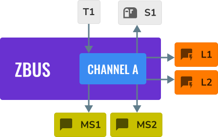
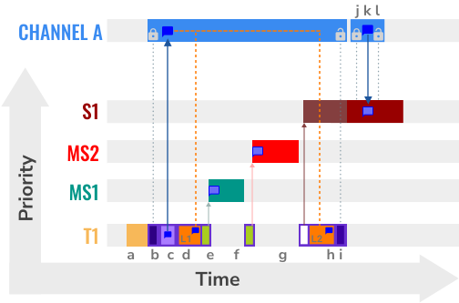
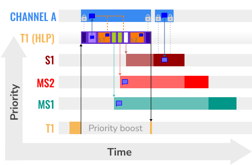

<!-- Copyright 2015-2026 Zephyr Project members and individual contributors. -->
<!-- SPDX-License-Identifier: Apache-2.0 -->
<!-- 中文翻译；阅读编号、导航和译注为本地新增。 -->

<a id="zbus-priority-boost"></a>

# 第9章\_优先级提升

原文：[zbus Priority Boost](https://docs.zephyrproject.org/latest/samples/subsys/zbus/priority_boost/README.html)。读取日期：2026-10-12，`latest`。

## 9.1\_优先级反转场景

本示例通过一个简单应用展示 **优先级提升（Priority Boost）**。关闭提升功能时，下面场景的执行序列存在**优先级反转（Priority Inversion）**；它未必明显影响每个应用，但希望避免消息订阅者与普通订阅者之间这种反转的应用，可以使用提升策略。

通道定义宏 `ZBUS_CHAN_DEFINE` 创建整数消息通道；宏 `ZBUS_OBSERVERS` 按顺序列出观察者。对象 `chan_a` 的列表为监听器 L1、消息订阅者 MS1 和 MS2、普通订阅者 S1、监听器 L2：

```c
ZBUS_CHAN_DEFINE(chan_a,
                 int,
                 NULL,
                 NULL,
                 ZBUS_OBSERVERS(l1, ms1, ms2, s1, l2),
                 0
);
```



图中 T1 是发布线程，L1/L2 为**监听器（Listener）**回调，MS1/MS2 为**消息订阅者（Message Subscriber）**线程，S1 为普通**订阅者（Subscriber）**线程。**原文注意：**必须调用函数 [`zbus_obs_attach_to_thread()`](../intercore_reference/P213_zbus核心接口.md)，把观察者绑定到线程，才能正确执行优先级提升。

## 9.2\_关闭提升功能

下图展示关闭提升时的执行过程。横向是时间，线程运行片段和观察者处理反映同一次发布可能被消费线程打断。



> 译注：前提是已按[入门指南](../getting_started/P002_入门指南.md)准备 west、Zephyr 工作区、目标工具链及 QEMU 模拟器。在已激活开发环境的终端中操作，当前位置为实验用 Zephyr 源码根。以下是官方构建及启动命令；Windows 使用已配置的开发终端，Linux/macOS 使用对应终端。`-b` 选择模拟板目标，`-t run` 执行构建系统的运行目标。切换示例时应使用独立构建目录或按 [west 构建说明](../west/P007_构建烧录与调试.md)清理旧配置，避免复用其他应用的缓存。

Kconfig 配置项 `CONFIG_ZBUS_PRIORITY_BOOST` 控制提升功能。west 命令的 `--` 后为 CMake 配置参数，`-D` 设置相应值；这里设为 `n` 关闭：

```sh
# From the root of the zephyr repository
west build -b qemu_x86 samples/subsys/zbus/priority_boost -- -DCONFIG_ZBUS_PRIORITY_BOOST=n
west build -t run
```

官方输出中 prio before/after（发布前后优先级）均为 5，两个监听器执行时发布线程也仍为 5；消息订阅者可能在两个监听器之间运行：

```text
I: --------------
I: 0 -> T1: prio before 5
I: 0 ---> L1: T1 prio 5
I: 0 -> MS1:  T1 prio 5
I: 0 -> MS2:  T1 prio 5
I: 0 ---> L2: T1 prio 5
I: 0 -> T1: prio after 5
I: N -> S1:  T1 prio 5
I: 0 -> S1:  T1 prio 5
I: --------------
I: 1 -> T1: prio before 5
I: 1 ---> L1: T1 prio 5
I: 1 -> MS1:  T1 prio 5
I: 1 -> MS2:  T1 prio 5
I: 1 ---> L2: T1 prio 5
I: 1 -> T1: prio after 5
I: N -> S1:  T1 prio 5
I: 1 -> S1:  T1 prio 5
I: --------------
I: 2 -> T1: prio before 5
I: 2 ---> L1: T1 prio 5
I: 2 -> MS1:  T1 prio 5
I: 2 ---> L2: T1 prio 5
I: 2 -> T1: prio after 5
I: 2 -> MS2:  T1 prio 5
I: --------------
I: 3 -> T1: prio before 5
I: 3 ---> L1: T1 prio 5
I: 3 -> MS1:  T1 prio 5
I: 3 ---> L2: T1 prio 5
I: 3 -> T1: prio after 5
I: 3 -> MS2:  T1 prio 5
I: --------------
I: 4 -> T1: prio before 5
I: 4 ---> L1: T1 prio 5
I: 4 ---> L2: T1 prio 5
I: 4 -> T1: prio after 5
I: 4 -> MS2:  T1 prio 5
I: --------------
I: 5 -> T1: prio before 5
I: 5 ---> L1: T1 prio 5
I: 5 ---> L2: T1 prio 5
I: 5 -> T1: prio after 5
I: 5 -> MS2:  T1 prio 5
I: --------------
I: 6 -> T1: prio before 5
I: 6 ---> L1: T1 prio 5
I: 6 -> MS1:  T1 prio 5
I: 6 -> MS2:  T1 prio 5
I: 6 ---> L2: T1 prio 5
I: 6 -> T1: prio after 5
I: N -> S1:  T1 prio 5
I: 6 -> S1:  T1 prio 5
I: --------------
<continues>
```

先按 `Ctrl+A`，再按 `x` 退出 QEMU。

## 9.3\_启用提升功能

下图展示同一场景启用提升后的过程。除启用配置外，还须把所有需要参与优先级计算的线程观察者正确绑定到各自线程。机制称为**最高锁定者协议（Highest Locker Protocol，HLP）**，详见[总线说明](../io_services/P003_消息总线zbus.md)。



将配置设为 `y` 后重新构建并运行：

```sh
# From the root of the zephyr repository
west build -b qemu_x86 samples/subsys/zbus/priority_boost -- -DCONFIG_ZBUS_PRIORITY_BOOST=y
west build -t run
```

下面输出中，两个监听器执行期间 T1 的优先级数值根据有效观察关系提升为 1、2 或 3，发布后恢复为 5。Zephyr 中更小的数值表示更高的调度优先级。

```text
I: --------------
I: 0 -> T1: prio before 5
I: 0 ---> L1: T1 prio 1
I: 0 ---> L2: T1 prio 1
I: N -> S1:  T1 prio 5
I: 0 -> S1:  T1 prio 5
I: 0 -> MS1:  T1 prio 5
I: 0 -> MS2:  T1 prio 5
I: 0 -> T1: prio after 5
I: --------------
I: 1 -> T1: prio before 5
I: 1 ---> L1: T1 prio 1
I: 1 ---> L2: T1 prio 1
I: N -> S1:  T1 prio 5
I: 1 -> S1:  T1 prio 5
I: 1 -> MS1:  T1 prio 5
I: 1 -> MS2:  T1 prio 5
I: 1 -> T1: prio after 5
I: --------------
I: 2 -> T1: prio before 5
I: 2 ---> L1: T1 prio 2
I: 2 ---> L2: T1 prio 2
I: 2 -> MS1:  T1 prio 5
I: 2 -> MS2:  T1 prio 5
I: 2 -> T1: prio after 5
I: --------------
I: 3 -> T1: prio before 5
I: 3 ---> L1: T1 prio 2
I: 3 ---> L2: T1 prio 2
I: 3 -> MS1:  T1 prio 5
I: 3 -> MS2:  T1 prio 5
I: 3 -> T1: prio after 5
I: --------------
I: 4 -> T1: prio before 5
I: 4 ---> L1: T1 prio 3
I: 4 ---> L2: T1 prio 3
I: 4 -> MS2:  T1 prio 5
I: 4 -> T1: prio after 5
I: --------------
I: 5 -> T1: prio before 5
I: 5 ---> L1: T1 prio 3
I: 5 ---> L2: T1 prio 3
I: 5 -> MS2:  T1 prio 5
I: 5 -> T1: prio after 5
I: --------------
I: 6 -> T1: prio before 5
I: 6 ---> L1: T1 prio 1
I: 6 ---> L2: T1 prio 1
I: N -> S1:  T1 prio 5
I: 6 -> S1:  T1 prio 5
I: 6 -> MS1:  T1 prio 5
I: 6 -> MS2:  T1 prio 5
I: 6 -> T1: prio after 5
I: --------------
<continues>
```

同样先按 `Ctrl+A`，再按 `x` 退出。若两次输出看不出配置差别，先检查构建目录中实际生成的 Kconfig 值、是否重新配置以及观察者绑定；不要只根据命令里写了 `y` 就断言功能已生效。

> 译注：输出中的 `N` 是示例通知日志标签，`<continues>` 表示继续运行。图与输出展示的是该例设置下的调度，不能当成所有线程、运行时观察关系或多核系统的通用无反转保证。

## 9.4\_源代码与接口

可查阅[官方示例源码](https://github.com/zephyrproject-rtos/zephyr/tree/main/samples/subsys/zbus/priority_boost)和消息总线的**应用程序编程接口（Application Programming Interface，API）**[参考](../intercore_reference/P213_zbus核心接口.md)。概念说明见[消息总线译文](../io_services/P003_消息总线zbus.md)。本页保留官方示例输出，本次未实际构建或运行。

[上一章：远端模拟](P008_远端模拟.md) · [下一章：运行时观察关系](P010_运行时观察关系.md) · [返回大纲](大纲.md)
