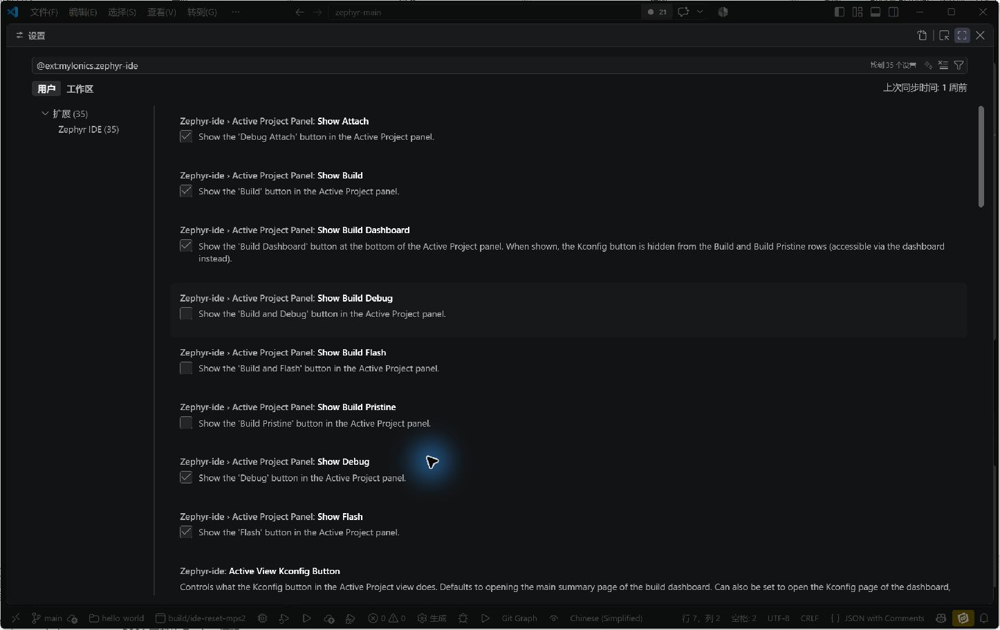

<!-- SPDX-License-Identifier: Apache-2.0 -->

# 第1章\_先找到入口，再查字段

本表按已安装的 **Mylonics IDE for Zephyr 4.1.1** 的 package.json、配置 Schema 与实现核对。它是一份查阅表，首次操作按 [主教程](P001_VSCode_Zephyr_IDE接入已有工程_Windows.md)。旧版重复截图不能作为逐项实测证据，已全部撤出本文。

## 1.1\_三个入口，不要混成“设置”

| 要改的内容 | 进入方法 | 保存位置 |
| --- | --- | --- |
| venv、SDK 查找目录及扩展偏好 | `Ctrl+Shift+P` → `Zephyr IDE: Open Settings`；或 `Ctrl+,` 搜索 `@ext:mylonics.zephyr-ide` | 选择 Workspace 后保存到源码根 `.vscode/settings.json` |
| 应用、板、输出、CMake 参数、额外 conf/overlay | Add Project/Add Build 命令，以及 Project/Build 详情；也可直接打开 JSON | 源码根 `.vscode/zephyr-ide.json` |
| 应用功能、硬件、源文件、仓库版本 | 直接编辑对应 Zephyr 输入文件 | 应用 `prj.conf`、overlay、CMakeLists.txt，模块描述，west 清单等 |

在本章单文件夹窗口里，“源码根”是 `G:/zephyr_practice/zephyr-main`。原生设置的 Workspace 范围优先于 User。插件自有设置页的 **Open in VS Code Settings** 会打开相同扩展过滤；页面显示名不一定逐字相同。

## 1.2\_完整键与界面显示名

| 插件自有设置页 Directory Settings | VS Code 原生设置显示名 | 完整键 |
| --- | --- | --- |
| Toolchain Directory | Toolchain Directory | `zephyr-ide.toolchainDirectory` |
| Virtual Environment Folder | Venv Folder | `zephyr-ide.venvFolder` |
| ZEPHYR_BASE Override | Zephyr Base Override | `zephyr-ide.zephyrBaseOverride` |

英文显示名方便在页面定位；JSON 必须写完整键。以下各组列出的35个现行键，都能通过原生设置的扩展过滤或按键名搜索核对。**插件自有设置页只列31项**；projectVariableDefaults、buildVariableDefaults、extraRunners、runnerProfiles四个数组设置应到原生VS Code设置/JSON或Runner专属页面查看。数组/对象可能显示 **Edit in settings.json**；这表示要编辑该项的数据，不是另一个安装操作。

图中搜索框为`@ext:mylonics.zephyr-ide`，右上显示35个设置。截图停在“用户”范围；为本章G盘工程改值时，先点击搜索框下面的“工作区”。这与插件自有设置页逐项选择Workspace的方式不同。

# 第2章\_35个现行设置

## 2.1\_已有工具与源码路径

| 完整键 / 默认值 | 填什么 | 对原生环境的作用 |
| --- | --- | --- |
| `zephyr-ide.venvFolder` / null | 已有 `.venv` 根，不是 python.exe；本章为 G:/zephyr_practice/zephyr-main/.venv | 插件任务使用其中 Python/west。改后重扫环境并检查任务解释器 |
| `zephyr-ide.toolchainDirectory` / null | 直接包含 zephyr-sdk-* 安装目录的父目录；先按当前实际解压层级核对 | 插件发现已有 SDK；区别于指向具体 SDK 根的 ZEPHYR_SDK_INSTALL_DIR |
| `zephyr-ide.zephyrBaseOverride` / null | 可选的绝对或 VS Code 根相对源码路径 | 覆盖任务注入的 ZEPHYR_BASE；不改变插件自身扫描板、samples、bindings 的源码树 |

null 表示未显式指定。SDK 根应有 sdk_version；只找到编译器 exe 不够。顶层 JSON 键 `ZEPHYR_SDK_INSTALL_DIR` 不是 VS Code 设置，不会因此创建环境变量。Python 扩展选择解释器也不能代替这里的 venvFolder。

## 2.2\_Kconfig按钮打开什么

| 完整键 / 默认值 | 取值及作用 |
| --- | --- |
| `zephyr-ide.activeViewKconfigButton` / dashboard | dashboard打开构建总览；kconfig-dashboard直达Kconfig页；gui-config/menu-config调用对应外部编辑器 |
| `zephyr-ide.projectViewKconfigButton` / kconfig-dashboard | Projects树的Config入口；可选kconfig-dashboard、gui-config、menu-config |

这是按钮行为选择，不改变任何 CONFIG 值。Kconfig 的功能设置仍来自 prj.conf 等源配置；先成功配置当前 Build，再查看或修改。

## 2.3\_构建与项目行为

| 完整键 / 默认值 | 作用 |
| --- | --- |
| `zephyr-ide.buildBeforeFlash` / false | 普通Flash是否先Build；Build and Flash命令自身总是先构建 |
| `zephyr-ide.automaticProjectSelection` / true | 编辑器切到另一已登记项目的文件时自动切换活动项目 |
| `zephyr-ide.separateBuildDebugProfile` / false | Runner增加独立Build & Debug绑定槽；默认与Debug共用 |

这些开关不安装依赖或补板级支持。第一次接入只需 Build；Flash、Debug要在硬件和runner条件齐全后另行配置。

## 2.4\_底部状态栏显示

这些键只控制入口显示，修改后按扩展声明重启 VS Code 生效。

| 完整键 | 默认 | 显示按钮 |
| --- | --- | --- |
| `zephyr-ide.statusBar.showBuildPristine` | true | Build Pristine |
| `zephyr-ide.statusBar.showBuild` | true | Build |
| `zephyr-ide.statusBar.showFlash` | false | Flash |
| `zephyr-ide.statusBar.showBuildFlash` | true | Build and Flash |
| `zephyr-ide.statusBar.showDebug` | false | Debug |
| `zephyr-ide.statusBar.showBuildDebug` | true | Build and Debug |

## 2.5\_Active Project面板显示

这组与底部状态栏独立；隐藏一处不等于隐藏另一处，更不会执行按钮动作。

| 完整键 | 默认 | 显示按钮 |
| --- | --- | --- |
| `zephyr-ide.activeProjectPanel.showBuild` | true | Build |
| `zephyr-ide.activeProjectPanel.showBuildPristine` | false | Build Pristine |
| `zephyr-ide.activeProjectPanel.showFlash` | true | Flash |
| `zephyr-ide.activeProjectPanel.showBuildFlash` | false | Build and Flash |
| `zephyr-ide.activeProjectPanel.showBuildDebug` | false | Build and Debug |
| `zephyr-ide.activeProjectPanel.showDebug` | true | Debug |
| `zephyr-ide.activeProjectPanel.showAttach` | true | Debug Attach |
| `zephyr-ide.activeProjectPanel.showBuildDashboard` | true | Build Dashboard；显示时Build/Pristine行的Kconfig快捷入口隐藏，从Dashboard进入 |

## 2.6\_West Update选项

| 完整键 / 默认值 | 对 west 的影响 | 不代表什么 |
| --- | --- | --- |
| `zephyr-ide.westNarrowUpdate` / false | update增加--narrow，减少所取Git历史 | 不按当前板子选最小模块集合 |
| `zephyr-ide.westKeepDescendants` / false | update增加--keep-descendants，保留清单revision后代上的当前提交 | 不是保留任意分支的万能开关 |
| `zephyr-ide.westZephyrExport` / false | 成功update后运行west zephyr-export | 不安装SDK，也不表示源码模块全已编译 |

选择这些设置本身不下载。可下载的项目和版本来自当前west清单；用west list查看，用定向west update维护所需项目。插件4.1.1没有“根据当前板子自动求解并只下载最小模块”的设置。

## 2.7\_环境注入与代码浏览

| 完整键 / 默认值 | 作用和使用条件 |
| --- | --- |
| `zephyr-ide.suppressWorkspaceWarning` / false | 隐藏缺ZEPHYR_BASE/SDK环境变量的警告；不修复路径或解除实际依赖问题 |
| `zephyr-ide.disableZephyrBaseInjection` / false | 停止向终端、任务、调试注入ZEPHYR_BASE，同时忽略zephyrBaseOverride |
| `zephyr-ide.useClangd` / false | 切到clangd并配置语言服务、关闭C/C++语义引擎；需要已安装clangd扩展 |
| `zephyr-ide.compileCommandsMode` / all | active/project/all决定收集哪些Build的数据库并合并到.vscode/compile_commands.json |

主教程选择 Microsoft C/C++，让 `C_Cpp.default.compileCommands` 直接指向当前 Build 的数据库；这属于 C/C++ 扩展设置，不是 Zephyr IDE 键。不要因为插件也有合并数据库功能，再维护第二套互相矛盾的跳转路径。切板后核对数据库来源。

## 2.8\_静态分析

| 完整键 / 默认值 | 作用 |
| --- | --- |
| `zephyr-ide.scaVariant` / none | Pristine配置时设置ZEPHYR_SCA_VARIANT；可选dtdoctor、gcc、clang、sparse、codechecker、coverity、cpptest、eclair、iar_c_stat、polyspace、custom、none |
| `zephyr-ide.scaCustomVariant` / null | scaVariant为custom时使用；须对应源码cmake/sca下实际实现 |

选择分析器不安装分析器。首次工程接入保留none；以后使用时核对该工具和许可，并重新配置。本文没有声称已运行这些分析器。

## 2.9\_变量与Runner数组

| 完整键 / 默认值 | 数据含义 |
| --- | --- |
| `zephyr-ide.projectVariableDefaults` / [] | 在项目详情中预设变量名；值另放项目customVars，不是CMake变量 |
| `zephyr-ide.buildVariableDefaults` / [] | 在Build详情中预设变量名；值另放Build customVars |
| `zephyr-ide.extraRunners` / [] | 给Runner选择列表追加名字；不安装程序、不实现Zephyr runner |
| `zephyr-ide.runnerProfiles` / [] | 用户级可复用Runner对象；工作区同名Profile优先 |

不用这些功能就保持空列表。自定义变量由`${projectvar:key}`或`${buildvar:key}`引用，不会自动成为环境变量、CONFIG或CMake -D参数。

# 第3章\_命令面板与管理页对应

下面是操作命令或管理入口，不能在上面的设置列表中当开关寻找。

| 任务 | 命令或页面 | 数据与行为 |
| --- | --- | --- |
| 外部west根接入 | Zephyr IDE: Setup Workspace from External Directory | 选择含.west的G:/zephyr_practice；主线选Mark workspace as already set up后扫描 |
| 已有环境扫描 | Zephyr IDE: Configure Existing Environment (Scan Zephyr Dir/Version) | 发现venv、源码和版本；不等于完整编译验证 |
| 选择已登记工作区 | Zephyr IDE: Select Existing West Workspace | 选择插件已有登记 |
| 跳过west准备标记 | Zephyr IDE: Skip West Setup | 只置westUpdated标记，不下载、不检查所有模块 |
| 添加应用 | Zephyr IDE: Add Project | 在zephyr-ide.json登记应用根 |
| 添加构建 | Zephyr IDE: Add Build Configuration | 板、参数、输出组合；先设置活动Project |
| 构建活动配置 | Zephyr IDE: Build | 由Project/Build形成west build命令 |
| 安装需求管理 | Zephyr IDE: Manage Workspace Installations | 管理toolchains、pipPackages、pipRequirements、blobs等声明 |

Workspace网页的Mark as Complete与外部目录向导的Mark workspace as already set up是不同界面。完整入口辨认见[入口地图](RESET_WALKTHROUGH.md)。Host Tools页用于主机工具检测/安装，Zephyr SDK页用于SDK发现与管理；Installed状态不能代替实际构建日志。

安装需求写在zephyr-ide.json顶层：`toolchains`列目标工具链，`sdkVersion`声明安装版本，`pipPackages`列额外Python包，`pipRequirements`列requirements文件，`blobs`列需获取二进制blob的模块，`sampleProjects`保存可导入模板，`commands.windows/linux/mac`保存相应平台自定义准备命令。它们不是一次Build必填清单，声明也不等于已安装；安装或Run Commands入口才可能执行外部动作。

# 第4章\_Project与Build如何变为Zephyr原生输入

## 4.1\_应用、板、输出和参数

以下路径从VS Code打开的G盘源码根计算。例中Project是hello_world，Build是ide-mps2。对象层级不是同名磁盘目录。

| 字段位置 | 主线值/含义 | 原生对应 |
| --- | --- | --- |
| projects.hello_world.name | hello_world | 插件显示标识 |
| projects.hello_world.relPath | samples/hello_world | west build的应用目录 |
| projects.hello_world.buildConfigs | Build对象集合 | 一个应用可有多个板/参数组合 |
| Build.name | ide-mps2 | 插件构建标识 |
| Build.board / revision | mps2/an386；无修订则省略revision | BOARD及可选板修订 |
| Build.relPath | build/learning-tools/zephyr-vscode/hello_world | west build -d输出目录 |
| Build.relBoardDir / relBoardSubDir | 额外板根 / 板目录子路径；内置板由向导取得 | BOARD_ROOT等板搜索信息，区别于board字符串 |
| Build.westBuildArgs | west参数数组 | west build层，位于--前 |
| Build.westBuildCMakeArgs | CMake参数数组 | --后交给CMake的-D定义等 |
| Build.compilerOptimization | debug/speed/size/none，省略为不覆盖 | 相关Kconfig优化输入；Not set与None不同 |

向导是收集这些值的入口，JSON是保存结果。修改参数后核对最终命令，按需要Pristine重新配置。`EXTRA_ZEPHYR_MODULES=G:/zephyr_practice/hal_xhsc-zephyr`属于Build的CMake输入；`toolchains`属于安装需求；两者均不决定west清单里下载哪些仓库。

编辑已有Build时，在Project Details点 **CMake Args**，仍会先出现 **Modify Build Arguments (1/2)：West build arguments**。保留第一框的west参数并按Enter，到了 **(2/2)：CMake arguments** 才编辑CMake输入。两个框都可能出现示例提示，不要把提示值当成必填项。[入口地图1.6](RESET_WALKTHROUGH.md)给出本轮实际打开的连续截图；图里的旧ZEPHYR_MODULES不是当前主线配置。

JSON数组里一个字符串就是一个参数。终端或向导中输入的命令行文本还需按其解析规则加引号；不能根据路径含盘符，就一概往JSON字符串中加入字面单引号。旧副本13不作为通用引号模板。

## 4.2\_Kconfig与Devicetree文件

默认`prj.conf`、板defconfig、基础DTS由Zephyr的应用与板规则加载。插件Project/Build中额外文件计数为0，不表示这些默认输入没有使用。

| confFiles列表与entry.extra | CMake输入 | 作用 |
| --- | --- | --- |
| config，false/省略 | CONF_FILE | 指定应用配置集合，影响默认prj.conf选择 |
| config，true | EXTRA_CONF_FILE | 在默认/选定应用配置之外追加 |
| overlay，false/省略 | DTC_OVERLAY_FILE | 指定overlay集合，影响自动选择 |
| overlay，true | EXTRA_DTC_OVERLAY_FILE | 在已有规则之外追加 |

entry.path指已有文件，相对VS Code根。Project级作用于各Build，Build级限于该Build。在对应详情的Kconfig/Devicetree Overlay入口选文件和类型；之后重新配置，并核对生成来源。Dashboard查看生成结果；要长期保存功能或硬件修改，维护prj.conf/额外.conf/overlay，不能只改build内的.config或zephyr.dts。

## 4.3\_Runner与其他字段

`activeProject`记录活动项目；Project/Build的`customVars`保存自定义字符串。`twisterConfigs`是Schema兼容数据；本版公开命令贡献未找到完整Add/Edit Twister向导，不能按一个数据字段发明按钮。

Runner Profiles把Flash、Debug、Attach映射到后端。Workspace级保存于zephyr-ide.json，User级保存于zephyr-ide.runnerProfiles。创建Profile与给Build选用Profile是两个动作；Build的`activeProfile`引用共享名字。

| Runner绑定kind | 含义 |
| --- | --- |
| auto | 根据构建生成的runners.yaml选择 |
| west-flash | 指定west flash runner与额外参数 |
| launch | 引用.vscode/launch.json中的配置名 |
| cortex-debug | 用结构化runner/探针/RTT配置补充调试输入 |
| west-debug | 由west启动debugserver，再由调试扩展连接 |

`flash`、`debug`、`attach`是动作槽；打开separateBuildDebugProfile才使用独立`buildDebug`。Build的`bindOverrides`额外参数只用于west-flash/west-debug绑定。Runner名称不会安装探针工具或补齐板支持。本文没有执行Flash/Debug/Attach。

# 第5章\_8个旧兼容设置

以下键在package.json中标记废弃。新配置使用右列，迁移时保留原值的实际语义，再删除旧键；不在现行页面寻找旧显示名。

| 旧键 | 当前键 |
| --- | --- |
| zephyr-ide.globalDirectory | zephyr-ide.toolchainDirectory |
| zephyr-ide.global_directory | zephyr-ide.toolchainDirectory |
| zephyr-ide.tools_directory | zephyr-ide.toolchainDirectory |
| zephyr-ide.toolchain_directory | zephyr-ide.toolchainDirectory |
| zephyr-ide.suppress-workspace-warning | zephyr-ide.suppressWorkspaceWarning |
| zephyr-ide.venv-folder | zephyr-ide.venvFolder |
| zephyr-ide.project_variable_defaults | zephyr-ide.projectVariableDefaults |
| zephyr-ide.build_variable_defaults | zephyr-ide.buildVariableDefaults |

项目Schema另兼容rel_path和debugOptimization，新写relPath和compilerOptimization；它们不是上述VS Code设置键。

# 第6章\_依据与核验边界

本轮实际读取安装包的package.json、resources/zephyr-ide-schema.json与dist/extension.js，并对照同版本上游源码。字段/命令存在和实现行为已核对；这与在本机GUI逐项运行是不同证据。旧重复截图不再用于支持任何操作成功结论，详情见[验证记录](VALIDATION.md)。

维护者参考：[插件配置说明](https://zephyr-ide.mylonics.com/reference/configuration/)、[命令参考](https://zephyr-ide.mylonics.com/reference/commands/)、[已有环境接入](https://zephyr-ide.mylonics.com/getting-started/external-environments/)。Zephyr原生概念参考：[west清单](https://docs.zephyrproject.org/latest/develop/west/manifest.html)、[模块](https://docs.zephyrproject.org/latest/develop/modules.html)、[构建与调试](https://docs.zephyrproject.org/latest/develop/west/build-flash-debug.html)。在线页面会变化，具体4.1.1入口以本轮安装源码核对为边界。
