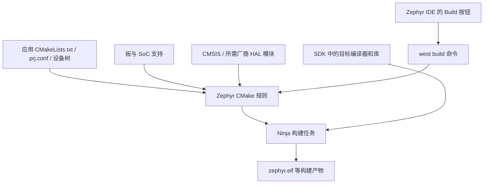
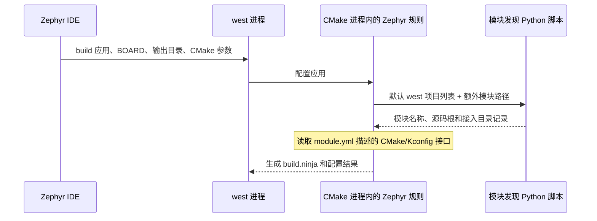

<!-- SPDX-License-Identifier: Apache-2.0 -->

# 第1章\_VS\_Code\_Zephyr\_IDE接入已有工程

先认清本章要构建给谁：**MPS2 是 Arm 的 FPGA 原型开发板平台，AN386 是它承载 Cortex-M4F 系统的一种 FPGA 映像/系统配置**。Zephyr 用 `mps2/an386` 表示对应板目标。我们先借用官方已有支持，理解工程怎样组成，再操作 IDE。平台与 FPGA 的关系见 [Arm MPS2/MPS2+ 技术参考手册第 1.2 节](https://documentation-service.arm.com/static/5fd9f120d68fe412ba040ffd)；[QEMU 官方 MPS2 说明](https://www.qemu.org/docs/master/system/arm/mps2.html) 列出 AN385 的 Cortex-M3 与 AN386 的 Cortex-M4 映像。当前 Zephyr 的 `soc/arm/mps2/Kconfig` 为 AN386 选择 Cortex-M4 与 FPU 能力，因此本章写作 Cortex-M4F。

应用则选择官方 `samples/hello_world`：它的任务是通过控制台打印信息。应用回答“要做什么”，板目标回答“在哪套硬件配置上运行”。同一个 `hello_world` 可以为不同受支持目标构建；选中 MPS2 板不会自动替你决定应用，Add Project 选中应用也不会自动决定芯片。

官方 MPS2 Armv7-M 板文档同时说明 AN385、AN386 和 AN500，但其中 `hello_world` 命令示例实际使用 **`mps2/an385`**。本教程明确改选同页列出的 **`mps2/an386`**，以 Cortex-M4F 为对照。不能把 AN385 的默认 QEMU 说明直接当作本教程已验证的 AN386 运行结果。本机原件为 `boards/arm/mps2/doc/mps2_armv7m.rst` 第 9—16 行与第 236—240 行；[固定源码的官方板说明](https://github.com/zephyrproject-rtos/zephyr/blob/25c8f4a23988dd3b2cfb463613622738298c2d6c/boards/arm/mps2/doc/mps2_armv7m.rst#L236)。

本章从第一次使用 Zephyr IDE 开始。先判断手里的目录是什么，再把源码和外部材料交给正确的工具，最后在 VS Code 中添加应用并构建。读者不必先知道插件设置键；每个键都从实际界面操作讲起。

贯穿应用是官方已有的 `samples/hello_world`，板目标是官方已有的 `mps2/an386`。先用它追踪一次完整工程：应用、MPS2 板与 SoC 支持、CMSDK 外设驱动已经在 Zephyr 主仓中；Arm 内核接口由清单管理的 CMSIS 6 提供；SDK 提供编译器。读者将亲自核对这些来源，再把同一工程接到 IDE。本系列另有 HC32 主线，它的厂商模块位于 `G:/zephyr_practice/hal_xhsc-zephyr`；1.9 再解释这条路线增加了哪些输入。

界面和命令按 **IDE for Zephyr，扩展 ID `mylonics.zephyr-ide`，4.1.1** 核对。插件 README、该版本源码与当前 Zephyr 源码是依据，较新网页的按钮布局可能不同。源码索引在 1.11.3。

第一次按 1.1—1.11 顺序阅读：1.1—1.4 回答原生工程需要什么；1.5—1.8 完成 IDE 接入；1.9—1.11 解释参数、构建结果和排错。前面环境已准备好的读者仍先读 1.2 的判断，然后跳到 1.5 操作插件。

配套 PPT 当前共 **61 页**。以下按实际页序对应正文；同一小节分散出现时分别列出范围，避免把插入的引导页算进其他主题。

| PPT 页面 | 正文小节 | 主题 |
| --- | --- | --- |
| 2—12 | 1.1 | 先分清 Zephyr 原生工程与 IDE |
| 13—15、17—19 | 1.2 | 判断：已有 west 工作区，还是只有源码 |
| 16、20—23 | 1.3 | 查清可下载的包，再准备 CMSIS 与 HAL |
| 24 | 1.4 | SDK 先准备好，再让构建选择它 |
| 25—26 | 1.5 | 安装插件，先找到四种实际入口 |
| 27—30 | 1.6 | 在 Open Settings 填写已有环境路径 |
| 31—34 | 1.7 | 把 west 工作区交给插件 |
| 35—41 | 1.8 | 添加应用，再添加它的 Build |
| 42—52 | 1.9 | CMSIS、HAL、SDK 参数填在哪里 |
| 53—56 | 1.10 | 第一次 Build 与源码浏览 |
| 57—61 | 1.11 | 日常动作、排错与源码依据 |

<a id="stage-map"></a>

## 1.1\_先分清 Zephyr 原生工程与 IDE

### 1.1.1\_没有插件时，工程怎样工作

Zephyr 是 RTOS 源码和构建规则。应用的 `CMakeLists.txt` 用 `find_package(Zephyr ...)` 加载规则；规则读取板目标、Kconfig、设备树、源码模块和工具链，生成 Ninja 构建文件。Ninja 再调用编译器产生固件。VS Code 和 Zephyr IDE 没有替换这套过程。

west 有两层用途：核心命令管理工作区和外部 Git 仓库；Zephyr 在源码的 `scripts/west-commands.yml` 中提供 `build`、`boards`、`flash` 等扩展。因此“已经安装 west”只证明 Python 中有这个工具，不能证明当前目录已有工作区、依赖或板支持。



可以直接调用 CMake，也可以让 west 调用 CMake，或者再由插件调用 west。调用入口不同，应用、板、模块和 SDK 仍然要齐全。原生 Zephyr 支持不使用 west 的模块接入；本章插件的构建、板列表和模块列表功能会调用 west。

以本章应用为例，官方原有的 `samples/hello_world/CMakeLists.txt` 先调用 `find_package(Zephyr REQUIRED HINTS $ENV{ZEPHYR_BASE})`，加载 Zephyr 的配置过程；随后 `target_sources(app PRIVATE src/main.c)` 把应用的 `main.c` 加入 `app` 目标。读者选择的 `BOARD=mps2/an386` 让同一过程取出对应板和 SoC 的硬件配置，模块列表让它找到外部源码，SDK 查找规则决定最终调用哪个编译器。**应用不会因为放在 Zephyr 文件夹里就自动编译，文件也不会因为已下载就自动加入固件。** 每一步都需要相应的构建输入和选入规则。

west 在这里是可选的入口与仓库信息来源。Zephyr 的 `cmake/modules/west.cmake` 使用当前构建 Python 查找 west；直接运行 CMake 且没有 west 时，它可以继续配置。此时外部模块不能再依赖 west 工作区自动列出，必须由工程显式交给 CMake。插件则是另一个使用者：本版 IDE 的 Build 调用 west，所以原生构建允许不用 west，并不意味着插件的全部功能也允许。这是 1.2 三条操作路线不同的原因。

上述规则由本次固定源码中的应用 `CMakeLists.txt`、`cmake/modules/west.cmake` 和 `cmake/modules/zephyr_module.cmake` 核对。官方说明可用于进一步核对：[应用构建](https://docs.zephyrproject.org/latest/develop/application/index.html)、[模块与 west 项目的区别](https://docs.zephyrproject.org/latest/develop/modules.html#modules-vs-west-projects)。下文直接展开操作，不要求先阅读这些文件。

### 1.1.2\_CMSIS、HAL 与 SDK 分别带来什么

先给接下来反复出现的名词一个具体含义。**Zephyr 模块**是按 Zephyr 的发现约定接入的源码目录，通常由 `zephyr/module.yml` 声明名字与 CMake/Kconfig 入口，也可按需要声明板、SoC、设备树搜索根。它可以提供普通应用组件，也可以提供硬件库；不是“所有外部目录”的别名。west 项目是 manifest 管理的仓库单位，一个下载项目是否成为模块，还要看这些接入条件。

**CMSIS Core**是 Arm 定义的处理器内核接口部分；这里使用 Cortex-M4 的寄存器、NVIC、中断和相关内联接口。CMSIS 是更大的规范与软件集合，不能把 Core 头文件叫作所有芯片外设的驱动实现。**HAL**通常指硬件抽象层，厂商可以把它做成独立库；**DDL**是一些厂商采用的设备驱动库名称；**BSP**指板级支持包。这些是职责或交付形式，不是 Zephyr 强制要求每块板各下载一份的三个固定目录。

| 对象 | 本工程的具体对象 | 引入后解决什么 | 谁读取入口 |
| --- | --- | --- | --- |
| CMSIS | 清单项目 `cmsis_6`，目录 `modules/hal/cmsis_6` | Arm 内核接口等源码依赖 | Zephyr 模块发现与 `modules/cmsis_6` 接入代码 |
| 厂商 HAL/DDL | 模块 `hal_xhsc`，已有目录 `hal_xhsc-zephyr` | HC32 寄存器、设备头与厂商外设实现 | 模块 CMake，以及使用它的 SoC/驱动适配 |
| Zephyr SDK | `zephyr-sdk-1.0.1` 根目录 | 主机上运行的交叉编译器、目标库与工具 | Zephyr 的 SDK/工具链查找规则 |

CMSIS 和 HAL 是参与固件构建的源码依赖。SDK 的编译器运行在电脑上，用来编译源码；它不是 `west.yml` 中的普通 HAL 项，也不是向应用 include 路径里加入一个目录就能生效。

这里的表按职责比较三类对象，并不是每块板都必须下载三种包。**MPS2 自己的硬件支持已经分布在 Zephyr 主仓的板、SoC、架构和驱动目录中。** `boards/arm/mps2` 描述板，`soc/arm/mps2` 提供 SoC 接入，`arch/arm/core/cortex_m` 提供 Cortex-M 架构实现。对于 `hello_world` 打印所走的串口，`drivers/serial/uart_cmsdk_apb.c` 内部声明了 UART 寄存器布局，设置波特率时直接写入寄存器 `bauddiv`；这份实现无需再调用一份单独下载的 MPS2 厂商 HAL。HAL 是硬件抽象层的通称，DDL 是一些厂商对库的命名，不能按这些名称推断每块板都有必装的独立库。

为什么确定选中的是这个驱动？MPS2 的设备树把 `zephyr,console` 指向 `uart0`，这个节点的 `compatible` 是 `arm,cmsdk-uart`。节点启用后，串口驱动的 Kconfig 条件使 `CONFIG_UART_CMSDK_APB=y`；`drivers/serial/CMakeLists.txt` 据此加入 `uart_cmsdk_apb.c`。应用的打印于是能经控制台层到达这一硬件实现。后面 1.10 核对编译数据库时，将看到这份驱动源文件，而不是寻找一个名叫“MPS2 HAL”的下载包。

CMSIS 6 则是另一层依赖。AN386 使用 Cortex-M4，Zephyr 的 CMSIS 适配头按 CPU 配置包含 `core_cm4.h`，外部模块提供这个头及相关 Core 接口。主仓内 `modules/cmsis_6/CMakeLists.txt` 只负责把外部模块的 `CMSIS/Core/Include` 加入头文件搜索路径，它不包含整份 CMSIS 库。因此只下载 Zephyr 主仓还不够；要按 1.3 的 manifest 修订取得 `cmsis_6`。本次构建中 CMSIS 主要以被包含的头文件参与，不能因为编译数据库没有一条外部 CMSIS `.c` 命令就判断它没有被使用。

这也是两个 `modules` 容易混淆的地方。目录名相同，内容与所属工程不同：

| 本主线真实位置 | 内容与来源 | 构建如何连上它 |
| --- | --- | --- |
| `G:/zephyr_practice/zephyr-main/modules/cmsis_6` | 随 Zephyr 主源码提供的适配 CMake、Kconfig 和适配头 | 描述当前 Zephyr 怎样使用 CMSIS Core |
| `G:/zephyr_practice/modules/hal/cmsis_6` | west 按 manifest 取得的外部 CMSIS 源码 | 元数据中的 `cmake-ext`/`kconfig-ext` 指向外置适配，Core 头仍留在此处 |
| `G:/zephyr_practice/hal_xhsc-zephyr` | 已有 HC32 厂商源码模块 | HC32 Build 显式追加这个根，随后由其入口和 SoC 适配选取内容 |

主仓 `modules/cmsis_6` 不是完整 CMSIS 包已经被下载的证据；外部 `modules/hal/cmsis_6` 存在也不是它已进入当前 Build 的证据。主仓适配、外部源码和本次模块发现必须接在同一条链上。以后遇到其他 `modules/<名字>`，先读它的 CMake/元数据确定角色，不按文件夹名称猜。

把这套判断迁移到别的板时，先找板文档列出的支持，再沿设备树、Kconfig 和驱动源文件查实际实现；只有实现依赖外部库时，才继续查当前 manifest 是否管理该库。已有文件与预期版本一致就复用，缺失或版本不符才补齐；清单没有条目时再查该厂商库的官方来源与 Zephyr 接入条件。1.3 和 1.10 分别完成下载前、构建后的核对。

HAL 包内存在 HC32F4A0 文件，不等于 Zephyr 已有你的开发板。板的引脚、晶振、内存，SoC 的启动和中断接入，以及 Zephyr 驱动到厂商 DDL 的调用关系，仍需板/SoC/驱动适配。IDE 的板列表只能列出当前源码和额外板目录实际定义的目标。

**MPS2 也有独立的厂商支持包。** 在 Arm Keil 的 CMSIS Packs 页面搜索 `V2M-MPS2_CMx_BSP`，可以找到 MPS2 的 Board Support / Device Support 包，本次核对页面列出版本 1.8.2；官方板页还列有 USART 驱动和示例。这个事实与“本章 Zephyr 工程是否使用它”是两个问题。本章采用 Zephyr 已实现的板、SoC、架构和驱动，再接入 CMSIS Core，并未把该 BSP Pack 作为构建依赖。不能因为厂商有包就全部下载，也不能因为本工程不使用它就说厂商没有支持库。核对入口：[MPS2 BSP Pack](https://www.keil.arm.com/packs/v2m-mps2_cmx_bsp-keil/boards/)、[MPS2 板与示例](https://www.keil.com/boards2/arm/v2m_mps2/)。

把 MPS2 的整体硬件支持展开后，可看到以下分工。表中的主仓文件已经随 Zephyr 下载；只有外部 CMSIS 需要另行取得。

| 硬件支持职责 | 本章 Zephyr 路线的实现来源 | 对 `hello_world` 的作用 |
| --- | --- | --- |
| 板身份、内存地址、外设节点和时钟描述 | `boards/arm/mps2` 的 YAML、DTS、defconfig | 确定 AN386 平台与硬件布局 |
| SoC 接入 | `soc/arm/mps2` 的 Kconfig、`soc.c`、`soc.h` | 将 AN386 接到 Cortex-M4 配置与 Zephyr 初始化 |
| 启动、异常和线程上下文 | `arch/arm/core/cortex_m` | 把处理器带到 Zephyr 内核运行状态 |
| 内核寄存器接口 | 外部 CMSIS 6 的 `CMSIS/Core/Include`，由主仓 `modules/cmsis_6` 接入 | 提供 Cortex-M4、NVIC 等 Arm Core 接口 |
| 中断与系统节拍实现 | 主仓 Cortex-M 中断代码、`drivers/timer/cortex_m_systick.c` | 把硬件中断和 SysTick 接到 Zephyr |
| 控制台和串口 | `drivers/console/uart_console.c`、`drivers/serial/uart_cmsdk_apb.c` | 输出应用的打印内容 |

GPIO、计数器、看门狗等功能是否可用，继续核对该目标的 Supported Features、DTS 节点和相应驱动；“板支持某功能”不表示当前 `hello_world` 已经启用它。这里的控制台只是跟踪源码选择的实例，不能代表整套硬件支持。需要为自己的板新增功能时，应逐项确认上述职责已有实现、依赖外部库还是仍须适配。

### 1.1.3\_IDE 增加了哪些配置

插件用 **Project** 记录一个应用目录，用 **Build** 记录“这个应用 + 板目标 + 参数 + 输出目录”。本章 Project 的目录是 `samples/hello_world`，它下面的 `ide-mps2` Build 选择 `mps2/an386`。以后同一个 Project 可以再有 `ide-hc32` Build；那是为同一应用增加另一套目标组合，不是把应用文件夹改名为芯片名。

环境设置决定如何找到 Python、west 和 SDK；点击 Build 后，插件把所选组合转换成命令。具体业务源码和 Kconfig 请求仍由应用自己的文件维护。

| 原生概念 | 插件对应对象 | 保存或观察位置 |
| --- | --- | --- |
| west 工作区和 Zephyr 源码位置 | Workspace 环境登记、扫描结果 | 插件管理的环境记录 |
| 已有 venv、SDK 搜索父目录 | Open Settings → Directory Settings | 工作区 `.vscode/settings.json` |
| 应用源目录 | Project | `.vscode/zephyr-ide.json` 的 `projects` |
| BOARD、west 参数、CMake 参数 | Project 下的 Build | 同一 JSON 的 `buildConfigs` |
| 内核/驱动功能、硬件描述 | `.conf`、`.overlay` | 应用源文件；插件可以选择这些文件 |
| 实际 SDK、模块与编译选项 | 配置与编译结果 | 构建目录的缓存、模块记录和编译数据库 |

**VS Code 设置、插件命令、Project/Build 配置、Zephyr 应用配置是四种入口。** 在 `Ctrl+,` 的通用设置搜索中找不到 Add Build 或 `CONFIG_GPIO` 是正常的；后面逐一指出应该去哪里。

## 1.2\_判断：已有 west 工作区，还是只有源码

### 1.2.1\_先看目录，不急着点安装

本章 VS Code 打开的文件夹是 `G:/zephyr_practice/zephyr-main`。west 工作区根则是上一层 `G:/zephyr_practice`，两者不是同一个目录。

```text
G:/zephyr_practice/
├── .west/config                  # west init 生成
├── modules/hal/cmsis_6/           # west 根据清单下载的外部源码
├── hal_xhsc-zephyr/               # 已取得的 HC32 主线 HAL
├── zephyr-sdk-1.0.1/              # 已安装 SDK 根
└── zephyr-main/                  # VS Code 打开这里
    ├── .venv/Scripts/            # 环境章建立的 Windows Python venv
    ├── west.yml                  # 官方原有清单，只读核对
    ├── samples/hello_world/      # 官方原有应用
    ├── boards/arm/mps2/          # 官方原有板支持
    ├── .vscode/                  # 后续 VS Code/插件写入配置
    └── build/learning-tools/     # 后续构建生成产物
```

源码、Python 或 SDK 尚未准备时，返回 [P001 终端与源码](../P01_zephyr_make_project/P001_准备UCRT64环境与下载Zephyr_Windows.md)、[P002 主机工具与 Python](../P01_zephyr_make_project/P002_主机工具与Python环境_Windows.md)、[P003 SDK](../P01_zephyr_make_project/P003_SDK准备与编译器选型_Windows.md)。这里不重复安装已有工具。

先在文件资源管理器打开 `G:\zephyr_practice\.west`，检查 `config`。再在 **Windows UCRT64 Bash** 中运行只读检查；完整块见 [01-check-environment.txt](commands/01-check-environment.txt)。

```bash
# Windows UCRT64；前提：源码根已有 .venv。
cd /g/zephyr_practice/zephyr-main
source .venv/Scripts/activate
python --version
west --version
west topdir
west config manifest.path
west config manifest.file
```

本布局应得到工作区 `G:/zephyr_practice`、清单仓库 `zephyr-main`、清单文件 `west.yml`。同一 Python 在不同目录执行 west，可能找到不同工作区，所以命令先 `cd`。若根目录不对，停止初始化或下载，先核对当前位置与已有配置。

### 1.2.2\_已有 .west：复用它

只读打开 `G:/zephyr_practice/.west/config`。本布局 `[manifest]` 下有 `path = zephyr-main` 和 `file = west.yml`，告诉 west 去哪里读取清单。不要照着摘录重写文件，也不要因插件尚未登记而删除 `.west`。

`west topdir` 指向正确工作区后，进入 1.3 核对模块，再到 1.7 用“标记已设置 + 扫描”接入插件。`already initialized` 表示工作区已经存在，不是要求重装环境。

### 1.2.3\_只有源码、没有 .west：建立工作区

若 Python 中已有 west、`zephyr-main/west.yml` 已存在，而且 `west topdir` 明确没有找到工作区，才需初始化。以下命令使用现有源码中的清单，不重新下载 Zephyr 主仓。完整块见 [15-init-local-west.txt](commands/15-init-local-west.txt)。

```bash
# Windows UCRT64；仅在确认不属于任何 west 工作区时执行。
# 前提：已有 zephyr-main/west.yml，venv 已安装 west。
cd /g/zephyr_practice
source zephyr-main/.venv/Scripts/activate
west init -l zephyr-main
west topdir
west config manifest.path
```

成功后产生 `G:/zephyr_practice/.west/config`，根目录和 manifest.path 分别是 `G:/zephyr_practice`、`zephyr-main`。`west init -l` 建立管理关系，**不会顺便下载全部模块**；下一节按清单选择下载。west 本身缺失时先返回 P002 在这份 venv 安装，不要把“没有命令”与“没有工作区”混为一谈。

也可让插件执行安装路线，见 1.7.2。两条路线任选一条，不能初始化后又重复安装。

### 1.2.4\_完全不使用 west：直接 CMake 与 Ninja

原生 Zephyr 可以直接用 CMake 和 Ninja，模块列表由 `ZEPHYR_MODULES` 明确传入。源码依赖的下载、版本固定和列表完整性由工程自己负责。本版本插件的 Board/Build/Modules 功能仍依赖 west，因此原生 CMake 可用不等于插件可以完整脱离 west 使用。

显式传入列表会改变“谁负责找模块”：正常 west 路线中，Zephyr 的发现脚本向当前工作区取得活动项目，再检查每个目录的模块入口；设置 `ZEPHYR_MODULES` 后，脚本改为使用你列出的基础模块集合。模块入口中的 CMake 和 Kconfig 再决定提供哪些源码、头文件和配置。`EXTRA_ZEPHYR_MODULES` 则追加本地模块，适合保留清单管理的 CMSIS，同时加入自建组件。三种输入最终都进入同一 Zephyr 构建过程，差别是获取版本和保证列表完整的责任在谁手里。

这是 **独立分支**：前提是 `hello_world`、`mps2/an386`、CMSIS_6、SDK 和 Python 构建依赖已齐全；显式模块列表只适用于这个最小应用，其他板和功能要补齐依赖。单独输出目录避免改变 IDE 主线缓存。配套见 [11-local-cmsis-build.txt](commands/11-local-cmsis-build.txt)。

```bash
# Windows UCRT64；直接调用 CMake/Ninja，不执行 west。
cd /g/zephyr_practice/zephyr-main
source .venv/Scripts/activate
export ZEPHYR_BASE='G:/zephyr_practice/zephyr-main'
cmake -S samples/hello_world \
  -B build/learning-tools/zephyr-vscode/hello_world-native -G Ninja \
  -DBOARD=mps2/an386 \
  -DZEPHYR_SDK_INSTALL_DIR=G:/zephyr_practice/zephyr-sdk-1.0.1 \
  -DZEPHYR_MODULES=G:/zephyr_practice/modules/hal/cmsis_6 \
  -DCMAKE_EXPORT_COMPILE_COMMANDS=ON && \
cmake --build build/learning-tools/zephyr-vscode/hello_world-native
```

需要多个模块时，一个 CMake 列表写成 `"-DZEPHYR_MODULES=目录1;目录2"`，引号保护分号不被 Bash 当作命令分隔符。不要为演示卸载 west 或删除 `.west`。命令成功后，`hello_world-native/zephyr_modules.txt` 应记录显式提供的 `cmsis_6`，`compile_commands.json` 中的包含路径应指向该目录的 `CMSIS/Core/Include`，最终应有 `zephyr/zephyr.elf`。若模块记录缺失，回查传入的模块根与 `zephyr/module.yml`；若记录存在但缺头文件，检查 CMSIS 实际内容和版本。规则可核对 [Without West](https://docs.zephyrproject.org/latest/develop/modules.html#without-west) 以及 `cmake/modules/zephyr_module.cmake` 的 `ZEPHYR_MODULES` 参数分支。

## 1.3\_查清可下载的包，再准备 CMSIS 与 HAL

如果需要先建立原生工程认识，按 [P004 CMSIS](../P01_zephyr_make_project/P004_CMSIS选择与下载_Windows.md) → [P005 工程与驱动模型](../P01_zephyr_make_project/P005_Zephyr工程组织与驱动模型_Windows.md) → [P006 HC32 / DDL 与模块接入](../P01_zephyr_make_project/P006_HC32与外部源码模块接入_Windows.md) 阅读。本章是在这些原生规则上找到插件的操作入口；下面的 MPS2 主线先复用 CMSIS，只有选择 HC32 目标时才进入 HAL 分支。

先把本次 MPS2 工程的来源对齐：板、SoC 和 CMSDK 串口驱动来自已经下载的 `zephyr-main`；CMSIS Core 来自工作区中的 `modules/hal/cmsis_6`；编译器来自 SDK。下面的查询不是搜索一个万能包名，而是回答外部 CMSIS 的仓库地址、目标版本和落盘位置。HC32 的外部 HAL 在 1.3.3 单独处理，因为它有自己的源码来源和使用条件。

查询顺序是：先确认当前工作区，接着确认清单中有无该项目，再核对本地关键文件和 Git 修订，最后才执行必要的下载。`west list` 输出存在只证明清单认识该项目，不能证明磁盘已有源码；磁盘已有目录也不能证明 CMake 已使用它。后者必须等 1.10 用生成记录核对。若查不到条目，先用 `west list --all` 排除仅被分组停用的项目，再考虑清单未收录的外部模块路线；不要把 `unknown project` 解读为“Zephyr 不支持任何使用该库的芯片”。

### 1.3.1\_怎么看当前版本有哪些项目

当前工作区解析后的 manifest 决定 west 管理哪些仓库。GitHub 组织有某仓库，不等于当前清单包含它；清单列出项目，也不等于已经下载或一定参与当前固件。

先打开官方原有的 `zephyr-main/west.yml`，只读看 `projects` 下的 `name`、`revision`、`path`。清单可能有 `import`，最终集合用 `west list` 看。下面不下载项目，原件见 [14-west-projects.txt](commands/14-west-projects.txt)。

```bash
# Windows UCRT64；前提：已有正确的 west 工作区。
cd /g/zephyr_practice/zephyr-main
source .venv/Scripts/activate
west list -f '{name}: {path} @ {revision}'
west list cmsis_6 -f '{name} {revision} {path} {url}'
west list -f '{name}' | grep -E '^(cmsis|cmsis_6|hal_)'
```

本次 `cmsis_6` 行的路径是 `modules/hal/cmsis_6`，URL 是 `https://github.com/zephyrproject-rtos/CMSIS_6`，修订是 `1c1840af7a7e757d6e2fec3ddb0e5ce0dfcc93c8`。清单同时列有 `cmsis`，不能因名字相似就任选一个；应看当前版本的架构与模块接入要求。

无参数 `west update` 更新活动项目集合；`west update cmsis_6` 明确更新此清单项目。分组启停和导入也影响集合。`west list` 是当前版本化清单的信息，不可把网页最新列表直接当作当前工程事实。[west 内置命令](https://docs.zephyrproject.org/latest/develop/west/built-in.html)；本地 `doc/develop/west/built-in.rst`。

### 1.3.2\_CMSIS 按清单下载，检查文件与版本

下载前在 UCRT64 执行 `command -v git`。使用 Windows 原生 Git，本机可用 `/ucrt64/bin/git`；若输出 `/usr/bin/git`，按 P002/P004 选择已安装的原生 Git，再 `hash -r` 并复查路径。Windows Python 调用 MSYS2 Git 曾造成 `^{commit}` 参数异常，1.11 给出识别方法。

```bash
# Windows UCRT64；前提：已核对原生 Git、west 工作区。
cd /g/zephyr_practice/zephyr-main
source .venv/Scripts/activate
command -v git
west update cmsis_6 && \
  git -C ../modules/hal/cmsis_6 rev-parse HEAD && \
  cat ../modules/hal/cmsis_6/zephyr/module.yml && \
  test -f ../modules/hal/cmsis_6/CMSIS/Core/Include/cmsis_gcc.h
```

首次下载成功后目录才应存在。`HEAD` 应与 revision 一致；`module.yml` 声明 `name: cmsis_6`，并有 `cmake-ext: true`、`kconfig-ext: true`，让 Zephyr 使用自身 `modules/cmsis_6` 下的接入代码。更新失败先处理错误，不继续 Add Build 假定依赖已齐全。完整块见 [16-update-cmsis.txt](commands/16-update-cmsis.txt)。

### 1.3.3\_HAL 不在清单，怎样引入

本次 `west list` 没有 `hal_xhsc`，不能直接执行 `west update hal_xhsc`。主线已有源码根为 **`G:/zephyr_practice/hal_xhsc-zephyr`**，与 `zephyr-main` 同级。它是持续使用的工程依赖，不是构建输出或临时目录；目录名与模块名可以不同。

缺少源码时，先读 [P006：HAL 查找与固定修订](../P01_zephyr_make_project/P006_HC32与外部源码模块接入_Windows.md#hal-origin)，从 Zephyr GitHub 组织仓库列表找到 [hal_xhsc](https://github.com/zephyrproject-rtos/hal_xhsc)，看 README 及对应源码。该章采用修订 `a84e04900616f68097d80cda2e89eaa8af3afadd`。这是教程准备路线的目标修订，不是对任意同名目录的鉴定结果。本次检查已有 `G:/zephyr_practice/hal_xhsc-zephyr` 没有 `.git` 元数据，因此不能用本地 `git rev-parse HEAD` 证明它已经对应这个 SHA；应保留下载来源/归档版本证据，或对照明确来源的内容核验。

P006 示例下载名为 `hal_xhsc`；已有目录名是 `hal_xhsc-zephyr` 时直接使用实际路径，不为教程改名或重复下载。

只读打开已有 `G:/zephyr_practice/hal_xhsc-zephyr/zephyr/module.yml`，原文件内容为：

```yaml
# 只读 HAL 仓库原有文件，不新建、不替换。
name: hal_xhsc
build:
  cmake: .
```

`name` 是模块身份；`cmake: .` 以模块根为基准，指向 HAL 根 `CMakeLists.txt`。文件存在不代表自动被搜索。清单外目录需在具体 Build 中通过 `EXTRA_ZEPHYR_MODULES` 交给 CMake，1.9 说明插件在哪里填写、谁读取、结果在哪里看。

## 1.4\_SDK 先准备好，再让构建选择它

### 1.4.1\_找 SDK 根，不找压缩包或单独编译器目录

实际 SDK 根为 `G:/zephyr_practice/zephyr-sdk-1.0.1`。打开应看到 `sdk_version`、`cmake`、`gnu`、`hosttools`、`setup.cmd`，ARM 编译器在 `gnu/arm-zephyr-eabi/bin`。只有归档尚未解压、只有 Minimal 未补目标工具链、或只有单独编译器包，都不是此完整安装状态。

```bash
# Windows UCRT64；前提：P003 已完成 SDK 安装。
cd /g/zephyr_practice/zephyr-main
cat ../zephyr-sdk-1.0.1/sdk_version
../zephyr-sdk-1.0.1/gnu/arm-zephyr-eabi/bin/arm-zephyr-eabi-gcc.exe --version
```

前者输出 SDK 版本，后者输出 GCC 版本，两者不是同一编号。缺文件时返回 P003 补安装，不在工程中伪造 `cmake` 接口目录。[SDK 官方说明](https://docs.zephyrproject.org/latest/develop/toolchains/zephyr_sdk.html)。

### 1.4.2\_自动发现与固定版本分别怎样做

P003 已让 SDK 在当前用户 CMake 包查找机制中可发现时，原生构建可先不填 `ZEPHYR_SDK_INSTALL_DIR`，通过配置日志确认版本。插件 **Toolchain Directory** 填搜索父目录 `G:/zephyr_practice`，用于其自身的工具链发现与管理。

若想在某个 Build 固定 SDK，在它的 **CMake Arguments** 加 `-DZEPHYR_SDK_INSTALL_DIR=G:/zephyr_practice/zephyr-sdk-1.0.1`。这里给具体 SDK 根，由 `cmake/modules/FindZephyr-sdk.cmake` 读取，1.9.2 展示保存位置。不要在 `.vscode/settings.json` 顶层写无前缀的 `ZEPHYR_SDK_INSTALL_DIR`；那不会自动成为进程环境变量。

插件的安装入口是命令面板 **Zephyr IDE: Install SDK**，管理页面入口是 **Zephyr IDE: SDK Management**。安装向导标题为 **Install Zephyr SDK**，先选择 SDK 版本，再选择全部或指定工具链；它会下载/解压并安装组件。已有完整 SDK 的本章主线只配置目录，不重复执行安装。Minimal、完整 GNU 包、独立工具链的选择与 Windows `setup.cmd` 步骤在 P003，选择 CMSIS/HAL 项目不能替代 SDK 安装。

<a id="open-folder"></a>

## 1.5\_安装插件，先找到四种实际入口

### 1.5.1\_打开文件夹，确认扩展 ID

正常启动 Windows VS Code，选择 **文件 → 打开文件夹**，打开 `G:\zephyr_practice\zephyr-main`。资源管理器顶端应是 `zephyr-main`，能看到 `west.yml`、`samples`、`boards`。环境按前文准备好后，不必每次从 UCRT64 激活环境才能启动编辑器。

按 `Ctrl+Shift+X` 打开扩展，搜索 **`@id:mylonics.zephyr-ide`**，确认 **IDE for Zephyr / Mylonics**，安装或核对已有版本。源码浏览使用 Microsoft C/C++，ID `ms-vscode.cpptools`。Cortex-Debug 用于后续调试，不是本章编译前提。若扩展禁用，在当前工作区启用；受限模式下先确认并信任自己的源码目录。

### 1.5.2\_设置、命令、侧栏、详情各管什么

| 从哪里进入 | 看到什么 | 用来做什么 |
| --- | --- | --- |
| `Ctrl+Shift+P` → `Zephyr IDE: Open Settings` | **Zephyr IDE Settings** 页面 | 填 Directory Settings 等插件设置 |
| `Ctrl+Shift+P` → 完整 `Zephyr IDE: …` 命令 | 顶部命令列表/操作向导 | Setup、Scan、Add Project、Add Build Configuration |
| 活动栏 Zephyr IDE 图标 | Projects、活动项目等侧栏视图 | 选择要操作的 Project/Build |
| 打开项目/构建详情 | **Project Details** | Kconfig、Devicetree Overlay、West Args、CMake Args |

`Ctrl+,` 打开的是 VS Code 通用设置，可按 `@ext:mylonics.zephyr-ide` 搜索已注册设置；它不是插件自有页面，不能在那里找安装向导或 Add Build。后面给出完整命令入口，侧栏图标布局变化时也有明确退路。

若命令面板连 Open Settings 都没有，先核对扩展 ID、版本、启用状态和本地文件夹，不要继续猜 JSON 键。命令标题与设置键由插件 `package.json` 的 `contributes.commands`、`contributes.configuration` 声明。

<a id="edit-settings"></a>

## 1.6\_在 Open Settings 填写已有环境路径

### 1.6.1\_输入框在哪，填哪个目录层级

1. `Ctrl+Shift+P` 运行 **Zephyr IDE: Open Settings**。
2. 在 **Zephyr IDE Settings** 页面找到 **Directory Settings**。
3. **Toolchain Directory** 填 `G:/zephyr_practice`，即 SDK 搜索父目录。
4. **Virtual Environment Folder** 填 `G:/zephyr_practice/zephyr-main/.venv`，即 venv 根，不是 `Scripts/python.exe`。
5. 每项右侧选择 **Workspace** 作用域，使路径保存在当前工程；提交输入后，再按下一小节查看 JSON 确认实际值。


截图观察 Directory Settings 标题、两个完整标签与右侧作用域。SDK 根、SDK 父目录、venv 根是三个不同对象，不要求其中存在名为 Zephyr IDE 的文件。

### 1.6.2\_查看保存的 JSON，知道下次谁会读

运行 **Preferences: Open Workspace Settings (JSON)**。单文件夹窗口中，对应 `G:/zephyr_practice/zephyr-main/.vscode/settings.json`，不存在时由 VS Code 创建。手动编辑只合并相关字段，保留已有设置。以下是文件内容，不是终端命令；原件 [03-settings.json](commands/03-settings.json)。

```json
{
  "zephyr-ide.venvFolder": "G:/zephyr_practice/zephyr-main/.venv",
  "zephyr-ide.toolchainDirectory": "G:/zephyr_practice",
  "zephyr-ide.useClangd": false,
  "C_Cpp.intelliSenseEngine": "default",
  "cmake.configureOnOpen": false
}
```

前两项由 Zephyr IDE 读取，影响当前 VS Code 工作区，修改或删除即可改变下次读取值。用户级设置影响其他窗口，本章不在那里保存工程专属 G 盘路径。`useClangd=false` 配合 C/C++ 设置选择本章语言服务；`cmake.configureOnOpen=false` 避免 CMake Tools 打开源码根时另行配置。

这里只保存路径，尚未登记 west 工作区。Python 扩展的“选择解释器”、终端中一次 activate、IDE 的 venvFolder 也不是同一个设置。下一节完成插件环境识别。

<a id="register-scan"></a>

## 1.7\_把 west 工作区交给插件

### 1.7.1\_已有环境：登记父目录，再扫描

前提是 1.2 的 `west topdir` 正常、1.6 的 venv 路径已保存。编辑器仍打开 `zephyr-main`，下面选的是含 `.west` 的父目录。

1. `Ctrl+Shift+P` 运行 **Zephyr IDE: Setup Workspace from External Directory**。
2. 目录选择器选 **`G:\zephyr_practice`**。
3. 工作区处理方式选择 **Mark workspace as already set up**，登记现有目录并跳过安装。
4. 再运行 **Zephyr IDE: Configure Existing Environment (Scan Zephyr Dir/Version)**。
5. 打开 **查看 → 输出**，输出频道选择 **Zephyr IDE**，查看识别出的源码路径与版本。

4.1.1 扫描代码读取已有 venv，执行 `west list` 查找包含 VERSION 等特征的 Zephyr 源码并保存结果；不执行 pip install、west init 或 west update。扫描确认位置和版本，不等于所有包及编译器已通过构建。

成功判断是活动环境根为 `G:/zephyr_practice`，Zephyr 源码为其下 `zephyr-main`，随后 Add Build 能取得板列表。若找到另一份源码，返回核对所选根与 manifest。只隐藏警告或只设置 zephyrBaseOverride 不能替代环境识别。

### 1.7.2\_没有 .west 时，插件也能建立它

如果 1.2.3 已在终端完成初始化，按 1.7.1 复用。若尚未初始化且选择插件安装路线：从 **Setup Workspace from External Directory** 选择父目录，选 **Use west.yml file**，再选择已有 `zephyr-main/west.yml`。

此分支会准备 Python/west、执行本地清单初始化、更新模块并安装 requirements，会联网和写入工作区，不能称为纯扫描。使用现有清单，不要求自建只含 CMSIS 的清单替换官方文件。失败时从输出确认失败阶段，保留已有目录并处理问题，不能把未完成安装当成可构建状态。

### 1.7.3\_完全新工程时，New Workspace 做什么

若要按页面操作，运行 **Zephyr IDE: Workspace Config** 打开 Workspace 页面。在没有活动工作区时，可选 **Create New Workspace in Current Folder** 或 **Create New Workspace in External Directory**；后者先选目标目录，随后 **New Workspace** 卡片进入标准本地安装路线。

另一个命令 **Zephyr IDE: Create New West Workspace** 直接启动向导：尚未登记当前目录时，先选 **Use Current Folder** 或 **Select Other Folder**；当前目录已经登记时，会直接要求选择新安装目录，再进入清单选择与安装。这个命令与上述页面入口不是同一个画面，不要等待它显示页面上的卡片。

**Workspace from Git** 用于从 Git 清单仓库建立 west 工作区；**Workspace from Zephyr IDE** 用于克隆完整 IDE 工作区/项目布局。新建路线需要目标目录、清单来源/版本与依赖，并继续下载安装。主线已拥有 G 盘源码、venv、SDK 与 `.west`，采用 1.7.1。

即使看到 **Use .west folder (Recommended)**，也不能仅凭 Recommended 判断是只读导入；应核对该版本是否继续 setup/update。依据：插件 README 的工作区说明，源码 `src/setup_utilities/workspace-setup.ts`、`src/setup_utilities/west-operations.ts`、Workspace 页面组件。

<a id="add-project"></a>

## 1.8\_添加应用，再添加它的 Build

### 1.8.1\_Add Project 选择应用目录

先打开应用的三份原有文件，确认要交给插件的是什么。可在 VS Code 用 `Ctrl+P` 输入相对路径，也可执行 [20-read-app-target.txt](commands/20-read-app-target.txt) 的只读命令。

| 应用中的文件 | 本次内容与职责 | 与 IDE 的关系 |
| --- | --- | --- |
| `CMakeLists.txt` | 查找 Zephyr，建立 hello_world 工程，把 `src/main.c` 加入 app | Add Project 选择包含它的目录，不新建同名替代文件 |
| `src/main.c` | 应用业务代码，调用打印接口 | 文件改动后构建当前所选 Build |
| `prj.conf` | 当前官方样例只有 `# nothing here` 注释，没有额外功能请求 | 空额外配置不等于没配置；板默认与 Zephyr 默认仍会参与 Kconfig |

AN386 板的默认配置已经开启串口/控制台等基础功能，所以这个样例不必在 `prj.conf` 重复写一长串开关。最终值在构建目录 `.config` 中核对。若自己的应用要改功能，编辑自己的 `prj.conf`；不要把 `CONFIG_...` 写进插件路径设置。

主线直接使用官方应用，不需要复制模板。运行 **Zephyr IDE: Add Project**，在目录选择器选 `G:\zephyr_practice\zephyr-main\samples\hello_world`。

插件检查该目录的 `CMakeLists.txt`，并以末级目录名产生 Project 名 `hello_world`，这里不会再要求输入应用名字。成功后 Projects 侧栏出现 `hello_world`，配置保存到源码根的 `.vscode/zephyr-ide.json`。只打开整个源码文件夹还没有创建插件的应用对象，不能跳到 Build。

应用原有 `CMakeLists.txt` 中，`find_package(Zephyr REQUIRED HINTS $ENV{ZEPHYR_BASE})` 加载 Zephyr，`project(hello_world)` 建立应用工程，`target_sources(app PRIVATE src/main.c)` 加入应用源码。Add Project 只是记住位置，没有替代这三个原生动作。

若想从样例创建自己的应用，可按 [07-create-app.txt](commands/07-create-app.txt) 复制到新目录 `apps/hello_ide` 再 Add Project。此自建分支的 Project 名和路径会改变，不要套用下一节 hello_world JSON。

<a id="add-build"></a>

### 1.8.2\_Add Build Configuration 向导逐项填写

运行 **Zephyr IDE: Add Build Configuration**，有多个 Project 时先选择 `hello_world`。侧栏短标签可能是 Add Build，完整命令以上述名称为准。

| 向导提示 | 本章选择或填写 | 决定什么 |
| --- | --- | --- |
| Pick Additional Board Directory | **Zephyr Directory Only** | 使用已扫描的原有板目录 |
| Pick Board | 搜索并选 **mps2/an386** | 具体板与限定目标，交给 BOARD |
| Pick Revision | 仅板有 revision 时出现 | 按实际列表；没有此步不代表遗漏 |
| Enter build configuration name | **ide-mps2** | 插件 Build 名称 |
| Select Build Optimization | **Not set (configured in KConfig)** | 沿用应用/板配置，不额外改优化 |
| Additional Build Arguments | 留空并回车 | west 层参数，不放模块路径 |
| Modify CMake Arguments | `-DCMAKE_EXPORT_COMPILE_COMMANDS=ON` | 要求生成编译数据库 |

板列表来自 `west boards`。列表为空时回到环境扫描与输出，不把自定义板名凭空写成已支持目标。选板不会自动下载 HAL，也不会生成你的硬件 DTS。

<a id="edit-project"></a>

### 1.8.3\_输出目录在 JSON 中设置

向导保存后，打开 **`G:/zephyr_practice/zephyr-main/.vscode/zephyr-ide.json`**，它是插件项目配置，不是 settings.json。找到 `projects → hello_world → buildConfigs → ide-mps2`，将其 `relPath` 设为：

```text
build/learning-tools/zephyr-vscode/hello_world
```

此值相对 **VS Code 打开的源码根** 解析，产物因此进入 `G:/zephyr_practice/zephyr-main/build/learning-tools/zephyr-vscode/hello_world`。向导没有独立询问输出目录；未设置 Build.relPath 时插件按“应用目录 + Build 名”推导默认位置。不要为控制输出目录而把 Build 名写成很长的路径。

完整可合并文件见 [04-zephyr-ide.example.json](commands/04-zephyr-ide.example.json)。已有多个 Project 时只合并 hello_world 对象，不替换其他项目。核心字段是：

| JSON 字段 | 本章值 | 读取结果 |
| --- | --- | --- |
| Project 的 `relPath` | `samples/hello_world` | 应用目录 |
| Build 的 `board` | `mps2/an386` | west build 的 `-b` |
| Build 的 `relPath` | 上述构建目录 | `--build-dir` |
| `westBuildArgs` | `[]` | `--` 前的 west 参数 |
| `westBuildCMakeArgs` | 编译数据库的 `-D` 参数 | `--` 后传给 CMake 的参数 |

保存后选中 `hello_world / ide-mps2`，核对活动项目和板名。Build None 通常是未创建或未选择 Build，不代表必须再次下载全部依赖。

## 1.9\_CMSIS、HAL、SDK 参数填在哪里

### 1.9.1\_CMSIS 已在 west 工作区：主线不填模块路径

`cmsis_6` 已由清单下载时，主线 `westBuildCMakeArgs` 保持只有编译数据库参数。点击 Build 后，应用加载 Zephyr；`cmake/modules/zephyr_module.cmake` 调用 `scripts/zephyr_module.py`，默认从 west 活动项目中寻找模块元数据。CMSIS 的外置接入标志让 Zephyr 加载自身 `modules/cmsis_6/CMakeLists.txt` 与 Kconfig，并为 Cortex-M 加入 `CMSIS/Core/Include`。



`west list` 说明清单有什么；构建目录的 `zephyr_modules.txt` 说明此次配置发现什么；`compile_commands.json` 记录 CMake 为哪些翻译单元生成了编译命令及 include 参数。编译数据库在配置阶段就能产生，不证明这些任务已经执行，更不证明固件已运行。执行结果另看本次构建退出状态、编译/链接日志和对应产物。

### 1.9.2\_固定 SDK：放在 Build 的 CMake Arguments

在侧栏选中 `hello_world / ide-mps2`，展开 **Project Details**，点击 **CMake Args**。详情中与它并列的 **West Args** 是另一层参数。点击 CMake Args 后仍会出现两步向导：第 1/2 步提示 **West build arguments**，保留原值并回车；第 2/2 步提示 **CMake arguments**，在这里修改。也可运行 **Zephyr IDE: Modify Build Arguments** 打开同一向导。

需要固定 SDK 时，保留编译数据库参数，再增加：

```text
-DZEPHYR_SDK_INSTALL_DIR=G:/zephyr_practice/zephyr-sdk-1.0.1
```

JSON 字段片段见 [18-sdk-cmake-args.json](commands/18-sdk-cmake-args.json)，合并到所选 Build，不覆盖完整项目文件。插件将参数放在 `west build ... --` 后，由 Zephyr SDK 查找脚本读取并写入当前构建缓存。以后换 SDK，修改参数并对该 Build 执行 **Pristine**，再从配置日志核对版本。

### 1.9.3\_按同一组输入，建立 HC32 的独立 Build

这一分支的应用仍是 `samples/hello_world`，目标改为 `uyup_rpi_a/hc32f4a0pitb`。它采用本系列 P012 的 HC32F4A0 适配：厂商 HAL 提供设备/DDL 代码，`hc32_port` 提供 Zephyr 的板、SoC、设备树和驱动接入。只下载 HAL 不会生成这些硬件定义。先完成 [P012 的逐层建立](../P01_zephyr_make_project/P012_编译示例与新增开发板_Windows.md)，再把已有输入登记给 IDE。

| 同一个问题 | MPS2 Build | 本系列 HC32 Build |
| --- | --- | --- |
| 要编译哪个应用 | `samples/hello_world` | 同一 Project，保留相同应用 |
| 选哪个目标 | `mps2/an386` | `uyup_rpi_a/hc32f4a0pitb` |
| 板/SoC/驱动从哪来 | Zephyr 主仓已有实现 | 已建立的 `build/learning-tools/p003/hc32_port` |
| 通用 Core 从哪来 | west 发现 `cmsis_6` | 继续使用同一外部 CMSIS_6 |
| 厂商外设代码从哪来 | 这条路径使用 Zephyr 的 CMSDK 实现 | 已有 `G:/zephyr_practice/hal_xhsc-zephyr` 中的 HC32 DDL |
| 编译工具从哪来 | 已准备的 SDK ARM 工具链 | 同一类 ARM 工具链；具体 CPU/板参数重新配置 |
| 输出到哪里 | `build/learning-tools/zephyr-vscode/hello_world` | 独立 `build/learning-tools/zephyr-vscode/hello_world-hc32` |

本次只读检查确认现有 HAL 目录与关键文件存在，但 G 盘的上述 `hc32_port` 工作副本尚未建立；所以这里给出的是**材料齐全后的操作步骤**，不是声称本机已完成 HC32 Build。先执行 [22-check-hc32-inputs.txt](commands/22-check-hc32-inputs.txt)：它检查 CMSIS、HAL 和适配模块，并用显式板/SoC 搜索根查询目标。预期最后输出 `uyup_rpi_a/hc32f4a0pitb`；缺文件或 SoC 时返回 P012 补对应层，不继续创建一个空目录冒充适配。

#### 1.9.3.1\_4.1.1 的树外 SoC 选板限制

对已有 SoC 的树外新板，向导 **Pick Additional Board Directory → Select Other Folder** 可以选择额外 `boards` 文件夹。当前 HC32 是另一种情况：它的 SoC 也在清单外的 `hc32_port` 中。

4.1.1 的 `build_selector.ts:getBoardlistWest()` 给 `west boards` 追加的是 `--board-root`，没有同步追加 `--soc-root`。本次用配套模块只读复核，只有板根时得到 `SoC 'hc32f4a0pitb' is not found`；同时提供板根和 SoC 根时才得到完整目标。向导枚举发生在 Build 的 CMake 参数生效之前，不能指望稍后写入的 `EXTRA_ZEPHYR_MODULES` 已经替向导发现新 SoC。

因此这条清单外新 SoC 路线在下一步直接合并明确的 Build 配置。它使用插件已有的配置文件接口，并保留成功的 MPS2 Build；无需伪造官方支持或修改 `.west` 来让下拉框出现。源码依据：扩展 `src/project_utilities/build_selector.ts:104—125`；Zephyr `scripts/west_commands/boards.py` 分别处理 board_root 和 soc_root。

#### 1.9.3.2\_在已有 Project 下合并 HC32 Build

在 VS Code 打开 `.vscode/zephyr-ide.json`，进入 `projects → hello_world → buildConfigs`。把 [21-hc32-build-fragment.json](commands/21-hc32-build-fragment.json) 中的 `ide-hc32` 成员合并为 `ide-mps2` 的同级项；保留原 Project、原 Build 及其他成员。下面完整展示这个新增成员，不是覆盖整个 JSON 文件：

```json
{
  "ide-hc32": {
    "name": "ide-hc32",
    "relPath": "build/learning-tools/zephyr-vscode/hello_world-hc32",
    "board": "uyup_rpi_a/hc32f4a0pitb",
    "westBuildArgs": [],
    "westBuildCMakeArgs": [
      "-DCMAKE_EXPORT_COMPILE_COMMANDS=ON",
      "-DEXTRA_ZEPHYR_MODULES=G:/zephyr_practice/hal_xhsc-zephyr;G:/zephyr_practice/zephyr-main/build/learning-tools/p003/hc32_port"
    ],
    "confFiles": {"config": [], "overlay": []}
  }
}
```

保存后在 Projects 侧栏展开 `hello_world`，选择新增 `ide-hc32`，核对其 Board 与输出目录。这个 Build 的名字和路径属于 IDE；`board` 将成为 west 的 `-b`，`westBuildCMakeArgs` 在 `--` 后交给 CMake。未复用旧构建目录时可直接 Build；该目录已存在且改过输入时，对这个 HC32 Build 使用 Pristine。这里不向 Build 填 `relBoardDir`，由下一段的模块元数据在 CMake 配置时提供完整硬件搜索根。

示例使用本机已有 `hal_xhsc-zephyr` 根；如果你的 P006 下载目录是 `hal_xhsc`，只把参数中的 HAL 根改为那个已核验的真实目录。JSON 数组的一个字符串就是一个参数，不再在字符串内部套 shell 单引号。若从 **Project Details → CMake Args** 编辑已有 HC32 Build，则完整输入项为：

```text
"-DEXTRA_ZEPHYR_MODULES=G:/zephyr_practice/hal_xhsc-zephyr;G:/zephyr_practice/zephyr-main/build/learning-tools/p003/hc32_port"
```

GUI 按命令行文本解析，外层双引号使带分号的列表保持一项；JSON 的字符串边界已经表达同一件事。原 [17-hc32-extra-modules.json](commands/17-hc32-extra-modules.json) 仍可用于给**已有正确 HC32 Build** 合并字段，不能代替上面应用、板和输出目录的建立。

#### 1.9.3.3\_这两个路径怎样变成硬件与源码输入

CMSIS_6 仍由 west 的基础项目集合发现；`EXTRA_ZEPHYR_MODULES` 只追加 HAL 与适配模块，保留这个基础集合。不要改成 `ZEPHYR_MODULES=只有HAL`，否则显式基础列表会漏掉 CMSIS 等原依赖。

`hc32_port/zephyr/module.yml` 是 P012 建立的适配元数据，其关键内容如下：

```yaml
# 只读已建立的 hc32_port/zephyr/module.yml，不在 IDE 设置中粘贴。
name: hc32_port
build:
  cmake: .
  kconfig: Kconfig
  settings:
    board_root: .
    soc_root: .
    dts_root: .
```

这里的 `.` 都相对 **hc32_port 模块根**。模块发现先把这三个根交给配置过程，随后在该根下找 `boards`、`soc` 和 `dts`，所以 CMake 能解析刚才的 HC32 BOARD。它不是把 `boards` 文件夹本身当 SOC_ROOT，也不是只靠一个板名推导出缺失的 SoC 实现。模块的 Kconfig 和 CMake 入口再连接对应驱动、默认配置和源文件。

另一个模块的 `name: hal_xhsc` 使 Zephyr 建立 `ZEPHYR_HAL_XHSC_MODULE_DIR`，供后续脚本引用真实厂商根。HAL 原有根 CMake 仅在 `CONFIG_HAS_HC32_DDL` 成立时进入厂商的整套接入；**P012 采用另一条明确的源码选择方式**：`hc32_port/soc/xhsc/hc32f4a0/CMakeLists.txt` 从该派生目录加入设备头、`system_hc32f4a0.c` 以及所需 `hc32_ll_*.c`，并使用自己的 `soc.c`、`reset_hook.S` 和链接片段。不要另外强加 `CONFIG_HAS_HC32_DDL=y` 导致 system、DDL 或复位接入重复选择。当前 HAL 的 HC32F4A0 CMake 按 `HWMv1`/`HWMv2` 条件选择 `platform_init.S`/`reset_hook.S`，不能笼统说开启它就一定加入完整裸机向量表；如另取厂商裸机启动文件，也必须检查它与 Zephyr 启动实现的边界。

这里还要区分芯片设备头与 Arm Core 头。HAL 中的 `hc32f4a0.h` 定义 HC32 外设寄存器、IRQ 编号和 FPU 等能力，再包含 `core_cm4.h`；后者仍由当前 Zephyr 配套的外部 CMSIS_6 提供。`system_hc32f4a0.c` 是 HC32 的系统实现，不能把它与通用 Core 头互相替代，也不能从旧裸机工程再复制一套 Core 目录抢占包含路径。

配置后核对 `zephyr_modules.txt` 中的 `cmsis_6`、`hal_xhsc`、`hc32_port`，再看 `.config` 的 HC32F4A0PITB 与 Cortex-M4 配置、`zephyr.dts` 的本板资源，以及编译数据库的 HC32 DDL 任务。最后看本次编译链接结果。每个检查分别回答发现、配置、生成任务与执行结果，任何一个单独成立都不等于实板运行成功。[模块接入原理](https://docs.zephyrproject.org/latest/develop/modules.html#integrate-modules-in-zephyr-build-system)；本地原件为 P012 的 `zephyr/module.yml` 和 SoC CMake。

板/SoC/驱动若已完整合入当前 Zephyr 源码树，硬件搜索根不再依赖这个树外模块；那种工程只追加实际需要的 HAL 即可。它是另一种已有工程状态，不能把“只加一个 HAL”套用到本节的清单外新 SoC 路线。

### 1.9.4\_prj.conf、overlay 与 -D 别填错位置

`-D...` 是 CMake 配置输入。`CONFIG_...` 写在应用 `prj.conf` 或附加 `.conf` 中，由 Kconfig 读取；设备树节点和属性写在 `.overlay` 中，由设备树流程处理。目录选择与功能开关不是同一层。

当前 4.1.1 的 **Project Details** 直接显示 **Kconfig** 与 **Devicetree Overlay** 两组。默认 `prj.conf` 先用 `Ctrl+P` 打开应用内的文件编辑；需要追加已有文件时，使用对应组的 **＋**。文件选择向导区分 **Extra** 和 **Overridden**，前者追加，后者替换默认文件列表。额外文件列表为空不表示没有读取默认 prj.conf；首次构建保留默认配置，需要增补时再选择追加。

配置后查看构建目录 `zephyr/.config`、`zephyr/zephyr.dts`，它们是合并结果，不是长期手工修改入口。持久调整回到源 `.conf`、`.overlay` 或构建参数，重新配置后核对。

<a id="first-build"></a>

## 1.10\_第一次 Build 与源码浏览

### 1.10.1\_点击前确认活动对象

确认 Project 是 `hello_world`，Build 是 `ide-mps2`，Board 是 `mps2/an386`，输出目录是 `build/learning-tools/zephyr-vscode/hello_world`，然后在详情点 **Build**。已有缓存且改过板、SDK、模块输入时，使用该 Build 的 **Pristine** 重新配置；无需重装整个工作区。

首次/Pristine 构建时，4.1.1 生成的命令形态是 `west build -b BOARD APP -p --build-dir BUILD ... -- CMAKE_ARGS`。普通增量构建复用缓存，未必再次列出全部 `-D`。输出中应先有应用、板、工具链的配置记录，再有 Ninja 编译进度，最后无错误结束。

终端等效操作见 [05-build-cli.txt](commands/05-build-cli.txt)。这是排错对照，不要求先在终端编译再点击按钮。比较时必须使用同一应用、板、SDK、模块和构建目录，另一套环境的成功日志不能证明当前配置正确。

### 1.10.2\_产物分别证明哪一步完成

打开 `G:/zephyr_practice/zephyr-main/build/learning-tools/zephyr-vscode/hello_world`。文件应由实际配置与构建产生，不手建空文件来消除提示。

| 生成文件 | 核对内容 |
| --- | --- |
| `CMakeCache.txt` | 应用、板、SDK 路径与显式 CMake 输入 |
| `zephyr_modules.txt` | 实际发现的模块名与真实目录 |
| `zephyr/.config` | Kconfig 最终选择 |
| `zephyr/zephyr.dts` | 最终设备树 |
| `compile_commands.json` | CMake 生成的翻译单元编译命令、参数和 include 路径；不证明任务已执行 |
| `zephyr/zephyr.elf` | 编译链接得到的 ELF |

只读检查见 [19-verify-build.txt](commands/19-verify-build.txt)。先看本次 Build 正常退出以及实际编译、链接日志，再结合对应输出目录的 ELF 判断这轮构建完成。旧目录可能留有上次的 ELF，所以“文件存在”本身不能证明刚才成功。编译数据库也可能在编译失败之前就已生成。

可在主线编译数据库查 `samples/hello_world/src/main.c`、`soc/arm/mps2/soc.c`、Cortex-M 的 `reset.S`、`drivers/serial/uart_cmsdk_apb.c` 与 `drivers/timer/cortex_m_systick.c`；在命令中核对 CMSIS Core include。这能将前面的组件分工对应到本次生成的任务。是否已运行需另有模拟器或硬件输出，是否能在 HC32 上运行还需对应板的验证；本章不要求 Flash 或 Debug。

<a id="source-navigation"></a>

### 1.10.3\_让 C/C++ 使用本次 Build 的参数

先确认 `compile_commands.json` 存在，再打开 **Preferences: Open Workspace Settings (JSON)**，合并如下字段。原件 [06-cpp-settings.json](commands/06-cpp-settings.json)。

```json
{
  "C_Cpp.default.compileCommands": "${workspaceFolder}/build/learning-tools/zephyr-vscode/hello_world/compile_commands.json"
}
```

`${workspaceFolder}` 是当前打开的 zephyr-main。直接指向此 Build 的数据库，使语言服务获得本次宏和 include 路径。插件可能另生成/合并 `.vscode/compile_commands.json`；本章不依赖该汇总文件，以免多个 Build 混淆。

打开 `samples/hello_world/src/main.c`，等待 C/C++ 解析，再跳转符号和头文件。编译成功但编辑器仍标红时，先看 C/C++ 扩展、数据库路径、是否换了 Build，不立即归为源码编译错误。换输出目录后同步此字段，换配置后先重建数据库。

## 1.11\_日常动作、排错与源码依据

### 1.11.1\_以后改东西，回到哪一层

| 要做什么 | 去哪里操作 | 看什么结果 |
| --- | --- | --- |
| 改 `.c` 文件 | 编辑源码后 Build | 增量编译与 ELF 更新 |
| 换板或保存另一套参数 | Add Build Configuration | 独立 Build 与缓存 |
| 改 venv/SDK 搜索父目录 | Open Settings → Directory Settings | settings.json 与环境扫描 |
| 固定 SDK、加清单外 HAL | Project Details → CMake Args；第二步输入框 | Pristine 后缓存与模块记录 |
| 改功能或硬件配置 | `.conf` / `.overlay` | 最终 `.config` / `zephyr.dts` |
| 更新清单依赖 | `west update 项目名` 或 West Update | Git 修订符合 manifest |

依赖更新、CMake 重配置、编译、烧录是不同动作。改应用一般用 Build；版本确需更新才 West Update，不把更新当成每次构建必点按钮。

### 1.11.2\_从错误位置判断原因

| 现象 | 先查什么 | 返回位置 |
| --- | --- | --- |
| 通用设置没有 Add Project/Add Build | 入口是否选错 | 1.5 的完整命令面板名称 |
| Open Settings 命令也没有 | 扩展 ID、启用状态、版本 | 1.5 |
| west 命令不存在 | venv 与 west 安装 | P002 |
| west topdir 找不到根 | `.west` 是否存在 | 1.2 初始化/不用 west 分支 |
| unknown project: hal_xhsc | 解析清单是否有该项目 | 1.3 与 1.9 的清单外接入 |
| Build None/板列表为空 | Build 是否创建/选中、扫描是否成功 | 1.7—1.8 |
| 找不到 SDK/GCC | SDK 根、目标工具链、缓存 | 1.4 |
| 缺 CMSIS 头文件 | 下载版本、模块发现、显式列表 | 1.3、1.9 |
| HAL 已发现但没编译 HC32 源码 | SoC/驱动符号定义和选择 | HC32 适配章节 |
| 编译成功但符号跳转失败 | 当前编译数据库路径 | 1.10.3 |

本系列曾遇到 `west update cmsis_6` 报 `...^commit: not a valid SHA1`，正确 Git 对象表达式应含 `^{commit}`。提交对象存在、直接 Git 检查成功，而 Windows Python 调用 MSYS2 Git 失败时，应优先核对 Git 实现与调用路径。切换原生 `/ucrt64/bin/git` 后该次更新成功，支持跨运行时调用兼容性的诊断；花括号丢失的具体环节尚未经进程跟踪定位。

不要据此无依据地换 Zephyr 版本、改清单修订或代理。完整证据链与 Git 选择步骤见 [P004 的 west/Git 排错](../P01_zephyr_make_project/P004_CMSIS选择与下载_Windows.md#west-git-compat)。IDE 进程的 PATH 与 UCRT64 终端可能不同；插件内失败时要核对它使用的环境，不能只看另一个终端。

### 1.11.3\_从 README 到实现的查证路线

插件仓库为 [mylonics/zephyr-ide](https://github.com/mylonics/zephyr-ide)。先读 [4.1.1 对应 README](https://github.com/mylonics/zephyr-ide/blob/4.1.1-prerelease/README.md) 的安装、工作区与项目管理说明；需要核对按钮、默认值或保存位置时，再看下列路径。正文操作不依赖读者自行全仓搜索。

| 插件行为 | 4.1.1 源码路径 |
| --- | --- |
| 命令标题与设置键 | `package.json` 的 contributes |
| Workspace 页面按钮 | `src/panels/workspace_panel/components/workspace-app.ts` |
| 环境扫描与初始化 | `src/setup_utilities/workspace-setup.ts`、`src/setup_utilities/workspace-config.ts`、`src/setup_utilities/west-operations.ts` |
| Add Project、默认输出目录 | `src/project_utilities/project.ts` |
| 板列表、Add Build 向导 | `src/project_utilities/build_selector.ts` |
| 参数解析 | `src/project_utilities/build_args.ts` |
| 详情的两个参数区 | `src/panels/project_build_view/components/build-section.ts` |
| west build 命令生成 | `src/zephyr_utilities/build.ts` |

Zephyr 源码依据为本次实验树 `25c8f4a23988dd3b2cfb463613622738298c2d6c`。固定源码便于复查；latest 官方网页用于概念说明，升级后以实际版本为准。

| 原生机制 | Zephyr 源码路径 |
| --- | --- |
| 项目、revision、落盘路径 | `west.yml` 及其导入清单 |
| west 可选性 | `cmake/modules/west.cmake` |
| 默认/显式/追加模块输入 | `cmake/modules/zephyr_module.cmake` |
| module.yml 解析与记录生成 | `scripts/zephyr_module.py` |
| CMSIS_6 include/Kconfig 接入 | `modules/cmsis_6` 与外部模块 `zephyr/module.yml` |
| SDK 根和版本查找 | `cmake/modules/FindZephyr-sdk.cmake` |
| 模块文档 | `doc/develop/modules.rst`，对应[官方页面](https://docs.zephyrproject.org/latest/develop/modules.html) |

短操作索引见 [ACTION_GUIDE](ACTION_GUIDE.md)，字段查询见 [CONFIGURATION_REFERENCE](CONFIGURATION_REFERENCE.md)。它们沿用这里的目录、Project、Build 与配置入口。
