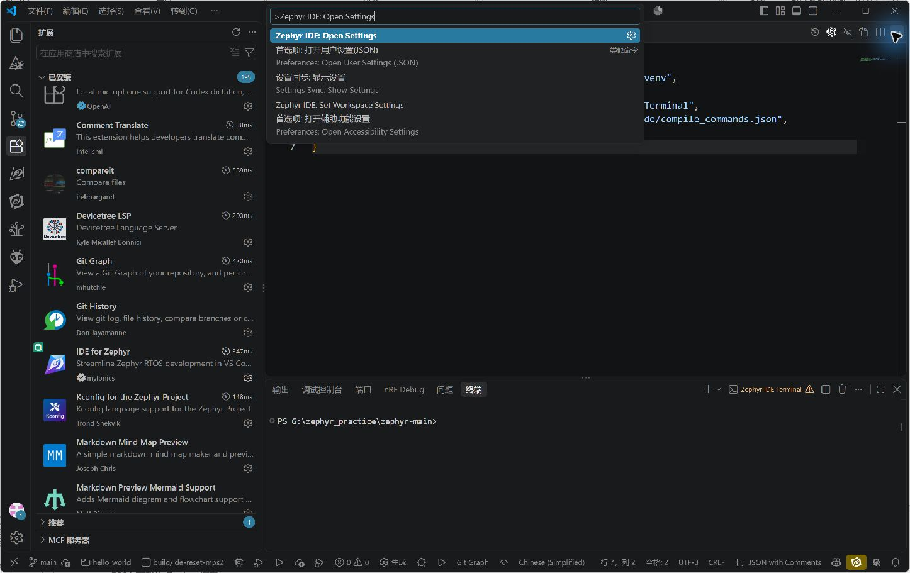
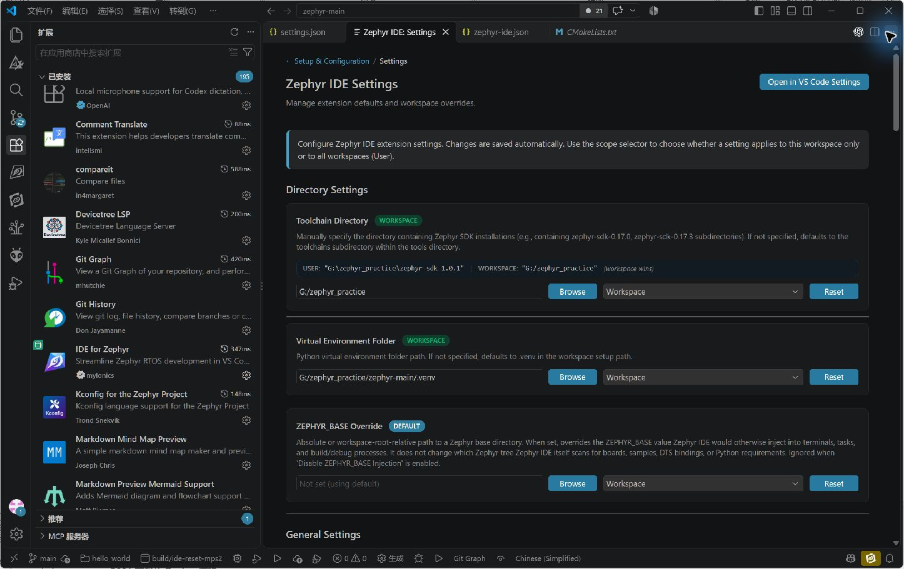
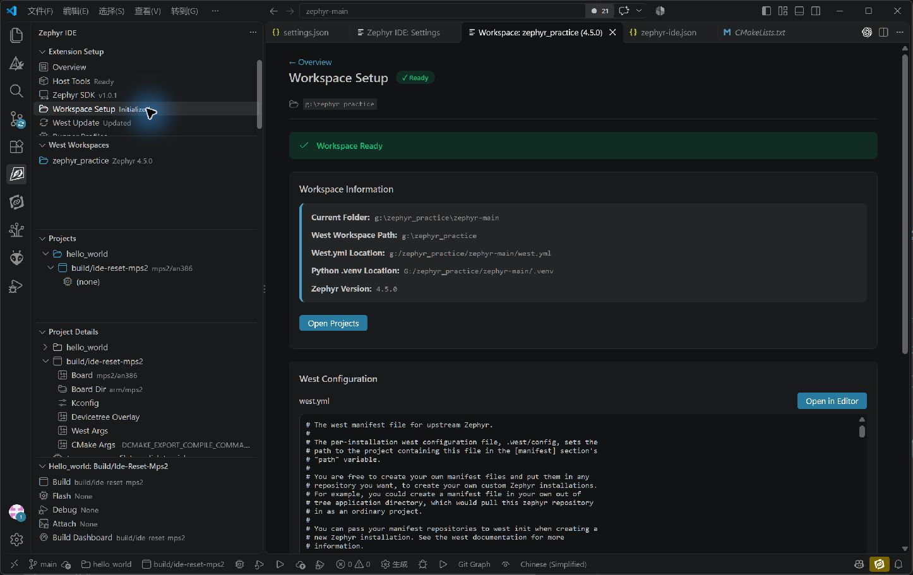
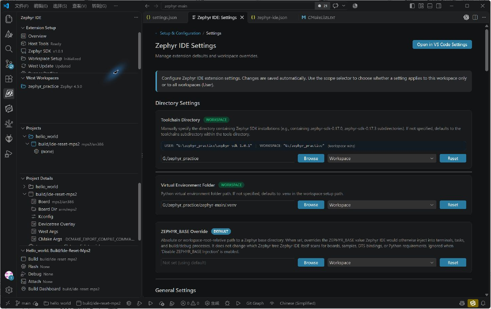
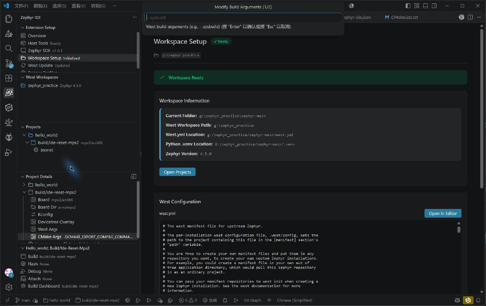
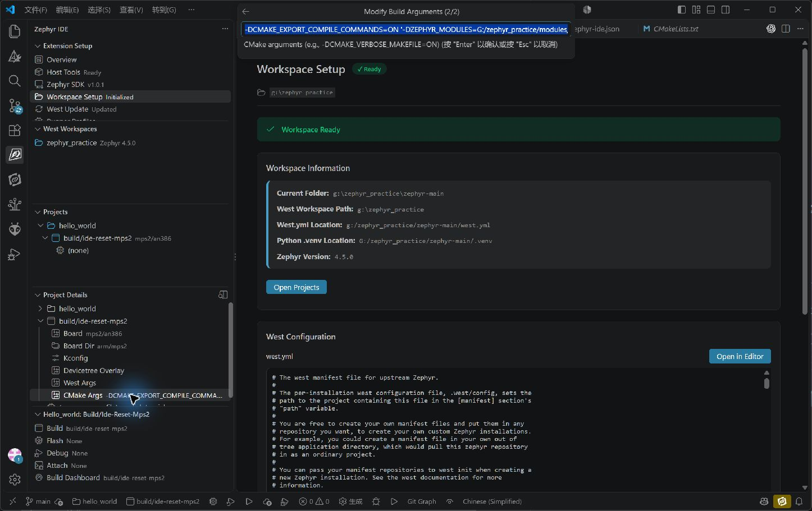

<!-- SPDX-License-Identifier: Apache-2.0 -->

# 第1章\_先按任务找到正确入口

**设置页只放扩展偏好和环境路径。添加应用、选板、执行构建、修改 Kconfig 属于另外的入口。** 在设置页搜索 Add Build 或 BOARD 找不到，并不能说明读者操作错了：原教程没有先交代它们分别在哪里。

本文保留原文件名以兼容已有链接，内容已改为入口地图。旧版“清空后逐屏实录”引用的图片不能证明所述操作，已撤回；现在无需为阅读教程清空插件、删除配置或重建工作区。完整顺序见 [主教程](P001_VSCode_Zephyr_IDE接入已有工程_Windows.md)。

## 1.1\_先确认是哪一个扩展

在 VS Code 按 `Ctrl+Shift+X`，搜索 `@id:mylonics.zephyr-ide`，确认发布者 **Mylonics** 和版本。本教程核对的是 4.1.1。Zephyr 项目自身提供 west、构建脚本、Kconfig、Devicetree 和源码；这个扩展负责调用工具、保存选项并展示结果。不同厂商的同类扩展没有统一的设置界面。

## 1.2\_两个设置页面如何进入

| 想打开哪一页 | 具体操作 | 能在这里改什么 |
| --- | --- | --- |
| 插件自己的设置页 | `Ctrl+Shift+P` → `Zephyr IDE: Open Settings` | 页面名 Zephyr IDE Settings；Directory Settings 中有 Toolchain Directory、Virtual Environment Folder、ZEPHYR_BASE Override |
| VS Code 原生设置页 | `Ctrl+,`，在搜索框输入 `@ext:mylonics.zephyr-ide` | 扩展注册的设置；选择 Workspace 范围后作用于当前工程 |
| 工作区设置 JSON | `Ctrl+Shift+P` → `Preferences: Open Workspace Settings (JSON)` | 当前单文件夹工程保存到 `G:/zephyr_practice/zephyr-main/.vscode/settings.json` |

插件设置页的 **Open in VS Code Settings** 按钮会进入第二条路线。两页的显示名称可能不同：自有页 **Virtual Environment Folder** 对应原生页 **Venv Folder**，它们读写同一个键 `zephyr-ide.venvFolder`。SDK 的查找目录对应 `zephyr-ide.toolchainDirectory`。原生页可按完整键搜索，避免只凭译名寻找。

图中高亮项才是本章打开的命令；下面相似的 Preferences 和 Set Workspace Settings 是其他动作。本图只示范命令入口，背后的旧设置内容不作为待复制配置。

这是2026-10-10本机4.1.1页面。Toolchain Directory与Virtual Environment Folder右侧各有一个范围选择器，图中两项均为Workspace；页面自动保存。图中同时显示User和Workspace值时，以标注workspace wins的工作区值为准。

只为当前 G 盘工程填写的路径放 Workspace 范围。原生页 User 与 Workspace 同名键都存在时，工作区值会覆盖用户值；改了 User 却没影响当前工程，先检查这一层。

## 1.3\_六件工作，各有一个入口

| 你真正要做的事 | 使用入口 | 实际读取或保存的位置 | 完成后看什么 |
| --- | --- | --- | --- |
| 告诉插件已有 Python/SDK 在哪 | 上述设置页 | `.vscode/settings.json` 的 venvFolder/toolchainDirectory | 扫描结果和构建日志中的路径 |
| 登记已有 west 工作区 | 命令面板 `Zephyr IDE: Setup Workspace from External Directory` | 插件安装登记；选择 `G:/zephyr_practice` | 活动环境对应含 `.west` 的父目录 |
| 扫描这套已有环境 | 命令面板 `Zephyr IDE: Configure Existing Environment (Scan Zephyr Dir/Version)` | 插件记录实际源码、版本和 venv | 源码为 G 盘 zephyr-main，venv 正确 |
| 把应用加入工程列表 | 命令面板 `Zephyr IDE: Add Project` | `.vscode/zephyr-ide.json` 的 projects | 项目中出现 hello_world |
| 为应用选择板子和构建参数 | `Zephyr IDE: Add Build Configuration` | 同文件的 buildConfigs | 板为 mps2/an386，活动 Build 为 ide-mps2 |
| 编译当前应用和板子 | `Zephyr IDE: Build` | 读取 Project/Build，调用 west build | 本次成功退出；输出目录产生新的 ELF |

命令面板输入 `Zephyr IDE:` 后再搜索动作名。JSON 中的 `projects → hello_world → buildConfigs → ide-mps2` 是对象层级；磁盘上没有要求创建这些同名目录。Build 尚未添加时，先完成向导，再打开保存结果。

## 1.4\_两个“已完成”名称为何不同

**主教程固定使用命令面板的外部目录路线。** 该路线的选择项叫 **Mark workspace as already set up**。Workspace 配置网页中的另一条路线有 **Mark as Complete** 按钮。它们属于不同界面，不能把其中一个名称套到另一个页面上。

两个入口都不足以证明源码、依赖和编译已经验证。接入已有环境后继续执行 **Configure Existing Environment (Scan Zephyr Dir/Version)** 并检查结果。`Skip West Setup` 只改变插件的准备标记；`West Update` 会运行仓库同步。它们不是同一个“刷新”动作。

核对字段的入口是侧栏 **Workspace Setup**，或命令 **Zephyr IDE: Open Workspace Config**。查看Workspace Information中的Current Folder、West Workspace Path、West.yml Location、Python .venv Location、Zephyr Version：前者是编辑器打开目录，west路径是含`.west`的父目录，两者应按本章关系对应。

这张图记录当前已登记环境的字段位置；Ready和Updated是插件状态，不能独自证明本轮编译成功。本次为查看入口打开页面，未重新初始化或下载。

普通 setup 中的 **Use .west folder** 仍可能进入 Python 安装及 west update 流程。已有环境应按主教程的跳过安装与扫描路线操作，不因 `.west` 已存在便认定该选项只做只读导入。

## 1.5\_原生配置在哪里，插件怎样引用

| Zephyr 原生输入/结果 | 日常编辑或查看 | IDE 如何对应 |
| --- | --- | --- |
| `west.yml`、`.west/config` | 核对仓库、revision、清单路径和活动项目 | Workspace 登记/West Update 调用 west；设置页不会列出可下载包的完整清单 |
| 应用 `CMakeLists.txt` | 声明应用源文件与构建逻辑 | Add Project 选择包含它的应用根 |
| `BOARD` | 选择实际板目标 | Add Build 的板选择写入 Build 的 board |
| `prj.conf`、额外 `.conf` | 配置软件功能 | 默认应用配置由 Zephyr 加载；额外片段通过 Project/Build 配置传入 |
| 板 DTS、应用 `.overlay` | 描述硬件及应用覆盖 | 基础 DTS 由板目标决定；额外 overlay 通过 Project/Build 配置传入 |
| `EXTRA_ZEPHYR_MODULES` | 为构建追加自有模块 | Build 的 CMake Args；不是插件 Settings 中的专用 HAL 开关 |
| `compile_commands.json` | 查看本次编译参数 | Microsoft C/C++ 的 compileCommands 设置读取它 |

更完整的键与字段对应见 [配置参考](CONFIGURATION_REFERENCE.md)。所有输入修改都应回到其源文件或插件设置；`build/.../zephyr/.config`、`zephyr.dts`、`CMakeCache.txt` 是生成结果，不作为长期手工配置入口。

## 1.6\_点CMake Args以后，为什么先出现West参数

在左侧Zephyr IDE的 **Projects** 中选中要修改的Build，再在 **Project Details** 展开该Build，找到 **CMake Args**。这是构建参数入口，不在Settings页。

截图使用本机已有的`build/ide-reset-mps2`定位入口，**它是历史Build名，不是现行教程要求新建的ide-mps2**。图中旧参数也不作为主线模板；读者应选择自己的目标Build。

点击CMake Args会打开一个两步向导，标题显示 **Modify Build Arguments (1/2)**。第一步说明为 **West build arguments**，只修改west层参数。已有需要保留的参数不动；本章新建hello_world的West参数为空，保持空并按Enter。

灰色`--sysbuild`是提示示例，不是本章要求输入的值。第一框不能放HAL的`-D`参数。

接着标题变为 **Modify Build Arguments (2/2)**，说明为 **CMake arguments**。现在才编辑`-DCMAKE_EXPORT_COMPILE_COMMANDS=ON`、SDK或模块等CMake输入。新建本章hello_world保留编译数据库参数；为已具备HC32完整适配的应用追加HAL时，按主教程1.9加入`-DEXTRA_ZEPHYR_MODULES=G:/zephyr_practice/hal_xhsc-zephyr`。

**图中显示的是旧Build已有的ZEPHYR_MODULES参数，只说明第二个输入框的位置，不能照抄为新主线。** 主线使用west自动发现CMSIS，追加HAL用EXTRA_ZEPHYR_MODULES。第二框确认后，打开`.vscode/zephyr-ide.json`核对所选Build的westBuildArgs与westBuildCMakeArgs；修改构建输入后按需要Pristine重新配置。

本次截图查看到第二框后按Esc退出，没有保存输入或修改G盘配置；图片证明入口顺序和字段可见，不是新参数构建成功的证据。
